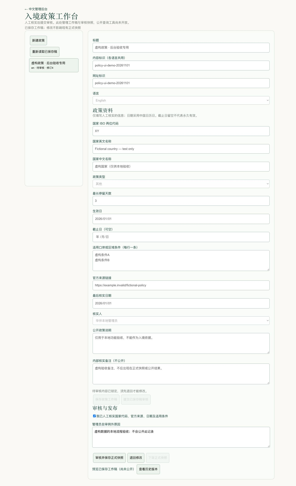
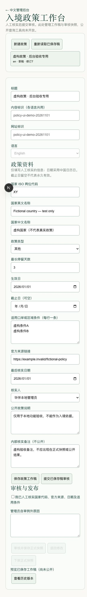
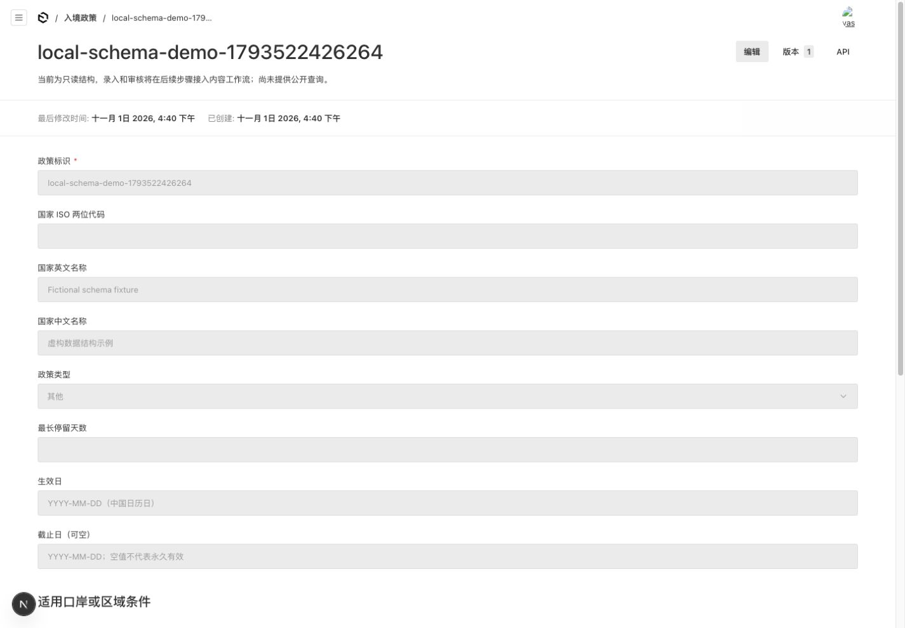
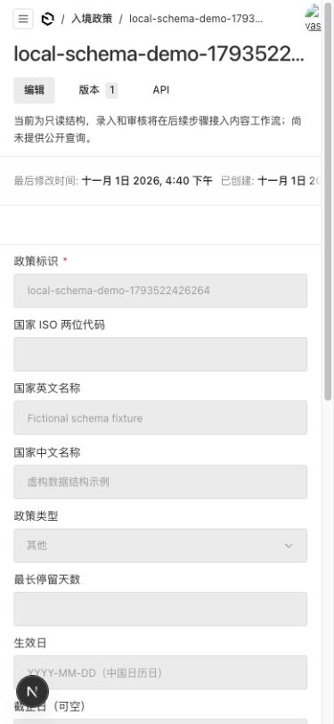
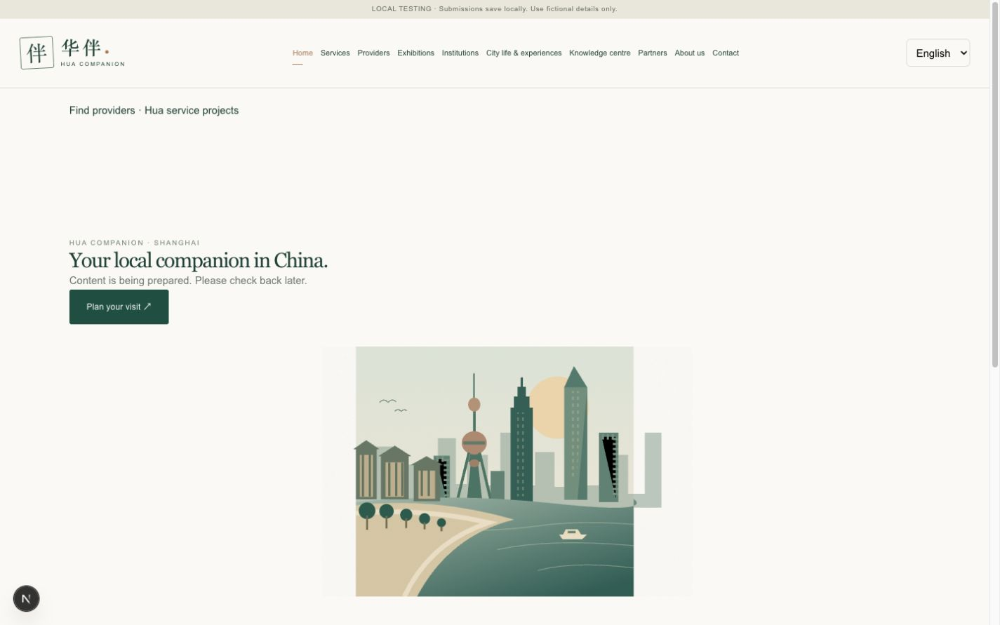
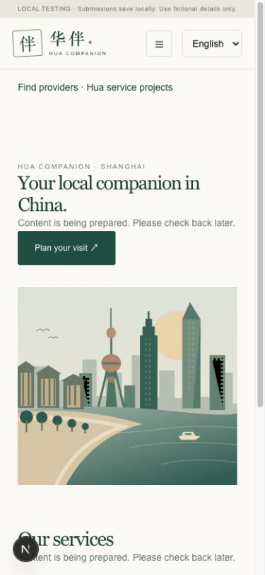

# 2026-11-13 任务 F 第六批：客户版报价说明

- 从 PR56 合并提交 `bbe36ba` 建 `codex/quote-customer-copy`。管理员在「公开公司信息」编辑合作对接、华伴统筹和代收说明。费用项送审时带入文案，发出前重新核对并锁定。待审核或已通过的草稿如有适用文案变动，须重新送审。历史报价原文保留。
- Node 24.22.1 上 `npm run check` 通过，307 项单测，0 lint 错误、451 条警告，与上批持平。隔离库的费用项、人工及虚构 AI 报价集成通过。生产 HTTP 核对运营和主管不能改文案，客户须登录且只能取得已发出的版本及允许公开的字段。测试覆盖代收仅有专用说明、留空默认、第三方收款、旧已发出版本和改配置后的重新送审。
- PostgreSQL 15 配套备份恢复核对 75 张表；克隆验证新增三列、空配置回滚、重跑及已使用配置的回滚拒绝。原演示库未升级。合并后先配套备份，再应用 `20261113_120000_quote_customer_copy`。无新增环境变量或依赖。下一批为主管毛利。 [E7、E8 验收步骤](quote-customer-copy-summary.md)

# 2026-11-13 任务 F 第五批：旧报价和 AI 草稿另存新版

- 从 PR55 合并提交 `1cc0208cef1414761b3f8e31ceba73206e281b81` 建 `codex/quote-save-new-version`。旧报价和已采纳的 AI 报价可从报价版本另存，待采纳 AI 结果也进入同一个编辑器。带入原条款、币种和费用，逐项选择服务方。原审核、原报价和原总成本保留，来源关联写入服务事件，新稿从待送审开始。
- 测试先复现旧版发出未提示另存，修正后拦截旧格式送审、审核和发出。费用项、人工二审、既有业务及 AI 报价集成通过，覆盖旧已发出报价仍可确认、旧稿原字段保留、旧批准不可用于新版、跨服务单权限、版本失效、幂等重试及运营成本边界。生产 HTTP 验证不同服务单和不存在的来源都返回 404。
- 独立复核后保留已发出 AI 版本另存入口，修正表单重选焦点和确认状态、保存期间切换来源及写入成功但刷新失败时的重试。Node 24.22.1 上 `npm run check` 通过，306 项单测，0 lint 错误、451 条警告。生产构建通过。
- 独立库配套备份 `.local/backups/quote-save-new-version-1794572137615`，恢复核对 75 张表。3163 实走旧人工报价另存、必选服务方、保存及送审，另用注入的虚构 AI 结果验证确认必选、采纳来源及待送审状态。桌面和 390 像素截图随 PR，实体手机和新人计时待验。
- 无新增迁移、依赖或环境变量。3100 的演示数据保留。合并后用新版代码普通重启，E7 可测另存与送审，E8 可测主管二审和成本权限。可配置对客文案及毛利视图后续交付。 [一页验收步骤](quote-save-new-version-summary.md)

# 2026-11-13 任务 F 第四批：新版报价逐项审核与发出

- 从 PR54 合并提交 `b277fd0` 开 `codex/quote-line-review`。新版报价按费用项 ID 分别确认主体差异和代收，再走整单二审。发出前重查主体、有效期、服务商资格、代收开关和绑定当前修订的审核。客户页显示三方和固定代收说明，内部原因及成本沿用权限边界。
- 代收默认关闭，只允许在职管理员维护，设置变更与费用项审核分别记入审计。独立复核后补齐客户展示、服务商删除并发保护、历史代收主体识别、同名费用项的行号、长服务商默认名称及选择性响应下的设置审计。
- Node 24.22.1 的 `npm run check` 通过，306 项单测通过，0 lint 错误、454 条警告。生产构建及隔离库的新版报价、旧人工二审、业务及 AI 报价集成通过。生产 HTTP 验证代收拒绝、成本边界和报价保存。备份恢复核对 75 张旧表，增量迁移上行、空设置回退、再上行保留旧字段数据。
- 在 3161 隔离站以虚构报价验证运营送审、主管只勾差异时无法批准、补勾代收后批准，以及运营在 390 像素视口发出。截图随 PR，实体手机及新人计时待验。3100 保留用户测试数据，合并后配套备份再应用本批迁移。 [E7、E8 一页验收说明](quote-line-review-summary.md)
- 本批需要数据库迁移 `20261113_110000_quote_line_review`，环境变量和依赖沿用。可配置文案、旧未发出稿和 AI 稿的新版转换、毛利视图后续交付。隔离验收外的代收开关保持关闭。

# 2026-11-13 任务 F 第三批：签约方、收款方与保存校验

- 从 PR53 合并提交 `2c5024c11c2ad83dca0da0ec75ec5e8a11fa42a9` 建 `codex/quote-line-party-validation`。外部费用项可改签约方并选择权限内的合格收款方，主体不同时必填原因。华伴自营主体锁定，服务端拒绝代收。保存的原因和收款方记录编号只进入员工投影。
- 新增集成测试先复现旧版拒绝合法主体变更。独立复核后改用有权限的收款方记录，同名服务商按编号区分，补上品牌组合名和已存自营报价的旧公司名校验。费用项、业务报价、AI 报价集成通过。生产 HTTP 验证拒绝代收、九项长中文原因正常保存及成本权限。客户数据投影测试确认差异原因与收款方记录编号不会泄露。
- Node 24.22.1 的 `npm run check` 通过，306 项单测通过，0 lint 错误、457 条警告。生产构建通过。隔离库配套备份为 `.local/backups/quote-line-party-validation-1794523998743`，恢复核对 75 张表。
- 3160 隔离站用运营和虚构资料验证自营锁定、从名单另选收款方、漏填原因后自动定位、补齐后保存，以及 390 像素视口显示。截图在本机忽略目录，PR 附件和对应云端检查见本批 PR。实体手机和新人计时待验。
- 本轮 E7 可测主体录入，E8 可回归成本权限。代收设置、逐项审核、发出和毛利后续分批。新数据沿用报价行 JSON，无需新增环境变量、数据库迁移或依赖。演示种子沿用。 [一页小结](quote-party-validation-summary.md)

# 2026-11-13 任务 F 第二批：报价费用项主体和私有成本

- 从 PR52 合并提交 `323716c0aeecf581e6461518f036ae784b430a0d` 建 `codex/quote-line-foundation`。新版人工草稿逐项保存经营模式和三方名称快照，支持华伴自营、权限内的合格服务商和手填例外。私有成本独立存储，按角色及服务单范围读取。旧报价及原总成本保留。
- Node 24.22.1 的 `npm run check` 通过，306 项单测通过，0 lint 错误、457 条警告（前批 460 条）。生产构建通过。隔离 PostgreSQL 的迁移、费用项、业务报价、AI 报价及生产 HTTP 集成通过。成本权限覆盖写入、降权重试、通用 API、事务回滚、客户投影和 CSV；空成本与明确填 0 分别验证。独立复核发现的名单资格变化、重试权限及表单保留问题已修复。
- 增量迁移在隔离库验证空表回退和有数据时拒绝回退。本机演示库配套备份 `.local/backups/quote-line-foundation-source-1794522659205` 恢复核对 74 张旧表指纹一致，应用迁移时再次核对原列数据。3100 普通启动，首页 HTTP 200，`npm run test:demo` 五账号通过，4 组共用政策、12 篇指南、6 个展会、5 条咨询、32 条已发布内容。
- 3159 隔离浏览器以虚构资料实测主管保存费用项、切换草稿模式保留输入、显示零成本和未填成本。运营在 390 像素模拟视口可核对同一版本的三方主体。截图留本机忽略目录，附件及远端 CI 见本批 PR。实体手机及真人新人计时待验。
- 本批 E7 可测费用项录入，E8 可测成本权限。新版草稿的送审、逐项确认、发出、客户版展示和毛利后续分批。已有演示库需配套备份后应用 `20261113_100000_quote_line_foundation`。环境变量、依赖和种子沿用，真实外部服务及 worker 保持关闭。 [一页小结](quote-line-summary.md)

# 2026-11-12 任务 F 第一批：所有报价发出前二审

- 从 PR51 合并后的 `66119c1f4a0e5d522f6c49dfdfcac0654e0c3fa0` 建 `codex/quote-review-all`。人工草稿单独送审，人工和 AI 共用审核与发出门禁。按现有数据范围核对员工权限。禁止起草人自审，管理员例外须明确确认并留原因。已发出、已确认历史仍按原流程。
- 审核事件包含当前报价版本、内容指纹、更新时点、审核人、时间、意见及管理员例外标记。独立复核发现同一修订改后恢复原文的边界，测试先复现，加入审核写入后的更新时点后通过。旧批准缺绑定时重新送审。改动的业务源码在 400 行以内。
- Node 24.22.1 的 `npm run check` 通过，304 项单测通过，0 lint 错误、460 条警告（前批 464 条）。生产构建通过。独立 PostgreSQL 的人工二审、业务报价、AI 报价集成和生产 HTTP 通过，覆盖未审发出、越权、旧报价确认幂等、精确版本和管理员例外。AI 集成使用进程内注入的虚构响应。
- 首轮 CI 的报价集成通过，随后公司信息权限测试选中 AI 测试留下的停用管理员而失败。本机独立库按同样顺序复现；清理临时管理员角色后，两套集成按顺序通过，`npm run check` 重跑通过。修复仅影响测试夹具。
- 配套备份 `.local/backups/quote-review-all-1794488598014`，恢复核对 74 张表指纹。3158 隔离站使用虚构报价，运营保存并送审，主管填意见批准，运营在 390 像素模拟视口发出并进入待客户确认。运营未见整单成本。桌面和模拟手机截图留本机忽略目录并用于 PR 附件，真机和新人计时待验。 [一页小结](quote-review-summary.md)
- 无数据库迁移、环境变量、依赖或演示种子变更。费用项主体、私有成本、逐项确认、毛利及预置待审样例随 F 后续批次。真实外部服务及 worker 保持关闭。远端提交和 CI 见本批 PR。

# 2026-11-12 任务 E：咨询关闭、重开与审计

- 从 PR50 合并后的 `ee3060a8c24cadab2bc1e5ac0358f2795c60b805` 建 `codex/inquiry-status-linkage`。关闭或重开须写原因，两项状态与一条含前后值的审计同事务保存。旧单边关闭提示核对，非状态资料仍可保存。协调完成沿用原成交口径，报价和服务单沿用原流程。
- Node 24.22.1 上 `npm run check` 通过，303 项单测通过，0 lint 错误、464 条既有警告。生产构建通过。独立代码复核发现 Payload 在原锁点前读取记录，已将咨询写锁提前，并补并发资料保存测试。旧状态表单冲突和原编辑锁均已验证。新增与改动源码行满足 200 字符限制。
- 新联动数据库与真实 HTTP 集成通过，覆盖操作原因、双字段、历史恢复、旧记录、角色与范围、重复与过期请求、审计失败回滚、403/409/423 和协调完成统计。咨询编辑、追加跟进、转服务单及业务报价集成通过。各套件使用符合原守卫的独立数据库。
- 数据库与图片配套备份为 `.local/backups/inquiry-status-linkage-1794485327748`，恢复核对 74 张表指纹。3157 隔离站以虚构咨询实走普通保存、取消、关闭、重开、旧标签页冲突及刷新，390 像素视口核对必填与布局。截图保存在本机忽略目录并用于 PR 附件。真人新人计时和实体手机仍待验。 [一页中文小结](inquiry-status-summary.md)
- 无迁移、环境变量、种子或依赖变更。真实外部服务和 worker 保持关闭。最终远端提交、CI 和附件见 PR。合并后进入任务 F。

# 2026-11-12 任务 E P1：关闭功能时隐藏面板

- PR49 合并提交 `7454e68575915fe5138c7ad4c0648c041f19ada0`，由该提交新建 `codex/hide-disabled-panels`。服务单按客户中心设置显示关联与进度面板，报价 AI 按原接口的可用状态显示生成与排队，客服按现有能力显示恢复 AI 和内部翻译。无生产内容 AI 适配器，隐藏工作台标签及 Payload 导航。没有调整 API 写入规则、记录权限、环境变量、依赖、种子或数据库结构。
- 独立复核指出关闭报价 AI 时仍需维护已有任务，已保留旧结果查看、人工采纳、复修和取消。新生成与重新排队隐藏。已修正业务测试对本机报价 AI 设置的假设，并在报价 AI 集成中验证关闭后仍能采纳已生成结果、保留待主管审核状态。
- Node 24.22.1 的 `npm run check` 通过，303 项单测全部通过，0 lint 错误、464 条既有警告。内容面板 SSR 先复现 AI 标签仍显示，修后通过。业务、报价 AI、客服、内容权限和内容任务集成通过。客户身份套件受原 55438 测试库守卫保护，本机随机库运行被拒绝，守卫未改，完整套件由 CI 的独立库运行。
- 隔离库来自数据库和图片配套备份 `.local/backups/hide-disabled-panels-1794482231014`，恢复后 74 张表指纹一致。3156 隔离站用运营账号验证内容工作台和管理后台入口、同一演示服务单关闭及模拟开启、旧报价人工整理、客服 AI 动作恢复和再次关闭，历史消息和人工操作仍可见。390 像素视口能展开新建报价。模拟配置使用 example.invalid 和虚构密钥，未生成任务或启动 worker。生产构建与真实 HTTP 的匿名拒绝、运营成本不可见、关闭状态和报价历史通过。
- 随机库和隔离站已清理。本机 3100 普通重启并通过五账号自检，保留共用政策 4 组、指南 12、展会 6、咨询 5、正式内容 32。截图不进 Git。[中文一页小结](disabled-panels-summary.md)。真人新人计时和实体手机仍待验，提交及 CI 见 PR。后续还有已批准的状态联动及任务 F。

# 2026-11-12 任务 E P1：来源核实日期

- PR48 合并提交 `2a4fda4b3eab1f54479655b18551f1022ca37fc4`，由该提交新建 `codex/content-source-verification`。入境政策沿用事实里的官方来源及核实日期，补旧提交入口的日期验证。其他内容通过既有医疗分类、已知旧稿标识、免签工具已有配置及「资料主题」判断。至少一条来源，每条日期是有效中国日历日且不晚于今天。只在送审和发布强制，草稿可逐步编辑。既有发布、退回和下架沿用原流程。没有迁移、环境变量、种子或依赖变化。
- 首次集成测试复现缺来源仍可送审，复核后又复现旧政策缺日期可提交及旧医疗问答漏判，均已修正。译文 UI 预填主题，服务端在新译稿省略时沿用原稿主题；两语日期按各自稿件检查。常规稿件仍可不填日期。旧待审稿需补齐才能发布，原正式版本不改写。
- Node 24.22.1 的 `npm run check` 通过，303 项单测全通过，0 lint 错误、464 条既有警告。政策日期控件 SSR、虚构资料送审和发布、待审旧稿校验、内容与权限、医疗机构、旧政策及双语译稿集成通过。翻译套件首次因隔离库命名守卫拒绝，改用其指定的另一随机库后通过，守卫不变。旧停留单位套件首次触发新旧正式政策混存保护，保留保护并在随机库模拟旧库模式后通过。生产构建和免签工具开关、正式政策、FAQ 及签证指南的真实 HTTP 回归通过。
- 主测试库从数据库和图片配套备份 `.local/backups/content-source-verification-1794440609124` 恢复，另建译稿测试库，均核对 74 张表指纹。3155 实际验证虚构纸港政策、就医指南、签证指南。空日期阻止送审，运营填好后保存并成功进入待审核。三张虚构截图留本地并用于 PR 附件，原图不入 Git。
- 随机库与隔离站已清理，原 3100 普通重启并通过五账号自检。保留 4 组共用政策、12 篇指南、6 个展会、5 条咨询、32 条正式内容。外部服务和 worker 未启动。[一页小结](content-source-verification-summary.md)。真人新人计时及实体手机仍待验收，远端提交、CI 和附件见 PR。

# 2026-11-12 任务 E P1：政策横幅搜索

- PR47 合并提交 `51c953f641095fc1aac678b36be6b052949dc00e`，从最新 `origin/main` 建 `codex/policy-banner-picker`。只返回该稿种类有编辑权的员工可选的中英文正式政策，结果包含国名、代码、类型和有效期。保存新增或换绑时，在与政策发布共用的事务锁内重查。关闭工具时保留原引用，审核规则和正文结构沿用。
- Node 24.22.1 上 `npm run check` 通过。300 项单测通过，0 错误，464 条既有 lint 警告。横幅 SSR、隔离库的选择和权限校验、文章工作流、内容权限通过。生产构建通过，开关启停两种状态的旧快照 HTTP 回归及匿名访问拒绝通过。初次本机 HTTP 脚本在 macOS Bash 遇空数组错误，修复脚本后两种状态重跑通过。
- 备份恢复核对 74 张表的指纹，数据库与图片配套存于 `.local/backups/policy-banner-picker-1794438866627`。在随机库及 3154 隔离站用虚构 XY 搜索、保存、预览和送审，英文候选键盘选中；选后下架得到重新选择提示，保留原稿，换选 XZ 后保存。390 像素视口可读完整有效期。现有生产模式虚构国家限制照常生效，虚构共用事实的交互使用开发模式。
- 独立复核发现两处兼容问题及一处文档旧说明，已对齐旧快照选择与渲染校验，增加脏快照回归，并在两种生产开关状态保留跨语言历史引用测试。选择后下架覆盖先选、后下架、再保存的时序。复核者独立重跑三项选择器单测及 SSR，构建、数据库、HTTP 和浏览器由执行者验证。
- 本机 3100 已普通重启，五账号自检通过，共用政策 4 组、指南 12、展会 6、咨询 5、正式内容 32。无迁移、环境变量、种子或依赖变化。截图不进 Git，远端提交、CI 与附件以 PR 和最终交接为准。[一页小结](policy-banner-picker-summary.md)。真人新人及实体手机体验待验。

# 2026-11-08 任务D6：展会手机筛选

- PR35实核合并c743ab46e77f59dcb5ca3bacac0c2b2ed59473c9，工作区干净，从origin/main无跟踪新建codex/exhibition-mobile-filters。执行已批准D6，原生details／summary初始收起，桌面共用入口；GET表单不引入客户端依赖。月份按本语已发布展会完整跨月范围生成、去重排序，保留有效网址选中值，收起时提示条件数。
- 保留原filterExhibitions与默认upcoming语义：进行中、待公布／延期仍如实显示，历史含已结束／取消；不改审核、咨询或权限，不伪造日期。月份纯测试跨年／重复／无日期／非法日期及所选无结果月份；SSR覆盖原生收起、select、默认／历史／全部、空结果、分页条件保留及中英隔离。RED缺枚举导出及旧页面缺details断言→GREEN。check262/262，lint0错误465既有警告、源码≤200无例外，无新any。
- 只读源配套备份.local/backups/exhibition-d6-1794146799855恢复到随机D6库供生产build，图片目录保留空态，不称本轮做全表指纹演练；原55438不写。生产build通过；HTTP首次错误要求form首属性action，实际class在前，按根因改成分别检查action／method后生产和3100中英HTTP重跑通过，32页页脚回归通过。失败不记通过，没有改产品应付测试。
- 3100普通停web/start刷新代码，无reset或种子修改；五账号自检共享4／指南12／展会6／咨询5／正式32保留。1440／390前后图目检，390 body375=scroll375；选2026-12／上海／虚构关键词结果1且条件保留，历史同月0结果可清除恢复默认，切英文同页、Space展开成功。Cua原生summary在AX为button、DOM为generic，按实际summary定位；嵌套select的getByLabel不匹配改用所见combobox角色，非产品故障。真机／新人和单独关闭JS浏览器未验，不将原生HTML结构证明冒充实测。
- [本轮一页小结及C4／C7展会部分](exhibition-filters-summary.md)。无新依赖／schema／迁移／环境键／种子；外部服务和worker关闭，不购买、部署或自动合并。独立整分支复核、临时副本清理、PR／最终head／CI及图片上传按实核后补记；证据只.local，不提前声称附件完整。D7／8／9留后续顺序PR。

- 一次独立整分支复核c743ab4..e3e1ede无Critical／Important／Minor。复核者独立展会／月份纯8/8、真实ExhibitionPage SSR和diff通过；完整check、build、HTTP、浏览器、DB／CI由执行者验证，不冒称独立重跑。未裁定项保留D7／8／9（代价：完整D未完）、单独禁JS／实体手机／新人／其他语言与RTL真浏览器（代价：这些体验不计通过）；截图与精确最终head由执行者实核。
- 唯一草稿[PR36](https://github.com/yaemart/huacompanion-ai/pull/36)，首代码e3e1ede已推送，首head云端42488841152两项全部成功。GitHub浏览器SDK仍报timeoutMs，尝试原生Edge窗口后成功在已登录会话上传4张公开截图并保存PR描述；连接器读回四个有效user-attachments链接且无Uploading占位，原生页面也显示四附件。四图为桌面／手机视口修改前后，原图仍.local；其他操作图留本机，历史PR图片不冒称补齐。
- 随机D6库与应用已清理，备份／日志／截图保留，3100继续运行；原55438未写。最终文档提交会触发新CI，远端一致性和精确head／Actions结果在PR与交接消息实核，不沿用首head绿色结果。

# 2026-11-08 任务D第3批：首页公开公司信息

- 实核PR34已合并a4414504cc9bb66d3bfc21edc82f85583571f32f，工作区干净，从最新origin/main建codex/public-company-info；D5单独PR，D6–9后续。使用已批准任务书，不重复请求设计／执行确认；当前checkout任务分支，构建隔离缓存。按Next包内server/client及缓存指南，服务端每次首页请求读取并白名单投影，不引入持久缓存。
- 新仅管理员读写Global“公开公司信息”，五字段无默认值：共享正式名称、分语所在地、公开邮箱／电话。字段空白省略，全空隐藏；不跨语补所在地，React转义，邮箱沿Payload验证。仅投影进入首页，不公开Global管理API，不改其他业务权限或内容二审。首页移除硬编码SHANGHAI公司所在地；已发布文章不重写。D8真实材料仍由用户／律师提供，不把城市插画当地址。
- RED→GREEN：缺纯投影／CompanyTrust模块失败后纯2/2及真实SSR通过；首页SSR初次静态导入撞既有CSS加载限制不是有效RED，移入既有CSS-hook动态导入后观察固定SHANGHAI断言RED→GREEN。集成权限全部成功但首清理误用禁止删除员工被403，改按原规则停用测试员工，不放宽权限；重跑通过。迁移往返、旧表指纹、已配置资料回滚拒绝、匿名／四非管理员角色／停用管理员拒绝、管理员保存清空及非法邮箱拒绝通过。
- check260/260、lint0错误465既有警告不增，源码200字符无例外；CompanyTrust／导航／页脚SSR与生产build通过。隔离生产两语首页空→配置→清空、匿名Global API403及32页页脚／目标链接通过；虚构公司仅D3随机克隆。1440／390配置图无横溢，中文地点对应；源空配置无区块，管理员五字段空表单浏览器可见，不向源写假主体。
- 源执行先仅停管理的3100写入，配套备份.local/backups/company-source-1794145101454，以同一只读快照dump恢复至另一随机库，71/71旧表指纹一致，媒体配套复制。事务只新增空表并登记20261108_220000_public_company，旧表原行除迁移新增记录外一致；dev标记保留，原55438不写。其他电脑旧演示新增缺表／列启动拒绝提示，须开发者先独立备份升级，不reset或自动push。新库完整迁移照常，无环境键／依赖／种子修改。
- [本轮一页小结及C9部分场景](public-company-summary.md)。普通重启／五账号自检、独立复核、临时副本清理、PR及最终head CI后续据实补记；截图和日志仅.local，不声称已附PR或真机／新人计时通过。真实AI／邮件／语音／通话及worker关闭，不购买、部署或自动合并。

- 最新普通停web/start保留数据，新增缺表／列启动守卫在本机通过；五账号自检通过，旧政策0／共享4、指南12、展会6、咨询5、正式32不变；34页含工具HTTP通过。最终代码check260/260、三组相关SSR、最终生产build和公司HTTP／32页回归重跑通过。迁移回滚禁止删已填资料，未修改既有禁止删员工规则。

- 独立整分支复核a441450..ab44322无Critical／Important，1Minor：长无空格名称／合法长邮箱可能溢出。以真实组件＋现有CSS的无DB临时SSR页复现390宽scrollWidth1496，按移动端验收重判为需修复；SSR换行断言RED→GREEN，仅公司区块增加overflow-wrap:anywhere；修复后同场景scrollWidth390=视口390。一次修复，不另派复核。复核者独立纯2/2和三组SSR／diff通过，不称其重跑DB／构建／HTTP／CI。
- 复核未裁定项逐项保留：真实主体／法律材料、既有发布文章和种子真实性不代写（代价：D8和完整C9未过）；D6展会／D7客服／D9回执后续顺序PR（代价：完整D未过）；其他五语所在地不配置且不跨语补空（代价：仅中英所在地）；电话仅文本展示（代价：不提供拨号交互）；真人／实体手机信任感未验（代价：不上线门槛）。旧公司记录源保持全空，截图只有隔离库虚构示例。
- 唯一草稿[PR35](https://github.com/yaemart/huacompanion-ai/pull/35)。随机D3库与应用、临时无DB长字段页已停用清理，源3100保留，备份／日志／截图不删。截图上传连接器无接口；浏览器尝试复用Edge GitHub会话时导航接口报timeoutMs故障，未上传，不能称PR附件齐全。最终修复与文档提交、远端一致性及对应head Actions在PR／交接实核，不沿用首head CI。

- 复核修复后check260/260、lint465不增，CompanyTrust／导航／页脚SSR全部通过；3100普通重启加载修复，不reset。首head ab44322的云端42486412597两项全部成功（含新迁移／权限／生产HTTP），但最终修复提交会重触发CI，最终结果仍按对应head另核。

# 2026-11-08 任务D第2批：公开网站统一页脚

- 实核PR33合并d48b6e5390c13033ef565f70c8394457b58d80f9；起始工作区干净，从origin/main新建codex/public-footer。仅D第2条，D第5–9条后续；复用已批准任务说明与当前checkout，使用独立应用缓存构建。
- PublicPage按locale统一输出PublicFooter，删除五处重复／简化页脚；复用既有coreText及样式，按D1公开路径隐藏空栏目。咨询、隐私与服务边界始终可达；不编造公司所在地、邮箱电话或待核实占位。有效公开语言页面为本轮范围，管理员／工作台／员工预览／无效路由不计公开页面。补robots注释与语言中立sitemap llms地址，Disallow保持，公开API保留；不保证爬虫采用或允许试运行收录。
- RED→GREEN：缺Footer模块、旧3100首页简化页脚及缺robots/sitemap发现均实际失败，随后七语言SSR和SEO5/5通过。完整check258/258，lint0错误465警告不增，源码200字符检查无例外；既有导航／空目录、免签FAQ／查询SSR通过。隔离生产build成功，32页HTTP及页脚目标、llms发现通过；生产虚构国家限制保留，免签工具另在本地非生产模式计入34页通过。CI注册页脚SSR及开关双模式HTTP。
- 源55442只读快照备份.local/backups/customer-d2-1794142239098恢复至随机D2库供构建与HTTP，不声称本轮做全表指纹恢复演练。3100正常stop/start更新源码，不reset，不改账号／政策或非政策数据，55438不写。1440／390首页、咨询、展会、客服前后截图目检；均单一页脚且body无横溢，英文隐私与中文联系点击成功，真机／新人计时未验。证据仅.local；未上传PR时明确未完成附件。
- 无新依赖、schema、迁移、环境键或种子变化；真实外部服务和worker关闭。独立整分支复核、临时副本清理、PR／推送与最终head CI后续按实际补记；不沿用旧提交CI。[一页小结／可测C4、C7、部分C9](public-footer-summary.md)。

- 提交前重跑check时，沙箱禁止既有端口占用测试监听127.0.0.1（EPERM），该次257/258不记通过；按原测试在允许本地监听的环境重跑258/258，未修改测试或业务。随机D2库确认无活跃连接后及自建应用已清理，备份／日志／截图保留，3100继续运行。

- 独立全分支复核d48b6e5..a031b3b：Critical／Important／Minor均0；复核者实际跑七语页脚SSR、SEO5/5和diff检查，不冒称其重跑完整DB／构建／浏览器。裁定保留D5首页公司区及上海文案、D6展会筛选、D7客服隐藏／白话、D8真实法律材料、D9回复承诺至后续顺序PR（代价：完整D和C9尚未通过）；管理员／工作台／预览／无效路由无公开页脚（代价：仅有效公开路由验收）；生产真实政策、本机真机／新人及爬虫采用未验（代价：不满足完整上线门槛）；截图上传仍待人工，连接器无上传接口且GitHub网页未登录（代价：PR附件未齐）。
- 业务源码新增＋删除173行，新增any为0；唯一草稿[PR34](https://github.com/yaemart/huacompanion-ai/pull/34)。首代码a031b3b已推送，首head云端单元／类型成功，数据库构建集成当时仍运行，不记全部通过。最终文档提交会重触发CI，精确head／远端一致和最终Actions在PR及交接实核，不借用首head绿色结果。临时D2库及应用已移除，配套备份／日志／截图保留，3100继续运行。

# 2026-11-08 任务D第1批：公开导航与服务链接

- PR32已实核合并479d18f，干净分支codex/customer-navigation基于最新origin/main；任务D按400行业务预算拆分，本批第1、3、4条，其余第2、5–9条留后续顺序PR。现有批准任务书作为设计依据，不重复要求确认；按用户分支工作流使用当前checkout，生产build在独立应用缓存中运行。
- 原因：Header固定菜单无公开内容过滤、知识分类固定八类、PublishedSite对子导航不区分页面、首页缺首屏工具入口；文章链接也未复核目标服务。新增请求级公开读取缓存，以listPublished为唯一资料来源，保留资格过滤／审核权限；所有公共page分别包仅公开路径的Provider，不放在长期保留的layout，不传草稿／员工／客户资料。相对／同站绝对服务链接、查询锚点及项目路径均处理，外站同名路径保留；目标不可用时显示原文字。按语言隐藏空栏目和空指南分类，旧空分类URL仍0结果可清筛选，子导航只服务相关页，工具按钮开关关闭时不显示。
- RED→GREEN：缺导航模块→三项纯测试通过；缺Provider／组件→SSR菜单、两语功能开关、无目标链接降级及空分类渲染通过。完整基线254；新check257/257，lint0错误465既有警告，源码最长200无例外，无新增any。类型检查发现toolLocales的两语includes联合类型和测试router缺bfcacheId，按真实类型改some及补测试上下文，无放宽类型。
- 只读源dump备份`.local/backups/customer-d1-1794136330701`恢复到随机hua_client_d1库供生产构建和HTTP，源无迁移或清理。克隆首次HTTP运行器漏传enabled，且正文按head首script截断导致关闭断言假通过，旧结果撤回：改为去script元素但保留HTML、确认真实nav/main，再串行开关双模式通过。测试下架漏管理员自审例外原因被拒，补原因重跑；失败残留2份自有稿只在克隆清理。完整草稿→送审→发布→下架链接周期通过。测试脚本自身清理不绕过审核，不改CLI安全限制；CI注册SSR和双模式HTTP。
- 隔离生产build成功；新SSR和既有浏览器查询／FAQ／说明SSR通过。浏览器本地模式：首屏免签按钮可见、跳新工具且中英切换同页、菜单隐藏无内容栏目、知识中心只显示5个有资料分类；390视口body375无横溢，按钮间距补12px。生产启动仍拒绝XY虚构国家（既有环境限制），保留限制，虚构工具浏览器改在非生产本地模式验收，不声称生产真实政策已验。实体手机／新人计时未验。
- 3100正常关闭再启动刷新本轮代码，不reset；原55438不写，外部服务／worker仍关闭，无新schema／迁移／依赖／环境键。后续完整桌面／手机证据、独立复核、临时副本清理和最终PR/head/CI另据实补记。原始日志与截图只在.local，不提交Git。

- 独立全分支复核479d18f..b7ccefc无Critical／Important，1Minor：服务商／项目页子导航仍指向空目录。按本批“隐藏空栏目”验收重判为需修复：实际CatalogPage空／仅项目SSR先RED后GREEN，同时省略普通服务页全空子导航；不另派第二轮复核。修复后check257/257、lint465、生产build和关闭／开启HTTP再次全部通过。业务新增＋删除277行，无新增any。独立者另跑Node24纯3/3和初版SSR通过，不把其未执行的DB／浏览器／CI算独立验收。
- 复核边界裁定：D第2、5–9条仍后续（代价：完整客户清单未过）；权限／报价／客户数据未改，沿用现有服务过滤与CI回归（代价：不声称独立全业务审计）；生产真实政策／新人真机未验（代价：上线门槛仍待）；浏览器／构建／恢复与账号状态未由复核者重跑或读密钥（代价：由执行者实际结果承担证据）。已打开／预取页面仍是快照，需导航或刷新，不把菜单当授权边界。
- 3100正常重启后五账号自检通过：旧政策0／共享4、原正式32、指南12／展会6、咨询5；账号权限／报价成本边界自检保留。1440桌面和390手机的首页、菜单、知识中心前后图已保存并目检；浏览器临时错误页控制遇data URL限制，重建运行时后新合法3100标签验证成功，没有绕过安全警告。截图上传工具缺失且网页GitHub未登录，尚未附PR，明确保留人工上传事项。源数据不reset；随机D1库确认无活跃连接后及自建应用已移除，保留只读dump备份／日志／截图，3100继续运行。
- 唯一草稿[PR33](https://github.com/yaemart/huacompanion-ai/pull/33)，首代码b7ccefc已推送；最终复核修复提交、远端一致性及对应head CI以PR33实核为准，不借用首head绿色状态。原本计划语言layout经Next指南核对改为page级Provider，页面导航新请求更新投影；不增加持久缓存。下一步仍先完成D剩余项，合并后才从最新main开下一PR。

- 最终head acb6a68的云端42476209682：单元／类型、空库迁移、生产构建、全部数据库集成均通过；新增生产HTTP在关闭模式失败。日志定位为测试守卫要求menu含/en/，但CI空内容仅首页/en，合法菜单被误拒。保留nav/main非空检测，改为明确匹配本语言首页（允许规范尾斜杠），补实际Header空发布投影SSR；不是产品导航或权限问题。该失败不记通过，修正后最终head重新跑CI，结果见PR33。

# 2026-11-08 任务C第6批：受保护演示切换

- PR31合并6f3c9ae，干净工作区从最新origin/main建codex/policy-demo-cutover。沿用已批准共用方案及8政策清单，不重复申请批准；6项源范围复核无变化，其他电脑不得复用本机IDs。
- 固定表／ID与完整行清单保护、虚构国家／来源校验、非政策JSON引用及额外FK闭包检查，清理只允许55442专用演示库或随机c6；事务锁内重载有效管理员、对比原文、精确删除与审计，失败回滚，有审计且旧表空才允许重试。范围漂移、新关联、管理员拒绝、审计失败回滚与幂等在克隆通过；非政策原列指纹一致。机器独有备份／迁移编排在忽略目录，通用保护／草稿种子与回归测试进入Git；其他电脑须开发者独立盘点升级，不自动清理。
- 新种子4事实／8语稿，只save，不自动提交或批准；国家只XY/XZ/XW/XQ，时长明确240小时，包含过期与固定2026-12-31截止。旧通用种子不再建分语政策；重跑不覆盖运营修改。启动旧标记拒绝受保护升级，已升级仍检查实际7个触发器／旧政策和旧稿为空／待办关联列；演示schema push关闭，根配置尊重既有HUA_DEMO_SCHEMA_PUSH=false键。默认入口跳新工作台，旧保存API防止旧页重建旧结构，越板块403。PR31Minor国家代码／类型显示已补齐。
- TDD：缺清理模块RED→GREEN；源码变化／新增事件关联拒绝、审计故障回滚及重复清理；缺种子模块、缺旧版启动守卫RED→GREEN；旧HTTP复制版本200 RED→409 GREEN不落库；旧演示自检0≠8 RED→共享4/语稿8/旧0 GREEN。测试清理先删可变子稿再删组，保留不可变FK限制；不为测试放宽删除或旧CLI限制。类型问题／SQL长行修正后check254/254、lint0错误465既有警告，源码最长200无例外。
- 克隆清理保护集成及10组串行：基础、事实、说明、共享编辑、语言横幅、草稿种子、旧审核／查询／编辑／横幅，全部退出0；新种子CI仅一次性CI库。说明SSR、生产构建和启用／关闭HTTP通过，包含默认入口、越权、旧接口、Origin、大小、无效编号与修订。既有PG并发query弃用提示保留，不扩大锁改造。
- 源执行：先停止本项目旧3000（避免原55438自动push，原库仍66表0政策、列／数量与盘点相同）、停3100写入。最新`.local/backups/policy-c6-restore-1794133753783`用同一只读快照dump及指纹，恢复到另一随机库66/66原列行一致，8政策与显式空媒体；初始备份另保留。源迁移初次因记录名称参数text/varchar冲突回滚全部DDL，未删除；加显式类型后正式安装基础／待办迁移，核对B3既有小时列并记录3个迁移名，dev标记保留。随后按原清单事务删8政策与关联、保留原审计并新增清理审计；新4事实8语全草稿，非政策原列指纹一致，0正式版本后才更新启动状态。
- 源浏览器两账号：运营提交3组；XZ空口岸可存草稿、送审具体提示；审核人写原因退回XY，运营看到原因修订重提，审核账号逐项勾选并发布XY/XZ/XW。运营无审核按钮权限，审核人无编辑权限；XQ草稿、8语说明待复核，公共新请求显示同组统一事实。虚构XY12月15日30天、XZ240小时含第三国联程、XY2027年2月15日尚未确认通过。390视口body375无横溢，真实视口截图已目检；不是实体手机／新人计时。截图.local/evidence/policy-c6不进Git，尚未上传PR。
- 演示自检通过5账号登录／原内容32正式、指南12／展会6、5咨询、3申请、2服务单及2人工草稿、运营不可见成本／主管可见、管理员自审原因规则；只创建／清理其自身临时检查稿。正常local:stop/start保留所有事实／说明稿、正式版本、迁移记录和7触发器。当前3100新演示保留运行，不reset；原账号密码／权限不改，AI／邮件／语音／通话／worker关闭。真实德美、外国朋友／新人计时仍未验。独立复核及最终交接见下。

- 切换后配套备份`.local/backups/policy-c6-after-1794135057315`恢复到另一随机库，71/71表全部行指纹一致：4组、3事实正式版本、8说明稿、6政策待办，旧政策0，媒体显式为空。未覆盖演示库。随机C6测试库及应用副本已移除，日志／备份／截图保留，3100仍运行。
- 独立全分支复核6f3c9ae..1d22b07无Critical／Important／Minor，diff-check通过；复核者4项纯测试使用系统Node25，未计入正式门禁，执行者Node24.22.1完整check254/254才为正式结果。复核未重复DB／恢复／浏览器／build／CI，由执行者上述实测承担该部分证据，代价是无第二份独立运行证据；真实政策迁移仍仅保留日后方案，代价是不能声称无损迁移已验；不部署、新人／外国朋友实体手机未验，代价是上线门槛仍需真人验收。
- 唯一草稿[PR32](https://github.com/yaemart/huacompanion-ai/pull/32)，首代码head1d22b07云端Actions42472912028两项全部成功。最终文档head会重新触发CI，结果及精确远端提交以PR32／最终交接实核为准。业务源码新增＋删除365行（测试／文档／CI不计），没有新增any；说明区PR31轻微待办已修复。执行账本归档忽略目录；不自动合并，下一步须等本PR合并后从最新main继续任务D客户端问题修复，再到任务E其他录入界面P0＋P1。

# 2026-11-08 任务C第5批：两语说明编辑与横幅统一读取

- 实核PR30合并`33c36d4ad51f91a1e872d3b2eebf58304d588a55`，从最新origin/main建立`codex/policy-language-editor`；开始工作区干净。遵循已批准任务拆分，一次仅一个PR，源库清理重建和默认演示切换留下一顺序PR，不重复申请已授权方案。
- readSharedPolicyNote在同一内容锁内读取当前正式事实、本语稿／历史及当前员工授权，返回固定公开事实预览和按事实生成的本语默认标题；无正式事实仍可保存但不能送审。新页面沿用事实URL加locale，保存／送审／退回／发布／下架／历史另存均带factVersion和revision，失败保留输入并清审核勾选，写后整页重读。数字建议仅规则提示，不改原文；正式网址不可改，历史另存只生成草稿。事实页也接另存按钮，权限及双人审核规则不变。
- 横幅读取全程持内容锁，按组当前不可变事实及上一正式事实比较到期／延期；固定白名单无内部字段。新旧正式政策混存503拒绝；新组即使下架也不退回同key旧快照。纯旧整体兼容保持，事实更新与横幅读并发只能看到完整前版或后版。
- TDD：读取缺locale RED→GREEN；混存缺拒绝 RED→GREEN；UI缺模块 RED→GREEN；不存在编号HTTP500 RED→404 GREEN。说明SSR验证原文、数字提示、只读角色、缺事实／过时依据禁送审、待审冻结、历史按钮。测试首次误把过时依据当可直接送审，按既有服务约束修正测试；React注释分隔文本造成HTTP断言失败，按可见文字归一修正，不改产品。类型检查发现JSON控制流窄化不足，改为校验后统一公开投影函数，无断言绕过。
- check252/252、lint0错误465既有警告，源码最长200无例外；九套串行克隆：基础迁移／事实审核／说明审核／共用编辑读取／本批说明横幅／旧政策审核、查询、编辑、横幅，全部退出0。既有pg并发query弃用提示保留。测试白名单只加随机c5，原CLI和55438专用安全限制不改。
- 生产build与说明HTTP关闭／开启通过：未登录跳登录，越板块404／写403、撤销后旧JWT拒绝、跨源403、150KB413、畸形JSON400、非法语言／编号404、旧事实／稿版本409、只读角色不能保存；成功只ok和private/no-store。CI加入本批集成、SSR和两个开关HTTP；云端head结果待实核，不沿用PR30检查。
- 初始配套备份`.local/backups/policy-c5-1794129109907`；对活跃源做旧备份／当前行指纹比较失败，差异是5张偏好、员工子表和会话运行表。改用只读pg_export_snapshot同步dump和66表指纹，另备份`.local/backups/policy-c5-restore-1794130007559`，恢复到全新随机库66表一致、8旧虚构政策保留、媒体显式为空。源55438／55442不迁移、不清理、不reset，原8政策及批准关联范围复核另记；不声称用户使用中的所有表静止。无新schema／迁移／依赖／环境项，全部外部服务和worker关闭。
- 浏览器隔离实测：运营分别编辑／送审两语，中文待审不阻塞英文；独立审核人分别勾选核对并发布，本语历史仅编辑者可另存。事实1版30天更新2版60天后，旧页面保存明确409且输入保留；重新读取两语均待复核，说明另存只生成草稿。事实历史另存1版后工作稿30天，但说明对照仍为正式2版60天。390x844窄屏面板纵排、正文与操作可达，DOM宽375未横溢；全页截图工具曾产生异常窄裁切，不作为验收证据，改原生视口截图已目检正常。桌面／窄屏图在.local/evidence/policy-c5，不入Git，尚未上传PR。不是新人或实体手机计时。
- 业务源码新增与删除合计400行（测试／文档／CI不计），没有压缩语句或新增any；独立复核及最终推送／CI完成后补记；[一页小结](policy-language-editor-summary.md)区分E1–E4、虚构C1–C3及真实德美／新人真机未验。3100仍旧副本，源库与默认入口正式切换尚未完成。

- 独立整分支复核33c36d4..3d89238：无Critical／Important；复核者单独运行新增说明SSR和diff检查通过，不读密钥、不连接库、不改工作区。1项Minor延后：事实对照区补国家代码和政策类型，减少同国多政策时切回事实页的步骤；当前国家／时长／日期／条件／来源和事实页入口可用，不阻塞本批。未派二次复核或扩大修复。
- 复核边界裁定：源清理／迁移执行／重建／3100切换按下一顺序PR，代价是新UI还未进入日常演示；真实政策和新人／实体手机结论仍未验，代价是用户上线门槛仍待真人测试；复核者未独立重跑数据库、恢复或浏览器，由执行者本轮实际结果佐证，代价是该部分只有执行者验收。沿用已授权checkout和随机克隆隔离，3000旧结构不冒充新验收；同快照新备份晚于初始测试克隆，两份均保留。
- 最终生产构建及新HTTP关闭／开启复测通过。源8政策和6项批准关联字段再次只读核对未变，未执行源清理。唯一草稿PR31；首代码head3d89238已推送，云端单元成功，数据库检查运行中；最终交接以PR31对应head实核为准，不预报CI通过。临时3135已停止，随机c5库及其应用副本已移除；执行账本已归档到.local/policy-c5/execution-record，备份和忽略证据保留。

# 2026-11-08 任务C第4批：统一免签读取与事实编辑器

- PR29已实核合并57f24b024c476d037d35a6bcd898bdd80ee5f44b；干净工作区从最新origin/main建立codex/policy-shared-editor。按400行业务上限交付免签工具读取／事实界面；两语说明界面、横幅读取、历史另存按钮和源库清理重建留下一顺序PR，不叠加、不重复申请已批准方案。
- listPublicPolicies在contentTransaction锁内读取旧快照、新生效组、同组不可变事实及本语正式说明。新旧正式政策混存503拒绝，纯旧整体继续旧读取；新结构不按语言回退。固定公开白名单排除核实人、员工、内部备注和草稿正文；事实变化、待复核／缺说明均只露事实，普通改稿保留同事实旧已审说明。没有语言事实缓存；政策横幅仍走旧读取，待整体切换前补齐，不能称全部统一完成。
- 新/content-center/policy-facts为授权SSR页面，复用国家搜索／天小时联动／列表／核实人默认值及高级标识；运营保存、送审、审核人有因退回、改稿重提、二人发布和下架。写API仅POST，Origin／限量JSON／权限／板块／revision由服务器校验，返回groupId后整页重新鉴权读取。已发布历史只读列版本；另存服务保留但新UI按钮待下一批。关闭功能404及no-store，无新业务权限。
- TDD：新适配纯测试缺模块RED→GREEN2/2，新读取集成缺模块RED→GREEN；浏览器发现通用提交错误后加入完整事实本地预校验，原生输入后具体缺口岸提示通过。另复现畸形草稿字段类型未抛错RED，补共享草稿类型检查（仍允许不完整字段）后纯校验5/5；防止新HTTP入口写坏列表可读性。首次check466警告仅新增未用解构变量，已消除，不调低lint规则。
- 最终check252/252、lint0错误465既有警告；八套隔离串行集成：基础up/down/up与不可变约束、事实二审、说明独立审核、新编辑／公开读取、旧政策审核／查询／编辑／横幅全部退出0。原通用workflow专用55438安全限制不改，本批未本机补跑整套；既有pg并发query弃用提示保留，不借本任务改锁。新测试仅随机c4或一次性CI；已有三套共享测试仅扩大到随机c4白名单，不放宽原政策CLI。
- 隔离浏览器实走虚构XZ录入自动240小时、保存、缺口岸具体提示、送审冻结、运营无批准权、审核人填原因退回、运营看到原因修订重提、独立审核确认发布、下架。390x844视口body未横向溢出，列表内独立横滚；不是实体手机或新人计时。日期自动fill仅改DOM未触发React事件，改原生AX输入后保存正常，未据工具限制改产品日期逻辑。截图.local/evidence/policy-c4（不入Git）；最终类型守卫／只读历史调整不冒称重跑整段浏览器。
- HTTP本地开发隔离副本实测未登录307、越板块页面404且不含内部文案、写403、审核人无编辑权、当前角色撤销、跨源403、无效JSON400、畸形字段拒绝且无新组、150KB限制413、过时修订409、成功仅组ID且private/no-store。生产关闭新页面和POST默认404通过，最终生产开启HTTP（含畸形字段不落库）及最终构建通过；整分支独立复核待实核补记。
- 配套备份.local/backups/policy-c4-1794118377425：数据库＋显式空媒体，恢复到另一随机库66表原列/行指纹一致，8旧虚构政策保留。新克隆安装已合并两个正式迁移，源66表列不变；原55438／演示55442不升级、不清理、不reset，3100旧副本保留，3000旧结构不用于本轮新功能验收。后续正式切换须停站、盘点、配套备份并装正式迁移；范围变化仍须停止。无需新环境键／依赖／账户，外部服务及worker关闭。
- 业务差异397行（源码新增与删除合计；测试／文档／CI脚本不计），无schema／迁移／生成类型变化。E1–E4/C1–C3的已测与未验见policy-shared-editor-summary；真实德美、新人／外国朋友真机、完整两语新编辑和受保护重建未完成。最终提交、远端一致性、PR及对应head CI另据实际补记。

- 独立整分支复核57f24b0..36a84fd发现1项Important：facts为JSON，旧select依赖不再提供枚举保护，`__proto__`等类型会在列表中渲染为对象。新增针对prototype／constructor／未知值的纯测试先实跑Missing expected exception，修复非空类型须属policyTypes后GREEN，null／缺省仍允许；生产HTTP补400且无新组验证通过。源库没有新共享集合，不存在需追溯修复的旧共享JSON；克隆夹具全部可移除。完整check252/252、lint465，修复后八套集成与生产构建、最终生产HTTP通过。复核者独立纯测试7/7并在内存复现，无其他确定Critical／Minor；未代跑数据库／构建／浏览器／恢复／CI，不发起重复复核。
- PR30首个源码head36a84fd的CI run42455552645：单元类型成功，数据库新集成失败，日志为公开output未定义。根因是测试隐式依赖本机演示VISA_CHECKER_ENABLED=true，云端默认关闭；本机flag=false复现（有旧快照时先报混存预期拒绝缺失），改为测试自己显式开启并finally还原后，干净克隆默认关闭环境通过，未改变产品默认开关。修复后的最终head云端CI另核，不能拿本机或旧head成功代替。
- 复核划界决定：两语说明交互、横幅新读取／旧入口、历史另存按钮和源库精确清理重建仍延期；因此用户3100尚不能按新结构验收。真实数据配对、政策正确性、生产部署及新人／实体手机均未验。保留父任务实测记录，不把单次独立纯测试视作独立全套验收。截图附件浏览器工具报错，仍仅本机保留，PR明确未上传，不谎称附件已交付。

# 2026-11-08 任务C第3批：说明独立审核及投影

- PR28实核合并3ec9a2d；从最新origin/main新建codex/policy-note-review，开始干净，旧分支及本机独立环境保留。仅新说明受信任服务／纯函数，不接公共DB读取、新编辑器或HTTP，不清理8条旧政策，不改种子／事实规则。业务新增323行，测试不计；无新schema、迁移、生成类型、依赖或环境键。
- 按组／语言独立保存、送审、退回、批准发布、历史另存及下架。每次带预期factVersion／revision，事务内重载政策角色／板块，保留内容→员工锁、送审冻结、实际参与人禁止自审／管理员原因审计。跨组／跨语恢复拒绝；正式历史存在后网址锁定；重复同语网址中文409，不覆盖。空说明可由人明确二审为无额外说明，不自动补译文。
- 说明批准原子创建不可变说明版本、只切本语引用、清needsReview、完成精确同语／同事实任务及审计；下架清本语引用并重开其任务，事实和另一语不变。事实变更／下架拒绝旧提交批准；任务更新／审计失败全回滚。事实-说明竞态不恢复过时说明，同语并发只批准一次，两语并发互不阻塞，无邮件任务。
- 严格说明补丁白名单仅title/slug/publicNotes，文本长度和现有网址语法校验，正文原样保存。中英文日期／天／小时本地规则只提示；固定投影只从immutable正式版本选title/slug/publicNotes。工作稿状态不决定旧已审说明可见性：只要正式说明引用当前事实且needsReview=false，改稿／送审／退回都保留原已审正文；缺失、待复核、事实／组／语言错配全部null。未来公开调用方仍须提供一致快照，本批没有读库公开入口。
- TDD两套先实跑缺模块RED；新纯测试4/4及新说明集成GREEN。完整check首轮因异构AND条件推断出的undefined索引不兼容Payload Where而失败；补明确Where类型，未改查询语义。最终check248/248、lint0错误465既有警告、类型／格式／200字符源码门禁通过。基础／事实／说明／旧政策审核／旧查询五套克隆串行集成退出0；既有pg并发query弃用警告仍在旧审核日志，未借本任务改锁。
- 新集成覆盖事实未发布时存说明、事实变化／下架拒绝提交与批准、原文及提示、两语退回不互阻、撤权和伪造角色／自审、管理员原因、已发布不可改删、待办与审计故障回滚、改稿保留旧说明、网址锁定／重复、跨组跨语历史、事实-说明／同语／两语并发、说明下架重开本语任务、历史恢复仍须审核及无邮件。新测试只允许随机c3克隆／CI；旧两套集成白名单仅增本批随机克隆，未放宽原CLI／55438专用测试安全限制。
- 本轮备份.local/backups/policy-c3-1794117164249，数据库与显式空media；fresh恢复独立临时库66表原列／行指纹与源库一致、8政策保留；恢复库随后移除。在测试克隆按顺序装已合并基础／待办迁移，66表旧列不变，未迁移源库。当前3100保留旧演示，3000旧结构不作新功能验收。E1–E4/C1–C3详见policy-note-review-summary，新界面／统一公开读取／受保护重建／真实政策／真人手机仍未验，无新UI截图。构建、独立复核、临时克隆清理及最终head/CI另据实际补记。

- 隔离生产build通过。独立整分支复核3ec9a2d..dae4110未发现Critical/Important/Minor，独立Node24.22.1新纯测试4/4通过；未代跑DB/build/CI或真人测试。复核明确未来公开读取须一致快照、本批没有UI／HTTP／公开DB入口，不把纯投影的正确性当作已完成网站切换。
- 本轮唯一草稿PR29；源码dae4110对应PR检查42452832001仍在运行，最终文档head另实核。再次两步源盘点：演示66表8政策、原库66表0政策，全部已批准清理关联范围不变；随机c3克隆已在无连接前提下移除，配套备份和日志保留。没有执行源库升级／清理／reset，最终提交和远端一致性见交接实核。

# 2026-11-08 任务C第2批：事实审核与两语复核待办

- PR27实核合并0f7963f；从最新origin/main新建codex/policy-fact-review，保留旧分支及本机数据。沿用已批准方案／清理清单，当前只做内部事实服务与复核任务，不接新编辑器／HTTP／公开读取，不执行8政策清理，不改演示种子。业务差异398行（迁移目录／测试不计，生成类型2行另列）；无新依赖／环境键。
- 保存不完整事实仍可作草稿，国家名单和字段白名单严格校验；送审／发布完整检查来源、日期、核实人授权，送审冻结。事务内重载员工、板块范围和角色，禁止实际编辑／提交参与人自审，管理员有原因例外并审计；旧policyActor补缺失账号明确403，原规则不放宽。历史仅同组复制为新工作稿，不改当前正式指针；正式版本连续递增并保存精确sourceRevision。
- 发布原子新增不可变事实、切换唯一指针、两语说明needsReview／新修订（保留旧原文及版本引用）、关闭旧任务／创建两语新任务和审计。两语无说明不阻塞；并发同修订仅一次成功，任务写入／审计故障全回滚。未新增说明批准或公开投影接入，不冒称两语公开页面已切换。
- 新可空workflow_tasks.policy_group_id及FK，工作台按政策板块可见／领取；停用或失权负责人由同序锁检查释放，done明确不能代替说明审核，通用worker跳过这些任务防止外发。迁移up/down/up保留71表原列指纹，非空关联拒绝down；基础迁移测试按真实依赖顺序先撤空任务关联再往返基础，再装回，不删除有数据的关联。
- TDD：新增草稿白名单单元RED“sharedFactDraft is not a function”→GREEN4/4；集成先纠正测试函数内await语法，再实跑缺服务模块RED。首轮实际失败为测试Number(已填充关系对象)得到NaN，按Payload关系ID契约修正，保留产品编号校验；完整克隆新事实集成退出0。补充撤销审核板块／停用核实人／空账号拒绝，管理员原因审计、跨组恢复拒绝、手工完成不代替审核、失效负责人释放和无邮件均通过。
- 完整check244/244，lint0错误465既有警告、类型／格式／源码最长200字符通过。克隆基础、新事实、旧政策审核、旧政策查询四套集成退出0；原通用workflow套件因原55438专用安全限制拒绝55442克隆，保留限制，本机未通过整套，不使用原库补跑；一次性CI55438执行另核。既有pg并发query弃用警告仍在旧政策日志，未借本任务改锁。
- 备份.local/backups/policy-c2-1794115456744包含数据库与显式空media；fresh恢复到临时新库66表原列／行指纹与源库一致、8政策保留，原库不变，临时恢复库已移除。测试克隆另装基础迁移保留66表，完整空库迁移71表／7保护触发器通过；自动push后71表业务指纹、7触发器及任务FK保留，仅预期dev迁移标记变化。私有报告辅助脚本误期待旧报告文件导致写报告失败，修正辅助脚本并重跑恢复验证通过，无产品／源库改动。
- 演示3100/55442仍用旧副本，原55438不写；3000旧结构不作本轮功能验收。E1–E4／客户C1–C3仍旧UI回归，场景表policy-fact-review-summary明确新服务自动测试与未接入的界面／真实德美／真人手机。新页面和截图均无；AI、邮件、语音、通话、worker保持关闭，不部署、购买、合并。生产build及独立复核、临时库清理、最终head／CI随后据实际补记。

- 隔离生产build已通过，未新增UI／截图。独立全分支复核0f7963f..c2fe319未发现Critical/Important/Minor，另跑纯校验4/4及diff-check；核对安装的JWT认证会从数据库读取员工，没有把JWT旧角色直接当当前权限。复核者未重跑DB/build/CI，不冒充其独立验收。已按真实依赖次序验证基础和任务迁移，后续完整界面/说明审核仍延期。
- 唯一草稿PR28。再次完整两步只读盘点源库均66表，演示8政策及全部已批准关联清单不变、原库0政策；本批随机克隆已在无连接前提下移除，配套备份与日志保留，没有触碰源库。源码c2fe319对应PR检查42451340663仍在运行；最终文档head及远端一致性、CI状态见最终实核交接，不能沿用旧head成功。

# 2026-11-08 任务C第1批：共用事实数据基础

- 用户已明确确认政策ID1–8及关联清单；只处理55442虚构样例，变化重新停止。当前批次没有清理源库或重建种子，没有切换旧审核／公开读取。基于PR26合并13d7e02，接手原任务分支ff-only同步，保留ed0ebd6盘点提交。后续按400行业务上限逐PR合并，不叠加；业务源码约221新增行，生成类型249行另列，测试／迁移不计业务上限。
- 新增5个隐藏集合：政策组、事实工作稿／不可变版本、说明工作稿／不可变版本。组仅一个activeFactVersion；同组／同语言引用、唯一工作稿／版本由数据库约束保护；正式版本在Payload及SQL均不可改删，直接集合写入关闭，匿名／停用／运营／编辑／审核人／主管不能直接读。管理员沿现有边界可读；没有改原业务权限或客户数据。
- 新事实用maximumStay/stayUnit显式天／小时，纯校验复用既有来源／日期／核实规则，不用旧240小时回退。新快照不能混入公开说明或未知字段；固定公开投影排除内部备注／核实人。说明needsReview默认true，实际审核、同步发布、分语隐藏／待办和编辑器留下一批接入。
- 单元先缺模块RED再3/3GREEN；克隆集成缺模块RED再GREEN。Payload失败会回滚同一请求事务，初版测试把后续删除误报为NotFound；改为每个预期失败独立事务，并补批量不可改写断言，没有放宽产品限制。类型生成后的必填字段和回调类型按实际API修正。
- Node24.22.1完整check243/243，lint0错误465条既有警告、类型／格式／源码行长通过。已有端口测试在沙箱EPERM，允许本机监听后重跑通过。新test:policies:shared:foundation已加入CI串行数据库套件；本机基础迁移／Payload/SQL权限集成退出0，旧policies:workflow、policies:query两套克隆集成退出0。既有pg客户端并发query弃用警告仍见工作流日志，本批未改锁或旧流程。
- 本轮配套备份.local/backups/policy-c1-1794113327815，媒体0且源目录不存在，显式空media及manifest。fresh恢复到一次性新库，66表全部原列／行指纹与源库一致，8条政策保留，验证后移除该恢复库。另一测试克隆up/down/up保留66表；正式down遇任一新表有数据拒绝。完整空库迁移链71表／7保护触发器通过，临时空库已移除。
- 使用Payload声明的普通FK、生成的FK／索引命名，加独立保护触发器：自动schema push可能移除未声明的额外FK/check，故未采用额外复合FK。实跑克隆自动push后7触发器仍在，65业务表原列指纹不变；只改预期dev迁移标记。该核对纳入集成断言，产品代码不启用自动迁移源库。
- 独立克隆缓存生产build通过。首次构建因自用结构检查临时脚本也被TypeScript扫描而失败，移除该脚本后重跑通过；无产品修复。保留已有工作区lockfile警告，没有为绕过警告改项目配置。未启动新Web/worker或浏览器测试，没有新页面截图；真人、新人、手机计时、真实德国／美国政策和外部服务均未验。
- 当前3000/55438、复制演示3100/55442未升级、重启、清理或reset；后者仍有原8政策。旧演示启动自动同步不能代替本轮触发器迁移：合并后刷新源码前先停站备份、核对迁移，指南已作本批例外。E1–E4／客户C1–C3仅回归旧界面，逐项见policy-shared-foundation-summary；新同步事实／独立说明验收待后续。无新依赖、环境键、外部账户或购买／部署授权，无自动合并。独立复核及最终推送／CI另据实际补记。

- 独立全分支复核13d7e02..fc03871未发现Critical/Important/Minor，另跑纯测试3/3及diff-check；未代跑DB/build/CI。已审定信任边界：服务端Local API默认overrideAccess=true仅供受信任代码，REST及显式false才走集合权限；下一批服务必须另做角色校验。正式迁移安装触发器，不能仅靠push；停写及DB超级用户维护继续受控。本批无新不可信绕过入口。
- PR27为本轮唯一草稿；fc03871对应PR检查42449522300仍在运行（不是最终文档head的结果）。本批随机克隆库已正常关闭连接后移除，备份与日志保留；只读完整两步盘点后，源库均66表，演示8政策及全部已批准关联范围不变，原库0政策。两条临时结构检查脚本滞留连接已按精确进程正常结束，没有强断源库。最终远端提交与CI由最终交接实核，不沿用基准成功。

# 2026-11-08 任务C准备：只读盘点与清理停止点

- 用户确认PR26已合并并亲测；API实核合并提交13d7e02dfe8e3e7e40ae8fe8b6fdcdd0dcfa0e10，fetch后从最新origin/main建立codex/policy-shared-facts-plan，原工作区干净。用户亲测不换算为新人10分钟或真机验收报告。
- 已批准的共用事实方案不重复申请批准；本次遵守master-plan第67行“数据清理前先列出将删除的虚构政策清单”和第14行“必须停下来等我确认”。清单见tasks/2026-11-08-policy-cleanup-scope.md，目前等待用户清单确认，尚未修改业务代码、清理或实施新结构。
- 原55438库与演示55442库均以只读事务盘点。原库政策0且尚无B3小时列，首次盘点SELECT该列报错后按information_schema适配旧列，未借此迁移或改源库。演示政策ID1–8均假国及example.invalid；对应稿18–21/39–42、快照6、政策事件6、质量8、稿历史22、事实历史14及口岸子行明确列出。政策待办/通知/锁和非政策横幅引用0，10条其他待办保留；不按宽泛条件删除。
- 备份.local/backups/policy-c-1794110205320包含数据库及媒体空状态（content_media0且目录不存在）、只读盘点和恢复验证。pg_restore目录可读，已恢复到独立一次性新库，66张表全部原列/行指纹一致，恢复后8政策；源库前后指纹不变，临时恢复库已移除。没有执行源库重置或清理，未触碰原站数据、env、外部账号或worker。
- 本次为停止点前准备文档，不另开一个纯文档PR；清单随后续C实施PR交付。提交前Node24.22.1完整check240/240，lint0错误465既有警告、类型/格式/源码行长通过；无业务变化，不跑无关集成或浏览器操作，不提供不存在的界面截图。业务超过400行按总指令分顺序PR、逐个合并，清理前重新盘点，若有新增/不明/真实数据或已部署目标必须再停。

# 2026-11-08 任务B3：政策类型默认值与小时单位（P0第4条）

- PR25已实核合并c5fe6dff0a86031c59e6f28fe018ba7121e3eb11；从最新origin/main创建codex/policy-stay-units。本轮只补第4条，完整B合并后才C。业务行数最终实核，不改权限/审核、种子、依赖和环境键。
- 新可空maxStayHours及历史列，经Payload生成类型；旧maxStayDays不转换，旧过境快照缺小时仍按原契约240。新默认只随类型切换；单方面30天/通用口岸、过境240小时且提交前必须有口岸、互免清空停留；手填口岸保留，须复核适用性。公开查询/表格/结果消费实际小时值，旧JSON形状保留。
- 单元RED缺模块→GREEN3；小时工作流RED字段不允许→GREEN；迁移RED缺文件→GREEN；仅正式快照有小时时回滚RED未拒绝→GREEN。类型检查发现误把数字显示分支放入备注textarea，定位收窄分支后修正。check240/240、lint0错误465既有警告；渲染覆盖三类标签/默认/required及两语144小时结果/表格。原有编辑/国家/编辑HTTP/工作流/工作流HTTP、公开查询加新小时/迁移八套集成通过；原data套件API先通过，CLI因55442不在既有55438限制拒绝，整套本地未过，不放宽安全限制，CI55438另核。
- 升级前配套演示备份.local/backups/policy-b2-1794108543246（目录名沿用辅助工具，不代表B2测试）；媒体表content_media为0条且目录不存在，备份保留空目录+manifest。常规迁移遇既有dev标记交互后未确认，停止子进程；仅在演示库事务应用新增两空列，核对全部旧列摘要一致后记录迁移，保留dev标记。写manifest时旧辅助脚本误查media表报错发生在事务提交后，已实核纠正，不重复迁移。临时表up/down/up、主表/历史/正式快照小时回滚保护通过；未在原55438上迁移/写入，不reset。
- 浏览器1440/390验证三类切换，互免空值、手填条件保留、小时可改；虚构b3-local-20261108空口岸保存成功/提交中文拒绝，补齐后提交锁定，随后仅清理本轮记录。截图.local/evidence/policy-entry-b3（不进Git）；桌面viewport截取因滚动残留不作通过证据，正常整页桌面/手机采用。日期控件自动fill未触发React状态时用真实键盘修改确认，不能将DOM值当状态已变。新人/真机/跨浏览器/真实政策未验。
- 顺带两个已授权轻微事项：公开资料手动收起再无效提交仍关闭，浏览器RED；增加原生details受控状态，invalid/改输入重开，匹配收起及手动展开GREEN。历史证据摘要按英文2026-11-07T13:31:48.684Z/中文13:32:12.006Z的完整报告纠正并重打包，本轮没有新Lighthouse测量。当前源码本地生产构建未跑；截图远端上传、独立复核、PR/最新head/云端检查见实核最终交接。

- 一次独立全分支只读复核c5fe6df..cd06ad7：复核者独立23单元及小时SSR通过，无Critical/Important代码判断，报告两个Minor。交接按实际用户影响升为Important处理：空口岸文本状态[""]会漏填30天政策的默认口岸，旧过境小时无法正常清空。分别新增RED断言（空行/空白/通用口岸换行；明确小时编辑接口）后GREEN，单元增至240；SSR及DB增加清空保持空白/不变成旧天数的检查。只在用户明确编辑小时才替换旧天数（含清空），旧值仍在历史；打开或局部改其他字段不动。一次修复，不二次派审。

- CI初次cd06ad7运行：空库迁移、生产build及前序套件通过；新小时测试在公开投影断言失败，因CI默认VISA_CHECKER_ENABLED关闭、本地演示默认开启。以功能关闭的隔离环境复现RED，测试按原query套件显式开启并在finally恢复后GREEN；产品开关默认及权限没有修改。最新head云端结果另核，初次失败不隐去。

# 2026-11-08 任务B2：国家搜索与自动标识（P0第2、3条）

- PR24实核已合并，merge `6493311cd0d4970d8e5a159172b661dc3973a1e0`；工作区干净，从最新origin/main新建`codex/policy-country-picker`。本轮仅第2、3条，第4条须本PR合并后继续，完整B后再C；不提前做共用事实或改演示种子/数据结构。
- 249个ISO alpha-2代码随源码打包，来自IANA tzdb公有领域iso3166.tab，与本机2025-07-01表核对。中英文显示名由固定Node24.22.1内置Intl.DisplayNames在服务器生成、通过现有授权接口返回，浏览器仅本地过滤，不调用外部国家服务，也不因浏览器ICU差异重算名称。名字是选择标签，不是已核实政策。
- 国家搜索支持德/Ger/DE及大小写/全角归一化；选中同时填代码、中英文名。搜索无匹配不改原选择，旧记录原名不自动替换，生产旧非法码显示重选提示。仅APP_ENV=local且NODE_ENV非production允许XY/XZ/XW/XQ四个醒目标注假国；其他未知码一律拒绝。服务端保存（合并旧字段后）、恢复历史、发布均校验，不能通过请求开启例外；空国家仍可存不完整草稿，完整发布仍须国家必填，旧快照与历史读取不重写。
- 新建时按国家、政策类型、当前语言生成title/contentKey/slug；切换只更新空值或原自动值，手改内容保留；不根据国籍猜语言，不另建语言副本。标题/标识/网址/语言默认在高级折叠区，外面显示当前语言和标题；默认沿用English，需要中文在高级切换。已有内容标识及语言不可改、已发布网址不可改，保留既有服务端规则；未发布网址与标题可手改。重复身份/网址和孤立主记录标识给出中文409，原记录及版本不覆盖。
- TDD：新模块缺失RED后4条新单元GREEN；数据库ZZ保存缺少拒绝先RED，保存/恢复/发布及重复防覆盖GREEN；渲染组件缺失RED后GREEN。HTTP校验提示先因通用错误失败，定位failure仅暴露ContentError后只包装固定国家业务提示，HTTP GREEN，未放宽通用异常脱敏。种子预览先因漏验ZZ RED，补整批前置校验后预览/应用均拒绝且前面合法行未写入；原CLI安全数据库名称/端口检查未改。
- Node24.22.1完整check235/235，lint0错误/465既有警告，无新增any、源码行长例外。初次typecheck因Next声明NODE_ENV只读失败，测试改用明确的可变环境引用并finally恢复后通过，未改生产类型声明。隔离PG15/55442国家输入、编辑器、编辑HTTP、审核工作流、审核HTTP五组集成及国家/高级区SSR渲染通过；既有pg并发弃用提示仍在，未升级依赖。新集成和渲染已接CI；本轮未重跑生产build或整个历史数据库套件。
- 开发浏览器1440/390实测德/Ger/DE搜索、中英文名称、de-unilateral-visa-free与中文标题自动生成、语言切换、手改后换类型保留、空搜索不丢选择、重复中文提示且列表仍8条、旧XY原名称保留。手机viewport/page均390。登录态中断后正常重新登录再验，误截的登录页标interrupted-login.jpg不作通过证据；裁切截图失败后改用正常整页desktop.jpg/mobile.jpg并逐张核实，保留本机.local/evidence/policy-entry-b2，不进Git。浏览器未成功写入新政策、未发布真实国家政策，临时输入已放弃。
- 本轮未reset，演示库及图片测试前配套备份.local/backups/policy-b2-1794106436704；集成仅创建临时虚构夹具并清理。原3000/55438不用于写入测试，无schema、迁移、依赖或环境配置变更，无真实服务、worker、部署、费用。可测E1国家/标识、高级手改、E3/E4回归；E2小时和类型默认值待B第4条，新人不看说明10分钟/真人手机未验，德国美国真实C1/C2仍未验，不能把国家目录当真实政策上线。

- 收尾补边界回归：先清空国家/类型再重选时，旧自动标识被误当手改保留，新增断言RED后改为只清空原自动值，手改值仍保留；新增第235条单元。旧记录若保留其他语言代码，选择框原来不含该选项，渲染RED后补只读原语言项及正确语言标签，不改已有语言或开放新语言入口。截图使用正常整页，裁切失败不作通过证据。

- 独立全分支只读复核（6493311..f56ef6f）未发现确定代码缺陷；复核者另跑5条新增单元、SSR和diff-check通过，未冒称运行DB/CI。其指出指南B1旧段仍写国家/标识待做，与B2新段矛盾；因指南直接决定用户验收范围，交接前已纠正，仅小时/类型默认值留下一步，不新增文案镜像测试。演示media表实核0条、源图片目录不存在，配套备份显式保留空media目录及media-manifest.json；不是声称复制了不存在的图片。无第二次派审，远端截图仍未上传。

# 2026-11-08 任务B1：政策核实默认值与列表（P0第5、6条）

- PR23已核实合并；从最新origin/main `3256f231065a620118a3d2921818abd934cc4aeb`创建`codex/policy-entry-list`。按400行业务改动上限拆分B，本PR只完成第5、6条；第2–4条须本PR合并后继续，不提前做共用事实、种子清理或后续业务。
- 新建政策核实人默认当前已授权登录员工，核实日由服务器按Asia/Shanghai生成，均可修改。打开已有政策不覆盖旧核实人、日期，包括旧空值；实际保存、二人审核、禁止自审及管理员例外规则不改。
- 左侧五列表格：国家、类型、工作稿状态、截止日、核实日，各列双向排序；缺失值始终最后，同值按id稳定。待审核/已退回/30天内到期筛选，日期含中国今天至第30天，排除已过期、无截止日及非法日期。只批量读取已授权工作稿对应事实，引用id/revision/identity不一致不显示关联资料；列表不携带内部备注或核实人对象。
- TDD：纯函数文件缺失先RED，5条单元GREEN；编辑集成新增默认核实人断言null≠actor先RED，投影/默认值/旧空值保留GREEN；组件缺失先RED，五列表头/aria排序/空列表/选中/禁用/可聚焦滚动渲染GREEN。Payload select返回部分字段，初次类型检查失败后收窄投影入参为Pick，未使用any或放宽类型。
- Node24.22.1 `npm run check`通过230/230，lint0错误/465既有警告，源码行长通过、无例外。隔离PG15/55442的编辑器、HTTP编辑权限和政策工作流集成均通过，包括匿名/越板块/停用旧JWT拒绝、已有核实值及空值保留、禁止自审、管理员原因审计、并发修订/历史引用/发布失败事务回滚。既有pg客户端并发弃用提示仍存在，未升级依赖或改锁方案。未运行生产build或整个历史数据库套件。
- 开发浏览器运营登录、1440/390视窗、截止日正反排序、待审2行、退回/30天到期空结果、新建核实人和日期可改、未保存禁选、放弃后恢复默认均实测。手机原35vh侧栏仅露表头，先读取首行bottom>panel bottom复现；改为表格自身滚动后首行可见，page/viewport均390，表格scrollLeft40而pageLeft0。截图在.local/evidence/policy-entry-b1，不进Git；远端附件状态以PR说明实核。
- 本轮未reset；测试前配套备份演示数据库和图片到.local/backups/policy-b1-1794099433735，临时集成夹具自行清理。原3000/55438未用于写入测试；没有schema、迁移、依赖、环境变量或种子变更。演示保持127.0.0.1:3100，真实服务/worker不启动。
- 本轮可测E1/E2的新建核实默认值、E3政策查找筛选及原审核流程，E4权限回归；尚不能据此宣布E1/E2完整通过。新人不看说明录入240小时并送审、真实手机/外国朋友计时未验，德美真实政策C1/C2仍未验。不需要新增外部账号，不购买、不部署、不合并。

- 独立全分支只读复核（3256f23..a4ae582）完成：未发现Critical/Important/Minor确定代码缺陷；复核者独立跑5条新增单元、渲染、非增量typecheck及diff-check。无第二轮派审。一次桌面clip图异常已从交付证据排除，改名failed-desktop-clip.jpg留本机；正常desktop.jpg/mobile.jpg逐张核实，截图异常根因未定位，不由单张异常图推断源代码问题。仍无新人、真机或跨浏览器通过结论，旧完整数据库套件未重跑。

# 2026-11-08 任务A：本地测试环境补齐

- 分支codex/local-test-demo从PR22合并后main 8ac456c3cc0e032456b2ec3a10a58c4c644fb5a5建立。用户已批准种子范围、虚构国替代和待审报价留F；本轮任务A一个PR，不再单开清单PR。
- local:start/stop/reset及start.command已补；首次专用库跑既有迁移，PG15/16检测及PG_VERSION匹配，旧库不跨版本升级；普通启动保留编辑，旧样例须显式reset才更新。备份数据库及图片在.local/backups/demo-*，账号在.local/test-accounts.txt（0600）。原demo命令仍兼容。
- 5页3服务5指南3展会3政策中英发布共38快照，另政策/指南各1条待审；5咨询3非公开申请2服务单2未发出人工草稿5账号。manager仍无reviewer/admin角色，服务商合作状态权限不扩。运营与新人各看本人2/1条咨询，主管团队5条；成本过滤集成通过。
- 可选local:start -- --lan只绑定私网地址；浏览器实测私网表单发现crypto.randomUUID在HTTP不可用，改为有native则沿用、否则getRandomValues生成UUIDv4；新增两条RED→GREEN，服务端规则不改。私网虚构咨询保存成功并获编号；最终已配套备份重置回初始数据，恢复127.0.0.1:3100监听。
- 本机Node24.22.1 check225/225、lint0错误/465既有警告、类型/源码行长通过；专用五账号集成及迁移/重置/重复启动通过。原.env、5业务表整行摘要及12图SHA与本轮开始一致，原3000/55438保留。PG16仅选择和匹配用例，未安装PG16实跑；干净Mac10分钟、新人/外国朋友真机未验；无新增依赖/schema/产品权限变更。
- 开发浏览器390/1440首页、服务页、免签、表单截图在.local/evidence/task-a，不进Git；私网XY查询2027-02-15显示尚未确认，过境资料含第三国条件。不是真人3分钟/10分钟结果；截图远端附件状态以PR实际说明为准。
- 用户追加决定已写master-plan/editor-ux/customer-fixes：E=P0+P1（含主管服务商审核原因/审计/权限测试）；P2在G后；D回执后台可配中英1工作日承诺，本轮未实现D/E。C10真实移动网络计时部署后；同Wi-Fi操作与安全/关闭方法见指南。
- 德美真实C1/C2仍未验；A“待审核报价”按用户例外未完成，留F；C9真实主体文本待用户/律师。B/C/D/E/F/G等不提前实现。实际提交/PR/CI及独立复核见最终交接，不自动合并或部署。

- TDD：新增运行环境/数据模块缺失先RED，私网非规范地址断言先RED，旧演示集成因缺新人账号RED；补齐后5账号集成通过。先前类型夹具不完整、文案行长237及一次文案整理语法错误均修正后完整check225通过，未放宽门禁。浏览器日期fill未生效改用原生年/月/日键盘操作后成功，未把自动化限制当业务缺陷。

- 独立全分支只读复核完成：无Critical/Important/Minor确定缺陷，未二次派审。复核者实跑diff/node语法/bash语法只读检查，不冒充再次运行数据库。截图附件连接器无上传能力，浏览器实核GitHub未登录；8份390/1440截图及私网回执保留本机，PR明确未上传，需登录后拖入，不提交Git。

# 2026-11-08 下一阶段总指令归档（仅文档）

- 从最新origin/main `3c419444c0f97caa3ef6937f8c41d01905607bd4`创建`codex/master-plan-docs`，起始工作区干净。新增总指令全文及三个附录文件：master-plan、editor-ux、staff-workbench、customer-fixes；仅统一Markdown排版，逐文件与附件经同一Prettier格式化后的文本完全一致。
- 已合并的policy-entry-ux、policy-shared-facts、quote-lines三份文件与origin/main逐字节一致，没有借归档修改批准方案。交接增加新顺序、停止点、PR21与新A范围差距；C1–C10/E1–E10清单原文不在附件或仓库，不自编编号，A阶段映射前需用户提供。
- 首次check因附件原文Markdown排版不符Prettier退出1；仅格式化四份新文档后重新check退出0：207/207单元，lint 0错误/465既有警告，无增加，类型及源码行长通过。文档内容无业务实现，无相关数据库集成/浏览器/构建需重跑，未声称新功能或真人验收完成。同步PR21合并后的main后再次运行完整check，217/217、lint 0错误/465既有警告及407源码行长均通过。
- PR21最新head `14f96eb6085785b55ce215c5dab47ef2fa1baed2` 的push/PR两项云端CI实核success。用户回复1选择先自行合并PR21，随后实核PR21于96f644f9f85c28474a5e677cf3a41f2e16b5082d合并。正常merge最新main时仅handoff/progress头部同位置新增导致冲突；保留双方完整记录解决，不强推。文档新head须另验CI。
- 本轮无新增可测C/E场景，不需local:reset；无界面改动，无需前后截图。原.env、数据库、图片、演示数据不改；无依赖、schema或权限变更，未启用真实服务、未启动worker、未购买或部署。同步后本轮分支已包含main的演示命令，保留运行环境；文档分支和远端head以最终交接核对。

# 2026-11-08 本地一键演示

- 用户回复1批准隔离方案，从PR20合并后的main `3c419444c0f97caa3ef6937f8c41d01905607bd4`建立`codex/local-demo`。本轮独立PR，仅开发工具、虚构夹具和操作文档；不改业务模块、权限、schema或依赖版本。
- 启动/关闭/重置命令和Mac.command共用入口，Node24.22.1、原生PG15独立55442，Web3100。白名单源码复制到.local/demo/app，Next/dotenv/媒体隔离；子进程环境不继承真实服务密钥，独立Cookie。重置须RESET及演示标记/精确目标/实际数据库目录校验，先备份后重建，不关闭无关进程。
- TDD：新增保护模块缺失先RED；环境文件加载及Cookie隔离断言RED后GREEN，最终10条保护用例。首轮数据库初始化因虚构展会来源与officialURL不一致失败，修正夹具并通过演示备份重置重新验证；未放宽发布校验。测试补充时清理集合名写错，改用现有content-events后重跑通过，临时自审数据完整清理。
- 首次装入政策/指南/展会各4份中英工作稿、6份正式快照、3咨询、2服务单/报价；四账号登录、运营本人/主管团队范围、成本剥离、内容二人发布及管理员有/无原因自审集成通过。示例通过现有服务审核发布，全部虚构；旧政策导入CLI安全限制未改。
- 完整check217/217通过，lint0错误/465既有警告，407源码文件行长通过、无例外；无新any。初次检查AbortSignal全局声明错误改用globalThis后通过；沙箱回环监听/ps限制的测试以本机授权权限重跑通过，不归因于业务代码。
- 生命周期实测：首次启动、重复启动、关闭/重启、浏览器修改政策后重启保留、取消重置不改数据、确认重置恢复初始数据，重置后test:demo再通过。浏览器运营登录、政策保存、两份报价无成本、公开虚构政策可见；截图只留忽略目录，未上传PR附件。不是非技术新人或用户本人验收，也未冒充。
- 原3000/55438保持运行，原.env、五张主要业务表整行摘要与12媒体SHA前后一致（411/217/236/51/302），未写原库测试数据。演示3100/55442保留供用户亲测；不启动两个worker，不启用任何真实外部服务。重置前备份仅本机，不冒充云端配套恢复演练。
- 独立全分支只读复核完成；首次initdb中断可能卡住重启的Important已修。新增完成标记，未完成目录保留为interrupted-postgres-*再重建；已完成库缺文件或存在不明启动记录则拒绝移动。错误信息缺失按首次安装阻断升为Important，同轮增加脱敏control.log及工具/错误码提示。三条新回归先RED（缺导出）后GREEN，10/10及完整217/217通过；无延期Minor。
- 真实恢复实测在另一个独立副本制造半成品PG目录，reset保留目录、创建缺失数据库、装入数据，四角色集成通过；取消reset退出0且保留站点。错误PG_BIN实测显示postgres/ENOENT并生成私有control.log。副本已停止，正常演示3100/55442恢复，原数据与图片再次指纹一致。新电脑安装环境、完整配套备份恢复仍未冒充通过。
- 一页指南覆盖启动、关闭、重置、账号及截图+操作步骤反馈。最新优先级与取消11月30日上线日期已写入README/交接/政策任务；订阅暂缓。完整生产build及旧DB回归本轮未重跑，相关风险主要是Mac进程/文件隔离，已做上述针对验证。最终提交/PR/CI以最终交接实核。

# 2026-11-08 PR20审阅决定与排期修订

- 用户明确批准共用事实方案，顺序更新为：政策P0第2–6条 → 第1条共用事实 → 报价分项与所有报价二审 → 订阅，各步合并后再从最新main开下一步。本轮继续文档分支，不写产品代码。
- 当前仅虚构政策的迁移改为配套备份、限定政策关联清理、在新结构重建；不做人工配对和新旧对照迁移。原无损迁移步骤完整保留并标“日后有真实数据时使用”，本次不实施。不删除其他业务数据或图片；本轮没有执行备份、清理或数据库操作。
- 报价方案删除“普通人工报价不强制审核”的旧建议，明确用户新增规则：所有来源报价发出前第二人审核，禁止自审、管理员例外须原因；批准绑定修订，改稿失效，代收及主体差异仍逐项确认，与报价分项一起实现。
- 基于现有政策工作台、审核/正式快照/公开读取/待办的改动范围，估算第2–6条2–3个开发日、第1条4–5个开发日，另留1–2天复核缓冲。11月20日前目标依赖11月9日前文档合并、后续评审及时和真实新人配合；详细里程碑见任务说明，不把估算称为已完成。
- 修订前已核实PR20原head `3e4731f7b9528d86f3622d364a22834fb041541d` 的push/PR两项CI通过；新提交须重新检查，不能沿用原绿色结果。本机Node24.22.1完整check仍207/207，lint 0错误/465条警告，无新增。仅文档，未重跑迁移、数据库集成、构建或浏览器。
- 旧本地分支未删除且不再开发，远端旧分支由用户处理。无代码、依赖、环境变量变更，未部署、购买、自动合并或启动worker。

# 2026-11-08 政策录入与报价方案：仅文档交付

- 已实核PR19合并及最新origin/main为`d49af6e88201498471f115e5e4866bd6a995d840`，原head为其祖先；工作区原先干净，从main创建`codex/policy-entry-docs`，保留旧本地分支及忽略目录，不覆盖本机数据。
- `docs/tasks/`新增政策录入任务说明、修订共用事实方案、报价分项方案三份文件。保留P0/P1/P2边界和停止点；共用事实按单一事实发布、分语说明复核设计；报价纳入本日补充的默认主体、自营锁定、代收开关/逐项确认及对客原文，补齐名单选择、提交校验和主管毛利建议。
- Node24.22.1下实跑`npm run check`退出0，207/207通过；lint 0错误/465条既有警告，源码行长402文件通过、无例外。文档格式与差异检查通过。当前未改产品行为，无须新增行为测试；数据库集成、迁移、浏览器、构建未重跑，不沿用旧结果宣称本方案已实现。
- 无源代码/锁文件/实际.env/数据库变更，不启动worker或外部服务。文档PR合并后再开始政策P0第2–6条；共用事实实施仍等用户明确审阅；报价随后单独PR。真实人员操作验收与代收律师确认均保留后续停止边界，本轮没有执行。

# 2026-11-03 阶段1.7本地部署准备

- 基于PR17新增Render手动部署模板与操作手册，官方JSON Schema以现有AJV2020本地校验通过；不调用资源创建接口、不购买、不部署、不自动合并。
- 门禁与启动验证先缺模块RED，再纯测试GREEN；整站Basic入口不替代员工权限，健康探针只返回ok。Render trial默认要求口令；维护模式阻断有效口令访问。worker默认待命，显式启动前必须先迁移/初始化/检查后台开关。
- 初次检查发现Node定时器显式导入遗漏和多余ts-expect-error，已修正；受限与维护HTTP均通过，覆盖页面/API/静态/匿名图片优化/伪造头/注册禁用/noindex。生产构建通过；实际构建首轮受本机数据库连接权限限制，重跑授权本机连接后完成。独立复核指出维护POST健康断言应503，已修正并实测。
- 独立复核无剩余阻塞安全问题。已确认并记录小限制：已认证图片优化器内部请求缺口令，返回401；当前没有next/image使用，不豁免静态保护。本轮不改图片架构。
- 云端首轮进程测试暴露待命日志早于SIGTERM处理器注册的竞争：保持“收到待命即立即退出”断言，将提示移到处理器安装后，不放宽退出成功要求。
- 最终 `npm run check` 204/204通过，lint 0错误/465条既有警告；生产构建通过。新增进程级测试确认worker待命不连接不可达数据库，并能SIGTERM正常退出。纯门禁、启动配置及模板约束测试加入默认check，真实HTTP两模式加入CI。
- 无新依赖、迁移、实际.env修改。现有本机免签预览已恢复（进程临时开关，不收录）。本机无Docker，未重跑镜像/容器恢复；平台账号/费用/磁盘权限/真实每日备份与恢复/托管性能仍待验。原有业务数据未迁移或覆盖。本轮无页面布局修改，HTTP门禁与配置测试为验收依据。

# 2026-11-02 本机交接及阶段1.5

## 2026-11-02 阶段 1.6 搜索基础补齐

- 新增工具 SEO/Google 验证字段、默认分享图、导航与搜索发现；关闭时移除入口和发现链接，工具页 404，原始政策不出现伪详情 URL。仅启用中英，不为另外五语生成工具链接。现有匿名/编辑者拒绝访问 SEO 配置；验证码过滤 HTML/URL，工具媒体随开关撤回公开权限。
- 纯函数先失败再实现；最终 `npm run check` 199/199 通过，lint 0 错误、465 条既有警告；生产 build 通过。迁移空库和备份克隆 up/down/up、配置存在时拒绝有损回退均通过，原 66 表原列数据保持。
- `test:policies:seo` 关闭/启用均通过；`test:seo`、`test:policies:query`、`test:permissions:content` 回归通过。旧 page HTTP 测试仍要求启用时不发现工具，先观察失败后改为随开关断言，再启用通过；CI 两种模式加入新 SEO 集成。云端首轮发现新增交接文本空行格式、以及干净环境缺少图片测试目录；分别规范格式并由测试自行 mkdir，未改业务行为。初次测试选中停用管理员造成 403，修正为选择既有启用管理员后通过，未绕过权限。
- 实际浏览器中英桌面/390 手机、移动菜单、后台字段与工具选项通过，截图在 screenshots/visa-search。后台手工截图未保存临时行；自动测试覆盖保存及重读并恢复原值。未重跑 Lighthouse/真实 GSC 验证。默认分享图仅品牌说明，无虚构政策事实。恢复默认开发进程后 page HTTP 关闭矩阵及 trial HTTP 通过；客服 worker 显示无 AI、转人工，工作流报告 reminders=5/processed=0（既有通用提醒，未宣称全库零提醒）。
- 独立代码复核无阻塞问题；建议补 SITE_LOCALES 图片条件经核对无需修改，因为合法配置已强制包含 en/zh，工具图片另受开关及两语约束。复核不替代实际测试。
- 自动审批拒绝新增截图用完整管理员；没有创建该账号，改用现有本地账号并退出。未部署、购买、接统计或自动合并。只读复核搜索测试账号、验证码和工具 SEO 临时行均为 0；既有权限回归保留 3 条非公开测试稿，总稿数 402，原 399 条未覆盖。前置 1.5 草稿 PR16 已建立，本步任务分支及草稿 PR 的最终 head/CI 以交接消息核实。

已从家里交接d1f2fe8接手，在codex/visa-policy-reminders本地实现；未推送/PR/部署/统计。
备份数据库和关联图片并独立恢复验证；新增五项迁移先克隆后本机事务应用，原60表原列数据一致。
Node24.22.1、PG15、锁定npm ci；基线check194通过。

新增纯日期测试先因模块缺失失败再2/2通过；真实DB提醒测试先失败后通过：正式快照隔离、30/7天、并发/重跑、负责人范围、未分配管理员可见、延期新版本、下架、无截止日、开关、补跑仅最新通知、故障事务回滚、即使邮件开启也无邮件任务。
独立复核发现同轮撤权/替代历史覆盖及禁用事件冻结清理两个P2，新增回归分别实际失败再修复通过；历史现保留两条，事件禁用只gate新建。
workflow、policies:workflow、permissions:content、content四套DB回归退出0；最终check196/196、生产build退出0；trial HTTP及中英文政策工具关闭404通过。开发网站3000与两个worker启动，support无AI网关，workflow首轮5条既有到期待办/0邮件处理，不是新增政策提醒。只读核实policy主记录/工作稿/临时staff/政策任务均0，本机工作稿399条，不能沿用家里电脑116条的记录。CI已补提醒集成命令，但未推送因此没有本head的远程CI结果。
DB测试有既有pg并发query弃用警告，目前pg8退出0，不宣称消除所有遗留警告。
本步无新界面/新公开数据入口，复用workflow-center；无新增截图，不重用旧截图冒充新验收。

# 实施记录

## 2026-11-07 审阅收敛与手机阅读

独立增量复核无Critical/Important，清空继承环境并禁用dotenv读取后单元207/207；279源码指纹、8张虚构截图及两份完整Lighthouse报告核对通过。延期Minor：原生details手动折叠后无效提交或部分改输入不自动重开，仍可手动展开；浏览器摘要在评分前生成，包内旧提示尚待上传前整理，评分以随后完整报告为准。没有第二轮复核。

本轮裁定与代价，按发生顺序：

1. 沿用PR19和原分支，保留43个既有提交，不另开整合PR或重写历史，按用户明确选择；代价是累计审阅仍大，后继功能需等合并。
2. 已批准设计视为同意直接执行，不重复计划确认；代价是必须守住该范围，不能把订阅设计当成已开发。
3. 前置43提交不在本次独立增量复核内；沿用既有验证，代价是旧问题可能仍存在，增量结论不能当全量认证。
4. 顶部导航保持、订阅仅设计符合批准范围；代价是导航仍较多，订阅尚不可用。
5. 浏览器、构建、HTTP、发布下架、数据库清理由执行方实测，复核员只读证据；代价是没有第二次独立重现这些流程。
6. 真机、读屏、现实政策、送达、托管、远端附件及最终CI不由本地复核背书；CI由执行方另核，其余保留未验，代价是本地通过不保证真实服务或公开许可。

用户确认沿用PR19唯一入口，PR19合并前不另开后继PR；不重写43个提交，已核对PR1–18的head均在PR19历史内。本机原工作区仅有本轮方案。

任务1：无秘密环境实测206/207，失败为support-operations内存测试子进程导入Payload配置。仅在测试子进程显式提供假密钥、不可达假DB及关闭外部开关，不改生产配置、不跳过测试。相同无秘密命令207/207，完整check207/207通过；没有连接数据库或真实服务。手机任务已完成：静态断言缺少卡片标签/表语义及默认展开资料先失败，再通过；同一SSR表DOM在700px以下转卡片，查询结果保留全部必要事实，完整资料初始/无JS展开、查询后可折叠。跳转入口只在键盘可见焦点显示。CUA实测中文390、无JS320、英文390及桌面1440，4政策/来源保留、宽度无溢出；查询2结果、手动展开、改国籍清空重开、未知国籍提示和0查询请求通过。日期fill未写入原生值，日历原生Return成功，没有改业务日期规则。四套静态渲染、check207/207、trial生产build与工具开/关HTTP矩阵/发布下架生命周期通过。官方Lighthouse13.6.0默认mobile/simulate、skipAudits=null，两语性能/可访问性100；仍是虚构小数据、本地测试，不代替真机/读屏或托管验收。新证据在忽略目录.local/evidence/review-consolidation，未上传GitHub。八条虚构政策及测试账号finally清理；副本PG55441/生产站停止，原站3000恢复、worker未启动。50份旧图片/JSON共4,966,606字节已先SHA校验归档，再移出当前版本；各README保留固定4341304原件链接，历史不重写。新证据仅.local，GitHub连接器无上传接口，网页未登录，未上传PR；压缩包可手动附PR，不能把本机路径当远端链接。新增一页中文小结及阶段2逐PR设计，后者仅设计、PR19合并后实施，停止点C不群发。协作规则已改为顺序任务不叠加PR。

## 2026-11-07 家里电脑接手续验

从交接3fef2bbdacfd02645bac186a13e425f9f298b1f5快进同步codex/local-basic-acceptance；原工作区clean、无站点/worker写入。全表及媒体备份恢复66表/12图成功。搜索缺失迁移先备份克隆up/down/up、有损down拒绝；临时独立PG同原CLI安全端点运行policies:data整组成功，未修改CLI限制。结束恢复原PG、仅事务应用该迁移，66表原列及12图不变，家里411/217内容保留，0本轮测试账号进入原库。证据见[家里本地验收](local-basic-acceptance.md)。

实际修复：退回prompt取消由错误默认意见提交改为无操作（保留确认空意见旧兜底）；合作申请摘要隐藏客户默认people/language（默认request输出不变）；CMS600px以下日期/面包屑/导航换行宽度修复417→390。单元先RED再GREEN：取消回放旧行为失败、摘要旧值1导致断言失败；布局直接CUA尺寸RED→GREEN。新增3项，check207/207、lint0error/465旧warning、402文件行长通过、any仍290/38。无新增依赖/schema/API/权限或报价规则/实际.env改变。

内容、内容权限、业务权限、表单DB/HTTP、business、trial HTTP七套退出0；APP_ENV=trial生产build通过。CUA实际Edge原生弹窗取消/确认、编辑保存/提交/退回修改重提/审核发布/下架及HTTP404；390手机需求/合作回执、目录筛选、权限内1条咨询备注/供应商备注、统计筛选/CSV BOM1行无内备注、服务单/人工报价保存/本地发出通过。没有真实邮件或通话。日期fill未提交React状态导致Invalid time value，原生分段键盘提交后完成，不为工具改业务；截图缩放异常改用明确CDP视口保存，原件留忽略目录。截图/范围见screenshots/local-acceptance-home。

原站已恢复，实际开关全部关闭；workflow319历史open、客服无queued、邮件0，两个worker不启动。真实账户/托管恢复/B、真机/全面跨浏览器/读屏/Lighthouse不冒称通过。既有backupcoverage首次因沙箱EPERM未连库，授权后重跑0；临时账号准备误选停用管理员被403拒绝，改选active管理员后0；队列统计误假定status字段的只读SQL报列不存在，按实际结构重查通过。未放宽安全校验消除这些错误。独立复核207/207，源码无阻断；经营截图失真Important已在备用隔离端口重拍两张390×844可读分屏并复验筛选/CSV，原站未切换。旧失真图不作为证据，未因此改布局。修正后check207/207；无延期Minor，裁定及代价见local-basic-acceptance.md。当前head远端CI另核。

## 2026-11-02 本地阶段1.4：正文政策状态横幅

从核对的PR14 5b106e2b2304996f8b8903073dd45685abdbb21e建立codex/visa-policy-banner，基准push/PR CI 41317987176/41317991206成功，本head另验。复用正文JSON及文章保存/审核/发布/预览，新policy-banner只存稳定contentKey和可选待确认布尔。普通指南编辑不获政策私有权限，AI候选拒绝该块。无新依赖/外部服务/迁移/环境键/实际.env变化。

正式读取仅active同语言同身份唯一快照，前次证据限同draftId且早于当前正式revision的最近publish审计；不读草稿/主表补事实。中国日历日截止0–30天优先到期；手动标记、缺正式数据、过期、未生效、空截止为尚未确认；远期无延长证明不显示。延长严格同国家/类型/生效日、新旧有限截止增加、核实日不倒退，展示双来源/核实日，不保证入境。默认关闭/非中英/非法块先拦截不读库，SSR额外检查SITE_LOCALES；DB错误传播，不假装成功。已打开页需刷新取更新，非实时撤回。

纯模型缺模块RED→4项GREEN，单元190→194；静态组件缺模块RED→两语三状态/转义/无链接/编辑控件GREEN。导出原cleanPolicy重命名时漏改一个旧调用，原query/country/table共18项报错，定位后补齐调用，全194通过；不是放宽断言。另两处测试预期修正：旧publicBody本来含undefined url/mediaId，保留原行为；中文尚未确认文案断言改为实际checkbox语义，产品文案未改。

真实DB和生产HTTP：草稿/待审不出现、首次发布到期→改稿不变→审核发布延长且旧证据正确；文章手动待确认改稿不影响正式页，审核发布才生效；政策下架/缺失同样无政策事实。错语言无来源泄露、普通指南编辑不可读政策私有版本或发布政策、关闭不读库与DB异常传播通过。CI新增静态横幅、DB及生产开/关HTTP串行检查。APP_ENV=trial生产build退出0，开启生产HTTP与原工具七语矩阵、关闭横幅/工具HTTP及trial HTTP均退出0。

content、permissions:content、policies:workflow、policies:query四套真实DB回归及banner/table/browser/faq四渲染退出0；新banner DB独立和生产HTTP均退出0。check194/194，lint0 error/465既有warning、Prettier/typecheck和源码行长383文件<=200无例外，最终check194/194退出0；临时证据JSON漏格式化曾被门禁拦截，格式化后通过。新增测试的两处无用赋值告警已清理，最终仍465既有warning。源码AST显式any仍290/38文件，无新增，剩余原因沿任务1/1.1a。业务源码新增308行/移除17行（含新文件258），低于400；无超过200字符源码行例外。pg现有并发client.query弃用警告仍在，测试无失败，不在本步升级依赖或改全局锁。

CUA生产两语桌面/390手机禁用脚本重载，三状态和新旧截止/4个来源可读、无横向溢出。后台原状态未登录，使用仅指南权限的虚构临时账号实际保存引用/待确认，预览修订2明确尚未发布；重载字段保持，手机宽390=scrollWidth390。账号已退出，设备/脚本覆盖撤销，自己标签关闭；[截图与限制](screenshots/policy-banner/README.md)。未重跑Lighthouse或屏幕阅读器/所有浏览器缩放，不拿1.3c成绩代表本页。

夹具期间worker停止、构建停dev且与check串行。finally后只读核实政策/版本/工作稿/正式快照/指南/FAQ夹具/临时账号/授权均0，原稿116保留、实际flagfalse。默认开发站和两worker已恢复：support无模型转人工、workflow为0提醒/0处理。升级兼容旧正文，但旧代码不能重存新块，多电脑先同步版本；无真实政策导入、购买/部署/统计，下一步1.5站内复核提醒。当前无需用户提供账户或费用。

草稿[PR15](https://github.com/yaemart/huacompanion-ai/pull/15)已创建并关联，依赖PR14，不自动合并。源码提交ac3bccb27969d98d37f51f78ad95e82981451f33；最终文档head/远端push与PR CI另核，不沿用基准或中途CI。

独立整轮只读复核5b106e2..ac3bccb无Critical/Important，另跑194/194单元及table/browser/faq/banner四渲染、diff通过，并查看4张截图及发布/还原服务；未代跑DB/HTTP/build/浏览器/lint/typecheck/CI。无需修复回合。次要问题延期：补集中回归覆盖三次publish取最近一次、夹杂return/unpublish后重新发布、历史还原保留引用/待确认、重复正式身份拒绝。实现经复核符合规则，目前属非阻断覆盖债务。

本轮裁定及代价（按发生顺序）：稳定contentKey作为政策身份 — 正式投影不含私有数字ID — 编辑需复制内容标识。截止0–30天优先到期 — 强调临近截止 — 刚延长但快到期仍显示到期。正常远期无延长证明不显示 — 只展示约定的行动状态 — 没有常驻正常徽标。现实政策/来源人工核实 — 本轮仅虚构夹具 — 事实错误可能误导出行，B前另验。1.5/1.6及后续公开另步 — 保持1.4范围 — 提醒/搜索接入尚未完成。托管/真实配套恢复/生产账户/B未验 — 用户当前只授权本地 — 不代表公开就绪。全浏览器/屏幕阅读器/Lighthouse/大规模性能不冒称 — 只有小样本有限布局证据 — 仍无全面性能/辅助技术认证。旧代码不能重存新块，先同步/回退前备份 — 明确兼容边界 — 旧代码可能拒绝或丢失新块。已打开页需刷新、正常远期无常驻徽标 — 正式页快照及行动状态设计 — 旧标签保留旧数据，正常政策可能无横幅。不自动抓来源或推断入境资格变更 — 只比较审核截止并提示主管机关核实 — 延长不能证明当前资格或保证入境。

## 2026-11-01 本地阶段1.3c：正式FAQ、可访问性与生产移动审计

从核对的PR13 231e2c94d2dcd29b9374ec66361fe810c2148b92建立codex/visa-checker-accessibility，基准push/PR CI 41314484133/41314489200成功，本head另验。复用现有faq审核发布，新增纯文本/来源核实投影、SSR可见FAQ及同源FAQPage；可选VISA_FAQ_CONTENT_KEYS精确选同语言正式身份，缺配置/重复/未发布/下架/不完整不造数据，空态不输出schema。不新增数据库结构、业务规则或权限变化，不接统计/邮件/模型，不改实际.env。新增项目依赖须确认的规则保持，用户本轮另明确批准临时官方Lighthouse13.6.0，安装在忽略.local/lighthouse-tool，根package/锁依赖未改。

TDD缺投影/组件模块RED→4项纯测试及中英静态渲染GREEN。首轮单元因测试helper默认参数把显式undefined替换为测试key，定位后改直接调用，无放宽产品条件。测试覆盖精确身份/语言/类型/重复、安全HTTPS/凭据/核实日期、完整纯文本/不支持块拒绝、不变性/白名单、可见schema一致、恶意script/HTML安全及空态。原生details/summary无需JS，来源和核实日可读；JSON-LD中的<转unicode，问答文本不改写。路由按需一次listPublished服务读取，工作稿从未传入控件。

真实生产HTTP（临时七语）政策/指南原链路继续GREEN；新增FAQ草稿/待审隐藏→发布HTML问答与schema相等→中文隔离→改稿保留原正式答案→下架消失，固定虚构key无原记录断言且finally清理。静态FAQ渲染及真实FAQ HTTP链路加入CI。test:policies:query与trial HTTP回归、默认关闭HTTP均退出0。FAQ源仍受既有通用已发布内容消费，首页行为未改，不把工具开关当所有FAQ全站私密开关。

APP_ENV=trial生产构建退出0。官方CLI mobile412×823/dpr1.75、模拟移动网络RTT150ms/1638.4Kbps、CPU4倍放慢，完整performance/accessibility两类别且skipAudits=null。英文初始100/97，报告发现color-contrast0（正文4.39:1<4.5）和label-content-name-mismatch0；局部工具--muted改用既有--ink，Header移除覆盖可见品牌的aria-label（视觉不变），重新生产build，两项审计均1。最终英文/中文性能与可访问性均100/100，无runWarnings；没有关审计、降节流或用空数据换分数。完整初始/最终JSON及设置/时间见[报告证据](screenshots/visa-checker-accessibility/README.md)，HTML原件在忽略.local目录。构建源码随后提交，关联源码提交/指纹与远端head分开记录，不能拿前一步分数冒充本步。

CUA实际桌面键盘：跳转、英文后Tab到中文、国籍后Tab到日期、空查询两项错误与字段关联、FAQ Enter展开，summary焦点3px；中文Space展开、390与320CSS像素文档宽等于scrollWidth，禁用脚本重载后查询禁用、完整政策3行与FAQ保留且可Space展开。设备/脚本覆盖撤销、自己创建的临时标签关闭，未操作用户原标签。手机viewport截屏曾有缩放异常，改用完整页截图并核实CSS视口，不作为产品问题改代码。未实跑VoiceOver/NVDA端到端或所有字体缩放/浏览器组合，不宣称全面WCAG认证；分数仅小型虚构样本，本地通过不代表托管与真实资料通过。

check190/190、Prettier/typecheck和行长门禁通过，lint0 error/465既有warning，374文件行长<=200无例外，源码AST any仍290/38文件，无新增，债务原因沿用任务1/1.1a。DB夹具期停worker、构建停dev且与check串行；最终政策/版本/工作稿/正式快照/FAQ/指南/临时账号/授权均0，原稿116保留，flag关闭。默认开发站及两worker恢复，support无模型转人工，workflow0提醒/处理。未购买/部署/公开，下一步1.4政策横幅，当前无需账户或费用，现实政策/指南/FAQ仍需工作人员核实发布。

草稿[PR14](https://github.com/yaemart/huacompanion-ai/pull/14)已创建并关联，依赖PR13；源码提交2d1fb0664cb3bce3267cce14838151be0390492b与生产构建源码指纹一致（src/package/锁/next配置构建后未修改）。业务源码新增143行/移除4行，低于400；报告JSON不计业务源码。最终head/远端/CI另核，不能沿用源码提交或基准状态。

独立整轮只读复核231e2c9..2d1fb06无Critical/Important/Minor；另跑190/190单元及faq/browser/table三套渲染、diff通过，查看三份报告及320无JS图。未代跑DB/HTTP/build/浏览器/远端CI，无需修复回合。裁定及代价：当前head远端/CI由实施者另核，依赖合并后重验 — 独立本地复核不能证明远端或合并兼容 — 未核实不能合并，不自动合并。 DB/HTTP清理与恢复按实施者实际记录 — 复核者受只读限制不重跑 — 不把审查测试代码当第二次执行证明。 构建与Lighthouse以保存原始报告核对 — 复核未独立重跑 — 不能声称另一环境已复现分数。 VoiceOver/NVDA及全部缩放/浏览器组合不冒称通过 — 本步实际覆盖自动审计和列出的键盘/重排检查 — 仍非全面辅助技术认证。 现实事实/官方来源和大规模数据须另验 — 虚构小样本不提供出行事实 — 真实资料不当或规模变化可能影响准确性/性能。 托管/真实网络/恢复/B留后续 — 用户当前只授权本地 — 本步不代表公开上线条件满足。 已打开页保留加载时快照 — 查询不联网且沿用既定设计 — 下架后旧标签须重新加载。 FAQ仍走既有通用公开发布模型 — 不改变原有公开内容消费规则 — FAQ配置不是全站保密开关，发布后可在其他既有FAQ入口展示。 源码关联采用已核实指纹与源码提交2d1fb0664cb3bce3267cce14838151be0390492b — 构建后源码未改且随后提交，报告不是最终文档提交重新构建 — 不能把文档提交当重新跑过审计。 1.4/1.5/1.6留独立步骤 — 保持本步1.3c可审查范围 — 横幅/提醒/搜索接入仍未完成。 无次要问题延期。

## 2026-11-01 本地阶段1.3b：浏览器国籍与入境日期查询

从核对的PR12 ee38900373d73b7df1776113d00b8a74424f0118建立codex/visa-checker-browser；基准push/PR CI分别41311968718/41311975140成功，本步head须另验。国籍选项由完整正式数据去重排序（含过期/未来），新增浏览器局部查询、两语结果卡片/错误/状态播报、可选精确正式指南引用及局部CSS，复用1.2逻辑；新增业务源码282行，原路由/导出小改，总计低于400行。无新依赖/服务/schema/实际.env变化，仍默认关闭、强制noindex，不添加全站发现入口。

TDD缺helper模块RED→4项GREEN，基线182→186；缺控件模块的静态渲染RED→两语全部GREEN。首次渲染测试大小写匹配autoComplete修为不区分大小写，不改业务逻辑。导出原safeGuide为safeVisaGuide不改规则，旧纯查询全部通过。控件无form/name/action，水合前禁用，空输入报关联错误；日期Enter/按钮触发，改输入立即清空旧结果。每卡独立时长/来源/核实日期，240小时及第三国/口岸条件保留，不计算离境日。

指南服务端仅按可选VISA_GUIDE_CONTENT_KEY精确选择listPublished同语言guide，缺失/重复/错误类型或路径返回null，不猜标题或首篇文章；需工作人员准备核实并发布真实指南。HTTP真实验证指南草稿/待审隐藏→发布有href/title→另一语言隔离→下架无链接，原政策草稿/审核/改稿/下架链路和私有字段拒绝保持；CI加入静态控件测试及同一虚构guide key。新增.env.example键不改本机实际配置。

已实跑npm run check（186/186）、test:policies:browser、APP_ENV=trial生产build、生产test:policies:page:http关闭/开启七语矩阵（工具仅中英）、test:policies:query及test:trial:http，均退出0。源码AST any仍290/38文件，本轮无新增，剩余原因沿用任务1/1.1a；lint0 error/465既有warning，Prettier/typecheck及369文件行长<=200无例外。生产构建与check串行，DB夹具期间两worker停止，finally清理后只读核实政策/版本/工作稿/快照/临时指南/账号/授权0，原稿116保留，flag关闭。

CUA生产浏览器实际英文与中文查询均0网络请求、0控制台事件、0异常，事件缓冲完整；网址与非敏感存储摘要不变。英文验证Enter、改输入撤销、过期/未列出待确认及正式指南，中文先两项空错误再两结果卡；390×844文档宽/内容宽均390，卡片不溢出。关闭脚本重载控件禁用、日期为空、无form，三条完整SSR行仍在。[截图及隐私证据](screenshots/visa-checker-browser/README.md)均虚构，设备/脚本覆盖已撤销，自己创建的临时标签已关闭。

原计划读取保留完整Cookie/localStorage/sessionStorage值被自动审批因可能含会话凭据拒绝；未绕过，改为页面内虚构输入检测、键名/网址/历史布尔摘要。未保存真实值，也不声称所有存储逐字相等或全面隐私审计。日期fill在CUA未实际写入，观察空值后改用原生分段键盘，未为自动化修改应用。默认dev和两worker恢复，support无模型转人工，workflow0提醒/处理；Next dev生成差异恢复，不提交。本步不含FAQ/完整Lighthouse，下一步1.3c；不代表真实政策或上线验收，无需账户/费用。

独立整轮只读复核ee38900..2f56f35无Critical/Important/Minor，另跑186/186单元、控件渲染及diff/status通过，并查看三张截图；未代跑DB/HTTP/build/浏览器/CI，无需修复回合。范围裁定及代价：FAQ/FAQPage留1.3c — 不扩展已批准的小步范围 — 当前无FAQ及对应结构化数据。 完整辅助技术/跨浏览器与生产移动Lighthouse留1.3c — 本步已验证新增标签/错误/键盘/状态区域，尚无全面验收 — 当前不能声称≥90或所有辅助技术通过。 保留1.3a手机表格行高及局部横滚 — 无本分支回归且新增结果卡片可读 — 完整表格仍需横滚且可能较长。 现实政策及指南由工作人员核实发布 — 虚构资料不作现实事实保证 — 核实不当会误导出行，B前必须另验。 后台SEO/全站发现及其他五语留后续且保持关闭 — 当前默认关闭/noindex及中英范围不变 — 页面目前不会被全站自动发现，不能宣称公开。 页面使用加载时的正式快照，发布/下架后须重新加载 — 浏览器查询不联网，符合本步局部查询要求 — 长期开着的旧页面会保留旧快照，不能宣称实时撤回。 不声称完整存储逐字比较或所有浏览器隐私保证 — 审批拒绝完整会话数据读取，采用非敏感摘要和源码检查 — 当前证据仅涵盖实际观测路径。 托管/部署/恢复/B另行验收，依赖合并与当前headCI由实施者另核实 — 独立本地只读复核不代替这些动作 — 不能把复核意见当上线或远端成功证据。 无次要问题延期。

草稿[PR13](https://github.com/yaemart/huacompanion-ai/pull/13)已创建并关联，依赖PR12；工作区/远端SHA及本head push/PR CI以最终交接和PR说明实核，不自动合并。

## 2026-11-01 本地阶段1.3a：中英SSR及无JS完整表格

从已核对PR11的7166350f9433ac281a51948638c567b997c141a9建立codex/visa-checker-ssr。具体中英工具路由只在字面flag=true及公开语言允许时读取正式投影；关闭/其他五语404。新增表格模型/双语copy/语义表格及局部CSS，复用Header和1.2查询/排序。业务源码369行，原查询仅导出排序及调用更名，低于400行；无新依赖/服务/schema/实际.env修改。页面强制noindex，不添加全站发现入口，1.6再统一接入；本机临时开启不等于公开。

完整表保留所有正式记录的有效期，包括已截止和未来生效，按ISO国家分组、本地名称展示；以显式中国页面日历日标注日期范围，访客需对照实际入境日。时长/条件由1.2产生，过境hours/240，空截止不代表永久，范围内仍不保证资格；错误/私有对象排除、正文转义、无记录不造事实。浏览器查询输入/签证指南选择留1.3b，FAQ/生产移动Lighthouse留1.3c，不拿本轮截图代替完整验收。

TDD表格缺模块RED→5项GREEN，加原query13项回归18/18；纯套件基线177→182。静态渲染覆盖双语表头/caption/完整行/201条、来源日期条件、恶意文本转义、无script/form/input及空态；tsx CLI受沙箱IPC限制，改用已有node --import tsx，无新增包。路由未实现时真实开启态HTTP先404≠200 RED，实现后GREEN。首轮check捕获新文案201字符，缩短新文案后重建及check通过。

实际check182/182，lint0 error/465既有warning、Prettier/typecheck通过，362源码/脚本/测试文件行长<=200无例外；源码AST仍290处any/38文件，无新增，原因沿用1.1a/任务1清单。APP_ENV=trial生产build退出0；开发/生产开启态HTTP及生产关闭态HTTP退出0，七语配置下工具仍只中英。真实草稿/待审隐藏，审核后HTML含来源/核实日期/240小时及条件；新草稿不改快照，下架立即消失，中英文隔离且无内部标记。原test:policies:query及trial HTTP退出0。静态渲染及生产开关HTTP已加入CI，需另核对本head结果。

通过CUA在生产构建禁用脚本后重载，中英全表和语言链接仍显示；桌面1440×1000可用宽1425且内容同宽，手机390×844文档宽/内容宽均390，表格区域333、内部850，横滚只在表格内，键盘右移可读条件/来源/日期，焦点3px。六张[截图与范围](screenshots/visa-checker-ssr/README.md)明确虚构；截图夹具已finally清理。浏览器高级viewport接口曾等待很久/超时，手机改用同一CUA的CDP设备模拟；临时标签脚本及设备模拟已撤销，viewport.reset接口超时未计为成功。没有绕过浏览器政策或改系统设置。

最终串行只读核实政策/版本/工作稿/快照/临时账号/授权均0，原稿116保留，实际flag关闭。默认dev及两个worker已恢复，support无模型转人工，workflow0提醒/0处理。Next dev只改生成的next-env.d.ts路径，已恢复自身生成差异，未入提交。草稿[PR12](https://github.com/yaemart/huacompanion-ai/pull/12)已建立并关联，依赖PR11；完整远端SHA及当前head CI在最终交接/PR说明实核，不沿用旧绿色结果。下一步1.3b，仍仅本地，无需账户或费用。现实政策与签证办理指南仍待人工核实发布。

独立整轮只读复核7166350..6144734无Critical/Important/Minor，另跑静态表格及表格/原query纯18/18、diff检查通过，并查看英文桌面/中文手机来源截图；未重跑DB/HTTP/build/浏览器/远端CI，无待修复问题。裁定保留：浏览器输入/隐私/特定指南留1.3b，尚不能按访客筛选；FAQ/完整可访问性及Lighthouse留1.3c，目前不宣称≥90；后台SEO/发现留1.6，当前不被全站自动发现且noindex；现实政策/部署/恢复/B不由虚构本地资料证明；共享Header原手机菜单/下拉依赖JS保持原样，本页另有无JS中英及后续入口；最终推送/worker/CI由实施者按本head核实，不把独立静态复核当运行证据。无次要问题延期。

## 2026-11-01 本地阶段1.2：入境政策查询纯函数

从PR10的b72e106f4a1540324e03abe6e1da6e2857d02f70建立codex/visa-policy-query。新增queryImmigrationPolicies及中英结果/条件提示，复用并导出有效日历日校验。无新页面/路由/schema/依赖/服务/实际.env改动；新增业务代码165行，原模块仅日期函数导出与引用更名，低于400行。无界面变更，手机/桌面截图不适用，旧表单截图不冒充本步验收。

查询含生效/截止当天，超期/空缺/未知国籍保守待确认；多种方式完整保留各自来源和核实日期，一般方式优先、同类稳定排序，不累计时长。240小时过境使用hours/240而非日历天数，不计算离境时间，始终提示口岸/行程/第三国条件待核实。空截止不表示永久。原始私有/工作流对象、损坏/未来核实记录不参与；正式状态仍由listPublicPolicies负责，纯事实对象不能证明发布。

实现决定：调用方显式提供核实日期基准，保证不读时钟，历史查询也不会把入境日误当今天；签证指南由listPublished提供，仅规范站内中英路径，没有真实已发布指南时null。代价是后续SSR必须供应日期和正式指南，不能自动补链接。过境按命名类型240h表达的决定要求后续UI显示小时分支。现实政策与指南仍需人工核实发布，本轮没有填充用户库。

TDD先缺模块RED→12项GREEN；增加三时区隔离后13项GREEN。另捕获Unicode字母经toUpperCase变为ASCII代码的问题（ſ/ı），新增输入用例RED后在转换前限定ASCII字母，GREEN。首次指南下架夹具缺管理员自审例外原因被既有403拒绝，补显式拒绝断言及原因，未改变权限逻辑。

check退出0：177/177单元、lint 0 error/465既有warning、Prettier/typecheck通过，354源码/脚本/测试文件行长<=200且无例外。源码AST仍290处any/38文件，本轮无新增，剩余原因沿用1.1a及任务1清单。隔离子进程UTC/上海/洛杉矶禁止Date.now/无参数Date、网络、存储，结果一致且无额外输出。新增DB命令test:policies:query（已入CI）及test:policies:data均退出0；后者仍有pg已有并发查询弃用告警，不升级依赖或改变旧夹具。trial HTTP退出0。

DB验证真实草稿/待审隐藏→人工审核后3天匹配→改稿9天仍返回旧3天→下架待确认；截止含当天、次日待确认，私有信息无泄漏。真实指南草稿/待审无链接，发布后有链接，下架后无；无指南时不造数据。只读核实政策/版本/工作稿/正式快照/临时账号/授权均0，原稿116保留、实际flag关闭。DB测试期间两个worker停止，最后已恢复；网站保持3000，support无模型转人工，workflow为0提醒/0处理。草稿[PR11](https://github.com/yaemart/huacompanion-ai/pull/11)已创建并关联，依赖PR10；当前head远端/CI按最终交接与PR说明实核，不引用旧绿色结果。下一步1.3a，仅本地，无须提供账户或购买服务。

独立整轮只读复核b72e106..fda3449无Critical/Important/Minor；另用Node24运行纯查询13/13及diff检查通过，未代跑DB/HTTP/build/CI，无待修复项。复核保留事项及裁定：纯事实不能证明发布，须由正式投影负责，否则调用方剥离草稿元数据会破坏边界；SSR指南/日期/展示留1.3，漏接将没有指南或错误基准；现实政策和最终入境资格仍人工核实，未经核实发布可能误导旅客；云端运行/部署/本headCI由实施者另核验，本地审查不能证明云端行为。无次要问题延期。

## 2026-11-01 本地阶段1.1d：仅草稿种子与正式投影

从PR9的ea98dbb建立codex/visa-policy-data，继续已批准阶段1计划，仅本地开发。提供外部JSON种子解析、seed:policies（默认预览，--apply才创建）、空白中英模板，以及供后续SSR消费的listPublicPolicies。无新公网路由/页面、依赖、服务、schema或实际.env修改，业务代码小于400行；本步无新界面，手机/桌面截图不适用，不复用旧截图冒充新验收。

种子只支持中英、字符串标识、最多100项/1MiB；整份先校验，禁止id/工作流字段及核实人/核实日期。示例没有现实国家政策，须工作人员补全与核实。服务重新授权，真正创建只走既有save且不传id；已有主记录/工作稿（含人工修改和已发布）跳过，并发唯一键失败后重读，不覆盖旧记录。单条失败事务回滚，先前成功的草稿保留，可重跑续导。CLI仅本机专用库，不自动提交、核实或发布。

正式投影仅字面flag true且en/zh才读库；从active正式快照完整读取、运行时校验和字段白名单，排除员工/内部备注/主记录引用/额外字段。编辑新草稿不改变旧正式结果，下架不显示；损坏行隐藏且不回退草稿，DB故障传播；截止null保留、数组复制。提取validatePublicPolicy后原发布校验仍额外要求有效核实人及内部备注类型；通用listPublished和公开内容API继续排除政策。

验证过程：缺模块/缺导出先RED，再解析3项及公开政策7项GREEN。无效政策类型遗漏先捕获“Missing expected exception”，补整批选择值检查后GREEN。首个人工修改比较混用非管理员API投影与DB原记录（providerRef被删），改为同一DB投影前后比较；孤立夹具补生成类型要求的status/revision，不改业务schema。原单元基线157通过。

真实DB data套件通过：预览零写入、草稿创建、重跑/人工修改/已发布不覆盖、两次并发只建一条、跨板块/审核员/停用缓存身份拒绝、全批先校验、孤立主记录跳过及失败无孤立记录；真实CLI预览→apply→重跑均不发布，JSON错误和初始化失败不打印虚构私密标记。正式投影覆盖草稿/待审排除、审核白名单、两语、新草稿隔离、下架、额外私有字段剔除、损坏数据拒绝、关闭/其他语言不读库、DB错误传播及201条完整读取。示例文件实际预览created为空、pending两项、published=false，未导入模板。content、permissions:content、quality、policies:workflow、policies:editor五套原DB回归串行退出0；policies、workflow、editor和trial四套HTTP退出0。并发路径仍有既有pg客户端query弃用警告，未改锁或业务逻辑掩盖。

独立复核发现3项Important：URL解析/初始化异常边界、pg查询参数可覆盖本机连接目标、标识缺失/null/数字被旧正则隐式转换接受。逐项补失败测试：连接守卫true≠false、真实CLI错误包含虚构密码、种子Missing expected exception；再修复为守卫只接受无查询/片段的专用postgresql本机URL、Payload配置和连接在守卫后导入且初始化/销毁统一安全处理、标识显式字符串检查。定向12项纯测试GREEN，修复后data DB及真实CLI再次退出0。复核者独立跑初始10项纯单元，仅作静态/纯解析复核，未重跑DB/HTTP/build/CI；本机实跑结果分别记录。

范围决定：采用外部JSON且默认预览，避免把未经核实政策写死在代码；代价是需人工准备资料。现实政策/来源核实、1.2查询与1.3页面、后续横幅/提醒所需版本标识和部署仍属后续，不由当前仅公开字段数组冒称完成。

最终check退出0：164/164单元，lint 0 error/465既有warning，Prettier/typecheck通过，349源码/脚本/测试文件行长<=200无例外。源码AST仍290处any/38文件，无新增，债务原因沿用1.1a及任务1清单。首次build因ProcessEnv与窄环境对象类型不兼容失败，改为显式传APP_ENV/DATABASE_URL，未使用类型逃逸或放宽限制；随后APP_ENV=trial的生产build退出0。只读核实政策/版本/工作稿/正式快照/临时板块授权均0，原稿116保留、实际flag关闭。网站与两个worker已恢复，support为AI不可用转人工，workflow为0提醒/0处理。本head远程提交/草稿PR/CI按最终交接实际核实，不沿用PR9结果。无需要用户提供的账户或费用；下一步1.2。

## 2026-11-01 本地阶段1.1c2b：政策后台表单与实际操作

本轮完成1.1c2，按代码量拆为读适配PR8和界面依赖PR。PR8首提交1d164bc的push/PR CI均成功（41296456740、41296476964），随后补同修订预览读取51ceaf3；该head的push/PR CI也已成功（41298798613、41298801369）。界面使用原content-center参数入口与样式，独立PolicyWorkbench/PolicyFields组件，没有继续扩大旧大组件的any；本PR新增业务源码393行，读取服务和回归另归PR8。无新页面路由类型、迁移、依赖、服务、费用或实际.env修改。

新增结构化字段表单、有效核实人选择、保存/提交/退回/审核/下架/历史恢复及受保护预览。修改任意字段清空人工确认；未保存不能提交/审核，待审字段锁定；管理员自审例外须原因。状态明确为工作稿或审核快照，公开工具尚未开放，无AI入口。导航、页面、读取API和政策预览受VISA_CHECKER_ENABLED及原板块权限控制；默认页面从原先307跳登录的失败用例改为404，不增加公开读取。

真实浏览器只使用明确虚构的policy-ui-demo记录（国家XY、example.invalid来源）。完成保存→提交锁定→管理员测试例外审核→修改停留3为5→历史恢复为新工作稿。只读数据库核实新工作稿5天时正式快照仍3天，且不含核实人/内部备注；恢复修订2后当前工作稿修订7、天数3、人工确认清空。新预览显示已保存的政策字段，手机实际打开历史列表；后台导航链接实际出现。验收记录/正式快照/事件/版本已清理，原用户稿116仍在，未操作用户原标签。

原生日期控件的自动化fill只改DOM未触发React事件，首次保存日期为空；定位后用真实键盘事件触发修改，再保存核对ISO值，未修改业务代码掩盖。视口切换首帧截图尚未重绘而失真，已丢弃；实际有效截图为桌面1425×2341、手机375×2563全页。手机DOM内宽与scrollWidth均375，无横向溢出；截图含虚构政策和明确未公开提示。

政策读取/工作台/预览真实JWT HTTP通过，包含跨板块404/403、停用旧JWT、最少员工资料及no-store；原content、permissions:content、quality、policy workflow、policy editor五套DB回归逐项退出0。启用态HTTP在回归结束后再次串行通过。首次check恰与dev重启并行，产生Next临时生成类型TS6053；稳定后串行typecheck退出0，无配置或断言改动。

独立复核发现预览混用两次读取：旧标题/修订与新政策字段可能并存。提取readContentPreview，整对采用事务返回的draft/policy。真实DB测试在首次findByID返回前插入实际保存，旧实现修订1≠2失败，再修复通过；标题、修订及7天字段同时断言。修复后真实JWT HTTP再通过。复核另一项为未保存切稿丢失，现dirty时禁新建/切稿，重新读取明确提示放弃修改；浏览器实际验证禁用→显式放弃→清空恢复，未入库。定向复核确认两项均解决，无剩余发现；复核者另跑纯单元5/5，仅检查DB/HTTP日志，未替主实施者重跑完整验收。

修复后生产build在停dev、APP_ENV=trial时退出0；完整check退出0：157/157单元、lint 0 error/465既有warning、Prettier/typecheck通过，341源码/脚本/测试文件行长<=200无例外。源码AST仍290处any/38文件，本轮无新增，剩余原因沿用1.1a及任务1债务表。恢复默认进程后关闭态HTTP（含授权已有政策预览404）与trial HTTP通过；后台已加载指南导航时政策链接为0。网站及support/workflow两个worker已恢复，AI不可用转人工，流程0提醒/0处理。只读核实政策/版本/工作稿/临时授权均0，原稿116保留、实际flag关闭。首次只读核实脚本误用DATABASE_URI导致连接默认数据库失败，改为项目DATABASE_URL后断言通过，未写库。

下一步1.1d仅草稿种子和已审核快照的专用公开投影；免签工具尚未实现，真实政策/云端部署/B确认未完成。本轮不需要用户提供账户或费用。

## 2026-11-01 本地阶段1.1c2a：政策表单受控读取

本轮按400行业务源码约束将1.1c2分两个PR，在同一轮继续完成：先受控读取/表单模型，再界面。新增readPolicyEditor持原内容→员工锁重新授权，一次事务读取同修订工作稿和政策；仅获政策板块权限的编辑/审核/管理员可读。核实人只返回有效授权员工的ID/姓名；不返回邮箱/账号角色/凭据。表单模型从生成类型派生、字段白名单，空值不伪造事实，保存时才去掉空口岸行。新GET /api/content-center/policy默认404，临时进程true才启用；实际.env未改。

仅新结构化政策允许完整核实字段替代额外文章段落，旧指南仍拒绝空正文。该真实DB用例先捕获正文不能为空失败，再通过；两项表单纯单元先模块缺失失败，再通过。DB读适配覆盖板块/停用缓存身份、最少核实人、旧修订409、非政策工作稿404和原指南正文规则。真实JWT HTTP验证私有字段只给授权员工、最少人员信息、no-store、旧JWT停用即拒绝。默认HTTP首次在重启期间连接失败，未计为通过；默认进程就绪后重验404通过。完整policy workflow回归退出0。

提交前check为157/157单元，lint仅465既有warning、格式/类型/338文件行长通过；无新any/迁移/依赖/费用。原三个进程不改配置：DB测试期间worker停止，页面进程按验收临时启闭；本轮最后恢复。该小步无界面截图，1.1c2b将提供手机/桌面实际截图、回归、独立整轮复核和最终PR/CI交接；不据此声称表单已可用。

## 2026-11-01 本地阶段1.1c1：政策审核发布事务与权限

按已批准1.1c及预留拆分规则，本轮先完成事务/权限适配，1.1c2再做后台字段界面；前置PR #6的push/PR CI均已实际成功（41291334908、41291360511）。本分支依赖PR6，不自动合并/部署。

新增immigration-policy板块，既有员工不自动获权。政策事实只在主记录，工作稿JSON保存id/revision引用；policyKey自动绑定contentKey:locale，独立输入policy有字段白名单。保存/历史恢复/提交/退回/发布/下架复用原内容事务、自审例外、贡献人和审计；政策操作按内容→员工顺序持锁并重新读取当前授权。发布须完整校验、有效且获政策授权核实人及policyReviewed明确人工确认；正式快照排除员工、内部备注与主记录引用。现有listPublished始终排除政策，即使临时flag true也没有公开工具。AI直接采纳被工作稿内部事务边界拒绝。

新类型及投影单元先失败再通过；真实DB保存先缺失主记录引用失败再通过。伪造body.policy导致清理前投影报错，已修正保存边界忽略不可信快照字段并复验。真实DB停用账号/缓存对象测试先发现缺少重新授权，补员工锁与读取后通过；授权以DB为准，移除与DB授权不一致的人工缓存断言，真实跨板块/停用测试保留。

迁移仅新增员工内容类型枚举。先停三个writer并备份到忽略目录.local/policy-workflow-before/database.dump（目录0700/文件0600）。空库全迁移通过；随机克隆up/down/up保留66张原表全部原列行数/内容指纹，down遇政策授权先拒绝且不删授权；随后本机事务up同样保留原数据及local迁移标记。迁移测试夹具曾错写_order/_parent_id，依据实际order/parent_id修正后通过，没有修改业务schema迁就测试。

test:policies:workflow与HTTP退出0，覆盖部分草稿、板块/角色/停用拒绝、字段伪造、通用写入保护、保存失败无孤立主记录、待审冻结、核实确认、旧快照隔离、历史恢复、缺失历史拒绝409、归属及旧修订拒绝、并发保存/发布仅一方成功、自审与管理员例外审计、快照失败整笔回滚、旧JWT立即拒绝、跨来源拒绝和公开列表隐藏。虚构政策/员工/工作稿/事件/任务及版本清理。原content、permissions:content、quality、agent、policies五套DB串行退出0；并发路径仍有既有pg客户端query弃用告警，未改原并发机制掩盖。

npm run check通过：155/155单元，lint 0 error/465既有warning，Prettier/typecheck通过，332源码/脚本/测试文件行长不超过200且无例外。生产build在dev停机且APP_ENV=trial时成功。无新增any、依赖、服务、费用或实际.env修改；原any债务沿用1.1a记录。独立只读复核无Critical/Important/Minor，另跑政策纯单元3/3及暂存diff检查通过；仅抽查DB/HTTP/迁移/build日志，未代替主实施者重跑。1.1c2界面、1.1d公开读取、真实政策、远程CI/部署不在复核范围，保留后续验证。网站和两个worker已恢复（workflow为0提醒/0处理，support为AI不可用转人工）；只读核实默认flag关闭、政策记录/版本/临时板块授权均为0。源码AST仍290处any/38文件，本轮未增加。本head云端CI另按实际结果报告。

本轮仅服务/权限步骤，没有新可用字段界面，桌面与手机截图不适用；1.1b只读截图保留，不能作为未来编辑界面验收。下一步1.1c2字段表单和审核确认，再做1.1d种子/专用公开投影。工具、真实政策和云端部署仍未交付；本轮无需用户提供账户或费用。

## 2026-11-01 本地阶段1.1b：政策集合、版本与安全迁移

新增`immigration-policies`（DB名imm_policies、生成类型ImmigrationPolicy），包含稳定唯一policyKey、国家中英名/ISO代码、政策类型、停留天数、日历日期文本、口岸区域数组、来源、核实人关系、公开/内部备注、工作版本状态和修订号；状态默认draft、修订1，最多30个版本。事实可为空，允许部分草稿；没有自动核实或发布。管理员仅可读记录和历史；匿名、普通编辑/审核/运营、停用员工不可读，通用创建/修改/删除/版本恢复对所有人关闭，受信内部overrideAccess除外。未改员工原板块枚举，1.1c再接现有审核服务，不提前放权。

`VISA_CHECKER_ENABLED`仅字面true开启，本步控制后台导航显示，默认false；没有公开工具或公开数据接口。示例配置已补，实际.env未改。发布契约改为从Payload生成字段派生，关系和口岸行规范化为ID/字符串数组；增加Payload内部备注null兼容，先观察用例失败再通过。没有新增包、外部服务或费用。基线151单元通过；新开关和集合测试先缺失失败，实现后通过。

新增迁移`20261101_082855_immigration_policies`，只加政策/版本/子表及锁关联可空列。生成器的down顺序缺陷在隔离克隆复现42704：CASCADE已删外键却再次删除；调整为先撤外键，up/down/up重新通过。另按已有迁移使用静态SQL字符串解决两份Drizzle SQL类的私有类型不兼容，无插值或any逃逸。生成类型/迁移索引和JSON快照均已更新，原迁移不改。

本机迁移前已停止网站和两个worker、pg_dump备份到忽略目录（目录0700、文件0600）。克隆恢复到随机新库，升级/回退/再升级逐表比较62张原表全部原列的行数和内容指纹，一致；同时检查新默认值、唯一键及版本表。空库全迁移也通过。随后仅在本机专用库事务应用本项up，62原表数据完全一致；未清空/覆盖原库，也没有重写其local development迁移标记。原图像目录未改，本轮是schema迁移验证，不冒充云端配套恢复。另机必须自行备份后按约定应用；down会删除新模块数据，不能用来随意切分支。

实际本地验证：`test:policies`退出0，覆盖部分草稿、记录/版本访问、所有通用写入及恢复拒绝、历史保留和唯一键；测试遵循原项目在destroy后正常exit，失败仍传播非零。`test:policies:http`使用真实JWT覆盖匿名/编辑/审核/运营拒绝、管理员只读、单条版本和count路径、通用REST及版本恢复拒绝、停用账号旧JWT立即拒绝；虚构员工/草稿最后清理。原content、permissions:content、quality三套DB回归均退出0。`npm run check`通过：152/152单元，类型、格式、行长检查通过；生产build在停dev且APP_ENV=trial禁自动push时成功。新DB套件加入CI，HTTP需运行本机网站，克隆迁移测试需升级前备份，见[操作说明](immigration-policies.md)。

实际浏览器验证管理员可看只读字段和版本入口，无保存/发布/创建入口；只用明确虚构的部分草稿截图。首次缩放截图异常已丢弃，重新开390×844手机视口得到375×812截图；1440×1000桌面视口得到1425×990截图（图像为实际内容区域）。临时显示进程已关闭、默认开关恢复；验收草稿及其版本已删除，原用户页面未导航改动。

本轮无公开页面变更，查询工具/政策编辑审核/种子仍未实现。下一步1.1c按独立PR接入工作流。本分支依赖PR #5，前置合并后改指main重验，不自动合并或部署；最终门禁退出0：lint 0 error/465既有warning、Prettier和typecheck通过，323源码/脚本/测试文件行长全部不超过200且无例外，152/152单元通过。源码any仍为290处/38文件，债务原因沿用1.1a及下方清单，本轮修改模块无any。独立静态复核无P0–P2问题，另核对快照仅新增4表4枚举及旧锁关系表新可空关联；复核者未重跑DB/HTTP/check/build，其单元尝试因未找到nvm停止，不计为通过证据。主实施者上述实测结果不变。trial HTTP通过，网站及两个worker已恢复，默认flag关闭、导航隐藏、GraphQL禁用、政策夹具及版本为0已只读核实。云端CI以本次提交实际结果另行报告。

## 2026-11-01 停止点A确认、本地阶段1.1a

用户明确确认Render，以及Cloudflare Web Analytics加站内每日业务事件汇总，同时要求当下继续本地开发测试。A已通过；这不授权购买、开通账户、云端部署或现在接统计代码。B/C/D仍须确认。前置PR #4提交fe08097的push/PR CI已实际成功（41284725627、41284750114）；main尚未合入这些基础，故本地先行用独立依赖分支/草稿PR，合并时按顺序改指main并重验，不自动合并。此安排的代价是后续重验成本，并不把草稿当已合并版本。

1.1a新增政策完整发布输入与公开白名单契约、日历日期/区间/核实日/字段/来源URL校验，过境口岸条件必填；公开投影排除核实人/内部备注/额外字段并复制数组。校验不访问网络，不确认现实政策事实或ISO代码分配；国家编码当前只校验两位大写格式，仍须人工核实。没有政策集合、迁移、录入界面、公开API或查询页面；函数未接入现有发布流程。后续1.1b/c再实现真实Payload集合与权限，不冒称已验证未来权限。单一主记录→工作流修订引用→正式白名单快照的映射约定见[政策数据契约](immigration-policies.md)。

内容发布服务改用PayloadRequest与生成ContentDraft/ContentPublished类型，输入字段unknown，原有验证后使用正文；去掉9处any并加ESLint错误防回退。保留原角色、板块权限、自审例外、事务锁、修订检查、发布隔离与目录业务规则。未验证输入与已验证正文分开，避免对unknown重新赋值后丢失类型收窄；typecheck先暴露这一编译问题，改为独立const后通过，没有添加类型逃逸或修改业务条件。源码AST复核any从299/39文件降为290/38文件；旧逐文件表作为历史记录，当前内容服务行已清零，其余债务原因不变。

实际验证：契约测试先因模块缺失失败，再5/5通过；原单元基线146项通过，新增后151/151通过；类型检查通过。更改前test:content通过；更改后8个真实本地DB套件串行均退出0：content、permissions:content、catalog、exhibitions、institutions、life、housekeeping、quality。包括编辑/审核分离、跨板块/停用拒绝、自审限制及管理员例外审计、版本与稳定URL、正式快照不被草稿改动、目录关联、内容复核和提醒幂等。quality套件出现既有pg客户端并发query弃用警告，未影响通过，不修改原并发流程来消除告警。测试期间停止本机两个worker；本轮无迁移、无新增依赖、无环境变量变更。

完整npm run check通过：lint 0 error / 465既有warning，Prettier通过，315源码/脚本/测试文件无超过200字符行且无例外，typecheck通过，151/151单元通过。content HTTP通过，覆盖登录、草稿预览保护、元数据、旧正式快照、语言隔离、私有/公开图片、下架和未配置AI拒绝。trial HTTP也通过，确认英文入口、两种公开语言及高级功能/API仍关闭。独立只读复核无Critical/Important/Minor，另行运行政策5项测试通过；后续集合权限/迁移/UI及现实政策事实不在本步可验证范围，须在后续步骤补齐和人工核实，不得据此公开政策。两个本机worker已恢复，workflow记录reminders/processed均为0，网站3000继续运行。

草稿[PR #5](https://github.com/yaemart/huacompanion-ai/pull/5)以PR #4分支为基线，本轮业务源码差异小于400行，未自动合并。本步无界面变化，桌面/手机截图不适用；前一步实际截图保留在screenshots/traffic-entry-phase0。下一步是独立PR的1.1b集合/版本/关闭开关与安全迁移，当前工具尚不可使用。推送后核对远程head，CI按最新提交实际状态单独报告。

## 2026-11-01 流量入口：阶段 0 核对、0.2 补齐与停止点 A

最新[用户任务书](traffic-entry-task.md)替代此前两份说明；旧章节保留为历史验证证据。范围到停止点 A，不开始阶段 1。已有基础在草稿 [PR #2](https://github.com/yaemart/huacompanion-ai/pull/2)，未合并；本轮用独立小 PR 补齐 0.2，暂基于独立 CI 补齐 PR #3 的分支，基础合并后须改指 main 并重验，不自动合并。

- **0.1 复用**：独立仅格式化提交 d24d7b3 已存在，前后测试及 AST 验证见本文件任务 1，不重复格式化。Prettier 100、ESLint/typescript-eslint、check 和 push/PR CI 已有。该要求在旧 PR 中实现；不冒称已追溯拆成三个新 PR。
- **0.2 补齐**：SITE_LOCALES 缺省由 zh,en 改为 en,zh，根路径仍进入 /en；更新配置示例、清单及交接。llms.txt 原来固定宣传七语言，现按实际公开配置列出。七语后台/代码保留，高级功能开关及权限未改。本轮修改文件无新增或保留 any，没有新增依赖、外部服务或迁移。
- **0.3 复核**：在 Node24.22.1 执行 npm audit fix --ignore-scripts，无 --force，结果 up to date，package/lock 均无变更。全树仍 23 项（6 low、17 moderate），omit=dev 仍 11 项（6 low、5 moderate），无 high/critical；**并非全部开发依赖**。运行时 deepmerge、生产树迁移工具 esbuild、开发 lint minimatch 的原因见既有任务 3 / trial-deployment.md。不兼容强制降级未执行。dependencies 无 node，engines/.nvmrc 已有。

实际验证：默认顺序单元测试先失败（旧 zh,en）再通过（3/3）；HTTP 新断言先捕获 llms 的旧七语宣传，再通过。完整 npm run check 退出 0：lint 0 error / 474 个既有 warning，Prettier 通过，313 个源码/脚本/测试文件无超过200字符行、无例外，typecheck 通过，146/146 单元通过。test:trial:http 验证根路径307到/en、两语选项顺序、llms、两页导航无客户/客服入口、全部客服功能关闭及两 API 503。独立只读复核未发现重要问题；阶段0.1提交97404cc的push/PR两次CI已实际成功（41284413080、41284433409）。本轮0.2的云端结果以新head单独核对。源码既有 any 债务仍为 299/39 文件，原因逐项在下方任务 1 清单；本轮没有扩大清理范围。没有修改数据库、客户权限或报价规则。另跑 check-locales-http.mjs 通过：12个页面、10个启用语言API检查、其余语言拒绝及sitemap/hreflang隐藏。

实际浏览器从根路径进入英文首页，仅 English/中文两项；保存了桌面1440×900及手机390×844截图。页面显示本机测试横幅及内容待准备提示，不冒充已发布内容。临时验收标签已关闭并恢复默认视口。

[托管比较](hosting-options.md)复用已核实方案并明确境外地域；新增[统计比较](analytics-options.md)，指出 Umami 默认匿名会话标识、Cloudflare 不支持自定义事件，以及无个人标识无法精确去重有效人数。推荐供确认：Render + Cloudflare 访问性能统计 + 阶段4站内每日业务事件汇总，指标以有效行为次数展示。**这只是提案，用户尚未确认；当前已停止在 A，没有接入统计代码、开通账户、购买或部署。**用户随后明确选择先整理阶段1完整任务书和实施顺序，已交付[阶段1开发计划](traffic-entry-phase1-plan.md)：拆分数据/审核/纯函数/SSR/浏览器查询/横幅/提醒/SEO/真实部署及B验收，含每个PR预计行数、权限与日期边界、A/B门禁。仅计划，没有阶段1业务实现。下一步先由用户审阅计划与A选择，确认后再开始1.1。

## 2026-11-01 流量入口 0.1：覆盖所有 PR 的检查触发

最新用户分阶段任务书要求每次 push 和 PR 检查。既有 CI 的 pull_request 仅针对 main；本次去掉 base 分支过滤，使有依赖的阶段小 PR 也触发同一门禁，push 和手动入口保留。只改 CI 配置，不改业务、权限、依赖或数据。本步独立 PR，依赖尚未合并的基础 PR #2，不自动合并。

格式化、Prettier100、ESLint/typescript-eslint、check 复用既有基础；独立仅格式化提交 d24d7b3 及前后测试证据见下方任务1。本轮 check 通过：lint 0 error/474 既有 warning、Prettier通过、313个文件无超过200字符行且无例外、typecheck通过、146/146单元通过。CI配置无界面变化，手机与桌面截图不适用。云端本次 head 的触发和结果以实际 Actions 为准，不沿用旧 head 的绿色结果。

下一步为独立的 0.2 英文优先补齐；到 A 必须等待用户确认托管与统计，不开始阶段1。

## 2026-11-01 任务 4 补测：旧 HTTP 七语假设

最终串行回归在 exhibitions-http 的 /es/exhibitions 复现旧测试仍要求200；新公开配置正确返回404。补修四个HTTP脚本（展会、机构、客服、路线），保留原英文业务／权限／隐私／缺失译文断言，启用语言验证200、lang/dir、API语言与切换器，关闭语言明确验证目录／详情404、公开API400；没有修改生产逻辑或缩小七语代码测试。

相关七入口串行全部通过：exhibitions-http、institutions-http、catalog-http、content-http、support-http、locales-http、check-routes（153项页面／404）。独立只读复核确认没有弱化原断言；typecheck、行长和diff检查通过。提交前完整check在含部署工具测试的工作区运行，146/146单元通过。完整原始结果保存在忽略目录 .local/task4-http-followup-*.log。

## 2026-11-01 收敛与试运行准备：任务 5

部署准备沿用现有技术，不接入新业务服务、不购买、不发布。hosting-options.md 给出一个推荐（Render Pro + 托管 PostgreSQL，按小型配置约 $86/月、建议预留 $100–120）和一个备选（Railway Pro + Neon Launch，按持续轮询假设约 $58/月、建议 $70–100），逐项列网站与两 worker、图片盘、自动备份、HTTPS、自定义域名和维护取舍，并链接当日核对的官方来源。明确 Render Pro 没有 Web 入站 IP 白名单，网关必须实际验收；Neon 因 worker 轮询不能按长期休眠估算。均为预算假设而非采购决定。

新增 Dockerfile、多进程 Compose 和独立恢复 Compose；Node24.22.1／PostgreSQL15，网站 3001、DB仅本机55439，与现有3000／55438分离。镜像以 node 用户运行，运行层 omit=dev（tsx由Payload生产依赖保留）；migrate 成功后才启动三个应用，图片命名卷持久化、worker只读挂载。构建不使用真实秘密；随机本地秘密只写忽略的 .env.compose。

增加受控首管理员 CLI（trial限定、默认dry-run、明确--apply、空staff二次检查与原advisory锁、审计、不输出密码），不开放公网注册或修改已有账户。compose:smoke仅允许隔离本机配置，虚构记录验证两表单入库服务、中文后台／中英网站／noindex、入口关闭、匿名／跨团队／停用访问拒绝、权限CSV/BOM/敏感拒绝与审计、真实私有WebP上传和访问隔离。

配套备份先冻结全部三个 writer，包括 restarting 状态，确认停止后保存 dump／图片／manifest；finally尝试恢复原应运行进程。恢复只用随机隔离项目的新库新卷，无端口、不覆盖原数据；逐表行数和全部行内容指纹、图片字节哈希与引用核对。目录0700、文件0600，忽略不入Git。独立复核发现并修复 restarting遗漏和中断恢复；两项假Docker行为测试先失败再通过。SIGINT／TERM在当前同步命令结束后走恢复，强杀／掉电需要人工命令，文档没有承诺必然自动恢复。

实际本地验证首轮：Docker build成功，migrate退出0，db和web healthy，两个worker均running。Compose冒烟通过；配套恢复通过，62张表、一张实际上传图片与原快照完全一致。验证目标清理后原四个常驻容器恢复运行；原开发库未作为恢复目标。本机一次空闲内存观察web约95MiB，两个worker各311–314MiB，不作为容量SLA。

最终镜像重建后再次冒烟通过，原数据库与第一张图片保留；第二次配套恢复通过（62 张表、2 张图片，verifiedAt 2026-11-01T03:24:57.772Z），仅临时恢复卷被清理。新增工具单元 4 项及全套 146 项通过；源码／脚本／测试行长检查 313 文件、无例外；lint 0 error／474 旧 warning，类型检查通过。最终全量串行复核：原22个npm集成脚本、workflow-customer、reporting/intake/trial/SEO及相关HTTP均通过。旧七语HTTP假设失败已单独在任务4补测提交bac71c1修正并复验；原英文业务／权限断言保留。余下backend/catalog/content/locales/trial HTTP五入口均通过，153项页面／404也通过。最后提交门禁146/146单元、lint／格式／类型／行长均通过；独立复核无阻塞问题。

最终源码any复核仍为299处／39文件，优先核心文件零any。验证后停止隔离Compose并保留卷；恢复原3000开发服务和support/workflow两个本机worker，高级／邮件／模型仍关闭。

launch-accounts.md 明确待你提供托管／数据库／DNS／网关／Resend发件域名与指定邮箱、隐私主体、管理员及备份责任。README已按“已完成／待接入／后续功能”收敛。真实发信、真实托管配套恢复、真实匿名与低权限验收均未执行，不用本机演练冒充。

## 2026-11-01 收敛与试运行准备：任务 4

新增 feature-inventory.md，逐模块列第一版范围、已验证／已实现未验证／未实现、外部依赖、试运行是否开启与开关。已实现的客户中心、语音、通话、AI 报价及内容 AI 等能力保留并明确未启用，真实邮件／模型／托管验收没有冒充本地通过。

SITE_LOCALES 默认 zh,en；显式错误配置拒绝启动，原七语模型、文案与后台预览保留。公网页面／元数据、切换器、所有已有公开内容 API 文档与 sitemap/hreflang 只展示启用语言，其余公开页面 404、公开 API 400。服务商业务“服务语言”筛选仍保留七语。服务端只向 Header 投影语言列表和客户／客服可见布尔值，关闭入口隐藏，已有服务端开关继续阻断请求。

全部客服开关改为默认 false，客户中心、邮件、AI 报价仍关闭；迁移仅改变 text_chat 数据库默认，不擅自改旧值。trial:configure 默认只预览，--apply 才在事务关闭已有高级开关并审计，不删除业务数据或改变员工权限，不在每次启动强制重置。代码复核发现 before 快照并发读取缺口，已先复现失败，再按原锁顺序持锁读取，并真实覆盖 support/customer/workflow 三组管理员未提交事务，审计均记录实际已提交前值。

实际验证：Task4 单元范围 142 项通过；check、生产 build、空库迁移通过，无新增行长例外。11 个串行入口全部退出 0：support、support:agent、support:voice、support:calls、customer、workflow、workflow-customer、七语 DB、SEO、support-http、locales-http。公开语言 HTTP 验证 12 页、10 个启用语言 API、五种关闭语言页面／API 和 sitemap 隐藏；新的 trial HTTP 验证导航隐藏、表单保留、客户／客服 API 503。支持用例显式开启后 finally 还原，没有删除原七语或权限断言。

本机实际运行 trial:configure --apply 成功，已将高级开关收敛为关闭并写审计（首次 ID1313）；后续并发测试也恢复为关闭。CI 加入纯 DB 的 test:trial。并发修复经独立复核无重要剩余发现。期间一次 check/build 并跑导致生成 types 文件被清理的临时 TS6053，已改为构建完成后串行 check 通过，未改配置掩盖。

本任务不需要购买账户。任务4推送01ee97a的两次GitHub Actions 41268617300、41268613738均确认success；任务3 c1e813b对应41267766965、41267763821也均success。此证据不替代后续提交CI。邮件、托管、网关真实验证仍待账户；任务5继续本地隔离容器验证及上线资料。

## 2026-11-01 收敛与试运行准备：任务 3

表单改为每客户端每十分钟 60 次、全站 6000 次的原子双层限流；耗尽客户端不继续扣全站额度。未配置代理时忽略转发头，用签名 HttpOnly Cookie 区分浏览器；清除 Cookie 可重置身份，此限制没有隐藏。受信 Cloudflare/nginx 仅信对应单 IP 头，额外要求网关覆盖的共享密钥证明和源站限制，错误配置 fail closed。部署文档列出真实网关必验项；没有新增外部服务接入。

两表单隐藏 contactFax 在存储、通知及配额前拦截机器人；服务商原 website 字段保留。计数只存密钥哈希。迁移新增 client_key 和复合唯一索引，保留旧 global 计数；回退仅删除临时客户端计数，不删客户记录。

无 --force 执行 npm audit fix，无兼容版本更新。移除 dependencies 的 node 包，保留 .nvmrc 24.22.1、engines >=24.22.1 <25，迁移测试使用 process.execPath。本机系统默认 Node 25，验证明确使用忽略目录保留的 Node 24.22.1；没有宣称已修改系统默认版本。审计最终全树 23 项（6 low、17 moderate），omit=dev 仍 11 项（6 low、5 moderate），均无 high/critical。deepmerge 为运行时依赖，旧 esbuild 位于生产依赖树的迁移工具链，minimatch 属 lint 开发依赖；详见 trial-deployment.md。未接受会破坏版本兼容的强制降级，剩余风险须上线前复核。

npm run dev 固化关闭 Payload HMR，保留 Next Fast Refresh；CMS 配置／schema／权限配置变化后手动重启，AGENTS 和部署文档已说明。保留客服全局锁 726280：现有测试不足以证明会话锁下跨会话额度及任务领取正确。明确容量为一个客服写入事务同时持锁、吞吐约受平均持锁时长倒数限制；文档算例不是实测 SLA。关键词计数检索的分词、同义词、多语、零分结果和截断局限已列后续，本阶段没有改 AI。

实际验证：新增身份／代理／honeypot 单元 7 项通过，全套单元 139/139 通过。真实 PostgreSQL 隔离 schema 四项通过，包括旧全局计数 42 保留、耗尽 A 不影响 B、50 并发请求全局精确 9、down 保留全局计数。HTTP 五项通过，包含两页真实隐藏字段、双表单拦截无存储通知、幂等回执、60 次后 429 且其他客户端可用、技术计数 CRUD 全 403。原 backend 13 项、HTTP 8 项、业务权限 8 项、内容权限和 support 回归通过。独立只读安全复核无重要剩余发现。

空库全迁移检查通过，另外核对 client_key 与复合唯一索引实际创建。生产构建通过；最终 npm run check 通过（lint 0 error、474 个遗留 warning，Prettier／296 个源码文件行长检查、typecheck、139/139 单元均通过）；git diff --check 通过。

网关限制、真实托管容量和真实防绕过验证仍待部署账户，不需要现在购买；本地运行未对外开放。

## 2026-11-01 收敛与试运行准备：任务 2

已增加中文经营概览 `/operations-overview`，从中文后台导航进入；周（北京时间周一）、服务类别、状态、来源和服务商申请状态均按当前员工数据范围统计。多类别咨询在各类别分别计一次；总数和漏斗按咨询去重。漏斗入口为筛选创建批次的全部咨询，已报价包括报价发出历史／quoted 或 won，已成交包括 won 或经客户确认的历史报价。没有改动原咨询状态和报价业务规则。

首次响应取咨询创建后最早的报价发出操作记录 sentAt（不表示邮件实际送达），或权限内关联客服会话中有员工身份的人工公开消息；不使用内部备注、AI 消息、普通状态更新时间推断响应。缺失历史不补零，界面显示中位数与有记录样本数／咨询总数。该指标覆盖系统可核实记录，不代表线下或未接入邮件的完整响应历史。

CSV 支持北京时间日期（首尾日均包含）、状态、类别。查询重新加载员工并沿用 Payload 原 scope，完整分页，十万条以上明确拒绝而不静默截断；统计只返回汇总。默认白名单不含内部备注、成本或原始 details/家政 JSON；仅管理员可显式包含内部备注和咨询关联报价版本／币种／最小货币单位的内部成本，服务商申请没有虚构成本字段。UTF-8 BOM、CRLF、引号/换行转义、公式注入转义均已测试。导出先写审计（员工、createdAt、筛选、字段、实际条数），审计失败不返回 CSV。

内容详情 SEO 标题、摘要、分享图仍通过内容工作台保存草稿并审核发布。新管理员设置 `/admin/globals/seo-settings` 覆盖 15 个固定页面／目录／表单，留空沿用默认内容；界面明确保存生效和所选分享图将公开。此设置仅管理员可读写，没有放宽内容编辑员的原权限。分享图沿用可见草稿的素材范围，草稿改图不影响公开快照；下架和移除固定页选择后立即撤销无其他公开引用的图片访问。

新增 `robots.txt`、canonical、分享元数据，sitemap 用真实内容身份和翻译网址生成 hreflang，不为不存在的译文伪造链接。`SEARCH_ENGINE_INDEXING` 默认 false；只有 `APP_ENV=production` 且显式为 true 才允许收录，私有后台／账号／客服页面即使正式环境也保留 noindex。新迁移 `20261101_022501_page_seo` 只增加 SEO 设置表、子表和两项枚举；已在一次性空库实际应用验证。

实际验证：

- 新 reporting 单元 4 项、SEO 单元 4 项；全套单元 132 项通过。
- `test:reporting` 真实 PostgreSQL：跨负责人／团队、停用及角色撤销、禁止非管理员敏感导出、默认字段不泄露、公式、日期边界、漏斗／响应口径和审计失败均通过；原 permissions:business 8 项及报价套件通过。
- `test:reporting:http`：匿名拒绝、真实 JWT、停用立即生效、Origin、CSV 实际 BOM 字节、默认字段和导出审计通过。
- `test:seo` 六项 PostgreSQL/HTTP 检查通过：管理员设置权限、素材板块权限、实际渲染、草稿隔离、静态页覆盖、noindex/hreflang 和图片访问撤销。夹具按原有正文／来源／管理员自审要求补齐，没有放宽发布规则。
- 最终串行 12 个回归入口全部退出 0：permissions:business、permissions:content、content、reporting、catalog、exhibitions-http、institutions-http、support-http、backend-http、catalog-http、content-http、locales-http。记录在忽略目录 `.local/task2-verification-results.json`。
- 两个独立复核分别覆盖统计导出和 SEO／权限／迁移，没有剩余发现。CI 数据库套件加入 reporting；SEO HTTP 用例需要正在运行的网站，保留为本地/部署验收入口。

已定位任务 1 的开发环境临时错误：实际捕获 TypeError `Symbol(drizzle:Columns)`，Payload HMR 重载期间数据库映射被重建；近期会话数为 0，排除了限流。开发服务临时以 `DISABLE_PAYLOAD_HMR=true` 启动后，完全相同的 12 入口顺序全部通过，未加测试重试或修改断言。临时诊断代码已移除。任务 3 将固化稳定开发启动及 CMS 配置变更后重启说明；生产模式本身不运行该 HMR。

任务 1 推送提交 f5ea0e3 的 GitHub Actions 已确认成功：push/PR 两次运行 41264600055、41264645631。该结论仅针对这个 head，不作为后续任务 CI 结果。

最终 `npm run check` 通过（lint 0 error、474 个遗留 warning，Prettier 与 290 个源码／脚本／测试文件行长检查通过，typecheck 通过，132/132 单元测试通过）；`npm run build` 生产构建通过。统计 HTTP 另验证实际浏览器同源 Cookie 可打开中文概览、页面始终 noindex；保留 Payload 的 Sec-Fetch-Site／Origin CSRF 校验。

生成器 SQL 模板的制表符和行尾空白另作小提交清理；check（132/132 单元测试）、空库迁移及 git diff --check 重新通过，SQL 结构不变。

本任务不需要购买或提供账户。Task 3–5 和真实托管环境验收继续执行。

## 2026-11-01 收敛与试运行准备：任务 1

本阶段分支 `codex/trial-readiness` 从已验证的协作配置 c3607ae 建立，保留尚未合并的 PR #1 修正，不自动合并 main。任务说明见 `superpowers/specs/2026-11-01-trial-readiness-design.md`。

基线扫描（src 下 TS/TSX/JS/MJS，含迁移）：131 个文件有超过 200 字符的行，共 699 行，最长 3358 字符；`any` 文本词元 450 次（后续按 TypeScript AnyKeyword 另报，文字和注释不算显式 any）。

已配置 Prettier 行宽 100、ESLint/typescript-eslint 与 `check` 串行入口，CI 改为每次 push 和 PR 执行。遗留显式 any、未使用变量及少数风格规则暂为 warning，类型/语法和其余推荐错误仍阻止检查；不通过删测或放宽权限消除告警。后续会逐文件清理优先服务类型，并记录剩余原因。

工具配置提交前验证：`npm run check` 通过（lint 0 error、类型检查通过、115/115 单元测试），`git diff --check` 通过。Prettier 3.9.10、ESLint 10.14.0。此提交尚未格式化业务源码。

基线夹具修正：旧 backend 集成用例补齐真实管理员、团队及 owner；support-agent 用例自行建立并清理已发布英文知识夹具，不再依赖本机种子内容。生产权限和业务逻辑不变。`npm run check` 再次通过（115/115 单元测试），22 个已有集成入口全部通过；HTTP 分支在后续单独验证。详细本机日志保留于忽略目录 `.local/`，不包含凭证。

### 任务 1：已完成的独立提交和验证

- `64c9f35`：工具与 check 门禁；提交前 lint/typecheck/115 项单元测试通过。
- `cea3af7`：历史测试夹具隔离；提交前 check、22 个已有集成入口通过。
- `d24d7b3`：**仅格式化**，311 个文件；Prettier debug-check（语法等价验证）、check、22 个集成入口、额外 workflow-customer、7 个 HTTP/语言接口入口、两个 HTTP 文档检查均退出 0。完整本机结果 `.local/format-verification-results.json`。没有修改业务规则。
- 七个旧数组文案文件改为具名字段对象；exhibition/form/public 三个文案文件原本已经结构化，保留。测试用格式化基线的完整七语言输出摘要检查每个原有字词及空格；9 项契约测试通过（含未知字段／语言原型名兜底及语音文案返回对象隔离）。公开函数输出保持兼容。
- 长字符串按段连接、长 URL 查询移出模板表达式；内容中心内联 CSS 移到同目录样式文件，样式规则保持原样。历史迁移 SQL 使用换行续接，TypeScript 解析后的十个文件全部 SQL 字符逐字一致。
- 新增源码行长门禁（200 字符）及每行最多一条语句规则；Prettier 检查加入 lint。Payload 自动生成类型和 importMap 由生成器管理，排除 Prettier 重写，源码行长检查仍覆盖 src。

优先服务已按指定顺序完成，每文件完成后才进入下一文件，类型检查与相关测试均退出 0：

| 文件阶段                   | 实际相关测试                                                                                                                                                  |
| -------------------------- | ------------------------------------------------------------------------------------------------------------------------------------------------------------- |
| intake                     | integration（13 项）、catalog、housekeeping                                                                                                                   |
| customer/service           | customer、workflow-customer（内存 Payload 替身）                                                                                                              |
| support/service            | support、support:agent、support:operations:db、support:voice、support:calls                                                                                   |
| business/service           | business、business:ai；三个 find 结果补 assert.ok，强化旧测试                                                                                                 |
| workflow/service           | workflow（PostgreSQL）、workflow-customer；最终复跑通过                                                                                                       |
| CMS access、各 collections | 每个文件完成后 permissions:business、permissions:content、content、housekeeping；客户／客服／报价／工作流配置还运行对应业务套件，最后再复跑四组权限／内容套件 |

PostgreSQL 事务会话依据实际适配器类型访问。Payload 的 createLocalReq 会修改传入请求，工作流保持原代理每次操作创建全新 transaction request 的隔离方式，未共享已变更的 user/context。没有改变锁顺序或权限表达式。两个独立复核分别覆盖文案排版与类型权限；发现的文案兜底问题已补回归测试并修复，复核无剩余发现。

最终 `npm run check` 通过：lint 0 error（474 个遗留 warning）、Prettier 通过、275 个源码／脚本／测试文件行长通过且无例外、typecheck 通过、124/124 单元测试通过；`npm run build` 生产构建通过。源码 AST 显式 any 清单如下。

最终 HTTP：business-ai、exhibitions、institutions、support、locales、backend、catalog、content、locales-http 各入口均有退出 0 的结果；语言脚本覆盖 42 个页面及 14 个公共 API。开发服务持续热重载期间，第一轮 support 曾 400、第二轮 catalog 图片读取曾 404；两条独立复跑通过，未修改断言或添加重试。保留失败与成功日志，尚未稳定复现或确认根因，Docker 生产模式验收时再次检查，不能把本地结果视为云环境已验收。生产构建通过，浏览器确认内容中心提取后的样式已实际加载。

本任务不需要购买或提供账户。剩余 299 个非优先文件显式 any 属于后续类型债务，清单如下；本阶段不继续扩大为全仓业务重写。任务 2 至任务 5 尚未在本节声明完成。

### 任务 1：剩余显式 any 清单

统计口径为 `src` 下 TS/TSX/JS/MJS 的 TypeScript AST `AnyKeyword`，不计注释、普通文字、测试/脚本及仓库根目录生成类型。基线 **443** 处；本次清理后 **299** 处，分布在 **39** 个文件。任务书指定的五个核心服务、CMS access 和各 collections 文件显式 any 均为 **0**，并以 ESLint error 防止回退。其余文件保留 warning，不伪称全仓清零；剩余原因逐文件如下。

| 文件                                               | 数量 | 剩余原因                                                                      |
| -------------------------------------------------- | ---: | ----------------------------------------------------------------------------- |
| `src/app/(frontend)/[locale]/[[...slug]]/page.tsx` |    1 | 旧路由入口的 JSON/可选对象类型；边界运行时校验保持原样                        |
| `src/app/(frontend)/api/content-center/route.ts`   |    1 | 旧路由入口的 JSON/可选对象类型；边界运行时校验保持原样                        |
| `src/app/(frontend)/api/customer/route.ts`         |    1 | 旧路由入口的 JSON/可选对象类型；边界运行时校验保持原样                        |
| `src/cms/housekeeping-fields.ts`                   |    2 | 非本次优先 collections 权限函数的 hook、字段条件或适配器对象，保留原有校验    |
| `src/cms/quality/hooks.ts`                         |    1 | 非本次优先 collections 权限函数的 hook、字段条件或适配器对象，保留原有校验    |
| `src/cms/staff-guards.ts`                          |    1 | 非本次优先 collections 权限函数的 hook、字段条件或适配器对象，保留原有校验    |
| `src/cms/support/operations.ts`                    |    1 | 非本次优先 collections 权限函数的 hook、字段条件或适配器对象，保留原有校验    |
| `src/cms/support/settings.ts`                      |    1 | 非本次优先 collections 权限函数的 hook、字段条件或适配器对象，保留原有校验    |
| `src/components/business/BusinessAI.tsx`           |   13 | 旧界面状态、表单及 API 返回投影尚未统一；本次保留交互行为，后续逐组件收紧     |
| `src/components/business/BusinessDesk.tsx`         |   10 | 旧界面状态、表单及 API 返回投影尚未统一；本次保留交互行为，后续逐组件收紧     |
| `src/components/business/QuoteReview.tsx`          |    3 | 旧界面状态、表单及 API 返回投影尚未统一；本次保留交互行为，后续逐组件收紧     |
| `src/components/content/CatalogFields.tsx`         |    2 | 旧界面状态、表单及 API 返回投影尚未统一；本次保留交互行为，后续逐组件收紧     |
| `src/components/content/ContentCenter.tsx`         |   27 | 旧界面状态、表单及 API 返回投影尚未统一；本次保留交互行为，后续逐组件收紧     |
| `src/components/customer/CustomerPortal.tsx`       |   12 | 旧界面状态、表单及 API 返回投影尚未统一；本次保留交互行为，后续逐组件收紧     |
| `src/components/quality/QualityCenter.tsx`         |    6 | 旧界面状态、表单及 API 返回投影尚未统一；本次保留交互行为，后续逐组件收紧     |
| `src/components/support/CallPanel.tsx`             |   11 | 旧界面状态、表单及 API 返回投影尚未统一；本次保留交互行为，后续逐组件收紧     |
| `src/components/support/SupportChat.tsx`           |    7 | 旧界面状态、表单及 API 返回投影尚未统一；本次保留交互行为，后续逐组件收紧     |
| `src/components/support/SupportDesk.tsx`           |   14 | 旧界面状态、表单及 API 返回投影尚未统一；本次保留交互行为，后续逐组件收紧     |
| `src/components/support/SupportOperations.tsx`     |   10 | 旧界面状态、表单及 API 返回投影尚未统一；本次保留交互行为，后续逐组件收紧     |
| `src/lib/business-ai.ts`                           |    5 | 运行时输入校验器与兼容投影尚未全面细化，避免把类型清理扩大为业务改动          |
| `src/lib/business.ts`                              |    5 | 运行时输入校验器与兼容投影尚未全面细化，避免把类型清理扩大为业务改动          |
| `src/lib/calls.ts`                                 |    2 | 运行时输入校验器与兼容投影尚未全面细化，避免把类型清理扩大为业务改动          |
| `src/lib/housekeeping.ts`                          |    1 | 运行时输入校验器与兼容投影尚未全面细化，避免把类型清理扩大为业务改动          |
| `src/lib/quality.ts`                               |    8 | 运行时输入校验器与兼容投影尚未全面细化，避免把类型清理扩大为业务改动          |
| `src/lib/support.ts`                               |    2 | 运行时输入校验器与兼容投影尚未全面细化，避免把类型清理扩大为业务改动          |
| `src/server/business/ai.ts`                        |   20 | AI 草稿与旧 hook 的 JSON/事务接口；基础报价服务已清零，扩展能力本阶段保持关闭 |
| `src/server/business/hooks.ts`                     |    3 | AI 草稿与旧 hook 的 JSON/事务接口；基础报价服务已清零，扩展能力本阶段保持关闭 |
| `src/server/catalog/eligibility.ts`                |    7 | 发布快照 JSON 与旧事务适配器类型，保留现有资格核验逻辑                        |
| `src/server/catalog/source.ts`                     |    1 | 发布快照 JSON 与旧事务适配器类型，保留现有资格核验逻辑                        |
| `src/server/content-agent/service.ts`              |   14 | 内容 AI 任务与网关候选 JSON 接口，未启用真实模型，不扩大本阶段重构            |
| `src/server/content/service.ts`                    |    9 | 内容发布/质量复核 JSON 与旧 hook 的动态输入类型，保留原有审核和发布隔离       |
| `src/server/quality/service.ts`                    |   14 | 内容发布/质量复核 JSON 与旧 hook 的动态输入类型，保留原有审核和发布隔离       |
| `src/server/support/agent.ts`                      |   14 | 扩展语音/通话/AI 及运营任务的 JSON、协议和适配器边界，待逐模块测试收紧        |
| `src/server/support/callGateway.ts`                |    1 | 扩展语音/通话/AI 及运营任务的 JSON、协议和适配器边界，待逐模块测试收紧        |
| `src/server/support/callService.ts`                |   25 | 扩展语音/通话/AI 及运营任务的 JSON、协议和适配器边界，待逐模块测试收紧        |
| `src/server/support/features.ts`                   |    3 | 扩展语音/通话/AI 及运营任务的 JSON、协议和适配器边界，待逐模块测试收紧        |
| `src/server/support/operations.ts`                 |   29 | 扩展语音/通话/AI 及运营任务的 JSON、协议和适配器边界，待逐模块测试收紧        |
| `src/server/support/voice-jobs.ts`                 |    7 | 扩展语音/通话/AI 及运营任务的 JSON、协议和适配器边界，待逐模块测试收紧        |
| `src/server/support/voice.ts`                      |    5 | 扩展语音/通话/AI 及运营任务的 JSON、协议和适配器边界，待逐模块测试收紧        |

- 2026-10-26: 用户同意技术与视觉方案；执行完整页面预览阶段。
- 决定：依照用户“分阶段推进”的指示，本轮先交付可审核整站；数据库、后台及外部服务进入后续阶段。
- 决定：空仓库在当前工作区实现，不复制空工作树，不触及任何现有产品代码。
- 本轮不购买、不发布、不收集真实客户数据。
- Task 1: complete — 双语页面与路由、七类服务、六篇指南及公共页面完成。
- Task 2: complete — 两套分步表单、条件字段、校验与明确不保存的预览反馈完成。
- Task 3: complete — 生产构建、11项回归测试、50项页面/404检查通过；桌面及390像素手机浏览器检查完成。
- 独立审查3项问题已修正：隐藏日期校验、取消类别后核对字段、根级404结构。
- 后续待实施：真实数据库、Payload后台、权限、通知、报价、AI、备份恢复及正式发布。

## 2026-10-27 本地后台基础节点

用户批准本地开发→Replit试运行→按需要迁移云平台。已接入真实 PostgreSQL 与 Payload 中文后台，完成员工权限、两类表单保存、咨询分配跟进、服务商申请审核字段、待配置通知、审计与历史版本。密钥与管理员密码仅留在本机忽略目录。

本次完成的是第一批的首个后台节点；上方“后续待实施”中的数据库、基础权限、备份恢复已在本节点实现。内容发布、报价、真实通知、统计、AI和正式部署仍未完成。验证证据及限制见 `local-backend-verification.md`，启动与操作说明见根目录 README。

## 2026-10-27 内容中心与AI任务

用户确认开发实施计划。已建立中文内容工作台、48条历史内容工作稿、审核发布/下架/预览/版本恢复、图片权限、内容化前台、AI任务未配置入口及受控执行器测试。真实模型接入和常驻worker仍待账户与额度明确后实施。独立审查4项问题已修复。详情见 content-agent-verification.md；实现取舍和剩余边界见 content-agent-ledger.md。

## 2026-11-07 本地基本操作验收

详见 [验收矩阵](local-basic-acceptance.md)。本轮 check（204 单元）及生产 build 通过；30 组数据库集成 29 通过、政策种子 CLI 1 组因隔离数据库名称被安全检查拒绝；3 组 HTTP 和 70 页七语言检查通过。浏览器需求提交、后台登录、草稿保存/送审/缺来源拒绝、目录筛选实际操作通过。备份恢复漏验问题先由覆盖断言复现（遗漏 24 表），修复后 66 表及 8 图一致。测试使用独立本机副本，外部服务均未接入，未部署。无源代码行长例外。

## 2026-11-09：任务D7 客服关闭与白话提示

- PR36合并e90725f已实核，干净工作区从最新origin/main建codex/support-page-ux。仅D7，业务源改客服page、已有文案与手机页头间距，不改授权／凭证／API／schema／依赖／环境键／种子。关闭在渲染前307同语联系，隐藏语言404；设置读取失败沿用关闭。
- TDD：support-http旧关闭页面200≠307，文案旧cross-device不满足another device，均实际RED；修后dev和生产关→开→关、原Cookie／HttpOnly／Origin／他人会话／员工未登录／通话关闭检查通过。初次check262/263因格式化阶段文案指纹；比对origin/main确认只改计划11字段，仅support hash更新，其他文案不变；check263/263、465警告不增、源码≤200无例外。
- 隔离生产build通过，七语生产HTTP、32页页脚及support访问隔离服务集成通过；源3100普通重启、test:demo五账号／4共享组／12指南／6展会／5咨询／32正式通过，34页源页脚HTTP通过。不reset、不写原55438，AI／邮件／语音／通话与worker关闭。配套只读备份.local/backups/support-d7-1794176112569恢复随机克隆，媒体为空，不冒称全表指纹恢复。
- 1440／390前后图、旧地址同语联系、同页切中英通过；开启英文时发现header-actions右沿376.17超出body375，手机gap15→10修复，最终生产build和七语关开关HTTP通过，中英手机375=scroll375通过。截图本机.local/evidence/support-d7，不进Git；最终附件、独立复核与精确headCI后续实核。真实手机／新人计时、其他五语真人校译未验；C7客服与C9联系入口仅部分，不称D整体完成。D8用户律师材料、D9回复承诺后续。

- 最终一次全分支独立复核无Critical／Important／Minor；复核者独立support／copy-contract／site-locales纯测试17/17及diff检查通过，未冒称其重跑生产／数据库／浏览器。裁定：既有API在关闭时仍允许凭证持有者读取本人的历史会话，本轮按页面范围保留，不增加任何读取权限；若要求关闭同时封禁历史，须后续独立界定兼容规则。裁定：D8材料／D9回执仍后续，不称整体上线可用，上线前须补齐。
- 隔离临时文字开关已关闭；终止自建3141进程，仅删除自建随机D7库和应用副本，源3100和两原库保留。最终test:demo仍通过。六张截图保留.local/evidence/support-d7；原生Edge在打开附件流程时两次被用户接管中断，未上传PR，不能称截图验收材料齐备。唯一草稿PR37，最终远端提交与精确headCI见PR和交接，不沿用首head。

## 2026-11-09：任务D9 咨询回执回复承诺

- PR37已实核合并8dc3ab0801c24429e9f95b1cd733c9c213ebe92d；干净工作区从origin/main建codex/inquiry-reply-promise。现有通知设置仅管理员可编辑中英两段回复承诺；服务器只传两段公开文字，经既有SiteContext到成功回执。保存API、编号、幂等、权限／邮件开关不改；申请回执不显示咨询承诺，空／失败没有回执；其他五语回退英文。
- 默认两语严格按用户原文，留空／读取失败每语独立默认；500字限制、React转义／手机任意断行。新增20261109_080000_inquiry_reply仅workflow_settings两可空列，生成Payload类型；旧演示缺列启动停止提示，勿reset。
- 纯／真实回执SSR先缺模块RED，再GREEN；check265/265、lint465不增、源码≤200无例外。随机D9库迁移往返72表旧列指纹相同，管理员保存／其他四角色及停用管理员拒绝、超长拒绝、已有自定义回滚拒绝／清空默认、邮件开关不变通过。
- 只读配套备份.local/backups/receipt-d9-1794177476575恢复随机D9库供验收，源55442尚未升级，原55438不写；修改前浏览器虚构提交／编号／未发邮件及1440／390图保留.local/evidence/receipt-d9。生产build／HTTP、源受保护增量迁移、后图与最终复核仍在进行，不称任务D完成。真实服务及worker关闭，不购买、部署或自动合并。

- 最终生产build通过，生产配置默认／自定义／清空投影与完整设置匿名403通过；trial本地HTTP503保持，明确APP_ENV=local的隔离生产站HTTP201/200及同编号通过。首head云端42531701708数据库集成均通过，在新HTTP错误期待201处503失败，与本机同因；已修测试明确默认拒绝／--intake-enabled本地成功，不改产品门禁或外部服务。
- 旧test:intake硬性限制55438/hua_companion，拒绝随机D9克隆；本机该旧组未通过，保留保护。在D9新HTTP验证原提交／幂等，CI合法临时库仍执行旧测试。客服服务隐私／角色／幂等回归通过，源34页页脚回归结果见日志。
- 真实浏览器在隔离本地生产站实走中英咨询成功，编号＋默认承诺＋本地未发邮件同时显示；漏填邮箱时姓名保留。管理员保存自定义英文后重新打开表单实际回执更新，清空配置恢复默认；390视口中英body375=scroll375，1440／390图存.local/evidence/receipt-d9，不进Git。新人／实体手机／外国朋友计时未验。
- 源缺两列启动保护实际拒绝，按受保护流程停写配套备份.local/backups/receipt-source-1794178142946，恢复72/72表指纹与0媒体文件一致，再仅新增2可空列及单迁移记录，旧字段原样保留；3100普通重启和test:demo五账号／4组／12指南／6展会／5咨询／32正式通过，原55438未写。其他电脑旧库需开发者备份后单增量核对，不盲跑缺失初始迁移或reset。无新依赖／环境键／种子，所有真实外部服务及worker关闭。独立复核、附件、最终提交和CI后续实核。

## 2026-11-09：任务 E1（进行中交付）

- 已核实PR38合并19acd83126c0e395cb8b264c984da4bdd3834889；干净工作区从origin/main创建codex/editor-intake-details。本批只实施E P0第1条前两项：两类初始资料中文只读卡片、顶部操作和元数据折叠；家政初始资料同用卡片。不改持久字段、权限／状态规则、种子、环境键或依赖。状态停止点方案另附，未实施。
- 纯函数／真实SSR先模块缺失RED后GREEN；自由文本与原型同名旧键另有失败回归再修复；纯3/3、SSR转义／只读／空态通过。新增随机E1库集成：原字段路径、布局、管理员／主管／本人可读，其他运营／跨团队主管／内容审核人／匿名拒绝读写，受保护原始详情和来源不能篡改、隐蔽去重键不泄露；主管仍不能改服务商状态／公开许可。最初测试把403误作失败，已修测试接受既有保护，不改产品权限。测试只清理自建记录，旧测试守卫不放宽。
- 生产build通过；完整check268/268、lint0错误465警告不增，源码≤200无例外；新增集成及SSR接CI。新集成首类型检查缺必填状态、PayloadCLI路径错误均已修测试／本机辅助脚本，不改产品保护。最终headCI、独立复核和截图附件见PR后续实核。
- 克隆配套只读备份.local/backups/editor-e1-1794223051688，源55442保留，旧55438不写。3143生产模式管理员实际保存／重新加载，元数据展开／收起、中文卡片和空资料通过；1440／390前后图只存.local/evidence/editor-e1。卡片343=scroll343；整页改动前后均375宽／scroll390（既有15px溢出，未称全页无溢出）。真人新人／实体手机／计时未验。
- 后续：追加跟进时间线、转服务单、P1逐PR，F二审与报价不提前做；不买服务、不部署、不启动worker。完整E7/E9仍未完成。

- 最终源码生产build再次通过，运营浏览器实际保存备注后重载仍保留，负责人只读、原需求不变；源3100普通重启、五账号／4组／12指南／6展会／5咨询／32正式自检通过，不reset。
- 一次独立全分支复核：Critical／Important为0，Minor两项延后：旧异常家政枚举若属于其他字段会误译；纯空白旧文字／空字符串数组可生成空卡。常规提交有校验／trim，未发现正常表单的阻塞回归；下一相关PR补字段枚举映射及空白回归。复核者独立纯3/3、真实SSR、diff通过，未独立重跑完整DB／build／浏览器／CI，作者实际验证与独立验证分列。
- 复核边界裁定：时间线／转服务单／P1本批之外（代价为完整E7/E9尚不可通过）；状态联动等待用户明确确认（等待期间两字段仍独立）；原后台15px整页溢出保留待后续处理（窄屏仍可能横滚）；真人／实体手机验收未执行（易用性计时无结论）；任意循环／getter等非JSON及超深人工JSON不在本批扩展防护（持久资料JSON且公共入口平面校验，若后台导入异常深度仍可能渲染失败，后续导入须有深度限制）。

## 2026-11-09：状态方案批准记录

用户选择“1”，批准保留两维、关闭／重开联动、原因必填和审计、协调完成不自动成交、旧数据不批量改写。方案、总计划、editor-ux和handoff已标记批准；原任务条文保留追溯，不把批准当成实现完成，同一方案无需重复确认。报价联动仍在F后另定。

PR39实核已合并2abfee5c1d616caada4a12b31fc8c18a02b58ca3，从最新origin/main创建codex/intake-followup-timeline。本次仅记录决定，随下一实现PR交付，不另开文档PR；尚未写时间线／状态联动。无源码、数据库、环境、种子、依赖变化，不reset、不启动worker。npm run check268/268、lint0错误465警告、源码行长检查通过；本次云端检查不借用PR39旧head结果。

## 2026-11-09：任务 E2 追加式跟进（进行中交付）

- 接手codex/intake-followup-timeline，ff-only与远端一致；基于PR39已合并main2abfee5，保留e158e6f状态方案批准。只做E P0第1条的跟进时间线及前批两项相关旧显示Minor，不做状态联动／转服务单／P1／F。
- 四个JSON列：两类主表follow_ups、版本表version_follow_ups。迁移逐条保留旧notes原文为首条，不猜作者时间；旧notes及全部旧列不动，新建种子／受控记录沿钩子留档旧备注，不改种子脚本。已有新跟进／未知数据时down拒绝丢失。
- 专用POST锁内重读员工与授权记录，来源／id／正文／UUID严格校验，不接受作者日期字段。参数化SQL只追加JSON，独立记录时间、不改资料updatedAt；既有审计同事务，普通保存锁内取最新历史防并发覆盖。普通CRUD readonly字段由Payload忽略，内部绕过访问控制的改写仍被钩子拒绝。客户端disableFormData，不把旧历史回传覆盖，追加不清空其他字段。管理员敏感CSV保留完整跟进，普通导出不扩大。
- 新纯／真实SSR先缺模块RED→GREEN；两项旧显示先真实失败后修复：家政枚举按字段翻译、空白旧值不生成空卡。补布尔ID／坏元数据先RED后GREEN。克隆四列迁移往返72表旧列指纹一致、所有旧备注／版本一致；DB集成角色／跨团队／停用／改团队、只读、元数据伪造、同键冲突／重试、不同键与同键并发、审计失败回滚及敏感导出通过。
- 浏览器首轮暴露Payload本人追加后普通保存误报过期，未记通过；独立编辑时间回归先RED后GREEN，改专用参数化追加＋普通保存锁内取新历史，避免绕过真实他人修改提示。Drizzle安装的两份类型不兼容，已在db-types集中桥接，无any或依赖升级；实际参数化DB回归通过。启动守卫初版psql未定义和两条测试超长行已在check失败时修正，未在源执行错误代码。
- 当前最终逻辑check273/273、lint0错误465警告不增，源码≤200无例外；生产build与HTTP权限／Origin／大小／元数据／no-store／幂等／停用JWT通过（修复后最终浏览器／HTTP、独立复核、源升级、最终headCI后续实核）。前期源只读备份.local/backups/followups-e2-1794226787998，随机E2库3144验收；原55438不写，源55442目前未升级，不reset。有效截图只.local/evidence/followups-e2及PR附件，未上传不冒称完整。

- 最终两类浏览器实走追加→重载；咨询未保存联系人继续留在表单，顶端保存显示“更新成功”，本人无过期对话框。服务商旧notes编辑框已移除。断线提交失败时文本保留；失败提示补中文保留／重试指引。排队转交先复现旧运营仍成功保存，再锁内重读当前员工及最新范围后两类均拒绝，其他并发与审计测试全绿。类型检查中不存在的select.id已去掉；沙箱EPERM的DB连接／临时端口监听另经授权本机运行，不将环境阻止算代码通过。最终check273/273、lint465不增。
- 本机源缺列启动保护实际拒绝；停写配套备份.local/backups/receipt-source-1794228790951，恢复72张表指纹相同、媒体0文件。事务仅添加四列／单迁移记录，71张非迁移旧表旧列指纹不变，旧notes和所有历史版本逐条一致。3100普通启动及五账号／4组／12指南／6展会／5咨询／32正式自检通过，无reset，原55438不写。

- 一次独立整分支复核2abfee5..a037556：Critical0，Important1（旧Compose夹具直接写notes被保护拒绝），Minor1（backend旧测试只改状态却打印跟进成功）。Important先在随机E2库执行实际Compose咨询夹具代码块，真实失败于旧备注保护，再将夹具改走专用追加服务，重跑通过并读回历史／普通与管理员敏感CSV。Compose环境守卫不变，只执行原咨询夹具块，不假称整套容器验收；本机Docker daemon未运行，整套compose:smoke本轮未跑。业务源码399行；scripts/smoke-compose.ts另计测试夹具增删9行（与其他测试／迁移一样不计业务），不通过压缩代码规避限制。Minor留下一相关验收PR：旧段仍检查状态而非真正追加，新专项有真实读回断言，本轮不把旧日志当通过证据。复核者独立8/8纯与两组SSR、真实hook内存复现通过，未独立重跑DB／check／build／HTTP／浏览器／CI；不再派复核。
- 复核边界逐项裁定：①状态联动／转服务单／P1／F按批准顺序后续，代价完整E7／E9仍未通过；②整条父记录删除和旧版本保留上限保持原权限策略，代价管理员删整条会带走嵌入历史，原备份负责恢复，非永久档案；③独立跟进不改父updatedAt／不单建父版本，代价父修改时间只代表资料编辑，时间线／审计为依据，后续资料保存仍包含最新历史；④实时推送、刷新草稿恢复／离开提示属后续P2，代价其他页面需刷新看新记录，刷新或离开会丢未提交文字；⑤原后台15px溢出未扩到本批，窄屏可横滚，新人／真机计时无结论；⑥不部署、不替另一电脑宣称同步，独立复核未核云端，最终headCI由执行者实核后交接。另保留普通CRUD只读字段200但未写入的Payload语义，代价调用方须检查返回值，不以200推断覆盖成功。
- 最终生产build／HTTP及真实SSR通过；运营断线原文保留，恢复连接重试成功。八张1425×891／375×812前后截图已实核GitHub附件链接，未提交Git。本机源五账号自检通过，随机克隆完成后清理，源3100保留；最终远端提交／精确headCI随后实核。
- 最终check273/273、lint465不增；仅本轮3144进程、两个验收标签、随机E2库及应用副本清理，备份和证据保留，源3100／55442与原55438保留。草稿PR40不自动合并；最终head、远端一致和对应CI由交接消息及PR核对。所有复核裁定、未验项和下一批Minor均保留，不以首head绿色替代最终head。

## 2026-11-10：任务E3 咨询编辑页转服务单（进行中）

- PR40实核合并d9d3d834d959763a66579a069dbe1e1b2091ec22且含ce7b9d6；起始工作区干净，fetch后从origin/main新建codex/inquiry-to-service-case。只补已授权E P0转单；按当前模型仅咨询能转单，服务商申请不伪造成客户咨询。状态联动已批准但不在本批，P1／F仍后续。
- 复用businessAction(create)和现有唯一关系／事务锁／创建事件／通知，不另建转换模型。新增锁内当前员工及原咨询范围复核的编号查询，只返回case编号或null；不存在／越权统一403。CMS独立UI先读取，失败可重试；默认标题可编辑，资料未保存时先提示保存。成功后新标签链接，原页面不导航、不提交其他字段。报价工作台按严格正整数URLid定位，仍由原API核权和成本过滤。
- 纯函数／真实SSR缺模块及业务缺导出先RED→GREEN；严格ID含数组／布尔／大整数／非十进制和Unicode标题，面板转义／已有单／失败／未保存验证。原Payload404不经ContentError会转400，新增查询统一拒绝回归先真实RED后GREEN，不改已有写API。DB当前权限／跨团队／停用／转团队、双账号并发只一单／创建事件、同key重试／异key重复、已有标题不覆盖和原咨询不变通过；实际200条更近咨询、旧单定位、转交时排队旧员工拒绝和通知唯一通过。测试最初workflow事件字段误写dedupe已纠正为实际key，没有改产品语义。
- Node24.22.1完整check275/275、lint0错误465警告不增、源码≤200无例外；生产build和真实HTTP鉴权、Origin／no-store、创建／重试、准确单及运营看不到成本、停用JWT拒绝通过。旧backend误导日志改为状态持久化／旧notes不变断言，保留其本地数据库守卫；加入CI合法临时库串行执行，不放宽到随机本机库。
- 源3100停写配套备份.local/backups/intake-case-e3-1794263137240，恢复随机E3库72表指纹相同；媒体配套保留，源普通重启，无reset，原55438不写。本批无schema／迁移／环境键／种子／依赖变化；3145独立生产站供浏览器验收。真实AI／邮件／语音／通话和worker关闭，不买、不部署、不自动合并。最终浏览器／截图、独立复核及精确headCI后续实核。

- 浏览器运营已有单#2实际新标签打开，原页未提交跟进文字保留；新人角色在随机库DEMO-INQUIRY-5修改联系人，未保存时按钮禁用／中文提示，顶端保存成功后自定义标题建#6，联系人和未提交跟进不清空。重开后仍关联#6，未改变咨询业务状态。不是外部新人／实体手机验收。初次viewport施加到另一活动标签导致部分手机图实际桌面或缩短，未接受为证据；清除临时CDP设备覆盖、在新验收标签用标准viewport重新核对390×844，卡片309=scroll309、原整页15px横溢仍在。
- 源3100普通重启后五账号及4组／12指南／6展会／5咨询／32正式保留；没有reset。首提交2134786的PR CI191已实核success，包含新增DB、生产HTTP及旧backend状态／备注断言；不借用它代表后续最终提交通过。当前业务源码增删242，独立复核／截图附件／最终远端另实核。
- 一次独立整分支复核d9d3d83..4c0fc30：Critical0、Important0、Minor1（联系人修改保存后，初次建议标题不自动同步，需手动改；避免覆盖自定义标题）。本轮不扩实现，记为后续相关体验待办。复核者独立纯2/2、真实面板SSR、完整业务差异／权限锁／成本路径及本机Next异步searchParams文档核对通过，未独立重跑完整check／DB／build／HTTP／浏览器／CI；无阻断修复，无二次复核。
- 复核边界逐项裁定：①状态联动／服务商P1／报价及二审F继续后续，不称E整体或完整E7/E8/E9完成；②服务商是资源而非客户，没有咨询就不转客户服务单，代价没有服务商直转快捷入口；③其他打开页面不实时推送，代价要重新读取／刷新；④只保证新标签期间原页输入保留，刷新／关闭／离开会丢未提交文字，跨导航草稿恢复等P2；⑤原后台15px横溢仍在，窄屏可横滚，新增卡片自身无内溢出；⑥新人角色自测／390模拟不是外部新人、实体手机或计时通过；⑦远端、最终headCI、附件、清理由执行者实核，不用首head绿色或本机文件代替；⑧不部署、不替另一电脑宣称同步，站内通知入队不代表真实邮件投递，worker保持关闭。建议标题初次加载后不自动改写，代价联系人改后可手动修正标题。
- 七张有效1425×891／375×812截图已上传PR41并实核附件链接；错误尺寸只本机忽略归档，不作为附件。仅本轮3145进程、五个验收标签、随机E3库和应用副本清理；执行记录保留后归档，源3100／55442和原55438保留，备份和原数据不reset。最终check／远端精确提交及CI由最终交接核对。

# 2026-11-10：E P1第一批，服务商标准多选

- PR41已实核合并main f886ca0714f69e76da9d03af5099c1e0f320a0e9；本机干净，从最新origin/main建
  codex/provider-standard-fields，不叠加PR。已批准E P1直接执行，内部拆为标准多选→主管有因审核→模板→内容。
- 只替换providers的city／languages后台Field；原文本列及公开自由文本申请仍兼容，inquiries.city不变。
  复用七语言／八城市目录，保守识别已有代码／多语言名称和有限别名，不分空格、不猜测“及周边”。
  未识别内容单列原文“待人工核对”，默认保留，可明确移除；打开／只改其他字段不规范写回。
  不增schema／迁移／种子／环境键／依赖，未新增any；未规范语言／地区仍待日后扩充名单，不冒充已核实。
- TDD：纯／实际Panel SSR先缺模块RED，再GREEN。constructor／__proto__未知片段实际RED丢失，
  Object.hasOwn修复后4/4GREEN；SSR勾选／转义／未知提示／禁用通过。初始check与新增测试并行造成
  typecheck缺模块RED，非已通过基线；普通沙箱check又被既有socket测试listen EPERM阻止；
  升级本机测试权限后完整check279/279、lint0错误465警告不增、源码≤200无例外。
- 配套备份.local/backups/provider-options-e4-1794265874291恢复72表指纹一致，媒体配套。
  源3100停写后备份，原55438未写；随机hua_provider_options_e4_*隔离库／3146验收。
  DB通过真实保存重读中文规范值＋未知原文、只改联系人原值不变、原详情／旧备注／跟进／旧版本保留、
  管理员审计、同团队主管资料编辑、其他运营／跨团队拒绝、空值拒绝、运营status／publicApproved不改变。
  无主管审核扩权，本轮不是服务商完整E9；真实AI／邮件／语音／通话／worker均关闭。
- 隔离生产build通过；运营在原版隔离申请1录入English／日语、Shanghai／上海及周边并保存，
  新版自动勾选英文／上海，待核对原文保留、保存按钮初始禁用。实际再勾中文／北京→保存成功→重载仍两项，
  未知原文保留。显式移除日语并清空语言后拒绝保存，字段说明明确且新联系人输入保留；
  键盘Space修正中文、勾英文后保存成功。均在随机隔离库，不改源演示数据。
  390×844实际视口，两组各339=scroll339；原后台整页15px横溢仍存在。
  五张有效截图留.local/evidence/provider-options-e4，桌面1425×990／手机375×812。
  原开发标签在进程更换后停留连接错误，HTTP200／监听正常，按官方说明新建标签后成功；未放宽网络保护。
  无指导新人／实体手机／10分钟计时未验。
- 源3100普通重启并test:demo通过：五账号／4组政策／12指南／6展会／5咨询／32正式，不reset。
  唯一草稿PR42，首提交c9a7381已推送。最终精确提交远端／CI由PR和最终交接实核，不借用首head结果。
  五张实际桌面／手机前后及空值提示图已上传PR42，接口实核五个user-attachments链接，未入Git。
  3146生产进程、严格随机E4库及独立应用已清理，备份／截图保留。有效验收标签已关闭，
  原开发标签因浏览器错误页保护拒绝关闭，留工具自动回收；不绕过保护，不关用户原标签。
- 独立全分支复核Critical0／Important0／Minor1；复核者Node24.22.1纯4/4、真实PanelSSR通过，
  完整check／DB／build／浏览器为作者证据，不冒充独立复验。Minor：同页相同path双实例辅助说明ID重复；
  当前表单city／languages不同path不冲突，留下一相关UX批次加useId及双实例SSR；
  计划“同字段多实例无重复ID”本批部分未满足，不宣称完全满足。
- 复核裁定（作者承担）：名单外项保留待核对，暂不加自由编辑／扩充；不批量规范历史，只有改该字段写回，
  原自由文本API兼容；主管有因审核、状态联动、完整E9仍后续；原版本上限不变，跨导航恢复和实时刷新未做，
  离开可丢未提交文字、旧版本仍按既有上限轮转；原整页横溢／真机／新人计时未验；
  最终CI／附件／远端由作者另实核，未部署／未验证另一电脑同步，真实服务和worker关闭。

# 2026-11-10：E P1第二批，主管服务商有因审核（待用户验收）

- PR42实核合并d995b2826241291285d32c2f2207e17f9dafb59b，干净工作区从origin/main建
  codex/provider-review-actions；按已批准主管审核授权实施，不另扩权。三按钮／原因、原范围、
  版本及审计同事务，目录726271→业务726281锁顺序一致，锁内重读当前员工／申请。
- 普通状态更新只读，guard只认服务端Symbol，不认客户端字符串；LocalAPI绕过和REST伪造均覆盖。
  核实／签约不授予公开，暂停clear许可并沿用项目暂停，恢复核实不自动上架或恢复项目；管理员另行许可。
  无新前置状态或服务商自审规则，不改咨询／报价二审规则。审计action含请求键供重试查询，原因／前后值留JSON。
- 先纯／Panel缺模块RED→GREEN；旧同path双实例helpID实测1!=2 RED→useId及双实例SSR GREEN。
  DB命令缺模块RED→GREEN；主管／管理员允许，普通运营／审核人／跨团队／缺原因／不存在拒绝，
  同键并发一条审核审计、异内容同键409、过期409、停用／转团队／排队转交拒绝、数据库审计trigger失败全回滚。
- 浏览器发现旧Payload只异步首次检查过期，顶部快速保存实际覆盖另一管理员修改。真实DB追加editBase
  过期拒绝回归先RED（Missing expected rejection）→隐藏虚拟字段afterRead派生updatedAt、锁内比较GREEN。
  REST普通服务商更新必须带editBase，否则409；LocalAPI传标记也检查，受控命令有自身原子检查。
  edit_base不存在持久列已断言，实际生成Payload类型，保留原声明顺序只加2处虚拟字段；
  TypeScript扫描全部接口成员token与生成稿逐项一致，避免无关重排。旧编辑页需刷新，REST调用方先GET再PATCH携带标记。
- Node24.22.1 check280/280、lint0错误465警告不增，源码≤200无例外；无新any／依赖／schema／迁移／种子／环境键。
  生产build、新HTTP鉴权／Origin／大小／角色／范围／重试／过期及CRUD版本保护通过；目录／家政DB原回归通过。
  原catalog-http测试只在隔离副本将固定3000改3147、用虚构管理员凭据运行，通过公开发布／JSON-LD／
  来源咨询／重试／暂停／图片撤销／sitemap／语言隔离；原源码目标和原3000未改，未放宽旧安全守卫。
- 主管实际空原因禁用、dirty先保存、核实／签约／暂停／恢复、公开始终false、原因成功清空、未提交跟进保留；
  审核后继续顶部保存通过。另一管理员改联系人后，审核和立即顶部保存均409提示、原输入保留。
  运营无审核按钮、仅资料／跟进。390审核区309=scroll309，原整页15px横溢仍在；真人／真机／计时未验。
- 停写源3100后配套备份并恢复随机E5库，72表指纹一致、媒体配套；备份路径见本机E5状态文件，原55438未写。
  真实AI／邮件／语音／通话／worker关闭。源3100普通重启、test:demo五账号／4政策组／12指南／6展会／
  5咨询／32正式通过，不reset。截图留本机E5忽略目录；最终交接见下。

- 唯一草稿[PR43](https://github.com/yaemart/huacompanion-ai/pull/43)，首代码66e404f已推送，
  首head云端Actions42801552066两项全部成功。六张当前有效截图实际上传、接口读回六个user-attachments链接，
  无Uploading占位；桌面1425×990、手机375×812，先前错误裁切另归档剔除，截图不入Git。
  随机E5库在无活跃连接后删除，3147进程、独立应用和四验收标签已清理；源3100／原55438、
  .local/backups/provider-review-e5-1794305927564配套备份、日志／截图均保留。
- 一次独立整分支复核d995b28..66e404f，Critical／Important／Minor均0。复核者Node24.22.1纯1/1、
  两组实际Panel SSR与diff通过；未重跑完整check／DB／HTTP／build／浏览器／CI，该部分由作者实测承担。
  无复核阻断修复。上一批helpID Minor已本批实际RED→GREEN修复，没有新的延后Minor。
- 复核边界与裁定：不自增服务商前置状态或禁止自审规则（本批未获这些业务规则授权）；
  applied／needs-info旧状态保留读取，修改走三受控动作；REST须带editBase、旧编辑页须刷新，
  兼容性代价已告知，换来服务端原子拒绝覆盖。跨导航草稿恢复／实时他人更新未做，需先自行保留输入再刷新；
  极慢网络导航矩阵未独立浏览器实测。原15px整页横溢、真人新人／实体手机／10分钟计时未验，
  E9仅基本功能可测，不等于上线门槛通过。其余P1模板／内容、已批准状态联动和F报价后续顺序PR。
  无部署／外部真实投递／worker运行／另一电脑同步结论。业务源码含生成类型358新增＋3删除＝361行，未超400。
- 最终文档提交将重新触发CI；精确最终HEAD、对应Actions和远端一致性在PR43／最终交接消息实核，
  不把首代码绿色检查作为最终文档提交已通过的证据。

# 2026-11-11：E P1 第三批，报价模板

- PR43 合并 ce8230d7328413d61d814bb6a605c7bc043334d7，从最新 origin/main 创建 codex/quote-templates。
  用户确认方案。管理员在独立设置按八类服务维护最多一份模板，运营仅在授权服务单读取匹配且启用的三项文字。
  点击填入只补空白，保存快照。无预填价格、成本、主体或代收，不改权限、报价发出和客户确认流程。
- 报价时间统一由服务端解析：无偏移输入按北京时间，有偏移输入保持原时间点，保存 UTC；人工、AI 和客户展示
  中国时区。旧报价不重写，预约时间不变。单元测试先缺模块失败再通过，覆盖跨日、纽约／上海／UTC、无效日期与边界。
- 独立复核初稿 0 Critical、4 Important、2 Minor。实测新建 B 单带入 A 未存报价文字，重置新建上下文后
  新 C 单为空；单击同一单保留当前表单。旧显式 +0800、微秒输入先失败再修复通过。
  Payload 先清除无效数组元素，实测 [null] 未拒绝；改在 beforeOperation 校验后 400 且设置保留。
  并发首次保存实测生成两父记录，改为事务内先锁再读取后只生成一条。
  并发回退可能丢数据，按影响上调优先级，先锁设置表再判断；客户按语言显示中国标准时间与 UTC+08:00。
  复核者独立验证纯测及静态路径，未独立重跑数据库、HTTP、浏览器和 CI。
- 隔离库配套备份恢复72张旧表指纹一致；迁移 up/down/up 保留原表，存在配置时拒绝回退。
  管理员维护、匿名／运营拒绝原始设置、重复与无效模板拒绝、跨团队拒绝、停用、历史快照、
  成本权限和金额计算通过。业务和注入式 AI 草稿回归通过，未接真实模型或邮件。
- 生产构建与隔离3148浏览器通过。管理员实际新增模板，手填不覆盖；桌面1440与手机390视口检查。
  日期控件有值但自动填写未更新 React 状态，实测保存失败；以原生 FormData 读取已提交日期后保存成功，
  草稿显示北京时间 00:15 并保留原报价。三图存本机忽略目录，是否上传及最终提交 CI 在 PR 实核。
- 源3100停止后启动保护拦截缺表；数据库启动后配套备份 .local/backups/quote-templates-source-1794353984652，
  只应用两表与分类枚举增量，登记前72表指纹一致；普通启动、五账号、4政策组、12指南、6展会、5咨询、32正式通过。
  55438 未写、不reset、未加样例模板。无环境变量／依赖变化。完整 check 285/285、lint 0错误465警告未增。
- 仍需人工新人／实体手机计时；本批可测 E7 的报价预填和到期，完整报价主体及二审留任务 F。
  不自动合并或部署，内容中心 P1 等本 PR 合并。精确最终提交、上游一致及 CI 在最终交接实核。

# 2026-11-11：内容中心 P1 第一批，自动标识与「高级」区

- PR44 已合并，基于 a295bdea14ad5e35039185e9c9c5ccb052f1b1e6 开 codex/content-auto-identifiers。
  用户确认方案。普通工作稿首次保存时服务器补空标识，中文回退短码，同语种重名递增；手填冲突 409，
  保留其他类型、其他语言原手填兼容。编号查询不回传其他工作稿资料。目录保留路径 services/projects 不会被服务介绍占用。
- 已保存内容标识不改，曾发布网址不改；普通未发布稿仍可改网址。固定页按页面匹配双语，
  已绑定固定页的标识不换绑，兼容同页旧标识；多个旧标识且无标准值时要求明确选择。普通内容不按标题猜配对。
- RED→GREEN：新稿空标识原本校验失败；新纯测试先缺模块；复核发现的固定页换绑由隔离测试实际复现，
  加约束后通过。保留手填跨类型跨语种兼容，工作台按同类型匹配普通内容。
  复核初稿 0 Critical／3 Important／2 Minor，三项 Important 已修；固定页夹具在 finally 清理，
  50 个自动网址候选的上限保留并告知可在高级区手填，未扩大到无上限扫描。
- 两次只读快照还原到隔离库，74 张原表指纹一致；新集成验证并发、同语种重复、跨语种手配对、
  下架快照占用、固定页沿用、越权、待审冻结、发布后改标题和历史恢复。原内容发布与注入式 AI 回归通过。
- 生产构建及隔离浏览器通过。运营默认折叠高级、直接保存中文稿、展开查看生成值、改标题保持标识；
  西语固定隐私页沿用 demo-page-privacy，并显示中英文原稿入口。隔离代理对保存成功后的列表 GET 注入一次 503，
  工作台保留已保存稿件，重按保存仍是同一 ID 且只有一条。未涵盖保存 POST 响应本身丢失的跨请求幂等。
- Node 24.22.1 完整 check 288/288、lint 0 错误465警告不增；独立复核的纯测试使用 Node25，
  不替代本批指定版本与实际数据库、构建、浏览器证据。桌面1440／手机390截图归档在本机，上传结果见 PR。
- 两隔离库与应用、3150 验收站／3149 模拟代理均已清理，备份、截图保留。无迁移、依赖、种子或环境变量变化，
  无真实 AI、邮件、部署或自动合并。E5 本批只验标识，真人新人及整篇编辑后续。
  本机3100普通重启后五账号、4政策组、12指南、6展会、5咨询、32正式自检通过，无重置。
  精确提交、CI 与上游一致在 PR 和最终交接记录。

# 2026-11-11：内容中心 P1 整篇编辑器

- PR45 合并提交为 59415da0af2a1c6600bfda88ea18e8a9aaa9f755。新分支为 codex/content-article-editor。
  通用工作台以连续正文编辑段落、标题、列表及链接，图片和政策横幅保留相对位置及原有字段。
  粘贴只读取安全结构与文本，已有未改动段落保留原值，保存沿用原 JSON 段落与审核规则。
- 转换纯测试先缺模块。复核发现链接图片说明丢失和软换行拆出列表项，重现后修复。另补旧段落空白保护和已有链接原位编辑。
  链接目标失效不会另建链接。超长试验首次只得到通用错误，补工作台保存前提示后重测通过，10,001 字符仍留在输入框。
  同一列表项内的多个段落目前可分成多个项目符号，文字保留。
- 指定 Node 24.22.1 下首次 check 因沙盒不允许回环监听为 291/292。最终 check 294/294，lint 0 错误、464 警告，较基线少 1。
  正文转换纯测试 6/6。隔离库内容发布、内容权限、内容助手三组串行通过，生产构建通过。
  另一次标识回归因本批随机库名前缀被原守卫拒绝，本地未计通过且未改守卫，云端结果在 PR 实核。
- 源演示只读备份并配套媒体，恢复后 74 张表指纹一致。写入测试只在独立 3151 站点与随机库。
  运营在 Chrome 粘贴 769 个汉字的 Office 格式虚构指南，加一条来源，保存、刷新重开、预览并送审。
  七个小标题、三项列表、原位改链接、全部正文、待审核锁定及未发布通过浏览器与隔离数据库核对。
  小标题、段落和列表按钮实测通过。390 像素视口完成粘贴，保留最后一段。四张桌面／手机截图存本机忽略目录，上传结果见 PR。
- 本机 Word 未激活，原应用复制按钮不可用。同一 Word 文件在 Pages 打开后实际复制，正文、列表、链接保留，标题传为普通段落。
  Office 剪贴板样本与 Word／飞书原应用验证分开记录，真人新人计时和实体手机待验。
- 本机 3100 普通重启，五账号、4 政策组、12 指南、6 展会、5 咨询、32 正式自检通过。
  无迁移、依赖、种子或环境变量变化。原 55438 未写，真实 AI、邮件、语音、通话和 worker 保持关闭。
  [E5 一页小结](content-article-editor-summary.md)。精确提交、远端和 CI 以 PR 与最终交接为准。

# 2026-11-12：内容中心 P1 来华指南双语对照

- PR46 已合并。分支 codex/content-bilingual-editor 从 origin/main 的 4564e69b6dd665d532f6d2d30988cad3c4129b04 创建。
  只接入中英文来华指南。桌面左栏显示已保存原文，右栏使用整篇编辑器。手机可折叠原文。
- 首次保存用事务核对原稿板块权限、修订及目标唯一性，沿用原稿标识，记录来源修订。原稿、已有译文和审核独立。
  共享字段限板块、排序和来源。原稿变更时保留译文，重新读取原文后由编辑核对。
- Node 24.22.1 下 check 297/297，lint 0 错误、464 警告，与基线一致。纯测试 3/3。
  隔离库双语、原内容发布和内容权限集成通过。覆盖越权、同语言或跨类型请求、旧原稿、并发创建、已待审冻结和禁止自审。
  旧分类 0 的预填不一致已由失败用例修正。旧标识被其他类型占用时提示联系管理员，不展示占用稿件。
- 隔离库备份恢复 74 张表指纹一致。E5 的 769 字虚构指南按原正文重建，验收资料补入测试核实日期与排序。
  运营实际点击「添加英文版」、对照填写、保存、提交及返回重开。隔离库确认原稿未被译文操作改写。
  英文稿保存七个标题、三项列表、一个链接和来源，只有一份待审核译文，无公开记录。
- 实际更新隔离中文原稿后，首次保存返回 409，英文标题与全文保留。读取最新原稿后保存成功。
  反向添加中文版也验证。独立复核发现旧列表可清空已保存表单。用隔离站暂存旧 GET 响应，保存成功后释放，表单和稿件编号保留。
  用于延迟的代码仅在隔离副本临时启用，生产构建前恢复正式源码。桌面、待审及 390 像素截图在本机忽略目录，上传结果见 PR。
- 无数据库迁移、依赖、环境变量或种子变化。真实 AI、邮件、语音、通话和 worker 保持关闭。
  生产构建通过。验收随机库、3152 和 3153 已清理。原 55438 未写。
  3100 普通重启后五账号、4 政策组、12 指南、6 展会、5 咨询和 32 正式内容自检通过。
  [E6 一页小结](guide-bilingual-summary.md)。新人独立计时及实体手机待验。精确提交、CI 及远端核对见 PR 和最终交接。
