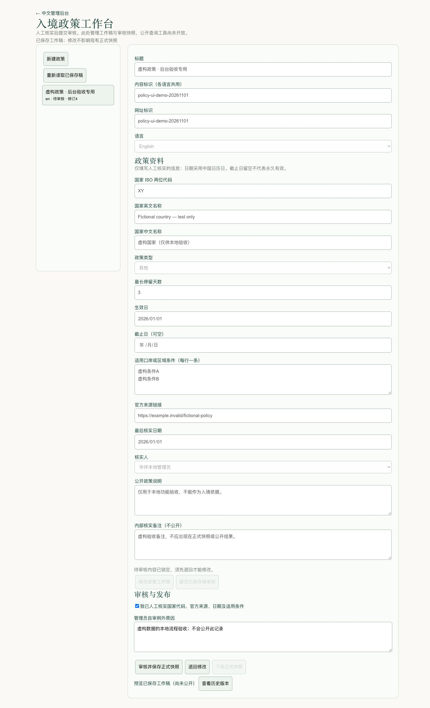
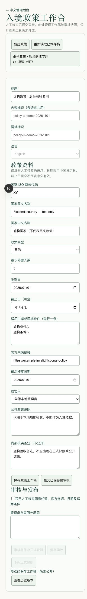
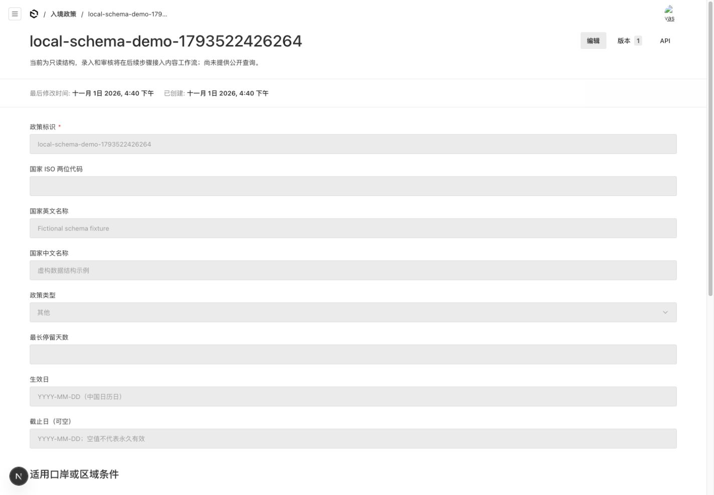
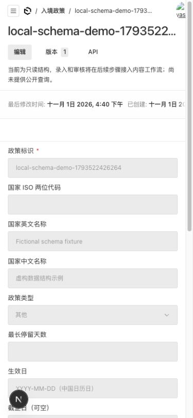
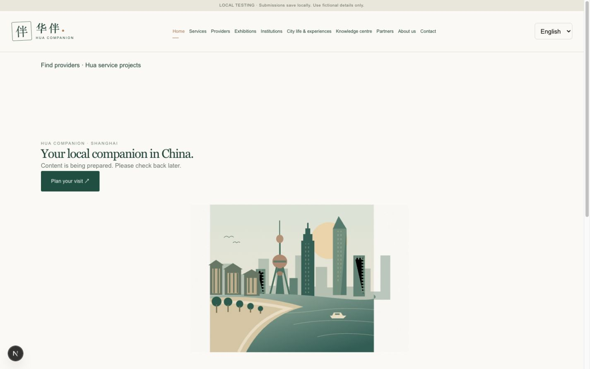
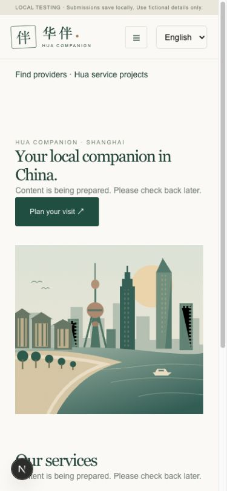

# 本地模拟活动暂停与恢复（2026-11-21）

## 下一届展会链接（2026-11-26，进行中）

PR121合并于main `610ccec4be9f322af64fdcdbdb1bd0e4c6b99d38`，本批`codex/exhibition-next-edition`；用户接受人工指定、允许日期待公布目标，原生推进，推送草稿不自动合并。
基线670/670；新增26项关系模型测试RED→GREEN，完整check696/696、lint0/445既有警告、849文件行长合格。保留旧缺键，拒绝格式/自指，覆盖语言/类型/日期/状态、未知日期、未确认历史来源及回环。状态函数原类型要求全资料，按实际读取字段收窄声明后typecheck通过，未改运行行为。
编辑/发布事务、公开/预览、真实PG/HTTP/UI及末尾复核待完成，不提前宣称整批成功。无依赖/迁移/配置/.env变更、不升级/reset原演示库，独立任务源码副本检查，其他任务三份文档原样保留。

## 单展会日历下载（2026-11-26）

PR120已合并至main `3789cf9c3978a61259e7d71c5439b43ed340de79`，本批分支`codex/exhibition-calendar-download`，用户接受整届一个全天日程、分期放说明，原生推进，草稿PR不自动合并。
对应[草稿PR121](https://github.com/yaemart/huacompanion-ai/pull/121)，[中文小结](exhibition-calendar-download-summary.md)。整届DATE含结束当天、分期仅说明，未知/延期/取消/待公布不可导出、已结束可历史导出；UID固定项目/语言/contentKey，纯文本转义与75字节UTF-8折行，无VALARM/收件人/邀请。
公开只读GET验证参数后才初始化数据库，当前语言无公开快照404、不可导出409、内部异常503；安全附件名、no-store/nosniff，详情地址从APP_URL构造不信Host。原审核/来源、已发布网址锁及试用/维护权限不变。
28项模型、16项实际路由及七语言详情入口先RED后GREEN；完整check666/666、lint0/445既有警告、847文件行长合格。真实PG展会/content、详情/预览、生产构建与HTTP通过；新HTTP组验证草稿隔离、改版/UID/SEQUENCE、撤下与三状态拒绝、历史日程、HEAD/Next405和全表只读，沿用现有exhibitions-http进入CI。
失败记录：基线621/622为沙箱监听EPERM，原样重跑622/622；TEXT正则控制字符lint改Unicode类别，夹具类型三处修正；真实HTTP最初改已发布slug被400拒绝，按既有规则修正夹具并验证全表回滚，不放宽规则。产品构建已通过，夹具修正后完整check及PG/HTTP重跑通过，复用同一未改产品源码的构建。
实际生产UI桌面1995=1995、390视口375=375，中英入口与提示、下载926字节文件的单事件/完整末日验证通过；首次浏览器等待中断，恢复后用实际下载控件取文件，console空，视口复原/关tab。未导入真实日历、不称真人/实体手机或所有厂商覆盖验收，截图/报告仅本机忽略目录未上传。
无新依赖/迁移/配置/.env变化，原演示库未升级/reset；独立随机库清理，仅停止本任务服务。其他任务三份文档保留未提交，完整检查在独立源码副本执行；末尾唯一独立复核及最终SHA的CI由PR121记录，不自动合并。下一届/订阅/提醒及H真实发送门禁后续另批。
唯一末尾复核0严重/2重要/0轻微，两重要项单轮修正、无二次复核：过去pending经原展示转ended而误下载，真实HTTP RED200≠409，服务从原快照在转换前计算只读calendarExportable，保存白名单去除伪造值；新HTTP验证原公开ended状态仍在、详情无下载、接口409且全表不变，历史announced/ended仍200。
语言配置错误原try外抛异常，三个实际解析器/路由测试RED→GREEN503/no-store/nosniff且数据库初始化0；模型只读拒绝也先REDtrue≠false。聚焦48/48、最终完整check670/670、lint0/445既有警告、847文件行长通过，PG/内容/展会、重新生产build和HTTP全部退出0，随机库清理。JSON原类型联合导致新增Object.hasOwn断言typecheck失败，补真实对象断言后通过，无放宽校验。
实施判定：实际客户端导入/覆盖/默认提醒不在本次实测范围，成本是各客户端可能重复/有自身提醒；订阅/邀请/分期独立事件/真实发送另批，成本本批无这些能力；expiresAt原不自动下架，成本为已确认历史内容需员工主动撤下。公开投影新增可选只读布尔值，不写数据或改变原列表状态；未来导出入口须遵守该资格。

## 展会结构化分期与到访资料（2026-11-26）

PR119已合并，fetch核对main `bb14c070359b292417cc4e272e1f923264d19c0a`包含H最终bb02fd9；用户接受方案2并明确授权原生实施、测试、交接、推送草稿PR，不自动合并。
分支`codex/exhibition-visitor-details`，[草稿PR120](https://github.com/yaemart/huacompanion-ai/pull/120)，[一页中文说明](exhibition-visitor-details-summary.md)。第一批仅阶段3.1资料补全，.ics、下一届、订阅和提醒后续分批，H真实试发前门禁保留。
新增可选分期数组（名称、日期、题材）及交通、外国买家登记、住宿区域、首次参展提示；复用版本化JSON，旧快照无新键仍可校验、编辑与重新发布，不后台补写旧记录。
分期最多12期、名称200/题材2000/四项文本各5000字符；分期日期同时空或完整严格有效、顺序正确且位于已知总体展期内，允许重叠、保持录入顺序。草稿空行可保存，发布需补齐名称与题材或删除空行。
分期只展示，不创建独立身份、路由、Event子事件、筛选候选、咨询或提醒；总体日期仍控制筛选/排序/结束状态/咨询/JSON-LD。七语言独立标签与本语言内容；新资料纯文本及嵌套白名单深复制，不传播未知内部属性。
现有展会工作台增删/编辑沿原field回调取消核验，沿原权限/dirty/版本/保存/审核/来源匹配/审计；公开详情与授权草稿预览共享新增展示，旧资料不显示空分区。无新依赖/集合/迁移/环境变量/.env变化，原演示库未升级或reset。

旧基线574/574；新增26项模型用例先RED后GREEN，任务1完整600/600和typecheck通过。UI渲染缺添加分期先RED，七语言/转义/旧字段省略/总体JSON-LD日期保持后GREEN。
实际Cua发现草稿预览另有模板漏新字段；真实页面渲染断言先RED，抽共享组件后GREEN，不改变原预览鉴权和基础字段。测试VM最初CJS加载ESM依赖出错，改为真实ESM模块、仅替换请求认证/读取边界；不是产品导入或权限变更。
独立随机PG及真实内容API通过：认证保存/提交/核验发布，匿名/无板块/跨源/编辑者发布拒绝，缺核验/来源/分期题材拒绝，读取和拒绝前后全表不变，旧公开快照隔离、修订409、版本恢复与撤下。既有展会与content集成、生产构建及真实HTTP通过，公开POST405、匿名预览跳转、七语言/撤下/取消保持。
实际生产页面桌面1265=1265、390视口375=375；真缺新键旧JSON控件空且正常，添加/删除分期取消核验，四项资料与未知日期分期保存恢复且授权预览可见；另推进服务端版本，手动与30秒自动保存409后输入保留。离开时原未保存提醒有效，仅丢弃虚构冲突输入，已登出/恢复视口/关tab。
截图/原始日志仅.local/exhibition-visitor-details，未上传附件，不称真实资料核验或实体手机验收。测试副本独立Cookie前缀仅隔离本机会话，仓库Payload配置未改。
工作区另有三份客户/服务商任务的未跟踪文档，保留不改不提交；该两份草稿格式导致原地lint不能全通过，完整检查改在只复制本任务和已跟踪代码的隔离副本执行，不跳过本次文件检查。
唯一末尾独立复核0严重/3重要/1轻微，三重要项单轮修正，无二次复核。
新增可预期校验改StaffFormError并注明具体字段/第几期，意外异常仍通用提示；5项提示单测及真实API越界/单边日期/超长/空题材响应正文先RED后GREEN，拒绝前后全表不变。
集成账号原密码复用公开展会key，实际登录断言先RED；改每账号独立32字节随机密码后公开key不能登录。复用专用数据库守卫，连接Payload前拒绝原演示库/错误host/端口/账号/名称/URL选项，17项守卫和真实入口初始化用例通过，不再只靠APP_ENV=local。
CI新增真实展会数据库套件和生产exhibitions-http，不用YAML字符串断言代替运行；最终CI须实核两组PASS日志。预览测试在含空格副本路径误判.ts为.tsx先RED，改文件URL检查后GREEN；仅测试工具修正。
单轮后在含空格隔离副本完整check622/622、lint0错误/445既有警告、842文件行长合格；真实PG/内容/生产HTTP及构建再次退出0，随机库清理。新测试as const导致只读数组类型不匹配曾阻断check，改明确夹具类型后全量通过，无放宽产品校验。
轻微延期：题材/四项到访输入框未提前显示或限制2000/5000字上限；服务端上限和具体字段400提示已验证，代价是粘贴长材料需保存后修正。真实展会准确性、.ics/下一届/订阅提醒/真实发送按用户边界另批，本批只做资料基础。
最终精确提交及对应CI由草稿PR120实核记录承载，不自动合并。原演示仍未应用H回执迁移，不能因本批无新迁移而直接升级既有库；接入仍按备份停Web/worker迁移重建流程。

## H 本地回执收尾（2026-11-26）

PR118已合并，fetch核对main `8155cdb9c76eed4552534fbb5b526db981ac4cf7`包含最终7811955；从干净工作区建立`codex/subscription-feedback-closeout`，沿用原生实施。
用户确认先补三个轻微项与只读回执汇总，退订邮件组装保留真实试发前门禁，先H后日历；[一页中文说明](subscription-feedback-closeout-summary.md)，[草稿PR119](https://github.com/yaemart/huacompanion-ai/pull/119)，不自动合并。
签名时间拒绝不存在日期与24点，合法闰日/偏移跨日保留；实际Next方法表+真实路由导出验证GET/HEAD等405，移除HTTP适配器伪框架断言。
独立PG事务分别覆盖仅绑定无反馈、签名反馈、邮箱级反馈及供应商拒发回退保护，失败回滚后全表指纹不变，原空表迁移往返保留。
本人活动增加独立回执汇总，按原冻结名单及本活动邮件级回执去重，区分全局营销拒发；邮箱级抑制不伪装本活动邮件退信，不暴露邮箱、事件/任务/尝试编号或摘要。
复用withCampaignRevision现职/主题授权/本人/最新版本与内容→业务锁，不读订阅名单、不写审计/反馈/确认；独立刷新不导航，不影响未保存选择、写锁、控制未知和续发状态。整页其余既有读取仍可能mock-reset，本批不扩展。
无迁移/集合/新依赖/产品环境变量/.env变化，原演示库未升级；测试仅独立虚构随机库，既有回执迁移接入前须配套备份停Web/worker迁移重建，勿reset。

日期缺失异常先RED；新增汇总服务存在断言先RED，实际API未接action400≠200先RED；修正后聚焦真实HTTP/PG通过。
回退夹具初次删除被拒发表引用的反馈触发外键，改为事务内引用兼容旧手工事件后分别验证保护；撤权夹具原置于worker证据之前使模拟确认失效，移到全部执行证据之后，不放宽原门禁。
首次完整check572/572；聚焦覆盖去重/重叠/跨活动、全局拒发、错版/撤权/停职/他人/非local、暂停/取消历史与损坏快照，独立API人群查询0次、全表指纹不变。
真实组件虚构响应隔离预览桌面2010=2010、390视口375=375，刷新成功/503/畸形响应保留选择和旧统计，console error/warn空；截图/日志仅.local/subscription-feedback-closeout，未上传附件，不称真人或真实投递验收。
初轮完整订阅38组退出0；唯一末尾独立复核0严重/2重要/2轻微，两重要项单轮修正，无二次复核。
统计asOf原能接受不存在日期及“1”却显示破折号，新增两例先RED，改为UTC毫秒ISO往返一致；有正数回执活动改版确认后实际下架政策，先证明current=false，再核对API原冻结版/正数回执/人群查询0次与全表指纹不变，恢复来源后确认仍有效。
注入新版送达归零变异，新断言实测0≠1先RED，finally恢复源码后GREEN；停职夹具旧JWT被撤销，恢复启用后历史验收重新登录，不放宽权限。
修正后完整check574/574、订阅38组再次退出0，lint0错误/445既有警告、835文件行长合格，业务源码增删228行≤400。交接空行首次格式检查失败，统一Prettier后完整检查通过。
轻微延期两项：邮箱级回退行同时命中sourceHash/kind/空attempt，尚无有attempt且空sourceHash的供应商邮件抑制单谓词用例（四种情形已覆盖）；页面矩阵未独立断言feedbackSummary读取次数/传值（真实API和实际组件已验），未来单谓词误删或SSR漏传的自动覆盖不足。
最终精确SHA与对应CI由草稿PR119实核记录承载，远端fetch核对后交接，不自动合并。真实发送、清除拒发、强制重试、公网、费用和部署均关闭。
真实试发前仍须当前同意版本退订凭证、正文退订入口及List-Unsubscribe组装验收和另行授权；本地模拟收尾不代表生产投递就绪。日历待本PR经用户合并后从最新main另开任务。

## 签名回执接收与本地整链路模拟（2026-11-26）

PR117已合并，fetch核对main `f639e692f98af05a97b5a483e095b055f5df717d`包含f0bc8f4，从干净工作区创建`codex/subscription-signed-feedback`。
用户已接受设计并沿用原生实施；[草稿PR118](https://github.com/yaemart/huacompanion-ai/pull/118)，[一页中文说明](subscription-signed-feedback-summary.md)。先H后展会日历。
新增仅local且默认关闭的POST签名入口，16KiB原始字节、三个svix头、HMAC-SHA256恒定时间比较、多v1候选和签名时间±300秒；验签及解析先于数据库初始化，保留试运行Basic/维护门禁，无非local匿名豁免。
私有本地模拟邮件绑定仅现职管理员内部服务可建，按邮件ID/原attempt/邮箱摘要固定目标；回调不信tags或任务编号，未绑定相关事件503重试。签名服务自行验签，内部共享持久化不对HTTP暴露跳过鉴权参数。
送达、永久退信、投诉及供应商抑制归一化；Temporary/Transient/Undetermined成功忽略，不自动当硬退信或触发发送。邮件级与无source_id邮箱级抑制区分，后者只匹配已绑定虚构地址、attempt为空；provider-suppressed不伪装退信/投诉。
已处理消息以resend命名空间+svix-id摘要及归一化来源指纹去重，同ID改目标/类型/时间409；迟到送达/移除/重订/新活动/续发不解除拒发，打开/点击事件验签后忽略。系统来源审计actor为空，不冒充员工。
内容→业务→邮箱锁、反馈/首次拒发/审计同事务，原手工管理员门禁、已开始结果记录、权限、只读、预算/冷却、限速、邮件优先及单封确认/资料邮件规则保留；无真实发送、费用、账号、隧道、公网接入或部署。
新增SUBSCRIPTION_FEEDBACK_ENABLED=false和空SUBSCRIPTION_FEEDBACK_SIGNING_SECRET示例，不修改已有.env，无新依赖。新私有绑定集合、可空attempt邮箱级反馈、sourceHash、provider-suppressed枚举和20261126_090000_subscription_signed_feedback迁移/生成类型；仅随机库应用，原演示未升级，接入前配套备份停Web/worker迁移重建，勿reset。

服务缺失断言先RED；27项协议/路由聚焦通过（含官方固定向量、原始体变化、非法UTF-8、ISO及±300秒）；无效签名原先getPayload先调用503≠401，新增实际路由vm断言数据库初始化0次后GREEN。
真实HTTP调用实际POST+PG模拟闭环通过，覆盖绑定迟到重试、并发重放、系统审计、两类抑制、审计回滚、已开始结果、新冻结/续发/worker拒发和只读指纹；手工跨第二真实任务同ID冲突补上PR117延期项。
初轮夹具预期误把同ID冲突409当未知绑定503、迟到送达追加合法回执当全表不变、零候选续发409当bound0，均按实际契约校正断言，不放宽产品门禁。历史迁移回退补新依赖逆序/正序及12表指纹。
首轮完整check549/549、订阅38组退出0，lint0错误/445既有警告，831文件行长合格；单轮修正后完整check551/551、订阅38组再次退出0，lint仍0错误/445既有警告、831文件行长合格。
末尾一次独立复核0严重/3重要/3轻微；三重要项单轮修正：官方Transient/Undetermined原400先RED再成功忽略；worker另备同邮箱未尝试可调度slot先实证再拒发，保持活动未改版/其他门禁可运行并比全表；错误归属改用首见消息ID、无绑定邮箱级事件及误导tags/attemptId，手工跨任务保持事件时间固定。
修正后29项聚焦及真实HTTP/PG组通过，无二次复核。轻微延期：不存在日历日仍可被JS规范化；GET405断言在HTTP适配器而非Next分发层；新迁移非空回退保护已有实现但未专门用例覆盖。
本批无UI，不虚构页面截图/真人或真实投递验收；日志仅.local/subscription-signed-feedback，无上传附件，并发PG驱动查询弃用警告保留未升级驱动。最终SHA及精确CI见PR118，不自动合并。
真实服务账号、发件、供应商实际重投、公网接入与部署仍不在本地模拟验收范围；代价本批不证明生产投递就绪。后续先审阅H本地闭环证据与遗留项，再做展会日历。

## 本地投递回执与营销拒发基础（2026-11-25）

PR116已合并，fetch核对最新main `ef7404e0126fd2897dc5233c583376565626b5ac`包含最终994db47；从干净工作区创建`codex/subscription-local-feedback`。
用户已接受设计并沿用原生实施；[草稿PR117](https://github.com/yaemart/huacompanion-ai/pull/117)，[一页中文说明](subscription-local-feedback-summary.md)。先H后展会日历。
内部recordLocalCampaignFeedback仅local/现职管理员/example.invalid，显式事件UUID、原尝试ID/邮箱、delivered/hard-bounce/complaint及标准ISO时间；无HTTP、UI、外部服务或真实验签适配器。
反馈关联attempt→slot→job/batch，原任务摘要及稳定尝试键交叉校验；当前联系邮箱变化仍只能抑制原邮箱。普通permanent不当硬退信，accepted不当送达，送达不称阅读。
同ID同内容重放不写，改目标/类型/时间409；硬退信/投诉和首条营销拒发及脱敏审计同事务，迟到送达不清除，重订、新活动和改版续发不复活。
内容→业务→邮箱锁顺序复用原守卫，营销资格集中排除拒发；原领取/开始在邮箱锁内复读，直接预检只反映资格、不取消任务。
原同意、语言、尝试正文/唯一键/结果、历史和额度保留；权限、共用预算/冷却、限速、邮件优先及重试不变；不改单封确认/主动资料邮件，不开放发送、清除、恢复拒发或强制重试。
新增两个默认拒绝CRUD/无集合端点的私有集合及20261125_120000_subscription_campaign_feedback迁移/生成类型；仅随机库应用，非空反馈/拒发表拒绝回退。
无新依赖或产品环境变量；原演示库未升级，接入前须配套备份、停Web/worker、迁移重建，不能直接reset。

RED为缺失回执服务断言；真实PG补例复现无效邮箱通用Error而非400，转中文ContentError后GREEN。
初轮类型检查发现测试泛型data.action未缩窄、隔离夹具国家码和员工变更缺管理员上下文，均修正夹具，不放宽产品校验。
完整集成发现历史迁移回退直接删除被新表引用的尝试表；全仓补齐依赖逆序回退/正序恢复及11表指纹预期，保留新外键与非空保护，无CASCADE绕过。
聚焦真实PG覆盖重复/冲突/乱序、权限/停职、时间及归属、审计失败全表回滚、重订/新活动/续发、私有表读取/删除拒绝、原任务历史不改；真实事务审计屏障和pg_stat_activity确认竞争操作确在等锁，释放后begin复读拒发。
完整check522/522、lint0错误/445既有警告、824文件源码行长合格；修正后完整订阅37组全部通过且退出0，含大表性能及worker中断组。
末尾一次独立复核0严重/3重要/1轻微；三重要项一轮修正，无二次复核：已开始→拒发→result原ineligible≠failed-local先RED，结果路径仅豁免新增营销拒发，原同意/联系/活动/令牌及其余守卫保留，禁止任何新尝试/重试。
全量流程在36组后停职最后管理员的夹具失败，新增备用管理员且实测降权拒绝；并发屏障改为唯一begin等待者，未尝试且同意不变的另一旧活动明确ineligible且续发不绑定，聚焦真实PG通过。
轻微延期：同事件编号改为第二个真实任务的专门冲突用例未加；服务已有目标/摘要匹配409，类型/时间冲突及全表只读指纹已覆盖。
本批无新增可视界面，不以截图或真实后台操作冒充内部服务验收；原始日志仅.local/subscription-local-feedback，未上传附件。并发PG组有驱动查询弃用警告，未放宽测试或升级驱动。
后续H仍需外部验签接收和整链路模拟验收；真实投递/费用/部署另行授权，不据本批宣称H整体完成或真实发件就绪。最终SHA/CI见PR117，不自动合并。

## 续发恢复流程提示补齐（2026-11-25）

新电脑fetch确认PR115已合并，main `ae9634e79fb2aecad9409244f485b12d88a21ea4`包含16b29a4；配置独立Node24.22.1/PG15.20、锁定依赖和虚构演示环境。
接手基线check522/522及订阅36组通过；从origin/main创建`codex/subscription-recovery-guidance`，早期[草稿PR116](https://github.com/yaemart/huacompanion-ai/pull/116)。
用户明确授权按两处提示范围直接继续，原生实施；[一页中文说明](subscription-recovery-guidance-summary.md)，先H后展会日历。
只改CampaignContinuation找回收据提示与CampaignPauseControls结果待核实提示：明确重开才同步预检说明，先核实控制成功后再刷新改版预检。
状态、请求、禁用、写锁和自动导航均无改动；独立查询只读，明确重开仍沿用原mock-reset边界；权限额度预算限速邮件优先重试保留。
按当前开发指令，低影响可逆文案不新增字符串镜像测试，运行已有行为回归21/21；完整check522/522、36组订阅集成退出0，lint0错误/445既有警告、821文件行长合格。
实际组件隔离浏览器使用虚构模拟响应，验证丢回执后只读找回无导航、预检禁用，控制未知提示及核实后原因保留与手动刷新；非真实后台全链路或真人验收。
桌面/390布局、client375=scroll375、console error/warn空；恢复视口并关闭本批tab，截图和原始日志仅.local/recovery-guidance-preview，无上传附件。
无迁移、依赖、产品环境变量或.env变化，不复制旧库、不升级既有演示库、不reset；原3100仍为本机独立演示。
末尾一次独立复核0严重/0重要/0轻微，无修复或二次复核；完整推送SHA与精确CI结果由PR116记录承载；保留旧交接正文，不自动合并。

## 本地续发收据补强（2026-11-25）

PR114已合并，开工fetch确认最新main `b6271cae107867c5fc083ad7de4531f1112b4dbd` 包含最终5ed9e9e。
分支 `codex/subscription-receipt-hardening`，早期草稿[PR115](https://github.com/yaemart/huacompanion-ai/pull/115)，[一页中文说明](subscription-receipt-hardening-summary.md)。先完成H，再做展会日历。

只读收据关联batch实际冻结草稿，交叉核对原版号、本人归属与活动；原冻结1/2、当前3时另一个合法早期版号仍503拒绝，不修复或写回。
共享既有事务的withCampaignRevision元数据守卫，保留现职、主题授权、本人、最新版本与内容→业务锁；原withCampaignDraft继续完整来源/预览/资格检查及每次调用内名单缓存。
独立收据读取不再构建草稿人数/模拟报告，驱动观察subscriptions查询0次；无快照与原冻结版本页面跳过收据调用，新版仍读一次。
预检说明按取消/暂停、恢复后的旧报告、无快照、原版、已有收据、未保存、处理中/未知、其他阻断、零候选和可确认状态细化；仅说明不授予执行资格。
已有收据说明不再邀请重复提交；未载入收据不等于数据库无记录，提交仍按原服务重查。父页面实时暂停/取消及未知控制状态参与说明。
独立只读收据与预检无reset/审计写入；整页其余既有状态读取和明确重开在条件变化时仍可能记录原mock-reset，本批未改变这一边界。
原权限、额度、共用邮箱预算/冷却、全站限速、确认/资料邮件优先和重试规则不变；没有真实发送、清除或强制重试。

RED→GREEN：冻结2/收据1/当前3原返回200≠503；收据名单原1≠0；页面无快照/原版两例调用1≠0；提示缺函数及旧报告忽略实时控制先RED。
首次元数据抽取漏换旧回调导致row未定义、提示增量修改漏绑定控制参数导致ReferenceError，均按真实失败定位修正，无放宽断言。
新增真实API/PG组检查合法与损坏收据全表指纹不变、篡改归属拒绝、现职停用/撤权、错误字段/旧版/他人拒绝；原草稿人数仍每次一次名单查询，退订3→2即时生效。
真实CampaignWorkspace SSR核实状态连接；页面函数回归5项、提示15项。完整npm run check518/518，lint0错误/445既有警告，821文件源码行长合格，Prettier及typecheck通过。
首次最终check仅既有端口占用测试因沙箱listen EPERM失败，许可环境重跑518/518；官方订阅集成36组通过，保留worker中断及10万行大表性能组。

隔离生产构建与真实浏览器开发自测：四个虚构活动，无快照、原版2、新版3未续发、新版3收据32项；原第2版显示准确且不再提示重复提交。
未保存选择刷新预检仍保留；暂停即时提示、恢复后旧暂停报告提示刷新；390视口client375=scroll375，桌面1265=1265，console error/warn空。
已登出、恢复视口；仅本批随机库和隔离副本清理，截图desktop/mobile.jpg及原始证据在.local/subscription-receipt-hardening，未上传PR附件，不冒称真人验收。
本批业务源码最终增删153行≤400，无迁移/依赖/产品环境变量/.env变更；原3100/55442未升级、原站/zh实测200，PR113既有迁移应用原库前仍须备份停Web/worker并迁移重建，无需local:reset。
提交4bff4e1后任务完成门禁完整36组退出0；唯一末尾独立复核0严重/2重要/2轻微，未追加二次复核。
两重要项均按实际影响修正：较新预检不能被旧页面暂停状态覆盖；预检通过不能指向本页仍禁用的续发入口。
时间顺序3例先RED，提示与真实工作台SSR旧确认入口先RED；传既有changedAt/asOf并在较新报告矛盾时提示重开核实，复用入口实际资格说明。
本地控制确实较新仍即时显示暂停/恢复；新报告与旧控制冲突先记下未保存选择再重开，独立刷新不自动导航或同步控制。
修正后24项聚焦单测、真实PG/SSR通过；完整check522/522、完整36组再次退出0，lint仍0错误/445既有警告，821文件行长合格。
轻微延期两项：找回收据后父预检仍提示先核实（面板已显示收据、写锁保留，代价一次明确重开后文案才同步）；控制结果未知也禁只读预检刷新（代价先核实控制状态）。
实施判定：整页既有名单读取和mock-reset范围不扩展，代价整体页面仍有名单读取且明确重开遇条件变化仍可reset；真实投递/调度改动/展会日历按用户边界留后续，代价本批不交付这些功能。
旧交接正文保留；任务完成最终36组、唯一末尾独立复核、推送完整SHA与对应PR触发CI实核结果由PR115记录承载，不自动合并。

## 本地续发后台入口（2026-11-25）

PR113已合并，fetch核对最新main `7479acc3790b070cacbb81f0c043643d508292ce` 包含最终4d4d61c。
分支 `codex/subscription-continuation-ui`，早期草稿[PR114](https://github.com/yaemart/huacompanion-ai/pull/114)，[一页中文说明](subscription-continuation-ui-summary.md)。先完成H，再做展会日历。

接入continue-revision-local明确确认写动作、read-continuation-local只读收据动作；本人现职主题授权、local、同源JSON和严格字段校验。
写动作仅适配PR113服务；只读查询用inspect确认路径，无reset/审计/任务写入，即使来源/配置失效、暂停取消也能核对历史收据。
收据严格限制活动/版本/原版/1–1000数量/标准时间/重放字段，不回私有数据。原frozen.current保持原义，已有本版绑定才允许新版占位。
面板显式勾选、ref去重；结果未知锁住保存/确认/准备/领取/控制，Enter同样受控；只读核实无记录才解除并要求重勾，查到记录原页展示、待明确重开；导航开始至卸载持续互锁。
重新改版须重新模拟逐语言确认；已尝试/取消/待核对历史不重置，新名单不补人。旧快照、预检、占位/调度/整批复核/演练提示与新入口对齐。

客户端先缺模块RED后33/33；API首个新动作RED400≠409，接服务后聚焦GREEN；SSR面板缺失RED后GREEN。
接口集成覆盖权限、同源/体积/类型、确认白名单、旧版、重放并发、无收据、来源暂停取消时只读全表指纹、原未占位项续发后准备领取。
首轮任务1完整check496/496；任务2首个检查仅测试夹具null推断报TS2322，显式Receipt|null修正，lint仍0错误/445既有警告。
更新2处旧文案断言，未放宽权限或指纹；首轮完整check496/496、35组订阅集成通过，保留大表性能与worker中断组。

隔离生产副本真实浏览器：32原名单，1待核对/1取消，第2版续发30；模拟完成1项后第3/4版各续发29。
未保存两项选择刷新预检仍保留；服务前丢失响应→未知互锁→只读null不再提交；服务后丢回执→未知→只读找回，初版自动重开问题已在独立复核修正，只有各版各一条审计。
原2项历史任务和原尝试逐行不变，最终3个不同版本收据、30个总绑定，旧已尝试项保持原版；实际占位/领取/开始/模拟完成均通过。
390视口document375=scroll375，提交50px，console error/warn均空；视口已恢复、账号登出且只关闭本批tab。截图desktop/mobile/mobile-confirm/uncertain.jpg仅本机未上传。
汇总文字已改为原名单含续发记录的准确口径。一次独立复核0严重/2重要/3轻微，未追加第二次复核。
两重要项：只读找回自动导航可触发原mock-reset、导航未卸载却提前解锁。真实组件内存回归先RED（导航1≠0、busy false≠true），修正后2/2GREEN。
找回收据就地展示，其他写入继续锁定；明确点击“重新打开本版活动”才读当前页面状态。正常/明确重开均持锁到旧页卸载，防慢导航丢失选择。
最终隔离生产副本再次实际验收：提交后丢回执且设置随后变化，只读找回全表指纹完全不变；明确重开后才有1条原mock-reset，原历史/唯一收据仍保留。
最终390视口375=scroll375，重开按钮50px、console空、已登出/恢复视口/清理；desktop-fixed/mobile-fixed.jpg替代旧截图作为最终恢复流程证据，不冒称真人验收。
实施判定：原设计的找回即自动重开改为就地展示并明确重开；代价多一次点击，换取只读按钮不间接写确认/审计。
轻微延期三项：收据原版未交叉核实际冻结版（损坏内部审计显示不一致，执行仍拒绝）；不可能有续发的页面仍多读一次全名单；预检入口说明未按状态细化。

本批无迁移/依赖/产品环境变量/.env变更。PR113迁移仍仅随机库验证，原3100/55442保留未升级，原站/zh实测200。
应用既有PR113到原库前需备份、停Web/worker、迁移重建；无需local:reset。隔离预览、副本、随机库已清理，原始证据本机.local/subscription-continuation-ui未上传附件。
末尾汇总措辞修正后check496/496、35组通过；复核修正后check498/498、聚焦接口/SSR及最终隔离生产验收通过，lint0错误/445既有警告，817文件行长合格；完整35组最终复验由PR114实核记录承载。
业务源码最终增删393行≤400；旧交接正文逐字保留。独立复核、最终推送SHA与精确CI由PR114实核记录承载，不自动合并。
只读保证针对独立收据/预检查询且找回不再自动导航；明确重开后才沿用原页面状态读取，条件失效时可记录原mock-reset，不会再次续发或尝试。

## 同活动改版本地续发服务（2026-11-24）

PR112 已合并，connector/fetch 确认最新 main `e80a0a07ff1d3d0a69fe387119700137966c0bba` 包含最终 `6f178578570cb4101060bd3909846a45af51f1b3`。
分支 `codex/subscription-campaign-local-continuation`，早期草稿 [PR113](https://github.com/yaemart/huacompanion-ai/pull/113)，
[一页中文说明](subscription-campaign-local-continuation-summary.md)。先完成 H，再做展会日历。

新增内部 resumeMockCampaignRevision 服务及 job 三个可空绑定字段；原 batch.draft、原名单、同意/语言/摘要/取消/历史均保留。
仅原 held、本地 example.invalid、无任何尝试行/完成证据、实时资格有效者绑定已重新模拟确认的当前新版，不补新人。
首次续发遇有效未完成领取整体拒绝；同版重放不扩展范围。内容→业务锁及订阅邮箱/主题锁下重读，审计/绑定同事务。
已有占位不重复收费，未占位仍走原额度；占位/列表/挑选/领取按任务有效版本过滤，旧已尝试项不会被新版 worker 领取。
权限、来源、暂停取消、共用预算/冷却、全站限速、确认资料优先和重试逻辑复用；不新增 UI/HTTP 动作/worker 扫描。

真实随机库：三列缺失 RED 后迁移 GREEN；旧 populated 数据 down/up 指纹一致，有绑定拒绝回退；生成类型仅增六行。
服务缺模块 RED→GREEN；新版列表原 gate RED 空数组后适配 GREEN。16 原任务仅 4 续发，6 并发仅一条新审计，其余重放。
延迟 COMMIT 拒绝返回503且全表回滚；已尝试/取消/资格失效任务逐行一致，选中项仅三列及 updated_at 变化。
零余额拒绝新增占位但原 key 幂等；一份新余额只给原未占位项；15分钟冷却、滚动24小时五次、限速、邮件优先均等待且不增尝试。
第二版首次正文来自新版，第三版退订事务通过 pg_blocking_pids 同步后排除该人，仅2项绑定；两个真实 CLI 进程模拟完成。
第二版已尝试的 key/正文/次数/重试/时间不变，旧 token 拒绝；来源/配置/撤权/停职/暂停/取消与零候选均拒绝。
来源/配置失效沿用原 mock-reset 审计行为，不把整条执行链冒称只读；绑定和原尝试仍保持。
夹具最初权限停职操作缺管理员身份返回403，补真实管理员后通过；不是产品逻辑失败。驱动既有 pg 并发查询弃用提示保留。

新增迁移 20261124_090000_subscription_campaign_continuation，仅随机库应用；原3100演示副本及55442库保留未升级。
应用到任何既有库前须备份、停 Web/worker、迁移后重启。无依赖/产品环境变量/.env 变更，无浏览器/真人验收。
原始日志仅本机忽略目录 .local/subscription-campaign-local-continuation，未上传附件。后台续发按钮/API仍待后续批次。
Node24.22.1：两次完整 check 均463/463、lint0错误/445既有警告，810文件行长≤200无例外；聚焦回归通过。
首轮完整集成在旧资格复核迁移夹具失败：新列顺序与恢复后的取消列顺序不同，数据 hash/count 一致；补齐第五处依赖顺序后34组全部通过。
一次新上下文只读复核0严重/1重要/1轻微。重要项：普通管理员邮件设置保存可在续发等订阅锁时使确认过期。
真实 Payload 未提交设置事务+订阅锁屏障先 RED（本应409却成功），在确认摘要读取前取得设置表共享锁，覆盖普通更新及首次插入。
仅续发通过内部 lockSettings 选项启用，锁持有至绑定/收据事务结束；其他共享确认调用保持原行为。聚焦 GREEN，最终完整 check 463/463、34组订阅集成再次全部通过。
轻微延期：占位/调度在新版尚无续发绑定时仍提示“改版续发尚未开放”；后续后台接入时调整说明，本批不改。
业务源码最终增删319行≤400，lint0错误/445既有警告，810文件行长合格；不追加第二次复核。
实施判定：模型与执行守卫一起提交，避免交付能绑定却不能按版本执行的中间状态；代价是单次diff更大。
原站3100/zh只读实测200。旧交接/progress正文逐字保留；最终推送SHA、精确PR触发CI和ready状态由PR113实核记录承载，不自动合并。

## 预检名单单次读取与大名单性能（2026-11-24）

PR111已合并，connector及fetch确认最新main `f34c9e749dcf57693eeb0c9a26e3d2ae98cb0a9e` 包含最终c216c43。
新分支 `codex/subscription-preflight-audience-reuse`，早期草稿[PR112](https://github.com/yaemart/huacompanion-ai/pull/112)。
[一页中文说明](subscription-preflight-audience-reuse-summary.md)。用户确认先完成H，再做展会日历，已补总计划决策记录。

本人预检人数估算和原任务资格判断复用本次事务内一次查询/归一化结果，仅局部惰性Promise，不缓存跨请求数据。
现职授权/归属/版本后才读取，政策和来源检查顺序保持；其他可执行操作仍自行重读。私有名单/读取器不进入DTO或API。
真实驱动观察先RED2≠1再GREEN1：无冻结/同版/改版/来源失效/配置/暂停取消均1次；拒绝权限/版本/非法输入0次。
跨请求退订/同意/邮箱/语言/隐私变化立即生效，原确认失效和执行门禁不变，所有表读取指纹一致。

随机库新增100000条五类订阅+6去重/语言/非法邮箱哨兵，独立计数40013有效、20000中文/20012英文/1排除；
原10任务仍6历史/1取消/0失效/1领取/2候选，不补新人，不复活历史。服务/真实POST无邮箱/名单泄漏。
最终完整回归5次预热交错名单两次/一次中位369.95/192.11ms，当前完整服务233.57ms；EXPLAIN逻辑扫描2→1、共享访问7308→3654。
仅比较重复名单工作，不冒称旧完整服务提速或生产SLA；ANALYZE在指纹基线之前，读和EXPLAIN不写表；finally精确清marker并核实0。
首个大名单夹具PG42P08源于状态参数被CASE推断text/枚举冲突，显式现有枚举cast修正，未改产品逻辑，不当作目标RED。

Node24.22.1基线及首个完整check463/463，lint0错误/445既有警告，806文件行长≤200无例外；聚焦DB通过。
最新完整check463/463、33组订阅集成全部通过；性能采用该完整回归样本。一次新上下文只读复核0严重/0重要/2轻微，未改业务源码或追加第二次复核。
两项轻微延期：阶段说明“5次预热交错”的预热措辞可更精确；本地台账阶段完成范围止于计划提交，未覆盖随后实现提交。
实际两组各预热一次后交错测量5轮，完整服务另测5次；实现提交5cdfa3f，最终推送范围以本PR和最终SHA为准。
复核者独立Node24.22.1非增量类型检查、预检/状态客户端37/37及diff检查，未重复跑完整DB/性能/浏览器。
最终推送SHA、精确PR触发CI与ready状态见PR112实核记录，不提前声称CI通过。
业务源码增删31行≤400；无新UI/协议/依赖/产品环境变量/.env/集合/迁移，原库不升级，无新增浏览器/真人验收。
原3100/55442及图片保留；日志和执行计划仅本机忽略目录.local/subscription-preflight-audience-reuse，未上传PR附件。
不开放实际续发、真实发送、清除或强制重试；整页既有状态reset与独立预检只读边界保持，不自动合并。

## 同一活动改版续发只读预检（2026-11-24）

PR110已合并，已核对最新main `719099d3a52da1e189713ec8f86294478c5cfc5e` 包含2fb0305。
新分支 `codex/subscription-revision-preflight`，早期草稿[PR111](https://github.com/yaemart/huacompanion-ai/pull/111)。
[一页中文说明](subscription-revision-preflight-summary.md)，范围、计划在docs/superpowers对应2026-11-24文档。

本人当前活动新增local只读预检服务、同源POST与后台刷新；仅原冻结名单、不补新人，五类互斥安全汇总与阻断说明。
共享确认流程的只读模式在同一事务中检查上下文，跳过reset写入；原可执行操作的重置与跨版本门禁保留。
原未占位可评估为候选；已尝试/完成、取消、待核对等历史不改。任何未完成有效领取均提示阻断，包括已尝试项。
不占额度，不生成任务、租约、尝试或审计；权限、额度、共用预算/冷却、全站限速、邮件优先与重试规则保持。
不开放真实发送、实际改版续发、清除或强制重试；预检无阻断也不代表可以执行。

真实POST新action先RED400≠200，客户端先缺模块RED再25/25；首个完整check457/457，445既有警告/0错误。
共享只读模式33组订阅集成通过；后补在途已尝试租约RED后修正，聚焦随机库回归通过，均核对全表指纹不变。
测试初次沙箱监听EPERM，使用本机监听权限后432基线通过；聚焦夹具XY改DE、旧版领取预期409改为既有404，未改产品语义。
隔离生产构建与虚构主管浏览器验收通过：原32项/第2版显示4历史、1取消、1资格失效、1领取、25候选，
新版缺确认和在途阻断可见。成功刷新、503无效JSON失败、Enter恢复均保留2项未保存选择；失败保留旧报告和原时间。
390视口document375=scroll375，按钮50像素；控制台错误0，视口恢复、账号登出。独立刷新前后全表指纹相同。
截图desktop.png/mobile.png/failure.png本机忽略归档，未上传；预览随机库、副本及环境快照已清理，原3100/zh仍200。
业务源码增删338行≤400；旧handoff/progress正文逐字保留，源码行≤200无例外。
复核修正后最终完整check463/463、33组订阅集成均重新通过，lint0错误/445既有警告，804文件行长合格。
一次新上下文只读复核0严重/1重要/1轻微。重要项为合法字段却矛盾的回执可能替换报告并显示无阻断，已接受修正：
5个拒绝用例先RED、修正后31/31，另保留“历史任务仍有有效租约但未开始领取计数为0”的合法回执，active-lease单向约束。
客户端要求缺快照/未改版标记与快照一致，有领取计数必须有在途阻断；最终463/33组通过，不追加第二次复核。
轻微延期：草稿人数和资格计算各读取归一化一次全主题订阅，大名单时可能延长共享锁持有；未测大订阅表性能。
范围判定：整页重载仍可能由既有模拟状态查询写mock-reset/审计，独立预检刷新不写；避免误把整页当只读。
浏览器证据为复核修正前，后续仅客户端一致性校验变化，由新增单元/真实API联测和最终CI验证，不冒称修正后浏览器复验。
最终推送SHA、精确PR触发CI与ready状态见PR111实核记录；不提前声称CI通过，不自动合并。

无依赖、产品环境变量、集合/迁移或实际.env变化；原库不升级，原3100/55442及图片保留。
日志/截图仅本机忽略目录 `.local/subscription-revision-preflight/`，未上传PR附件；不推断其他电脑同步，不自动合并。

## 第二页空审计直接回归（2026-11-23）

已确认PR109合并，最新main `3117fde89df034baf161a70ca213495310caae26`包含其最终162e4cd；
新分支 `codex/subscription-review-empty-audits`，早期草稿[PR110](https://github.com/yaemart/huacompanion-ai/pull/110)。
[一页中文说明](subscription-review-empty-audits-summary.md)。用户“下一步”承接唯一轻微待办，仅补测试。
既有30项分页夹具，保留第二页5项的数量和编号检查，再逐项断言events=[]、hasOlderEvents=false。
原分页1/1/0审计查询、隐私、全表只读指纹和大表验证保持；业务源码目标0行，不修改产品行为。

两个错误控制串行运行真实随机库：误填默认历史命中empty history新断言；误标更早记录命中older history新断言。
两次底层退出1、caught/restored均true，服务SHA-256逐字恢复；不提交变体，不使用reset或强推。
Node24.22.1本批完整check432/432、33组订阅集成均通过；lint0错误/445既有警告，798源码文件行长合格，无例外。

无依赖、环境变量、迁移或实际.env变更；src/scripts/package/锁文件/生成类型最终对main已核对无diff，原库不升级。
无页面/接口/权限/重试规则改动，不开放真实发送、清除或强制重试，无额外浏览器/真人手机验收。
原始日志仅 `.local/subscription-review-empty-audits/` 忽略归档，未上传PR附件；原3100/55442及图片保留。
一次新上下文只读复核与最终SHA/精确CI以PR110实核为准，不自动合并，不推断另一电脑同步。

## 来源失效回归与批量待核对审计（2026-11-23）

已确认PR108合并，最新main `8909dbb53e7974ce83585efa2c9a32096e5cf50f`包含其最终8de4e46，
从该点建立 `codex/subscription-review-audit-batch`，早期草稿[PR109](https://github.com/yaemart/huacompanion-ai/pull/109)。
[一页中文验收](subscription-review-audit-batch-summary.md)。本批补其两项轻微待办，不改页面/权限/只读操作与原业务规则。

在随机库临时将正式policy_groups.active_fact_version_id置空，先核对readCampaignDraft.current=false，
再直接读明细服务和真实POST：200、4项待核对、原冻结版本/任务编号/尝试/安全审计不变，无敏感字段，全表指纹相同。
finally逐项恢复原事实引用。受控错误在明细层拒绝失效来源时，指定断言RED409≠200，变体SHA逐字恢复，随后正常回归。
不是修复一个已存在的历史拒绝问题，而是用直接回归补齐此前覆盖缺口；没有清除、重置或补造任务。

审计改为仅本页最多25项的VALUES目标集，以entity/record_id连接审计，再核对after.slotId及动作白名单；
按slot分区row_number和审计ID倒序取21，沿用20条逆序展示与hasOlderEvents。空页0次，非空页1次SQL，
未领取或无审计任务保留空数组；不返回原始after/邮箱/凭证/正文/唯一键。原当前角色/授权/归属/版本/local/同源与时间隐私保持。

真实驱动观察器先RED25≠1，批量后25/5/0页为1/1/0次。初轮0次不是正确RED：根pg8.23.1与Payload pg8.20.0不同，
定位后改为观察p.db.pg.Client.prototype并透传/还原；适配器类型边界窄化后通过，不通过升级依赖解决。
本批业务源码32增15删共47行≤400。Node24.22.1完整check432/432、33组订阅集成通过，lint0错/445既有警告，798源码文件行长合格无例外。

大表在原30项分页夹具内新增100000条四类不匹配审计、10000条单任务集中历史、25条逐任务基础记录和4条晚到错误哨兵，
共110029条本次标记数据；晚到哨兵防止大量正确历史掩盖错实体/recordId/slotId/动作。真实SQL返回25组、热组21条、每组≤21，
与独立PR108逐项谓词逐项核对排序/截断完全一致；读取和EXPLAIN前后全业务表指纹一致，finally只删除本次marker/actor数据并核实0。
生成夹具与ANALYZE仅在随机测试库，均在读取计时和指纹基线之前，生产服务没有这些写操作。

最终本机arm64/PostgreSQL15.15（Homebrew）/Node24.22.1，预热后5轮交错：旧审计中位183.60ms、新13.83ms，
新完整服务中位29.79ms（原完整服务未测，不套用提速比）。EXPLAIN ANALYZE BUFFERS逻辑扫描25→1、
共享hit+read访问80,164→3,504；并行节点按一次逻辑扫描统计，不冒称只有一个工作进程或独立磁盘读块。
首轮正常也为181.33→13.70ms，最终记录采用带晚到哨兵的完整回归结果，不挑最快样本。
硬断言一次查询/扫描、减少缓冲工作、旧新等价和只读，不设绝对毫秒阈值；该夹具不证明生产SLA或无限历史规模。
原始样本和计划在 `.local/subscription-review-audit-batch/`，未上传PR附件，不提交Git。

无新依赖、环境变量、集合、索引或迁移；原库不升级，原3100/zh仍须交付前确认200，图片保留。
本批无UI布局改动，不重复浏览器/手机/真实提供商验收；实际使用证据为真实服务、HTTP、数据库和查询计划。
历史记录整体保留；旧小结当前遗留说明链接本批，旧阶段未覆盖的事实不抹去。真实发送、清除和强制重试仍未开放。
一次独立只读复核、最终推送SHA及精确PR触发CI在PR109实核，不预称另一电脑同步，不自动合并。

## 本地待核对任务只读明细（2026-11-23）

已核对PR107合并及包含关系，main `da7a195465b58b4c3829eebbbe8b1e1668ae67d3`，新分支
`codex/subscription-review-details`，早期建立[PR108](https://github.com/yaemart/huacompanion-ai/pull/108)。
[一页中文说明](subscription-review-details-summary.md)。用户“下一步”承接已展示的只读明细范围，沿用原生实施和一次末尾复核。

活动页在汇总下方展示本人待核对列表，每页25项、占位编号升序；展开查看最多5次尝试时间、最后模拟结果及安全审计。
每项最近20条动作/时间，存在更早审计时明确提示保留；从记录可判断unknown/五次/23小时/未完成租约失效，
持久review仅已保存unknown可明确结果不明，其他明确未保存具体原因；仅未终止attempting/retry按当前期限推导。完成及永久失败优先，不误列。旧冻结版本、暂停取消和失效来源历史仍可读。
新增同源POST `read-mock-review-local`，只接受campaignKey/revision/page（1–40）；复用withCampaignDraft事务、
当前角色/主题授权/归属/当前版本，管理员不越权看他人。只在local开放，不返回邮箱/摘要/订阅ID/凭证/唯一键/正文/原始审计JSON。
查询推导过期review而不落库，翻页刷新不多记尝试/审计，不开放清除、强制重试、真实发送；其余规则保持。

Node24.22.1完整check432/432，lint0错误/445既有警告，796源码文件行≤200无例外；33组订阅集成全通过。
新增纯原因14项与客户端20项；真实状态组扩展30review分页25/5/0、20审计截断、错recordId不混入、敏感after字段投影隔离，
每表指纹完全一致。匿名/运营/编辑/审核/未授权管理员403、跨主管404、旧版本409、撤权/停用403、非local403，
暂停/取消/关闭配置/旧快照历史可读，原worker及预算限速竞争回归保持。业务源码增删394行≤400，测试不计。

TDD新action授权本人空列表应200实际400先RED；原因和客户端缺模块RED后实现，25项GREEN；首轮typecheck发现
flatMap字面量拓宽、Staff编号联合类型和只读夹具数组契约错误，按实际类型修正后完整通过，无跳过。
渲染断言在页面实现时补入真实Workspace集成，不声称其单独经历了组件RED；接口及客户端先RED。

隔离生产构建与localhost3186虚构主管验收：32占位、30review，两项完成/失败排除；五类原因夹具只在随机库调整时钟/次数，
不声称人工造出的五次是worker实跑。实际25/5翻页，503无效JSON保留原页/时间/任务及2项未保存政策选择，恢复后刷新成功。
键盘Enter展开审计，390视口document375=scroll375，主要按钮50px；恢复视口和拦截后最终页面控制台错误0，账号已登出。
浏览器读取前后全表指纹相同；生产副本与随机库已finally清理，临时环境快照删除。图片/原库保留，原3100/zh交付前另核。
截图在 `.local/subscription-review-details/desktop.png`、mobile.png，原始日志未上传PR附件，不提交Git。

无新依赖/环境变量/集合/迁移或实际.env更改。PR97/105既有迁移仍按旧交接备份、停Web/worker、迁移后重启，不自动升级原库。
一次独立复核0严重/3重要/2轻微。三项重要均接受：持久review不得随时间/次数误归因、时间JSON备注不得外泄、
成功回执须校验当前快照版本与枚举字符串。9项单元先RED后34/34 GREEN；日期备注真实DB先RED（原文≠ISO）后服务统一ISO，
严格客户端只收规范UTC时间，实际API到客户端联测重新验证。完整432/33组结果见最终记录，不追加复审。
两项轻微延期：来源失效的明细接口缺直接回归（静态未见拒绝）；每页最多25次串行审计查询，未测大审计表延迟。
后者在业务锁内可能增加等待，前者未来变化可能漏检；本轮不据此声称覆盖或性能已补齐。
复核者独立25/25窄测试并读实际回执，未重跑完整DB/构建/浏览器；主执行负责这些验证。
上述浏览器证据为复核前实现，复核修正由新增单元/真实DB和最终CI核实，不冒称修正后浏览器复验。
交接新增段落首轮格式检查提示两文件空行，修正后完整重跑；没有跳过文档格式。
最终SHA/精确PR触发CI见PR108实际记录；当前不预称云端通过，不自动合并，不推断其他电脑同步。

## 独立 worker 处理中 SIGKILL/SIGTERM 同步验收（2026-11-23）

已确认PR106合并，最新main `6645d967731e52ce6f57a190e225a3827a13cb5b`，从该点建立
`codex/worker-signal-sync`，早期建立[PR107](https://github.com/yaemart/huacompanion-ai/pull/107)。
[一页中文验收](worker-signal-sync-summary.md)。本批补齐PR106的处理中信号轻微待办；生产worker、src、scripts、
package/锁文件/生成类型与该main无diff，业务改动0行。原权限、额度、共用预算、限速、优先及重试保持。
不开放真实发送或清除待核对；无新依赖、产品环境变量或迁移，原库不升级。

只在随机订阅库创建指定slot结果审计的BEFORE INSERT屏障，父连接持唯一session advisory锁，子事务申请同key xact锁。
独立application_name、wait_event和pg_blocking_pids指向父连接，正向证明到达当前结果事务后才发信号。
SIGKILL后排空子进程close，释放屏障并等待全部命名数据库会话消失，才核对回滚。原attempt仍1次且lastOutcome空，
领取/开始审计各1，无结果审计。仅随机夹具模拟租约到期，状态汇总review保持4；accepted/unknown两次新CLI均idle，
全库指纹不变，无重记、补结果或清除。

SIGTERM前已有当前项及下一项。当前结果事务阻塞时发信号，测试preload仅在同步监听器本轮后nextTick报告IPC，
不设置stop、不实现业务退出。收到报告后仍确认同一PG backend阻塞，才释放；进程完成当前结果、只有一份完成回执、
退出0，下一项无lease/attempt/claim审计。显式新进程随后可处理下一项，证明它不是本来不可处理。
launch等待close排空stdio；清理先订阅close再杀未退出子进程，避免错过exit事件；唯一锁/DDL均finally清理。
没有固定sleep猜信号阶段。SIGINT、平台服务管理器或真实邮件传输中断不据此推断已验收。

Node24.22.1最终完整check398/398通过，lint0错误/445既有警告持平，789源码文件行长合格，无例外。
33组订阅集成在全新随机库全部通过，保留原独立进程/权限/预算/限速/优先/重试回归与网络、生成类型和日志护栏。
基线完整check397通过；首版新检查发现删除旧sleep后unused delay多1警告，清理导入后恢复445，没有跳过检查。

测试加强采用三组错误控制，全部跑真实CLI及数据库：屏障不匹配时因结果事务未达而worker先退出；TERM立刻退出时
因处理中确认前退出；TERM忽略停止时因领取下一项。三个指定断言均RED，退出1，每次finally逐字恢复原文件；
随后正常398/33组GREEN。错误控制只临时改本任务已保存的精确文件，记录caught/restored均true，不提交变体，
不使用reset/强推或清理他人目录；生产源码最终对main逐字无diff。原始记录在 `.local/worker-signal-sync/`，未上传PR附件。

本批没有页面改动、浏览器/手机/真实提供商验收或截图。实际体验证据是独立进程、事务阻塞、信号、退出码及数据库审计。
随机库、锁、触发器与测试子进程已清理；原3100/zh仍200，55442及图片保留。旧handoff/progress原文整体保留，
旧worker小结的当前遗留说明链接到本批，历史阶段局限不删除。PR97/105既有待应用迁移仍须备份、停Web/worker、迁移后重启。
一次独立只读复核：0严重/1重要/0轻微。唯一P2是回执Promise提前拒绝可能抢先退出、跳过finally；
无数据库严格拒绝子进程反例先RED，再立即登记拒绝处理且返回原Promise，证明清理执行、后续仍收到原错误后GREEN。
修正已接入launch，完整398/33组重新验证，不追加复审，无遗留发现。复核者独立diff检查及最小反例，
未独立跑DB/构建/浏览器/CI；完整检查、DB和最终CI由主执行实核，页面无改动不追加UI验收。
一次沙箱完整check被既有端口监听测试EPERM阻断；允许本机监听后原命令重跑，未跳过测试。
最终推送SHA与PR触发CI见PR107实核，不自动合并、不推断其他电脑同步或所有push触发CI通过。

## 本地模拟营销独立 worker（2026-11-22）

已确认PR105合并，最新main `02bec32f150c88c1496424e9015cb2a8a396718c`，从该点建立
`codex/subscription-mock-worker`，早期建立[PR106](https://github.com/yaemart/huacompanion-ai/pull/106)。
用户已选择“指定活动和模拟结果”，只消费已有占位。专用CLI串接原候选、领取、开始与结果，默认accepted，
可选temporary/rate-limited/unknown/permanent。`--once`仅一轮，空闲/等待是正常结果，不保证完成。
[一页中文用法与验收](subscription-mock-worker-summary.md)，README已加虚构编号示例。

每阶段复核当前主管/主题授权、本人活动/版本/确认/资格/暂停取消；原额度、共用尝试预算、全站限速/优先及重试保持。
不准备余额/占位、不代确认、不消费优先单封邮件、不全站扫描、不真实发送，不清除review。
短时dispatch等待保留原未开始凭证且不续期，数据库当前租约/token/时钟决定是否失效；确定的begin前租约竞争
以ContentError子类标识，保持原HTTP409/中文文案，只有此类可丢弃内存凭证并下轮重选。
本轮started=true才记录启动时固定的虚构结果。其他权限/结果/COMMIT异常停机并毒化实例，不补成功，重启不接管已开始任务。

仅APP_ENV=local；参数与PAYLOAD_DROP_DATABASE=true在Payload初始化前拒绝。专用adapter保留原选项，禁止自动建库/push；
关闭命令自身类型生成、HMR和遥测，原已解析配置不重新sanitize，不改Web配置。仅输出安全状态/编号/次数/下次时间。
无新增依赖、迁移或产品环境变量；原PR97/105待应用迁移仍须先备份、停止Web/worker、迁移并重启，原库未自动升级。

Node24.22.1完整 `npm run check` 397/397通过，lint0错误/445既有警告，785源码文件行长合格，无例外。
33组订阅集成在全新随机库通过。新增真实CLI/双进程单槽竞争、五类结果、temp受15m后重试、global30s及优先只读等待、
withdraw资格拒绝、短等待凭证/expiry不变、当前DB租约提前失效及查询后竞争恢复、暂停/角色/跨主管/旧版拒绝、
begin后撤权不得补结果、结果审计延迟COMMIT失败CLI退出1、重启不接管、SIGKILL后review推导与TERM轮次间退出。
子进程拦截全部fetch、ws及类型生成子进程并验证0触发；完整stdout/stderr不含联系人或凭证。
另外npm实际入口非local拒绝；初次沙盒tsx IPC管道EPERM不计作正确拒绝，允许本地管道后核实固定中文错误和退出1。

TDD：参数和worker导出缺失先RED；null outcome误默认成功RED后改undefined-only；新增夹具/ProcessEnv/stdio类型错误按实际契约修正。
实际捕获Payload启动遥测RED，命令局部关闭后GREEN。内存到期收据不能代表当前DB租约的RED后改读当前记录。
一次新上下文只读复核a177e78：1严重/2重要/1轻微。严重/重要均接受：删除开关/自动建库、开发生成类型/HMR、
查询后到begin之间租约竞争误停。随机隔离启动探针实际RED为dropRejected=false/autoCreated=true/generated=1，
不向既有库注入删除开关；只有随机空库错误建库被复现并清理。修正后true/false/0，网络守卫0；
租约窗口竞争真实数据库RED后专用错误恢复GREEN，完整397/33组回归，不追加复审。
复核者独立Node24参数5/5与diff检查通过，未冒称独立DB/构建/浏览器/CI验证。开发配置不是原始Config，未重建或强转，
用已解析配置的局部覆盖保留其余设置。测试守卫queueMicrotask全局及新增const警告已修正，lint恢复445。

轻微延后：SIGKILL仅在观察到begin提交后发送，未保证已进入休眠结果事务；TERM在首条完整回执后发送，
只证明轮次间退出，处理中信号同步测试尚未补强，不称已验收该时点。此处是测试覆盖局限，未发现对应生产状态越权。
复核边界逐项核对：完整检查/DB/最终CI由主执行实核；本批无UI改动所以未做浏览器；交付文档由主执行完成；
真实提供商/人工清除属于用户明确未开放范围，没有据本批推断可用。

本批没有生产副本/截图或真人手机验收；实际体验验收为独立CLI进程与数据库，构建由最终CI核实。
随机库/子进程已清理，原3100/zh仍200，55442及图片保留。日志在 `.local/subscription-mock-worker/`，未上传PR附件。
业务源码及package累计250行≤400；没有新权限入口或新网络适配器。最终推送SHA与精确PR触发CI见PR106实核记录；
不自动合并，不声称其他电脑已同步或所有push触发CI已通过。

## 本地全站邮件限速与营销让行（2026-11-22）

已确认PR104合并，最新main `392da87f8f35104145546818ae4518fdf826d87d`，从该点建立
`codex/local-mail-dispatch-priority`，早期建立[PR105](https://github.com/yaemart/huacompanion-ai/pull/105)。
[一页中文亲测](local-mail-dispatch-priority-summary.md)。本地营销、确认/资料、员工/客户通知和客户验证码
共用持久数据库闸门，放行后至少1001ms；营销退让当前可处理的确认/资料，失效/未来/冷却任务不阻塞。
等待不计次/不写审计。短时开始等待保留匹配的原未开始凭证且不续期，原邮箱冷却仍按旧规则丢弃凭证。
终态和同次核实先于新闸门，候选只读，开始最终再核对。原权限、额度、共用预算及重试/review保持，无清除入口。

营销闸门/attempt/审计同事务，写入完成后更新间隔基准；单封、通知、验证码提交70秒哈希owner预占，
实际transport前同闸门锁下核对归属，完成后再隔1秒；过期旧worker不能恢复挤入。新锁726284不占客户原726283。
通知未配置保持disabled；已预占但未进transport的过期/失权/读取异常分支安全收尾，逃逸transport异常仍保留70秒，适配器捕获的网络异常仍按原uncertain结果处理。
非local绕过本轮闸门，不借此开放真实邮件。原真实邮件/AI/语音/通话/正式评分开关未开放。

Node24.22.1最终完整 `npm run check` 391/391通过，lint0错误/445既有警告持平，源码行长无例外。
32组订阅集成在全新随机库全部通过。新组覆盖真实计时/延迟触发器、跨邮箱/跨队列/跨进程、原锁互不阻塞、
优先与非优先、在途/过期owner、无发送通知分支/未知transport、未配置disabled、验证码等待无写入、
审计延迟COMMIT失败HTTP503后全库回滚、私有ACL及空态迁移往返/有状态拒退。
相关原customer/workflow集成在3e3e84f严格随机库忽略副本通过，保留外层回滚代理，只调整原55438保护条件；CI执行原脚本。
无新增依赖。业务302新增/32删除，共334行≤400，生成Payload类型另25行。

TDD中真实400ms延迟暴露按最早放行计时不足1秒，改用attempt/审计完成后的新鲜时钟收尾后GREEN。
客户端短调度等待原lease保留先RED再GREEN。新增锁回归最初同名导出遮蔽导致夹具错误，修正后通过，不冒充功能RED。
最终证据复核发现锁隔离夹具提前插入时钟会让延迟INSERT触发器未命中，改为删除该随机夹具行后再做真实延迟竞争并重跑。
一次新上下文独立只读复核3e3e84f，0严重/2重要/0轻微；两项均接受。分别复现未配置retry≠disabled、
无投递owner仍占用的真实数据库RED，补五分支及逃逸异常后修正并重跑完整check/32组，不追加复审。
失权夹具最初缺管理员上下文触发403，改为管理员停用独立通知收件人，保留原撤销会话规则；provider异常原本返回uncertain，修正预期，不改原语义。
复核者独立Node24客户端23/23和diff检查通过，未独立重跑数据库/构建/浏览器/CI。
真实提供商/非local实际投递不在本批；交付文档和浏览器由主执行完成，均裁定为合理复核边界。

隔离生产构建及浏览器使用3e3e84f实现：主管领取任务后准备不同邮箱优先确认队列，开始显示确认/资料优先0次，
原凭证不续期；虚构消费后可开始。开始200保存后替换503无效JSON，核实请求逐字相同，仍仅1次；
原租约随后到期按旧规则待核对。受控30秒调度夹具核实全站限速0次；真实1秒证明来自专门DB计时。
自动领取跳过完成和review，最终4项/4次，完成2/review2，开始审计4，无等待/核实多记。
390视口document375无横向溢出，主要按钮50px，活动页控制台错误0，无真实邮件/真人手机计时验收。
后续通知边界修正由最终check/32组与CI验证，不称为该修正的浏览器复验。
视口恢复、临时页/拦截关闭，随机库/生产副本/临时环境快照已清理，原3100/zh仍200，55442和图片保留。
截图/日志在 `.local/local-mail-dispatch-priority/`，未上传PR附件，不提交Git。

新增私有集合及 `20261122_210000_local_mail_dispatch` 迁移；有状态下回退拒绝删除。无产品环境变量变更。
原演示未自动升级。连同PR97既有待应用迁移，应用前先备份、停止Web/worker，迁移后重启；勿靠schema push升级。
独立worker结果执行、人工核对/清除及真实发送仍后续。最终推送SHA、精确PR触发CI以PR105实核记录为准；
不自动合并，不推断另一台电脑已同步或push触发CI全部通过。

## 本地营销共用尝试预算与冷却（2026-11-22）

已确认PR103合并，最新main `92d75d7e31e5dabe70758afab0be35c3b6c56895`，从该点建立
`codex/subscription-shared-attempt-budget`，早期建立[PR104](https://github.com/yaemart/huacompanion-ai/pull/104)。
用户明确15分钟间隔、滚动24小时最多5次共用尝试及原重试，待核对不开放清除。
两种原时间数组统一查询，不建镜像计数表：本地营销按冻结recipientHash，确认/资料按规范邮箱，
跨主题/状态合计，最新一次+15分钟与第五近+24小时取较晚者。邮件70秒在途预占保留；
仅local合并模拟营销，trial/production仍仅确认/资料。营销开始与单封预占共用规范邮箱无主题锁，
保留原内容/业务/主题锁顺序。领取、等待、重复开始不多计次，失败/未知/完成消耗保留。
[一页中文亲测](subscription-shared-attempt-budget-summary.md)。

营销claim/begin等待返回cooldown-local和时间，允许0次、不建attempt/审计；页面丢弃内存凭证，
未开始的60秒租约保留。已开始/结果幂等优先，核实不会被自身冷却改写。临时失败/429须同时遵守
原退避与共用预算，仍按首次起23小时/最多5次停review；候选批量查当前千人批次并跳过等待。
原角色/主题授权/归属/来源/确认/冻结/暂停取消/资格、营销日2000与邮箱24小时1份均保持。

Node24.22.1最终完整check388/388通过，lint0错误/445既有警告持平，773源码文件行长无例外。
31组订阅集成通过；新组含实际虚构邮件控制发送、双向跨主题、15分钟及24小时边界、六条历史取第五近、
四封邮件+一次failed营销耗尽五次、70秒未来预占、旧大小写、改址不转移营销历史、非local隔离、
原凭证幂等/等待全库指纹不变、子进程营销begin与父邮件竞争仅占一次、审计延迟COMMIT503全库回滚。
原重试/页面/调度夹具同时前进16分钟和nextAt，不以仅改nextAt绕过生产冷却。业务138新增/35删除，共173行。

初始RED为最近邮件后营销仍attempting，及0次cooldown客户端不接受。共享SQL首次将数组交给Drizzle
被展开成标量，改为参数化JSON记录集后GREEN；新集成主体已通过时，清理遗漏实际邮件产生的凭证，
补凭证清理。check先后发现210字符测试SQL和targets隐式类型，分行并显式类型后通过，无行长例外或any。
一次独立只读复核da93de5发现0严重/0重要/0轻微，Node24两组客户端20/20与diff检查通过；
复核者未独立运行全量check、数据库/并发、构建、浏览器或CI，未追加复审。

全新随机库/隔离副本生产构建成功。服务准备4项占位、首项已完成；浏览器领取2后在随机库插入同邮箱
最近确认邮件的虚构历史，再开始显示0次冷却。仅在隔离库将邮件时间移至16分钟前、未开始租约到期，
重领后begin真实保存200再替换503无效JSON，界面锁写，核实请求逐字相同，仍是同一次attempting1。
429填120秒，下次仍取更晚的共用15分钟；开启自动领取跳过等待的2，改领另一邮箱3并手动完成。
再用隔离时间夹具前进16分钟后，2第二次开始累计2，unknown停review，再领取仍review无清除。
最终刷新4任务/4次尝试，完成2/待核对1/待领取1；数据库attempts1/2/1，claim3/recover2/begin4/outcome4，
等待和核实无重复计次。390视口document375、按钮50px、活动页控制台错误0。
这是可控虚构时间演练，不声称真人等待15分钟/24小时或真实发送验收。

临时页面/拦截关闭、视口恢复，随机库和构建副本已清理，临时环境快照删除；原3100/zh仍200，
原3100/55442和图片保留。截图与日志在 `.local/subscription-shared-attempt-budget/` 忽略归档，未上传PR附件。
无新增迁移、依赖或产品环境变量；PR97既有迁移仍按旧交接备份后应用。全站传输限速/优先级、
独立worker自动结果、人工核对流程及真实发送继续后续。真实邮件/AI/语音/通话/正式评分关闭。
最终推送SHA与精确CI见PR104实核，不自动合并，不声称另一台电脑已同步。

## 本地模拟任务自动选择与领取（2026-11-22）

已确认PR102合并，最新main `3ee9bd70f5bf9f02cd654f1a577accbb2d4ff96f`，从该点建立
`codex/subscription-mock-scheduling`，早期建立[PR103](https://github.com/yaemart/huacompanion-ai/pull/103)。
用户明确本轮页面自动挑选并领取已占位/到期可重试任务，开始和结果手动，不新增独立worker或清除待核对。
候选读取复用当前角色/主题授权/本人版本/来源/确认/冻结/暂停取消与实时资格；候选只是建议，
随后原逐任务claim仍最终复核，竞争不能重复领取。页面主动开启后每5秒一轮，有凭证则等手动处理。
[一页中文亲测](subscription-mock-scheduling-summary.md)。

Node24.22.1最终完整check386/386通过，lint0错误/445既有警告持平，771源码文件行长无例外。
30组订阅集成通过，新增候选接口覆盖角色/跨主管/撤权/降权旧会话、未确认未冻结、严格输入/同源/JSON/大小、
非local、状态和时间筛选、稳定读取全库指纹不变、并发claim、暂停/取消和配置失效。
跳过完成/失败/待核对/尝试中、已开始后租约到期、五次/23小时门槛、实时失效及等待中的任务。
到时重试沿用原正文和唯一键，损坏重试时间503，不放宽原预算/日/邮箱额度、退避或尝试规则。
源码业务244新增/25删除，共269行≤400；无新迁移、依赖或产品环境变量。

RED为缺候选接口400对200、无自动入口和缺客户端模块。首次runner误匹配p而非payload，未执行新组，
纠正后观察到有效RED；追加降权夹具恢复角色后旧会话仍403，重新登录后继续验证配置失效409，未改规则。
一次独立只读复核0严重/1重要/0轻微，与初轮浏览器同时发现完整draft透传被严格接口400拒绝。
补富草稿字段投影用例先RED，客户端仅传campaignKey/revision后GREEN，服务严格输入保留；
最终check386和独立两组客户端18/18通过，未追加复审。复核者未独立重跑数据库/构建/浏览器/CI。

第二轮全新随机库/副本生产构建成功。服务准备4项占位、首项完成，浏览器实际开启自动模式跳过首项领取2。
持有凭证6秒无新请求、无自动开始；手动临时失败后等待期间改领3，3手动unknown停review。
下一次2到期重试的领取真实保存200后替换503无效JSON，模式关闭/写入锁定，6秒无新请求，
核实与原claim请求逐字一致，返回busy且不恢复凭证。显式重新开启后领取4，手动完成；
未开始的2租约实际到期后自动重领，手动第二次开始并完成。所有终态后显示暂无可领取，不碰review。
候选读取200响应中关闭自动模式，再放行响应，6秒没有后续claim，证明在途选择不能绕过关闭。
最终刷新4任务/5次尝试，完成3/待核对1。库内余额1/占位4，尝试1/2/1/1；claim4、recover2、
begin5、outcome5，核实未重复计次。手机390视口document375，按钮50px，活动页控制台错误0。
末尾将无任务提示改为“开启后继续核对”的条件句，避免关闭后旧提示误称仍在运行，由最终check/CI验证，
不将这处措辞列为新增浏览器复验。无真人手机计时或真实邮件验收。

两轮预览随机库/构建副本均清理，临时环境快照已删，临时页面/拦截关闭、视口恢复；原3100/zh仍200，
原3100/55442和图片保留。截图/原始日志本机 `.local/subscription-mock-scheduling/` 忽略归档，未上传PR附件。
PR97既有迁移仍按旧交接备份后应用。共用尝试预算/冷却、全站传输限速/优先级、独立worker自动结果、
人工清除待核对及真实发送留后续；真实邮件/AI/语音/通话/正式评分关闭。
最终推送SHA和精确CI见PR103实核，不自动合并，不声称其他电脑已同步。

## 本地模拟余额与任务占位准备（2026-11-22）

已核对PR101合并，最新main `be94eef9492be718f6715ec74e539b72ea456dcc`，从该点建立
`codex/subscription-mock-preparation`，早期建立[PR102](https://github.com/yaemart/huacompanion-ai/pull/102)。
管理员无需主题授权即可设置/读取虚构余额；主管为本人已确认、冻结的当前活动逐次占位。
三个POST直接接原余额/占位服务及新增管理员只读快照，不放宽角色、主题授权、归属、来源、资格、
暂停/取消、1小时余额、北京日2000和同邮箱滚动24小时1份规则。占位立即追加演练选项，不重建组件。
[一页中文亲测](subscription-mock-preparation-summary.md)。

Node24.22.1完整 `npm run check` 377/377通过，lint0错误/445既有警告持平，
767源码文件行长无例外；29组订阅集成全部通过。最终check首次沙盒内端口测试EPERM，
在允许localhost监听的环境重跑通过。新覆盖管理员无主题授权/降权旧会话、主管无余额权限、
严格输入/同源/JSON/大小/非local、只读全库指纹、实际余额、0份/到期、同键竞争/重放、跨活动邮箱限制、
HTTP审计延迟COMMIT失败503后全库回滚。原额度套件继续覆盖真实2000份日上限。
新增9项客户端单测覆盖未知余额只读、未知占位同键及畸形回执。业务385新增/6删除，共391行≤400。

初始测试生成夹具误取内层finally，修正外层清理后再确认缺少只读导出RED；页面渲染RED缺准备区域。
客户端非字符串状态回执用例先RED，再禁止数组字符串化后GREEN，未放宽原规则。
一次独立只读复核b23d025发现0严重/0重要/1轻微：无任务提示仍要求重新打开页面，已改为上方准备后直接领取。
复核者独立Node24客户端9项、空态静态渲染及diff检查通过；未冒充独立完整检查/数据库/浏览器/CI。
轻微文案修正由最终check及CI验证，浏览器生产副本使用修正前代码，不称为修正文案的浏览器复验。

全新随机库/副本生产构建成功。浏览器管理员无主题授权时设置2份余额，保存200后替换为503无效JSON，
保留金额/原因并锁写；核实实际仅发送read-mock-budget-local。主管从页面保存/双语言确认/冻结4项名单，
占位200后同样丢回执，核实请求逐字相同，恢复already-reserved并即时进入选择器，无需刷新。
领取任务1后追加任务2，任务1的选择和内存凭证保留，仍可开始并模拟完成；继续占位提示余额用完。
刷新汇总4项、未占位2/待领取1/完成1、尝试1。数据库只读核对余额1条、占位2条，审计分别1/2，无重复。
主管没有余额设置区。390视口document375无横向溢出，准备/领取/刷新按钮50px，活动页控制台错误0。
无团队虚构主管仪表板的今日待办不可读属既有提示，本轮只验证活动功能，无真实邮件或真人手机计时验收。
视口恢复、临时页/拦截关闭，随机库及构建副本已清理，临时环境快照删除；原3100/zh仍200。
截图/日志留 `.local/subscription-mock-preparation/`，未上传PR附件。原3100/55442及图片保留。

无新增迁移、依赖或产品环境变量；PR97既有迁移仍须按旧交接备份后应用。
自动调度/领取、共用尝试预算、人工清除待核对及真实发送留后续，真实邮件/AI/语音/通话/正式评分关闭。
最终推送SHA与精确CI结果见PR102实核，不自动合并，不声称其他电脑已同步。

## 已占位本地模拟任务后台演练（2026-11-22）

已确认PR100合并，最新main `e4765bdcc86035331e41cf77346ea86d73ed5976`，从该点建立
`codex/subscription-mock-task-playground`，早期建立[PR101](https://github.com/yaemart/huacompanion-ai/pull/101)。
用户明确只接已占位任务的领取/开始/结果，余额和占位仍由服务准备。本批只读任务选项返回本人当前
冻结批次的占位编号，三项POST直接复用原claim/begin/result，不开放旧complete、清除review或重置。
凭证仅领取成功返回并保存在页面内存；开始前不开放结果提交，结果不明锁相同输入核实，其他表单互斥。
[一页亲测](subscription-mock-task-playground-summary.md)。

Node24.22.1最终完整 `npm run check` 368/368通过，lint0错误/445既有警告持平，
763源码文件行长无例外。28组订阅集成通过，含全部角色/同源/JSON/大小/严格输入、跨主管及跨活动、
旧版/撤权/非local、领取不算尝试、重复开始/结果幂等、等待/429/5次23小时、旧凭证/中断/review不可绕过、
暂停/取消/配置失效、选项只读全库指纹及HTTP审计COMMIT失败503后全库回滚。新增9项客户端边界单测。
源码业务397新增/2删除，共399行，未超过本批400行限制。

初始RED分别为缺任务选项导出、客户端边界函数和页面区域。新增夹具补正各动作合法字段、配置失效409、
审计depth0和测试action类型后GREEN，未改既有严格输入、权限或状态规则。一次新上下文只读复核4cfd7f6
发现0严重/0重要/1轻微：primitive成功回执会出现英文TypeError。主执行在指定Node24补用例先RED，
加对象形状保护后9项GREEN及完整check368通过，未追加复审。复核者仅单点内存复现使用系统Node25，
未独立重跑完整检查/数据库/构建/浏览器/CI，其环境结果不冒充项目指定Node验证。

全新随机库/副本生产构建成功，服务准备4个虚构占位。浏览器认证后台后首次进入活动，实际临时失败等待、
到时重领第二次unknown停review且不能开始；另两任务accepted完成及permanent停止，第四任务429等120秒。
永久失败结果真实保存200后替换成503无效JSON，页面锁住任务/结果/原因/政策/保存等，核实请求与原输入
逐字一致，恢复failed回执并解除锁定。随机库只读核对结果审计及尝试数分别2/1/1/1，核实无重复。
汇总刷新显示4任务、5次尝试，未保存政策选择会阻止领取。390视口document375，无横向溢出，按钮50px。
活动页控制台错误0，视口恢复、临时页关闭、拦截清理，随机库和构建副本已清理。此前既有虚构无团队账号
仪表板今日待办暂不可读提示仍在，浏览器范围只限本批活动功能；无真人手机计时或真实邮件验收。
轻微primitive修复由Node24单测和最终CI构建验证，不将它列为新增浏览器复验。
截图及原始日志留 `.local/subscription-mock-task-playground/`，未上传PR附件，临时环境快照已删除。

无新增迁移、依赖或产品环境变量，原3100/55442及图片保留；PR97既有迁移仍须按原交接备份后应用。
余额/占位页面、自动调度/领取、共用尝试预算、人工清除待核对及真实发送留后续。真实邮件/AI/语音/通话/
正式评分关闭。最终SHA、远端与精确CI结果见PR101实核，不自动合并。

## 本地模拟任务状态汇总与刷新（2026-11-22）

已核对PR99合并，main为 `804af1895a34723af923a69b64e73308612f733d`，从该点建立
`codex/subscription-mock-task-status`，早期建立[PR100](https://github.com/yaemart/huacompanion-ai/pull/100)。
用户确认本轮只做状态汇总与刷新。本人活动页读取原冻结批次，展示互斥分类、累计本地尝试次数、
最早重试和统计时间，旧版名单单独标明。接口新增read-mock-status-local，仅返回数量、版号和时间。
复用当前角色/主题授权/归属/版本门禁，仅本地，同源/JSON/大小和私有响应头保持。
来源/配置变化、暂停/取消不隐藏历史；终态及未知结果历史优先，超时按待核对推导，读取不写库。
[一页亲测](subscription-mock-task-status-summary.md)。

Node24.22.1最终完整 `npm run check` 359/359通过，lint0错误/445条既有警告持平，
758源码文件行长无例外。27组订阅集成全部通过，包含身份/撤权/停用/跨主管/旧版/非本地、
同源和严格输入、所有分类、租约/五次/23小时边界、取消/配置/改版历史及读取/POST全库指纹不变。
新增6项客户端单测覆盖成功摘要、无效JSON、畸形成功、总数不一致、网络错误及权限提示。

服务初始RED为缺少导出；完整工作区渲染RED缺少状态区域后GREEN。首次服务回归在最后停用
员工夹具处被既有staff权限钩子拒绝，改为用管理员身份设置夹具后完整27组通过，未放宽规则。
浏览器注入503无效JSON发现英文解析错误，抽取原行为后单测RED复现，再统一中文失败提示、
校验成功摘要后GREEN。最终完整check359和27组再次通过。

两次全新隔离生产构建均成功，最终浏览器认证后台后打开活动页，四项虚构任务分别显示重试时间已到、
待核对、永久失败、模拟完成各1。正常刷新保留未保存选择；503无效JSON保留上次统计和时间，
显示中文未更新提示。故障注入页关闭后，新页面正常刷新200；活动页控制台错误0。
390视口实测document宽375，无横向溢出。临时视口已恢复，注入页已关闭，随机库/副本清理。
浏览器验证范围为本次活动状态功能；未配置团队的虚构主管仪表板有今日待办暂不可读提示，
不据此宣称整个后台验收。截图及原始日志留 `.local/subscription-mock-task-status/`，未上传PR附件，
无真人手机计时或真实邮件验收。

一次新上下文独立只读复核c5da845未发现严重/重要/轻微项，未独立重跑测试/构建/浏览器/CI；
其后浏览器发现的客户端解析问题按上述RED/GREEN修正，未追加复审。主执行核对最终源码和运行结果。
本批无新增迁移、依赖或产品环境变量，原3100/55442与图片保留。PR97既有尝试表迁移仍须备份后
按原交接升级，原演示库未自动升级。人工核对/清除待核对、调度、共用尝试预算及真实发送仍属后续。
真实邮件/AI/语音/通话/正式评分保持关闭。最终SHA、远端一致与精确CI见PR100实核，不自动合并。

## PR99同步PR97合并后的main（2026-11-21）

已确认PR97合并，最新main为 `970d0df54f69030548be69e4a9f83731b84d774a`。
接手并快进同步 `codex/subscription-preview-cold-start` 的原提交45a2728后，
正常合入该main。两处冲突来自文档顶部记录及标题重叠，保留PR97重试记录、
PR99冷启动验证记录及来源提示早期记录。业务代码自动整合。

Node24.22.1的完整 `npm run check` 通过，353项单测、lint0错误/445警告持平，
753源码文件行长无例外。26组订阅集成与3项预览生命周期集成全部通过。
全新随机库应用包含PR97的新迁移，临时副本生产构建成功，认证后台后首次访问活动页、
中英首页和订阅管理均200，五路并发均200，模块错误0。退出清理随机库和构建副本。
原始日志留 `.local/pr99-main-sync/`，本次文档冲突整合没有新增浏览器截图。
最终合并提交、远端一致性和CI将按精确SHA核对并记录在PR99，不自动合并。
本次同步没有新增迁移、依赖或产品环境变量。PR97原有尝试表迁移在随机库验证，
原3100/55442及图片保留，演示库升级仍须配套备份并按原说明迁移。

## PR97同步main与文档冲突处理（2026-11-21）

接手 `codex/subscription-mock-task-retries`，已快进同步远端原提交ceedefb。
将main `bb298be9428da3a717c6196cdec669f691210f99` 合入本分支。
两处冲突均由文档顶部追加记录重叠造成，完整保留PR97重试记录及PR98来源提示记录。
PR98的取消终态提示与PR97的重试服务自动整合，相关代码和回归均保留。
冷启动改进由独立[PR99](https://github.com/yaemart/huacompanion-ai/pull/99)交付。

Node24.22.1的合并后完整 `npm run check` 通过，353项单测、lint0错误/445条警告持平，
752源码文件行长无例外。独立随机库26组订阅集成全部通过，含重试/待核对和取消终态回归。
原始日志留 `.local/pr97-main-sync/`。本轮为文档冲突整合，没有新增界面验收或截图。
本次冲突处理没有新增迁移、依赖、环境变量或截图。PR97原有尝试表迁移仍只在随机库验证，
原3100/55442及图片保留，升级演示库前须配套备份并按原交接应用迁移。

## 本地模拟任务重试与待核对（2026-11-21）

已核对PR96合并 `4baf78b6f73f9fa01251e24f55be17a035c8669f`，从最新main建立 `codex/subscription-mock-task-retries`。本批先逐任务服务：begin冻结正文/稳定活动邮箱摘要键并记数据库时间；每次尝试只有首次返回started=true，重复开始只读状态。临时失败30秒指数退避、429取更长Retry-After；最多5次/首次23小时，未知、开始后租约失效或耗尽门槛停review，无重置入口。[一页亲测](subscription-mock-task-retries-summary.md)。

26组订阅集成、完整check353/353通过，lint445持平，752源码文件行长无例外。真实父子进程同时开始只记一次；同时模拟成功只记一次结果/完成；进程开始后终止、推进随机库租约到期后待核对。覆盖不换正文/键、旧凭证、等待/五次/23小时、旧complete不能绕过、权限与私有读拒绝、撤权/暂停/取消、配置/来源失效及新同意不复活。延迟COMMIT审计失败时尝试和租约全库指纹回滚；份额/预算/原单封队列不变。

初始RED为缺少新迁移/服务导出；旧迁移演练因新FK先拒绝退回份额表，已按新到旧顺序先回退最新空表，再保留指纹比较、更新8→9表清单后重迁移。配置/来源失效后旧模拟确认不会自动恢复，补强夹具先重测逐语言确认再继续，未放宽规则。最终补强用例和全部26组重跑通过；无本轮浏览器或真人界面验收。

新增私有表/迁移 `20261121_213000_subscription_campaign_mock_attempts` 与Payload生成类型，仅随机库验证，有记录拒绝回退；原3100/55442、图片、种子保留。原库升级须先配套备份、迁移并重启，无新依赖/环境变量。领取尚未开始的旧租约演练保留；进入尝试后旧claim/complete受状态门禁，本地完成不代表外部投递。无API/页面/worker/传输接入；跨确认/资料共用尝试预算、限速、人工核对及真实回执/全局拒发留后续，不能据此开放真实发送。原取消来源提示和预览冷启动两处待办仍在。真实邮件/AI/语音/通话/正式评分关闭。一次独立只读复核发现尝试审计用了份额ID，可能按尝试ID漏查。以明确不同ID的回归先RED复现0条/预期1条，改为尝试主键并在after.slotId保留份额关联后GREEN；修复后26组及完整check353/353再次通过，lint445持平，未追加复核。复核未独立重跑环境；主执行实核本地/远端与最终CI，外部传输、调度/共用预算、拒发/回执、页面及部署仍未接入。最终SHA/CI见PR核对记录。

## 取消终态提示与隔离预览冷启动（2026-11-21）

来源终态提示已通过[PR98](https://github.com/yaemart/huacompanion-ai/pull/98)合并，
最新main为 `bb298be9428da3a717c6196cdec669f691210f99`。
本轮冷启动修复在 `codex/subscription-preview-cold-start` 独立交付。
PR98在后续修复完成前由用户合并，只包含83ad7b1的来源提示及回归；
已验证的冷启动提交从最新main应用到本分支，应用后的文件树与原验证版本一致。
来源变化、下架或过期且活动已取消时，明确旧预览仅供查阅；可编辑活动继续提示重选保存。
完整工作区回归先RED复现错误保存指引，再GREEN；历史快照和表单禁用一并检查。
[一页亲测](subscription-preview-stability-summary.md)。

全新随机库/副本中，认证访问admin后首次访问活动页复现webpack模块错误及30秒超时。
仅本机诊断追踪捕获缺失 `(ssr)/./src/cms/StaffDateCell.tsx`，当时模块表包含前台
SiteContext/CampaignWorkspace，定位为开发路由编译期间的客户端模块表失配。
隔离预览改为在临时副本完成 `next build --webpack`，成功后执行 `next start`，
种子、构建与运行使用production模式。每次需等待完整构建，代码变更后重新启动预览。
日常 `npm run dev` 保留Fast Refresh。实际先后台后前台及五路并发均200，无模块错误，
退出清理随机库与副本。第二个全新副本也完成构建及浏览器流程。

首轮生产预览的XY样例被现有生产国家代码校验拒绝，临时库已清理。预览样例改用DE，
中英名称明确标为虚构德国隔离资料，来源仍是example.invalid；继续执行生产国家代码校验。
此修改仅涉及随机预览种子，原3100演示种子和数据保留。构建保留既有警告及嵌套目录的
workspace根目录提示，实际构建通过。

首轮沙箱基线单测的本机端口用例遇到EPERM，使用所需本机端口权限后353项通过。
最终Node24.22.1完整 `npm run check` 通过，353/353单测、lint0错误/445警告持平，
750源码文件行长无例外。取消提示修复后25组订阅集成通过。
新增生命周期集成先RED再GREEN，真实子进程验证构建先于启动、失败不启动、
中断清理，共3项通过。一次独立只读源码复核无严重/重要项，轻微项为固定3186端口的
生命周期测试影响日常check，已移到显式integration入口并重跑3项；实际预览运行期间
再次完整check353通过。复核者未独立运行测试/构建/浏览器/CI，未追加复审。

浏览器完成首次登录和活动页访问、虚构授权/保存、双语模拟确认、冻结4人名单、取消、
仅在本次随机库下架虚构来源后刷新，终态提示及历史快照正确。390像素视口实测宽390，
无横向溢出、浏览器错误0。截图保存在 `.local/subscription-preview-stability/`，
未上传PR附件；临时视口已恢复、浏览器页已关闭、随机库和副本清理。真人手机计时另验。
无新迁移、依赖或产品环境变量，原3100/55442及图片保留。真实邮件、AI、语音、通话和
正式评分关闭。最终推送SHA与云端CI按精确提交在PR实核，不自动合并。

## 历史交接：来源提示修复初期（2026-11-21）

核对最新 main 为 PR96 合并 `4baf78b6f73f9fa01251e24f55be17a035c8669f`，
工作区干净，从该点创建 `codex/subscription-preview-stability`。既有重试任务分支保留。
来源失效且已取消时，活动页显示旧预览仅供查阅；可编辑活动继续提示重新选择并保存。
完整工作区渲染回归先观察到错误保存指引，再修复通过；25组订阅集成和完整
`npm run check` 通过，353项单测、lint445持平，749源码行长无例外。
原始证据留 `.local/subscription-preview-stability/`。

冷启动正在使用全新随机库和预览目录调查，尚未确认修复。
无迁移、环境变量或依赖变化，原演示库和图片保留。最终验证及亲测步骤随本PR补齐。

## 后台取消按钮（2026-11-21）

已核对PR95合并 `4c3c2031727ff3d346ffd9031467d25d27460224`，从最新main建立 `codex/subscription-campaign-cancel-ui`。原POST新增cancel-local，服务端严格要求confirmed=true并只传三项原服务输入；身份、版本、原因和本地门禁不变。折叠区单独表单，明确不可恢复、保留历史和已占份额，复用上方原因，勾选后才能提交；取消不受恢复门槛或未保存选择阻挡。[一页亲测](subscription-campaign-cancel-ui-summary.md)。

25组订阅集成及完整check353/353通过，lint445持平，749源码文件行长无例外。覆盖匿名/管理员未授权/运营/编辑/审核/跨主管、撤权、非本地、同源/JSON/大小、明确确认与严格输入、旧版409；HTTP取消后终态重读、重复不改原因/审计、旧租约/恢复/冻结拒绝，已完成/快照人数/份额和余额不变。先观察缺少客户端输入函数导出的RED，实施后GREEN；最终源码25组重跑通过。

真实浏览器3186随机预览：未勾选禁用、空原因聚焦；暂停未确认并勾选未保存资料仍能取消；请求中原因/资料锁定；请求阶段注入503无效JSON显示中文待核实，重读仍暂停并保留选择；真实POST成功200后替换响应为503，重读后进入已取消且未保存勾选在当页保留。另一活动正常成功并刷新，快照1的中文4/英文0保留。跨主管找不到本人外活动、运营无入口；390覆盖实测CSS375，无水平溢出，按钮50px/折叠标题约47px。临时拦截已清除、尺寸已复原；无真人计时或真实邮件。截图在本机忽略目录，未上传PR附件。

成功使用服务器取消回执原地更新终态，不追加提交后读取；未知结果沿用待核实锁定。确认勾选每次请求重置，失败核实后重试需重新确认。无新迁移/依赖/环境变量/worker；旧迁移仅随机库应用并清理，原3100/55442、图片和种子保留。原库如未升级仍需配套备份、迁移、重启。本轮先预热前台路由后浏览器主流程无冷启动错误，不宣称此前Next冷启动根因已修复。真实邮件/AI/语音/通话/正式评分关闭，一次独立只读源码复核无阻断项，留轻微待办：来源失效且活动已取消时，原提示仍要求重新选资料保存，但终态表单已禁用；后续相关PR修正文案。未追加复核。复核没有独立重跑测试/浏览器/CI或核验清理/远端，主执行已实核本地证据，精确SHA和CI见PR最终记录；附件未上传，不声称其他电脑同步。

## 本地活动永久取消服务（2026-11-21）

已核对PR94合并 `237e0e25e9594ed361bbdbb41a18684f05acc3ab`，从最新main建立 `codex/subscription-campaign-cancel`。本批按已批准B补取消服务层，无取消API/按钮或worker。当前获授权主管只可取消本人当前版本，原因必填；无确认、已暂停、来源下架仍能取消。同一活动终态持续，新版本也不能冻结/占位/领取/完成/恢复。原暂停原因/时间和审计保留，重复取消不覆盖。[一页亲测](subscription-campaign-cancel-summary.md)。

24组订阅集成通过：角色/撤权/归属/严格输入/非本地/旧版拒绝；保留已完成及旧资格取消原因、快照人数/已占份额/余额；真实子进程完成等待取消锁后被拒绝；审计COMMIT失败全库指纹回滚；迁移往返无损、有取消数据拒绝回退。新增“取消后再退订”回归先RED复现完成记录被资格复核改写，改为终态活动只汇总历史后GREEN，完整24组重跑通过。页面渲染验证已取消终态及禁用；暂停数量文案改为失效领取凭证。没有本轮浏览器/真人取消按钮验收，不把服务测试当人工亲测。

新增 `20261121_190000_subscription_campaign_cancel`，仅随机库验证并清理；旧迁移测试显式往返最新层后再验证旧表。Payload类型由配置生成，无新依赖/环境变量；原3100/55442、图片、种子保留。原库升级须先配套备份、迁移、重启。取消不归还营销占位、不撤回外部操作；重试/待核对、共用尝试、限速/优先级、真实余额与真实发送留后续。隔离预览冷启动问题仍待排查。完整 `npm run check` 353/353通过，lint445持平，748源码文件行长无例外。一次独立只读复核发现已暂停后取消仍有“恢复后再冻结”的矛盾提示。完整工作区渲染RED复现后，显式传递取消终态并移除操作表单和引导、保留历史快照；有无快照两种回归GREEN，24组再次通过。未追加复核；本批不验证部署、真实投递、取消入口或worker，均在当前授权范围之外。精确SHA与CI见PR最终核对记录。

## 后台暂停恢复按钮（2026-11-21）

从已核对PR93合并 `64083b0fc93f8d43c84be82dd8fbd2952b58355a` 建立 `codex/subscription-campaign-pause-ui`。原POST增加control-local并复用原服务；活动页原因必填、状态与时间持久，暂停不受未保存/失效确认阻挡，恢复须保存并有效模拟确认。暂停后冻结立即禁用，仍可测试确认；成功原地更新保留未保存选择，所有相关表单提交中互斥。[一页亲测](subscription-campaign-pause-ui-summary.md)。

23组订阅集成通过（含角色、本人范围、同源/格式/大小/严格输入、陈旧版本、撤权、非本地、旧租约恢复仍拒绝和队列不变）。实际浏览器完成管理员授权→主管草稿→空原因拒绝→暂停→刷新持久→双语确认→恢复；失败注入503保留原因/选择、提交中互斥、未保存选择暂停后保留、运营拒绝和窄屏检查。请求拦截已撤销、浏览器尺寸已恢复。390像素设备覆盖实测CSS宽375、无水平溢出、控制按钮高50；非真人手机计时。

浏览器发现客户端曾扩展整份草稿导致严格接口400，已改为仅投递四字段，补实际完整草稿输入回归并RED→GREEN；未放宽服务端。隔离预览冷启动遇到Next开发模块错误，重新编译后主流程完成，未证明根因已解决，保留为预览稳定性待办；临时诊断仅在忽略副本，未进入产品。可选--isolated-browser用localhost隔离原站cookie；预览沿用dev-env关闭Payload HMR，不宣称它解决该错误。

一次独立只读复核发现重要项：提交已成功但响应丢失会显示旧状态。已用“待核实”渲染RED及提交后丢弃响应/重新读取回归修复；核实前所有相关操作锁定，原因和选择保留，重读沿用本人/授权/版本门槛。复核轻微项暂留：暂停成功提示的数量实际为失效租约数，不代表全部任务。浏览器又实测真实POST返回200后拦掉响应：显示待核实、其他表单锁定；手动重读显示已暂停，原因和未保存选择保留。拦截已清除；修复后23组集成和完整check353/353再次通过，lint445持平。未追加复核。原授权下拉提交中禁用、历史快照位置措辞两处轻微待办已顺带修复。无新迁移、环境变量或依赖；不接worker或真实发送。随机库和预览已清理，原3100/55442、图片和种子保留。截图与原始日志在本机忽略目录，未上传PR。完整 `npm run check` 通过（353/353、lint445持平、745源码文件行长无例外）；首次受限沙箱端口测试EPERM，按所需本地端口权限重跑后通过。精确远端SHA/CI见PR最终核对记录。

- PR92合并 `d7a8af9568ac3d7ae4db1a2f0517e19b666889c0` 经连接器、fetch和包含关系核对，干净起点从最新main新建 `codex/subscription-campaign-pause`。沿用已批准B，先做本地服务与测试，不接UI/API/worker或真实发送。[一页亲测](subscription-campaign-pause-summary.md) · [实施计划](superpowers/plans/2026-11-21-subscription-campaign-pause.md)。
- 新私有活动控制表按稳定活动编号存暂停状态，默认无记录为未暂停；当前本人版本及独立主题授权不变，通用CRUD/REST全部拒绝。冻结、占位、租约抢占及完成在原content→business事务锁内检查暂停；暂停同事务让未完成有效租约到期，已完成、冻结快照和额度不改。恢复必须当前有效模拟确认，不复活旧凭证；新草稿版本保留同一活动暂停。
- 本批输入选择：状态变化必填原因，重复同状态保留原原因/时间，不追加审计。代价是不能用重复点击改历史原因。暂停无需有效模拟确认，来源下架或发件配置变化仍可停；恢复需有效确认，未完成工作需要新租约。暂停不撤回外部副作用，也不构成真实发送许可。
- TDD先观察缺控制模块RED，实现后22组订阅集成exit0。包括默认状态/幂等、原因输入、普通运营/无授权管理员/跨主管/非本地/撤权与私有CRUD拒绝、冻结/占位/抢占/完成暂停门禁、跨版本持续、来源下架和配置失效仍可停止、恢复确认、旧凭证不复活、已完成整行保持原样、暂停/恢复延迟审计COMMIT失败完整回滚、迁移往返/非空回退保护及原2份占位/单封队列指纹不变。
- 一次独立只读复核发现1个Important（测试证据）、无严重/轻微项：原子进程可能在暂停提交后才启动，不能证明实际争锁。加入200ms模拟启动延迟和独立观察连接，RED实测立即观测时缺少阻塞链；改为有界等待实际“子进程→暂停事务→测试连接”两层阻塞关系后才释放锁，GREEN22组全部通过，子进程完成409。测试用PGAPPNAME标记临时子进程连接，非需配置的产品环境变量。未追加复核，服务逻辑未改。
- 补强复核用例后最终完整check exit0：353/353、lint445持平、typecheck/Prettier及743个源码文件行长通过，无例外。生成类型旧接口除Config映射外不变，新增控制接口及select；数据库和完整check串行。业务改动185行，小于400，无源码例外。
- 新迁移 `20261121_150000_subscription_campaign_control` 仅随机测试库应用，非空控制表拒绝回退；只依赖staff，原旧迁移往返保留空控制表，无需改变其拆装依赖。原3100/55442、图片、种子保留，无新依赖或需配置环境变量。原库升级仍需配套备份、迁移并重启。原始日志本机忽略归档，无浏览器或真人手机验收。后台按钮、永久取消、重试/待核对、共用尝试/冷却、限速/优先级、真实余额和回执留后续；真实邮件等保持关闭。精确推送和CI以最终PR实核记录为准。

# 本地模拟任务抢占与租约（2026-11-21）

- PR91合并 `d2bbd1dfbc8c3b6c15c2652f0fd9357cd435e30b` 已经连接器、fetch和包含关系核对，工作区干净，从最新main新建 `codex/subscription-mock-task-leases`。按用户明确请求补本地模拟租约，不接真实发送。[一页亲测](subscription-mock-task-leases-summary.md) · [实施计划](superpowers/plans/2026-11-21-subscription-mock-task-leases.md)。
- 独立私有租约表按原已占份额唯一；沿用当前本人版本、授权、来源/配置、同意和虚构邮箱检查及content→business锁。数据库时间判断租约，过期后换随机凭证，旧/过期凭证不能提交。完成标记与审计同事务，只记一次；凭证不写审计或忙碌响应。通用CRUD/REST拒绝所有角色。原占位账本和任务held/cancelled状态不改。
- 本批实施选择：租约60秒，沿用现有单封邮件租约时长，客户端不能改期限，不新增续租。代价是慢的模拟处理须重新取得租约。去重承诺仅限有效租约与持久模拟完成标记/审计；过期旧进程仍可能计算但不能提交，真实外部副作用幂等、未知结果仍另行实现。
- TDD先观察缺租约模块RED，后实现。`npm run test:subscriptions` 21组exit0：两个不同PID子进程同步竞争只有一方获得凭证；终止获租者，未到期仍忙碌；只在随机库将租约设为过期，存活者换凭证恢复，旧/错误凭证409；父子进程并发完成仅1条完成审计，同凭证重试幂等、完成后不再抢占。覆盖抢占/完成越权和跨主管、退订/同意/语言变化、撤权和非本地拒绝、私有CRUD拒绝、凭证不进审计、延迟审计COMMIT失败整体回滚、迁移往返/非空回退保护、额度不重占和单封邮件队列指纹不变。进程与随机库正常清理。
- 初次完整check仅发现测试对象collection被推断为string；加as const保留字面量类型，运行时不变。最终check exit0：353/353、lint445警告持平、typecheck/Prettier通过，740个源码文件行长无例外。生成类型旧接口除Config映射外不变，仅新增租约接口及选择类型。数据库和完整check串行。
- 一次独立只读复核发现重要并发问题：公开退订锁与模拟完成原先不同，退订可先提交、完成随后仍落库。新增双事务回归，以未提交退订持有正式邮箱/主题锁，用数据库阻塞关系或已完成结果作同步屏障；RED实测错误completed-local。修复后租约操作按固定顺序取得原始及规范化地址的订阅共用锁，再重读资格；GREEN返回ineligible且完成标记为空，21组集成通过。旧邮件路径锁顺序已检查，无反向获取content/business锁；不追加第二轮复核。真实传输/UI/常驻worker为复核明确未评审范围，保持未接入。
- 顺带补齐PR91轻微测试待办：千人负载场景冻结结束后，以数据库当前时间减1小时固定该场景占位；原独立北京午夜断言保留。业务改动约241行，小于400行，原始日志本机忽略归档，无本批截图或真人浏览器/手机验收。
- 新迁移 `20261121_130000_subscription_campaign_mock_leases` 仅随机库应用，已有租约时拒绝回退；旧迁移测试先卸新依赖表。未升级原3100/55442、图片或种子，无新环境变量/依赖。原库升级仍需配套备份、迁移并重启。共用尝试/冷却、全站传输限额/优先级、真实余额和实际投递仍待后续，真实邮件等保持关闭。独立复核、精确推送与云端CI以最终PR记录实核补充。

# 群发模拟额度：批量查询性能待办（2026-11-21）

- PR90合并 `cc167bcf5dc90163c9cb055a364144a89cf16278` 经连接器、fetch及包含关系核对，起点干净，新建 `codex/subscription-quota-batch-query`。本批只处理前批明确留下的逐邮箱查询性能待办，沿用已批准B，不新增发送能力。[一页验证](subscription-campaign-quota-summary.md) · [实施计划](superpowers/plans/2026-11-21-subscription-quota-batch-query.md)。
- 原额度统计SQL在同一数据库时钟和共享锁内聚合滚动24小时占位邮箱摘要；候选循环查集合，取消逐人count。毫秒截断与旧JS时钟取整一致，空窗口归为空数组。权限、预算/每日/邮箱限额、幂等、事务审计和对外返回不变；摘要不跨事务缓存或对外输出。
- TDD：扩展真实隔离库，复用两批各千人的冻结历史，再冻结千名当前候选。RED实测原实现1,000次逐邮箱计数（预期0）；实现后GREEN，全部受限返回email-limit，解除最后一名后准确为该名占位，两次候选扫描均无逐邮箱count，账本只增加1条。不是纯假对象测数量，实际冻结、账本、额度和资格判断仍运行；原权限、空窗口、跨午夜、滚动24小时、8路并发、审计COMMIT回滚等20组集成全部通过（exit0）。
- `npm run check` exit0：353/353单元测试通过，lint445既有警告持平，typecheck/Prettier及736个源码文件行长通过，无例外。与数据库套件串行运行；无源码格式例外。测试统计的是逐邮箱count次数，不据此声称真实吞吐量或锁占用毫秒数已验证。
- 独立只读复核：严重0、重要0、轻微1（延期）。千人扩展用例复用前一北京日末时间，若冻结过程恰好跨下一个北京零点，历史占位可能移出24小时窗口，导致测试偶发失败；后续把该场景的时间基准固定为冻结完成后数据库当前时间减1小时，独立跨午夜用例保留。本次未据此改生产语义，也未追加复核。
- 本次无新迁移、环境变量、依赖、原演示种子或页面，原3100/55442、图片和环境文件保留；随机库自动清理。原始报告本机忽略目录，无截图或浏览器验收。本地模拟1小时预算规则不变；真实账户核对、共用尝试/冷却、全站传输限额、优先级、租约及实际投递仍待后续，真实邮件等开关保持关闭。复核、精确远端提交和CI以最终交接/PR实核补充。

# 群发 B5b：本地模拟余额与份额占位（2026-11-21）

- PR89合并提交 `452ae9643c87fde918a60703ca2492dc5e5d5c90` 经连接器和fetch核对，干净起点新建 `codex/subscription-campaign-quota`。按已批准方案B继续调度前置服务，无新页面、公开接口、worker或真实发送。[一页本机验证](subscription-campaign-quota-summary.md) · [实施计划](superpowers/plans/2026-11-21-subscription-campaign-quota.md)。
- 两张私有只追加账本：管理员设置带原因的模拟剩余份数；获授权主管在当前本人草稿、来源、同意和有效确认门槛内为原冻结任务取得唯一模拟占位。通用CRUD/REST关闭，只接收@example.invalid虚构邮箱，收据不含邮箱、摘要或任务名单。任务仍为held/cancelled，不产生发送许可。
- 数据库时钟与共享事务锁保证余额、北京时间每日2,000份、同邮箱滚动24小时1份及并发幂等；重设余额不能绕过固定上限，取消/过期不返还历史份额。设置/占位与审计原子提交，提交结果回读失败返回503。
- 验证：先观察缺少quota模块的RED，再实现；最终 `npm run test:subscriptions` 20组通过（exit0），含两批真实冻结的1,000人历史模拟账本、2,000/2,001边界、北京午夜、滚动24小时、8路并发、同键大小写、换键同任务、角色/撤权、非虚构邮箱、迁移往返及延迟审计COMMIT失败回滚。原单封队列指纹不变。初次check发现测试辅助函数UUID类型推断过窄及一个未用变量，已修正参数为string并移除未用解构，保留运行时UUID验证；串行复跑集成和完整check均通过。最终check：353/353单元测试、类型检查及Prettier通过，lint445警告持平，736个源码文件行长通过、无例外。
- 一次新上下文只读复核：严重0、重要0、轻微1（延期）。最坏逐个检查1,000个受限邮箱会在共享锁内产生多次SQL，可能延迟其他本地业务操作；接入调度前应预取受限摘要集合。不据此声称真实群发容量已验证，未追加第二次复核。
- 本批判断：模拟余额固定服务器时间1小时有效，以演练未知/过期时关闭；代价是本机需要刷新模拟值，不代表真实账户余额核实有效期。真实账户证据口径留后续。
- 新迁移 `20261121_090000_subscription_campaign_mock_quota` 仅在随机临时库应用；非空账本拒绝回退。原3100演示、55442库、图片、种子未升级；无新依赖或环境变量。日志本机忽略归档，无本批截图或浏览器验收。真实余额、共用5次尝试/15分钟冷却、每秒传输限额、优先级、租约及实际投递留后续，原单封规则不变。精确推送提交及CI以PR最终实核记录为准。

# 群发 B5a：本地资格复核与持久取消（2026-11-20）

- 连接器核对PR88已合并，fetch后确认前批提交包含于最新main `17dd427677e672a01e1fe2a0d1d759217e20fba7`；起点干净，新分支 `codex/subscription-campaign-dispatch`。按已批准B分批，本批先做调度前置复核，限额原口径和原单封队列不改。
- 新服务recheckCampaignRecipients沿用当前授权、本人最新草稿、来源/配置及有效模拟确认的同事务门槛，只处理原冻结批次任务。共享规范化资格按原订阅ID、同意版本、语言及邮箱摘要比较；无资格、同意变化、收件资料变化分类取消，记录时间和原因。已取消者直接保留，重订/恢复资料不复活，晚订阅不补入，原快照不改。
- 任务增加cancelled状态、cancelReason/cancelledAt可空字段，无新表或公开接口。迁移用枚举替换保留held值，不对旧任务批量取消；down先锁表，有任何取消状态/元数据则拒绝回退。旧迁移测试先撤新字段/枚举再撤旧表，顺序重建；不使用CASCADE或丢数据绕过。
- 每次显式复核记录操作者、时间、原因汇总和本次变更任务ID，审计与所有任务更新同事务；返回仅编号、时间及计数，不返回邮箱、摘要、逐人列表或凭证。回读审计阻止适配器吞延迟COMMIT失败时虚报成功。新的模拟确认仅允许本批取消无效任务，不自动替换旧快照的发送授权。
- TDD观察到缺少新服务模块RED，实现后首轮19组订阅集成全部PASS。覆盖有效冻结后真实本地退订→取消→重新订阅确认仍取消；同意版本、邮箱、语言、隐私变化分类；五路并发只有5个新取消且之后为0；快照保持中文1/英文5，剩余held中文1/英文0，取消原因2/1/2；晚订阅不补入。匿名/运营/编辑/审核人/未授权管理员/伪造身份/跨主管/撤权/非local/旧版本和未知参数拒绝，来源下架和配置变化阻止更新，实际延迟审计COMMIT失败保持整批held/无取消元数据。
- 新迁移在6条held任务上down/up，既有表指纹一致、原值保留；已有取消后down明确拒绝。原邮件队列数不变。Payload实际生成类型仅扩展任务状态、两个可选字段及Select映射；没有手写生成文件或放宽类型/安全守卫。
- Node24.22.1 `npm run check`353/353，lint0错误/445既有警告持平，格式及类型检查通过，733个源码行长无例外。基础353通过；数据库与完整检查串行。新业务源码约122行，迁移注册另43行，低于400。
- 一次新上下文只读复核无Critical/Important/Minor发现，不追加复核。复核未评估实际发送与退订的并发顺序、最终发送授权、额度或租约；这些本批未实现，状态仍不可执行，不声称相关安全门槛已验证。资格复核是查询时点的观察，未来发送仍必须再读并加锁。
- 新迁移只应用随机临时库，未升级原3100/55442、图片或原种子；无新依赖、环境变量、真实worker、购买或部署。真实邮件、AI、语音、通话和正式评分保持关闭。原库升级前仍需配套备份与进程重启。
- [一页验证](subscription-campaign-recheck-summary.md)。本批无新按钮或浏览器操作，未制作或上传截图；不拿前批图片充作本批证据。原始日志在 `.local/subscription-campaign-dispatch/`，不入Git。前批界面轻微待办保留，后续接调度额度/租约，再分批处理退订竞争及回执。精确推送SHA、PR和CI在最终交接实核。

# 群发 B4b：手动冻结入口与人数汇总（2026-11-20）

- 通过连接器核实PR87已合并，fetch核对包含前批提交，从最新main的 `eb042befa53a77170919319f38f9fceb330c63eb` 建 `codex/subscription-campaign-freeze-ui`；初始工作区干净。沿用已批准B，不接真实发送。实现前读取安装版Next.js route handlers/server-client说明。
- 抽出服务器专用campaignAudience，完全复用PR87的JS邮箱规范化、同邮箱最新记录、当前隐私、确认时间及整数同意版本判断；预估与冻结消费同一资格集合，语言资料缺失仍列排除。先新增实际en4而非en1的RED，抽取后17组GREEN。抽取中Prettier发现多余循环尾部，测试启动前修正，未更改业务限制。
- 新增本人历史快照只读服务，经当前授权和最新本人草稿核验后返回严格白名单的编号、版本、时间、中英文数及是否匹配草稿；JSON字段再次投影校验，不将邮箱或任务行传给客户端。历史快照可在模拟失效后读取，但撤权/跨主管仍拒绝。
- 同源POST action freeze-local重用原冻结服务，仍校验有效模拟确认/来源/配置/版本/所有权，沿用16KB JSON限制与no-store/noindex。页面仅在保存并逐语言确认后开放按钮；未保存及请求中禁用，错误保留选择。完成后显示所属版本、北京时间及“全部暂存，未发送”。新稿保留并标明旧快照，不冒充当前成果、不覆盖历史。英文模拟主题和正文设lang，中文操作说明仍为中文。
- 新页面集成先观察缺少readCampaignFreeze导出的RED；实现后18组PASS，覆盖真实路由模拟确认→冻结→读取→重复→晚订阅不补→新版旧快照和拒绝续发、匿名/运营/无隐式授权管理员/跨主管/撤权/未知参数/伪造人数拒绝、来源/配置失效保护、历史读取不依赖新模拟结论、白名单隐私、缺确认/未保存/忙碌渲染门禁、北京时间、语言标记以及原邮件队列不增加。未将静态渲染冒称浏览器。
- Node24.22.1完整 `npm run check`353/353，类型/格式通过，lint0错误/445条既有警告持平，730个源码行长检查无例外。18组订阅集成通过，数据库与完整检查串行。无新迁移、字段、生成类型、环境变量或依赖。
- 一次新上下文只读复核未发现Critical/Important，不追加复核。两项Minor留后续：管理员的授权下拉未随请求禁用，未提交的选择可能在成功跳转时丢失；未保存提示“下方”与实际快照位置不一致。前批两项轻微待办（重复邮箱预估口径、英文模拟语言标记）已在本相关批次处理。
- 实际3186随机库浏览器：管理员授主管1→登出换主管→保存v1，冻结禁用；模拟并双语确认后改选择，未保存时模拟和冻结禁用；存v2清除旧证明→重测双语确认→手动冻结，快照1/第2版、中文4英文0、北京时间和未发送清楚；改稿时快照保留，存v3仍显示第2版旧快照并说明不支持续发。390视口宽390/页面宽375，无横向溢出，按钮50px，英文DOM语言en，尺寸已恢复。真实手机、新人无提示计时未验。
- 正常关闭独立预览，清理临时库、随机账号和副本；原3100/55442及图片未升级。截图 `.local/subscription-campaign-freeze-ui/` 只本机，未上传PR附件，不提交Git或冒称CI截图。原始日志同目录。[一页亲测](subscription-campaign-freeze-ui-summary.md)。
- 实施取舍：为与订阅入口保持完全一致，共享的最新邮箱资格规则仍读取该主题记录，现也用于预估；内存/扫描随记录数增长，大规模使用前需优化，未实测容量上限。调度、额度、实时退订/拒发核验、回执、改版续发和真实邮件均未接入，不据冻结开启worker或外发。

# 群发 B4a：本地收件资格快照与暂存任务（2026-11-20）

- 通过连接器核实 PR86 合并 `b5dc650b2a171d98a15cd552b8fa315ecc18d5b1`，fetch 后从最新 main 建 `codex/subscription-campaign-freeze`；起点干净，原分支保留。沿用已批准 B，按 400 行规模拆分，本批仅服务层。
- 新私有 batches/jobs 集合默认拒绝匿名及所有员工的通用 CRUD，无 REST 端点。快照保存本人不可变草稿、有效模拟确认、时间和人数；暂存任务只保存订阅编号/同意版本/语言和规范化邮箱摘要，不复制邮箱。稳定活动编号+摘要唯一，状态只有 held，旧 worker 不会处理，不增加原单封邮件队列。
- `withConfirmedCampaign` 在原内容→业务锁和同一事务内检查草稿、来源、配置、授权及逐语言模拟确认。验证失败仍保留已观察到的失效；真正工作回调在验证捕获区之外，回调写入后抛 ContentError 也回滚，避免半份名单。冻结与审计一起提交，适配器延迟 COMMIT 失败时以审计读回拒绝成功。
- 合资格条件：政策更新、最新规范化邮箱记录、已确认且有确认时间、同意版本>=1、当前非空隐私版本、有对应语言资料；同邮箱一份。首批最多1,000，1,001整批拒绝，零人也不冻结。重复和五路并发返回同快照，不补晚订阅者。旧版本和同活动新版本续发本批均明确拒绝，不改写历史；后续再做续发。
- TDD：缺新服务模块 RED 后实现。首次实际SQL因枚举与text比较失败，按数据库字段类型增加显式text转换；另加较新大小写邮箱已退订的夹具，实际多算1人的RED，改为先取最新记录再判断状态/隐私/语言后GREEN。类型生成第一次虚构密钥不足32字符被既有安全守卫拒绝，修正专用假值后由Payload生成；旧接口仅重排，新集合类型真实生成。事务编号按Payload异步类型等待后再查询，不放宽类型规则。
- 最终订阅集成17组PASS：既有全链路、新集合五角色/匿名CRUD拒绝、跨主管/伪造身份/管理员无隐式授权、未测试/仅测试/配置变化/来源下架和恢复/撤权重授/非local/旧版本拒绝、并发唯一、规范化去重和较新退订、状态/隐私/语言/确认时间/无效同意排除、1,000/1,001边界、唯一约束、回调ContentError回滚和真正延迟审计COMMIT失败无残留。迁移空表往返原表指纹一致、有数据拒绝回退；旧迁移测试先拆依赖表再重建，不使用CASCADE掩盖关系。
- `npm run check` 353/353，lint0错误/445既有警告持平，格式与类型检查通过，728个源码行长检查无例外。基础单测首次沙盒回环监听EPERM为352/353，允许监听后重跑353/353，不把受阻结果算通过。数据库测试与完整检查串行，不启动真实worker。
- 一次独立只读复核指出SQL的去空格/转小写和既有customerEmail规则不一致，可能漏掉制表符/NBSP包围的较新历史退订。新增夹具实际得到en2而非en1的RED；改为同一SQL语句读取主题记录、按既有JS邮箱函数规范化并由新到旧判定，完整17组GREEN。修复仍不复制/返回邮箱。复核的轻微项“历史重复记录下预估人数可能高于快照人数”留下一汇总/UI批次，不追加复核轮次。
- 实施决定：为保证与订阅入口完全一致且查询快照一致，暂一次读取该主题的记录，找到1,001名合资格者即拒绝；其内存/扫描成本随主题记录量增长，未来大规模使用前应优化。真实发送、额度和改版续发不在复核范围；只有held且未接worker，不据此宣布这些能力已通过。
- 新迁移 `20261120_150000_subscription_campaign_freeze` 只应用随机临时库，原3100/55442、图片和原种子未升级或覆盖。无新环境变量、依赖、外部服务、真实邮件/AI/语音/通话、购买或部署。原库升级前仍需配套备份并重启。
- [一页本机验证](subscription-campaign-freeze-summary.md)。本批无新页面，不据服务测试声称用户已亲测或真人验收通过；不沿用上批截图当作本批证据。原始日志仅在忽略目录 `.local/subscription-campaign-freeze/`，无截图或报告上传。实时发件复核、退订竞争、额度/调度/回执和改版续发尚未实现，held不能用于真实发送。

# 群发 B3：本地模拟测试与手动确认条件（2026-11-20）

- PR85 合并提交 `c20b923d45d28a06732f433bac0bec054fc87d47` 已通过 fetch 和包含关系核对；干净起点建立 `codex/subscription-campaign-mock-checks`，沿用已批准 B 方案。不改变内容、报价二审规则，本地同一获授权主管可以测试并确认。
- 新增默认拒绝 CRUD 的私有检查表及迁移 `20261120_130000_subscription_campaign_checks`。测试、逐语言确认和失效记录只追加，与审计同事务，使用既有内容→业务锁。绑定本人最新草稿、正式事实/说明版本、语言、授权版本及发件配置摘要；密钥和原始配置不入记录或响应。审计延迟 COMMIT 失败仍拒绝成功响应。
- `/subscription-campaigns` 接入模拟面板，固定虚构收件人，显著标注未实际发送。未保存修改、未测试、来源失效或非本地环境不能确认；缺语言不冒认，逐语言可读勾选由前后端共同校验。不导入邮件适配器，不生成邮件任务，也不冻结收件资格或批准真实群发。
- TDD：缺新模块 RED 后实现。最终 Node 24.22.1 的 `npm run test:subscriptions` 16 组 PASS，覆盖既有链路、迁移空表往返/有数据回退拒绝、匿名和各角色 CRUD/接口拒绝、跨主管/旧身份/旧版本、五路并发幂等、未知参数/同源保护、语言和测试编号伪造、相同公开内容重新发布仍失效、下架、配置和授权变化、真正的延迟审计提交失败及邮件队列不增加。测试自行设置并恢复政策开关，不依赖本机默认值。
- 一次独立只读复核：Important 为配置 A→B→A 恢复旧确认；新增回归实际得到 `true !== false` RED，增加持久失效记录后完整 16 组 GREEN。被拒绝的确认也提交已观察到的失效记录，恢复配置不能复活旧测试。复核另一项 Minor 的请求中修改丢失，由实施者升为 Important，因用户验收把丢失修改视为严重；只在忽略副本撤回保护并延迟 4 秒复现可编辑 RED，恢复正式源码后实测锁定 GREEN、响应后恢复。代价是请求期间暂时不可编辑。英文预览缺独立语言标记仍为 Minor，留下一相关 PR，不追加复核轮次。
- 最终 `npm run check` 通过：353/353 单元测试，lint 0 错误、445 警告持平，725 个源码文件最长行检查无例外，格式与类型检查通过。应用和集合源码新增约 396 行，迁移及注册另 44 行；生成类型 41 行另计。迁移与依赖测试不可单独上线，本 PR 保持同一可运行批次。
- 实际浏览器：管理员授权→主管保存→未测试禁止确认→双语虚构邮件→只勾中文被拦→双语勾选确认→改选择提示先保存且隐藏完成→保存新版本后失效→重新测试确认。390 像素视口无横向溢出，按钮高 50 像素；临时视口已恢复。延迟响应下的编辑锁及完成后解锁另实测通过。真实手机、新人计时及真实送达未验，不据此标整份 C/E 清单通过。
- 验证期间一次并行 check/集成时 PostgreSQL 后端遭 SIGKILL，数据库自动恢复；该次不计通过，最终串行重跑通过。首次独立开发预览曾出现 webpack 模块工厂错误/空白，刷新恢复；另启独立冷预览 HTTP 页面及内容正常，未再复现。保留为本地开发启动观察，不用产品代码掩盖。原 3100 页面 HTTP200、原数据库继续监听。
- 全部写入在随机临时库；预览已正常关闭并清理副本、账号及临时库，4 秒延迟和撤回保护只存在于已清理的忽略副本。原 3100/55442 库、图片和原种子未升级或覆盖。无新环境变量、依赖或真实 worker；真实邮件/AI/语音/通话保持关闭。原库应用迁移前仍需配套备份并重启。
- [一页亲测](subscription-campaign-mock-checks-summary.md)。截图、原始日志仅存 `.local/subscription-campaign-mock-checks/`，未上传 PR 附件，不入 Git。下一批为逐人调度、资格冻结和额度等，须本 PR 合并后再开始；真实发件仍另需授权。精确推送 SHA、PR 和对应 CI 在最终交接实核。

# 群发 B2b：后台授权管理与活动草稿页面（2026-11-20）

- 基线：已通过连接器和 fetch 核对 PR84 合并提交 `d77ae451b9106a875d3c18d9539ceca21bb0995c`，从干净工作区建立 `codex/subscription-campaign-pages`。实现前阅读安装版本 Next.js 的 route handlers/server-client 文档，沿用现有任务分支流程。
- 新中文 `/subscription-campaigns` 页面及仪表板入口。管理员可授撤政策更新操作权，但自己做活动也须明确授权；主管只见本人最近 50 份活动、公开政策及汇总人数。客户端报错保留当前勾选，保存后返回版本及双语预览；不提供发件操作。
- 新 `POST /api/subscriptions/campaigns` 验证当前员工身份、同源、JSON 类型、16KB 上限与白名单操作，复用 B1/B2a 的服务端角色、归属、版本和审计规则。只在现有白名单草稿报告增加公开摘要选项以恢复勾选，无新权限边界或数据结构变化。
- TDD 缺少新接口/组件的 RED 后实现。订阅集成 15 组 PASS：匿名/运营/编辑/审核人和未授权主管拒绝、管理员无隐式活动权限、授权后本人创建/续存、其他主管不能查看或保存、版本冲突、撤权/停用、跨来源/类型/坏 JSON/超限/额外字段拒绝、名单不泄露及邮件队列不增加。真实 HTTP 路由调用与组件渲染结合，不把纯静态渲染当作浏览器操作。
- 首轮集成只因测试假定管理员 ID1 存在而失败，改为独立 keeper 夹具；第一次完整检查发现临时账号数组循环推断 TS7022，为测试账号添加明确类型后通过。未放宽权限、类型检查或 lint。最终 `npm run check` 353 项通过，lint 0 错误/445 既有警告持平，721 个源码文件行长无例外。
- 独立只读复核指出一项 Important：仅有旧正式快照时，界面提供了不能保存的政策选项。先新增旧快照公开可读但工作区必须为空的测试，观察实际 `2 !== 0` RED；再只展示有活动共用事实且事实唯一的选项。保留公开读取的开关及旧新混存保护，另补相同事实歧义排除测试；修复后完整 15 组集成及 check 再次通过。不追加复核轮次。
- 3186 临时预览使用四个随机账号（管理员、两主管、运营）和虚构共用事实政策，不改原演示种子。实际浏览器：管理员无本人活动权→授予主管1→主管空选择提示→勾选保存 v1 双语预览→重新打开保留勾选→键盘加选并续存 v2→管理员撤销→主管旧 URL 拒绝→运营拒绝。390 像素视口宽和页面宽均 390，保存按钮高 50；临时尺寸已恢复。真实手机/新人无提示验收未完成，不据此把 C/E 清单全部标通过。
- 浏览器结束后正常关闭 3186 模拟进程并确认临时库、预览副本及账号文件清理。原 3100/55442 仍监听，数据库与图片未升级或覆盖。本批无新迁移、依赖或环境变量。无购买、部署、真实邮件、AI、语音或通话；活动保存不入队。
- 截图及原始日志仅存本机忽略目录 `.local/subscription-campaign-pages/`，未上传 PR 附件，不入 Git；[一页亲测](subscription-campaign-pages-summary.md)。业务源码约 385 行，未超过 400。模拟测试/手动确认、收件资格冻结、额度/队列和回执仍属后续工作。
- 首次 PR85 云端 run `44635876599` 在最后订阅组失败：新测试未自行设置政策开关，依赖本机演示环境默认为 true；CI 默认关闭导致 `workspace.choices.length` 为 0。读取该提交日志后在本机主动移除开关，复现相同 RED；测试先验证关闭时无选项，再自行开启、结束恢复原值。不改产品默认值或 CI 环境来掩盖问题；修复后重新执行完整检查与 15 组集成。旧提交的云端失败不能当作最终通过。

# 群发 B2a：活动草稿版本与固定预览（2026-11-20）

- 基线：PR83 合并提交 `017ad7c4489b016b58804fe70f0835f810217a6a`；分支 `codex/subscription-campaign-drafts`，fetch 后核对包含 B1，开始时无未提交修改。
- 新私有集合/迁移保存稳定活动 UUID 和只追加的草稿版本。复用 B1 当前授权，主管只读写本人活动；内容锁后业务锁在同一事务中，序列化发布、撤权与并发保存。保存、审计同事务，额外验证提交成功后才返回。
- 只接受已发布共用事实政策的中英文公开摘要，验证双语事实相同；不接受自由正文/内部字段。保存摘要及正式事实、说明版本绑定，来源过期/下架/变化后旧预览失效。固定模板保留来源、核实日和免责声明。无整份语言资料不回退其他语言。
- 单 SQL 按有效确认、当前隐私版本及语言汇总预估人数，不返回邮箱；尚不是发送资格快照，不声称拒发/额度/逐人任务已完成。本批无 UI、API 或发件入口；后续接页面、模拟测试和手动确认。
- TDD：新增迁移和服务分别先出现缺少模块的预期失败，再实现并跑通。迁移往返核对原表指纹、通用 CRUD/REST 拒绝、重复版本/有数据回滚拒绝。后续覆盖越权、撤权竞争、跨主管、语言配对、来源相同内容重新发布也失效、过期与下架、并发版本冲突、延迟提交失败不误报成功、旧版本保留及邮件队列条数不变。
- 实际检查：`npm run test:subscriptions` 14 组 PASS；`npm run check` 通过，353 单元测试，lint 0 错误/445 既有警告，未增加。第一次 schema 验收因测试 URL 的重复斜线得到 404，改夹具为 `URL.origin`；第一次预览夹具用了未支持的 `ru`，改为现有 `fr`；类型检查要求等待 Payload 事务编号，已修正。均有后续完整通过记录，未放宽业务限制。
- 首次完整检查发现测试夹具解构产生 3 条未使用变量警告（448），改为明确选取所需字段；最终完整检查恢复 445，未放宽 lint。最终 14 组订阅集成再次通过。一次独立只读复核无 Critical/Important/Minor 发现，复核者未代跑数据库或完整检查；模板自然度留用户亲测。
- 生成类型通过 Payload CLI 生成，仅新增集合和对应类型，无既有类型语义变化。业务源码约 320 行（不计生成类型、测试和文档），源行长无例外。原始日志在忽略目录 `.local/subscription-campaign-drafts/`；本批无截图，不虚构 PR 附件或浏览器通过。
- 未完成：后台入口及用户亲测、模拟测试/手动确认、逐人发送/预算/退订竞争/回执拒发、真实账户/投递。无真实邮件、购买或部署。迁移未应用原演示库，原站点和图片保留；无环境变量、依赖或种子变化。

# 2026-11-20 群发 B1 独立授权基础

- 用户明确接受 B 与默认口径后，PR82 在实施计划编写期间合并。已 `git fetch origin` 并用连接器核实其合并提交 `3464e028c17532945c7c302d198df7da1e9fbf0c`，保留未提交计划，从最新 main 创建 `codex/subscription-campaign-grants`。同步方案、摘要、阶段设计和总任务书的确认记录，不重复询问同一授权。
- 新增私有 `subscription-campaign-grants` 集合和 `20261120_090000_subscription_campaign_grants` 迁移，仅增加独立授权表，不自动授权任何员工。直接 CRUD/REST 关闭。管理员设置或撤销政策更新授权；主管（含兼任主管）和管理员自己都须显式获授权，不因此开放订阅邮箱或 CSV。以当前数据库角色和启用状态复核，授权/撤销版本单调递增，同值设置幂等。已停用或降职的目标仍可由有效管理员撤销授权。
- 授权变更与审计复用员工写操作的 `726281` 事务锁；提交后读回审计，避免现有适配器吞 COMMIT 异常时虚报成功。审计只含目标员工 ID、主题、状态和版本，不含邮箱、密码或凭证。未来活动须绑定授权版本并在同事务中复核，本批没有活动、UI、公开路由或发件入口。
- 观察到缺少迁移、缺少授权服务的两次有效 RED，随后分别实现并通过。独立临时库的 `npm run test:subscriptions` 最新 12 组通过，覆盖原十组回归、新集合默认拒绝/唯一约束、空表 down/up 指纹一致、有授权回退拒绝、五类角色与伪造角色拒绝、停用/旧对象/撤销、8 路并发设置、与员工停用串行、真正的延迟审计 COMMIT 失败不残留授权，以及授权主管仍不能读取或导出邮箱。
- 首次 `npm run check` 在测试夹具处报必填 `enabled` 类型缺失：Payload 运行时默认值与生成的必填布尔类型不同。权限/重复记录夹具改为明确传值，默认关闭通过真实 SQL 省略该列验证；不改产品字段或绕过类型检查。修正后 Node 24.22.1 下 `npm run check` 353 项通过，lint 0 错误、445 条既有警告持平，源码最长 200 字符检查无例外。
- Payload 类型由 CLI 在无效的类型生成专用数据库地址下生成，未连接原演示库。生成器重排了部分旧接口成员；TS AST 对比确认旧接口的成员类型完全一致，新增授权接口与 Config 映射。业务源码新增约 190 行（不含生成类型、测试和文档），未超过 400 行。只读独立复核无 Critical/Important/Minor 可操作发现，复核者未代跑数据库测试。
- 本轮未应用迁移到原 55442 库，未重置或覆盖原 3100 演示、账号、图片和资料。无新依赖、环境变量或种子；未启动真实 worker，真实邮件/AI/语音/通话保持关闭。新增表升级原库前仍需数据库与图片配套备份。截图不适用；原始日志位于忽略目录 `.local/subscription-campaign-grants/`。[B1 亲测和边界](subscription-campaign-grants-summary.md)。下一批为活动草稿、政策版本及固定双语预览，待本 PR 合并后继续。

# 2026-11-19 停止点 C 群发方案比较（仅文档，待确认）

- 用户确认 PR81 已合并，并明确只出方案、不得真实发件、等确认后再实施。`git fetch origin` 核实 `main` 为 `912b154d3f510fff6d3112b314a8fa360104c7fa`，包含 PR81 提交；本机工作区干净，从该点建立 `codex/subscription-broadcast-proposal`。
- 新增[一页选择单](subscription-broadcast-summary.md)和[完整比较](tasks/2026-11-19-subscription-broadcast-options.md)。比较外部 Resend Broadcasts（当前 Contacts/Segments/Topics 模型）与华伴后台使用现有邮件 API 受控群发。公开官方资料核对价格、每日额度、主题/全局退订、幂等窗口及回执，未登录、创建或配置供应商账户。方案给出开发/运营维护代价、不同规模费用假设、管理员与主管权限边界、模拟到真实试发的停止点，以及建议的限额和人工确认流程。
- 独立设计复核指出跨政策版本可能重复发送的歧义，已明确建议保留活动 ID、跨版本去重，仅续发从未尝试者；更正另建明确活动、重新测试和手动确认且不绕过频控。复核确认该问题已解决，无剩余重要问题。复核者未实施或执行发件/数据库操作。
- Node 24.22.1 下 `npm run check` 通过 353 项单元测试，lint 0 错误、445 条既有警告持平；格式及类型检查通过。本轮仅 Markdown 文档，无业务/权限实现、数据库/种子/迁移、依赖或环境变量变更，不重复数据库或浏览器验收，不把未来群发验收清单称为已通过。临时报告位于忽略目录 `.local/subscription-broadcast-proposal/`。
- 尚无用户的 A/B 选择或默认规则批准；方案建议不作为现有业务规则。文档 PR 合并不等于允许实施，真实邮件、联系人同步和群发均保持关闭，未购买、部署或启动 worker。

# 2026-11-19 任务 H 订阅整体验收

- 从已核实的 PR80 合并提交 `78a22e29be6ff507ba7c3c7209da0ee5be5e36b9` 建 `codex/subscription-flow-acceptance`，开始时工作区干净。新增 `subscription-journey.ts`，在原独立临时库执行器内用真实 Payload、路由和注入的模拟传输，串联中英文申请、单封确认、后台管理、CSV、审计及网页/客户端退订。验证未勾同意不创建记录、未确认不入已订阅名单、打开链接不消费、确认不能重放、退订后从已订阅导出排除、匿名及运营拒绝。未改业务源码或权限规则。
- 预览补充普通确认邮件的模拟退订链接，原确认链接继续输出。只在本机 3186 受约束的临时预览内打印，保留 `@example.invalid` 接收限制，无真实发送。新增[一页亲测 S1–S5](subscription-flow-summary.md)，无需 `local:reset`，Ctrl+C 清理并重启即可恢复样例；修正文档中所选政策邮件仍待实现的旧提示。
- Node 24.22.1：基线 353 项单测通过；`npm run check` 353 项通过，lint 0 错误、445 条既有警告持平；最新 `npm run test:subscriptions` 十组通过。首次在沙箱内运行基线时，本机端口用例被 `listen EPERM` 拦截，恢复本机执行权限后完整重跑通过。订阅集成原有 pg 并发 query 弃用提示仍存在，未改依赖或掩盖输出。
- 浏览器实测中文、英文申请和确认，管理员筛选后导出成功。390 像素英文表单不勾同意被原生必填校验阻止，字段保留；确认及退订后可见正确回执、地址栏去除凭证，页面宽度为 390 无横向溢出。新预览输出的普通退订链接已实际使用。以同一条英文虚构订阅在 pending/confirmed/unsubscribed 三阶段调用本机 HTTP：管理状态、BOM CSV、已订阅筛选、导出审计条数及匿名/运营拒绝均通过。
- Excel 原生“打开”进入文本导入向导，自动识别 Unicode (UTF-8)，选择逗号后生成 A1:H2，中文列名、展会提醒和已订阅显示正常；未改写 CSV。默认日期自动显示为斜杠，窄截至时间列为 `#####`，指南说明按文本导入或拉宽列。未测试其他 Excel 版本和真实邮箱客户端。
- 独立临时库、复制目录下生产构建通过，实际 HTTP 验证双语入口及预选、单语言隐私下架门禁、管理员页面/API、匿名/运营拒绝、4 条筛选 CSV/BOM、no-store/noindex 通过。只读独立复核无可操作发现，复核者未代跑测试。截图和原始 CSV/报告保存在忽略目录 `.local/subscription-flow/`，未上传 PR 附件，不提交 Git。
- 两次预览及生产验证的临时库、账号文件和复制站点已清理；3186 已停止，原 3100 网站和 55442 数据库继续运行，未启动真实 worker。无迁移、环境变量、依赖或演示种子变更。真人手机用时、外国朋友无指导体验、真实邮件送达未验，群发保持停止点 C。

# 2026-11-19 任务 H 2.4 订阅名单 CSV 导出

- 从 PR79 合并提交 `9e71c79` 建 `codex/subscription-csv`。管理员按已应用主题和状态导出全部匹配记录，包括其他分页。日期和截至时间按北京时间写入文件。复用 UTF-8 BOM、公式转义和导出审计，凭证与内部字段排除在导出之外。
- 独立 PostgreSQL 的订阅集成九组通过，新增匿名、主管、运营、编辑、审核员、读取中撤权和失效会话拒绝，以及 28 条跨页、筛选、空结果、公式转义和审计提交失败测试。审计成功提交后才返回 CSV。Node 24.22.1 下 `npm run check` 353 项单测通过，lint 0 错误、445 条警告持平。
- 3186 浏览器核对 28 条及筛选后四条的生成反馈。实际 HTTP 响应验证 CSV 字节、BOM、第二页记录、筛选及后台审计。生产构建和 CSV HTTP 检查通过。文件在本机忽略目录，Excel 原生打开待用户亲测。数据库、环境变量及依赖沿用现有版本，群发保持停止点 C。 [一页亲测](subscription-csv-summary.md)

# 2026-11-19 任务 H 2.4 只读订阅管理

- 从 PR78 合并提交 `9e5e630` 建 `codex/subscription-management`。有效管理员从后台进入订阅管理，查看按主题的待确认、已订阅和已退订数量，以及按主题、状态筛选的分页名单。日期按北京时间显示，原始凭证和内部字段排除在返回名单之外。
- 独立 PostgreSQL 的 `npm run test:subscriptions` 八组通过。新增覆盖匿名、主管、运营、编辑、审核员拒绝，伪造角色和撤权后拒绝，25 条分页、状态筛选、重复参数及敏感字段白名单。独立复核发现的连接占用问题已修复，12 路并发读取回归通过。
- Node 24.22.1 下 `npm run check` 通过 353 项单测，lint 0 错误、445 条警告，与 PR78 持平。
- 3186 隔离浏览器用临时管理员和运营账号验证登录、两页 28 条虚构资料、政策更新已订阅筛选四条、以及直接访问名单接口被拒绝。390 像素视口下仅名单区域横向滚动。生产构建及 HTTP 实测管理员页面和 API、匿名/运营拒绝、无缓存和禁止索引均通过。截图留本机忽略目录。
- 数据库、依赖和环境变量沿用现有版本。临时预览账号文件、数据库和站点随退出清理。CSV 导出留在下一批，群发保持停止点 C。 [一页亲测](subscription-management-summary.md)

# 2026-11-18 任务 H 2.3 免签结果政策资料邮件

- 从 PR77 合并提交 `783a21e` 建 `codex/visa-policy-email`。结果卡片按语言生成所选公开内容标识。凭证核销和资料邮件入队原子提交。worker 发件前在发布锁内复读所选公开资料，沿用同邮箱限额、可靠重试和一键退订。
- 3186 隔离浏览器实测 390 像素视口。输入虚构 XY 和 2026-12-15 后查询未发出 POST。提交请求只有公开资料标识和订阅字段，未包含国籍或入境日期。点击模拟确认后只收到所选资料。截图留本机忽略目录。
- Node 24.22.1 下 `npm run check` 通过 353 项单测，lint 0 错误、445 条警告持平。独立 PostgreSQL 的订阅集成七组通过，覆盖逐条选择、重复确认、同邮箱排队、发件锁、下架、迁移回滚保护与既有订阅回归。免签结果渲染检查通过。
- 首次 CI 的订阅步骤复用前序测试数据库，政策公开读取返回 503。订阅步骤现与本地一样使用新的临时库，政策邮件集成改用共用事实和已发布单语说明，浏览器亲测仍使用虚构 XY。调整后本地七组订阅测试通过。
- 使用新增迁移 `20261118_130000_policy_subscription_mail` 保留原队列和凭证。现有环境变量与依赖沿用，真实发件保持关闭，群发保持停止点 C。 [一页亲测](visa-policy-email-summary.md)

# 2026-11-18 任务 H 2.3 中英文公开订阅表单

- 从 PR76 合并提交 `1bcd60e` 建 `codex/public-subscription-form`。中英文首页、指南、免签工具与展会页新增选择主题和明确同意的表单。免签工具预选政策更新，单场展会可单独订阅。配置或同语言已发布隐私说明缺失时整块隐藏，提交接口同步复核。
- `npm run test:subscriptions` 在独立 PostgreSQL 库六组通过，覆盖未勾选、隐私版本、已发布隐私说明、跨站、蜜罐、重复提交、模拟发件、确认和已有退订。保留原 PostgreSQL 适配器非阻塞提示。
- 3186 隔离浏览器验收通过中文键盘操作、英文主题切换、取消勾选、虚构隐私说明和中英文模拟邮件确认。390 像素视口测试无表单横向溢出。截图留本机忽略目录。
- 预览启动迁移期间及运行期间中断后均确认清理临时库。Node 24.22.1 下 `npm run check` 通过 353 项单测，lint 0 错误、445 条警告，与 PR76 持平。
- 沿用现有环境变量、依赖与数据库结构。工具结果页的「发到我的邮箱」和资料发送待单独接入，真实发件保持关闭，群发停在 C。 [一页亲测](subscription-form-summary.md)

# 2026-11-18 任务 H 2.2b 单封确认邮件与一键退订

- 从 PR75 合并提交 `348a5a8` 建 `codex/subscription-delivery`。工作流 worker 发送中英文单封确认邮件，并按邮箱跨主题检查 15 分钟间隔和滚动 24 小时五次上限。使用数据库时钟，同一邮件内容和唯一键用于超时重试及中断恢复。
- `npm run test:subscriptions` 在隔离 PostgreSQL 库五组通过，覆盖模拟超时、429、并发、中断恢复、发送限额、匿名确认、一键退订、旧凭证、保留旧队列与拒绝丢弃投递历史。PostgreSQL 适配器保留一条非阻塞弃用提示。
- 3185 隔离生产构建及 HTTP 通过。试运行门禁下，匿名确认可完成，客户端 POST 退订返回 204，GET/HEAD 无副作用，其他受限入口继续拦截，应用日志中未出现测试凭证。全部使用模拟邮件。
- Node 24.22.1 下 `npm run check` 通过 353 项单测。lint 0 错误、445 条警告，与 PR75 持平。
- 迁移 `20261118_090000_subscription_delivery` 只为原队列增列。新增默认关闭的 `SUBSCRIPTION_MAIL_LINKS_VERIFIED`，真实邮件送达、DKIM、网关脱敏和供应商日志处理待验证。群发保持停止点 C。 [一页亲测](subscription-delivery-summary.md)

# 2026-11-17 任务 H 2.2b：公开订阅提交与邮件入队

- 从 PR74 合并提交 `972d896` 建 `codex/subscription-submission`。同源提交须带明确同意及有效隐私版本。单场展会查当前语言已发布版本，非本机须由可信网关验证。订阅客户端及全站限额与咨询表单隔离。
- 同邮箱跨主题共用 15 分钟入队间隔及滚动 24 小时五次额度。待确认订阅和单封私有邮件任务在同事务写入，提交后核对任务键。成功、额度和蜜罐使用统一回执，旧确认状态沿用。
- `npm run test:subscriptions` 四组通过，覆盖跨站、无效同意、可信网关、发布展会、入队并发、额度恢复、匿名私表访问以及强制语句和提交失败回滚。验证空表回退、已有数据指纹及有任务时回退拒绝。模拟外部请求计数为零。
- 3184 隔离生产构建及 HTTP 通过，两个相同请求回执一致，数据库仅有一份待发送任务，凭证尚未生成。Node 24.22.1 下 `npm run check` 通过 353 项单测，lint 0 错误、445 条警告持平。
- 新迁移 `20261117_210000_subscription_mail_queue` 及默认关闭的 `SUBSCRIPTION_REQUESTS_ENABLED`。worker、带实际发送间隔的可靠重试、邮件客户端一键退订留在后续批次。群发保持停止点 C。 [一页亲测](subscription-submission-summary.md)

# 2026-11-17 任务 H 2.2b 第一批：确认和退订链接

- 从 PR73 合并提交 `d6dd5ff` 建 `codex/subscription-confirm-optout`。一次签发确认和退订两类随机凭证，各存摘要。同版本确认 24 小时、退订 365 天，修改订阅和核销凭证由同一事务完成。新同意使旧版本失效。
- `npm run test:subscriptions` 在本机独立空库通过三组检查。涵盖默认关闭、预取、跨站提交、正文大小、跨用途、两类过期、撤销待确认、并发确认与退订、再次同意、未使用旧凭证和重复核销。PostgreSQL 适配器仍有一条非阻塞弃用提示。
- 3183 隔离站用虚构邮件链接完成匿名英文确认、中文退订和同标签页重复打开。真实浏览器核对地址栏清除片段、只点击后发送、请求地址无凭证。同样流程在启用本机试运行门禁及带尾随斜杠的站点地址时通过。手机尺寸和桌面截图留本机。
- Node 24.22.1 下 `npm run check` 通过 353 项单测，lint 0 错误、445 条警告持平。新增默认关闭的 `SUBSCRIPTIONS_ENABLED`，数据库和依赖沿用 2.2a。下一批接公开提交、邮件重试和同邮箱限额。模拟验收未发真实邮件，停止点 C 保持。 [一页亲测](subscription-links-summary.md)

# 2026-11-17 任务 H 2.2a：订阅数据与确认凭证

- 从 PR72 合并提交 `ef32e48` 建 `codex/subscription-data`。增加两张私有表，按规范化邮箱和主题保存订阅。保存语言、隐私版本、同意时间、站内路径和可选合作方编号。待确认不生效。24 小时凭证只存按用途计算的摘要及版本。确认和核销用同一事务。
- Node 24.22.1 下 `npm run check` 通过 353 项单测，lint 0 错误、445 条警告持平。`npm run test:subscriptions` 在全量迁移后的独立空库通过精确 24 小时有效期、过期、跨用途、重签、并发唯一版本、并发单次确认、确认后重放及隐私检查。关闭集合 REST 端点返回 501，受权限约束的 Local API 返回 403。
- 恢复演示库配套备份核对 75 张表。副本补齐历史迁移后，本批升级、空表回退和重新升级均保留 79 张既有表。有记录时回退被拒。3182 隔离站用已知虚构记录实测匿名列表和按编号读取，两集合均无邮箱或凭证数据。
- 独立复核后限制验收数据库地址及查询参数，显式要求关闭自动 schema push。新迁移为 `20261117_120000_subscription_data`，旧数据保留，环境变量和依赖沿用。2.2a 通过命令行亲测，真实邮件、公开入口和群发均未执行。 [一页亲测](subscription-data-summary.md)

# 2026-11-17 后台录入 P2：展会、服务项目和机构的填写辅助

- 从 PR71 合并提交 `bbb9b61` 建 `codex/content-field-examples`。三类资料的中英文标题、摘要和业务自由文本字段显示虚构示例。地址示例按字段语言显示。服务项目包括家政专属说明及对客价格条件。部分空白说明可手动插入模板，其他输入和已有内容保留。
- 模板保留原输入框和审核流程。编辑与待审核稿的字段旁提示尚未替换的模板文字，切换稿件语言也能识别。发布前仍由审核人核对。示例独立于保存数据。
- Node 24.22.1 的 `npm run check` 通过，353 项单测，0 lint 错误、445 条警告，较 PR71 减少 2 条。字段示例、内容功能面板和手机工作台渲染通过。隔离 PostgreSQL 的内容、内容权限、项目、展会、机构五组回归通过。
- 配套备份恢复核对 75 张表，3181 隔离站用虚构展会、英文服务项目和机构验证插入、修改、保存、刷新、预览、送审及锁定。预览只显示保存后的文字。核对了桌面和 390px Chrome 触屏视口。实体手机和新人独立计时待验，截图存本机忽略目录。
- 数据库、环境变量、依赖和演示种子沿用已合并版本。 [一页亲测](content-field-examples-summary.md)

# 2026-11-17 后台录入 P2：手机字段分组和底部保存

- 从 PR70 合并提交 `2975346` 建 `codex/staff-mobile-editor`。指南和其他内容工作稿、政策共用事实及单语说明、新报价草稿和 Payload 咨询／服务商主表单按业务字段分组。手机各表单使用原有的唯一保存入口，内容和政策的保存状态及错误就近显示。
- Node 24.22.1 的 `npm run check` 通过 353 项单测，lint 0 错误、447 条警告，与上一批持平。移动保存、内容面板、政策录入与单语说明渲染通过。隔离 PostgreSQL 的内容、板块权限、报价和分项成本回归通过。
- 演示库配套恢复核对 75 张表，3180 隔离站用 390px Chrome 触屏视口验证指南、事实和单语说明保存、待审核锁定、报价必填提示后建稿、咨询保存后读回、服务商末尾字段和桌面原位保存。键盘高度使用模拟；实体手机待验。截图留在本机忽略目录。
- 数据库、环境变量、依赖和种子沿用已合并版本。Payload 导入映射随代码更新，合并后重启演示站。 [一页亲测](staff-mobile-editor-summary.md)

# 2026-11-17 后台录入 P2：日期和版本名称

- 从 PR69 合并提交 `3ccbd19` 建 `codex/staff-dates-and-versions`。内容、政策、报价及复核工作区统一「草稿」「已发布版本」「第 N 版」。本语说明待复核时标明公开页暂不展示。统一后台列表和工作台日期，以北京时间显示为 `YYYY-MM-DD`，交易和审核所需时刻保留。
- Node 24.22.1 的 `npm run check` 通过，351 项单测、0 lint 错误、447 条警告持平。洛杉矶和东京时区单测覆盖跨午夜、跨年、日期原值和旧数据。内容、政策说明、跟进历史渲染及隔离库内容权限、报价和分项回归通过。
- Chrome 模拟洛杉矶时区，查看内容草稿、已发布版本和历史，确认咨询列表跨日日期和记录链接，390px 手机确认报价有效期及版本号。空库完整迁移、政策说明 HTTP 和政策复核提示通过。提醒测试使用空库排除演示副本已有的邮件任务。
- 演示配套备份恢复核对 75 张表。Payload 导入映射已生成，生成类型与主分支一致。无新增迁移、环境变量、依赖或种子。Payload 自带比较弹窗和日期输入沿用原生时区或外观。 [本地亲测](staff-dates-and-versions-summary.md)

# 2026-11-16 后台录入 P2：按钮禁用原因

- 从 PR68 合并提交 `9b59df0` 建 `codex/staff-action-reasons`。内容工作台、政策共用事实及单语说明、报价送审与审核的暂不可用按钮旁显示中文提示。提示与按钮状态共用原有条件，保留原生禁用和可访问描述。
- Node 24.22.1 的 `npm run check` 通过，345 项单测、0 lint 错误、447 条警告持平。共享按钮、内容面板、政策录入和政策说明渲染通过。隔离库内容、内容权限、服务单报价及报价分项回归通过。
- Chrome 实测虚构指南未保存、待审核锁定和本人回避。390px 下核对政策送审提示可见、报价等待二审、审核意见和主体差异确认。独立复核发现的 CSS 测试导入及勾选文案不一致已修正。截图只保存在本机。
- 配套备份恢复核对 75 张表。无新增迁移、依赖、环境变量或种子。原演示数据保留，正式评分继续关闭。 [本地亲测](staff-action-reasons-summary.md)

# 2026-11-16 后台录入 P2：草稿自动保存与离开提醒

- 从 PR67 合并提交 `73601d5` 建 `codex/editor-draft-autosave`。内容工作稿、政策共用事实和本语说明每 30 秒尝试保存；使用既有权限、草稿校验和修订保护。普通内容的后台保存更新工作稿行，保留手动历史版本及来源复核状态更新。
- 新报价增加未保存提醒，仍由员工明确保存新版本。咨询和服务商沿用 Payload 现有离开提醒。正式评分保持关闭。无新增迁移、依赖、种子或环境变量。
- Node 24.22.1 的 `npm run check`、340 项单测、0 lint 错误、447 条警告（减少 1 条）及隔离生产构建通过。隔离 PostgreSQL 的内容、板块权限、共用政策编辑与 HTTP、内容质量回归通过。覆盖草稿修订、冲突、待审核锁定、第二人审核、正式快照和手动历史保留。手动保存的接口响应沿用原格式，自动保存请求额外返回当前草稿。
- 隔离浏览器核对新指南、共用事实和本语说明约 30 秒自动保存并可刷新复读，正文保持焦点。切换或离开的提示可取消，另一页先保存时原输入保留。配套备份恢复核对了演示库 75 张表。原 3100 的数据保留。 [本地亲测](editor-draft-autosave-summary.md)

# 2026-11-16 任务 G：月报 CSV 导出

- 从 PR66 合并提交 `cd977d1` 建 `codex/staff-monthly-csv`。复用月报权限和口径，从北京时间自然月导出本人、指定员工或逐人全员文件。全员沿用已停用员工的历史范围。试行导出指标、样本和状态，待定与复核另列。所有数据行使用同一个数据库快照截至时间。
- Node 24.22.1 的 `npm run check` 通过，336 项单测、0 lint 错误、448 条警告持平。隔离 PostgreSQL 的导出、月报、评分卡和投诉申诉集成及生产构建通过。验证月界、跨月复核、越权、导出中降权、审计失败拒绝、BOM 和公式转义。
- 配套备份恢复核对原演示库 75 张表，验收副本补齐既有迁移。隔离生产 HTTP 实测管理员全员、指定员工、审计和请求权限。浏览器隔离会话失效后重新登录，实际下载核对中文 BOM、本人、待定、北京时间截至和凭据保护。截图及样例仅存本机。
- 原 `3100` 演示库及其他数据保留，本批无迁移、配置、依赖或种子变更。 [亲测步骤](staff-monthly-csv-summary.md)

# 2026-11-15 任务 G：月度评分卡试行

- 从 PR65 合并提交 `ead2894` 建 `codex/staff-scorecard-trial`。管理员维护职责权重、目标、样本门槛与人员分配，填原因后保存并安排北京时间未来月份。员工仅见自己的观察记录。前三个月只记录，之后继续记录，正式评分等待另行确认。CSV 留后续。
- Node 24.22.1 的 `npm run check` 通过，334 项单测、0 lint 错误、448 条警告持平。隔离 PostgreSQL 的评分卡、月报、投诉申诉回归与生产构建通过。覆盖权限和规则留痕、跨年三个月、待定及跨月复核、历史版本、人工回复样本、提前撤销复核、跨月关联去重。
- 演示副本配套恢复核对原库 75 张表。新迁移在前序迁移齐全后验证空库回退、再升级，78 张旧表指纹一致。非空时回退被拒且规则保留。原 3100 演示库尚未升级。本批新增私有规则表，依赖、环境变量和种子沿用。
- 3175 隔离生产站浏览器重现月份值漏存，改用表单实际值后成功保存、安排及锁定。真实 HTTP 验证匿名跳转、普通员工权限、私有报告缓存和正式启用被拒。截图仅存本机。 [亲测步骤](staff-scorecard-trial-summary.md)

# 2026-11-15 任务 G：个人业绩与月报

- 从 PR64 合并提交 `068424a` 建 `codex/staff-monthly-performance`。员工查本人，管理员查全员或指定员工。待确认、申诉期内和复核中的记录单列，跨月复核可回算首次确认月。内容缺少计划日期，计划发布数显示缺少数据。评分与导出留待后续。
- Node 24.22.1 的 `npm run check` 通过，331 项单测，0 lint 错误、448 条既有警告持平。生产构建、隔离 PostgreSQL 月报与投诉申诉回归通过。验证了北京月界、实际跟进与及时改期、跨月复核、权限、跨咨询首响排除和待审时下架旧版的审核配对。
- 原演示库配套恢复核对 75 张表，隔离库补齐前序迁移。生产 HTTP 核对登录和私有缓存、运营指定他人被拒、管理员汇总和按人查看、无原始凭据泄露。隔离浏览器实走运营登录、后台入口、个人月报及待定记录。原演示库未修改，本批无新增迁移、依赖、配置或种子。 [本地亲测](staff-monthly-performance-summary.md)

# 2026-11-15 任务 G：投诉、纠错登记与独立申诉

- 从 PR63 合并提交 `7f46e50` 建 `codex/staff-performance-metrics`。已实现服务单投诉、已发布内容及政策纠错、人工判定、个人站内通知和独立申诉。按事发时负责人或发布版本职责归属，登记、判定及复核均留审计。评分、看板、月报和导出在后续批次。
- Node 24.22.1 的 `npm run check` 通过，327 项单测，0 lint 错误、448 条既有警告持平。生产构建和 PostgreSQL／HTTP 隔离集成通过。覆盖来源权限、交接前后归属、判定回避与并发、跨员工隔离、站内通知、北京时间申诉边界、同一共用事实双语去重，以及整件撤销保留各人复核记录。
- 隔离库配套恢复核对原演示库 75 张表。补齐前序迁移后，验证本批增量迁移、空表回退（76 张表指纹一致）及再升级。原 3100 演示库尚未应用新迁移。无新环境变量、依赖或种子变更。
- 隔离浏览器以虚构资料验证从站内通知打开本人判定、提交申诉、禁止重复提交、从服务单登记投诉。截图保存在本机，独立复核及并发由隔离集成测试验证。 [合并后亲测步骤](performance-incidents-summary.md)

# 2026-11-15 任务 G：后台报错提示

- 从 PR62 合并提交 `a64f298` 建 `codex/staff-validation-messages`。政策资料与说明、指南、咨询转服务单和报价的常见提示标明表单字段、来源条目或费用项及下一步。表单附近显示错误，统一采用业务用语。只向页面传回明确的校验与业务提示；内部异常和不可读取的响应使用中文重试提示。
- Node 24.22.1 的 `npm run check` 通过，324 项单测，0 lint 错误、448 条警告，比上一批少 3 条。生产构建、隔离库核心 HTTP 校验、报价分项与权限、双语说明审核、来源核实日期及表单渲染均通过。
- 运行前恢复核对旧演示库 75 张表，在隔离副本应用缺少的前序迁移。浏览器使用虚构资料验证报价第 2 项数量、逾期、保留输入及改正保存，政策缺口岸和修正送审，指南缺标题及来源网址。截图留本机。原 3100 数据未修改，本批无迁移、依赖或环境变量。 [E2、E5、E7、E8 亲测](staff-validation-messages-summary.md)

# 2026-11-15 任务 G：员工每日站内摘要

- 从 PR61 合并提交 `ba375fb` 建 `codex/staff-daily-digest`。员工自行开启，明确标记的服务单常规进展在下一次北京时间 09:00 成为个人摘要。紧急通知、客户通知和待办沿用原路径。旧通知的送达和读取状态保持原样。
- Node 24.22.1 的 `npm run check` 通过，319 项单测，0 lint 错误、451 条警告持平。生产构建和隔离库集成通过，覆盖时间分界、真实服务单事件、带期限的即时通知、重试、权限变更、跨收件人及通用集合隔离、客户通知和邮件入队分流。
- 演示库配套备份恢复核对 75 张表，克隆安装前序迁移后验证本批默认行为、空配置回滚、重复升级及使用后回滚保护。隔离站实走勾选、刷新、展开摘要、标为已读以及待送达隐藏。截图留本机，原演示库尚未升级。 [E10 附加亲测](staff-daily-digest-summary.md)

# 2026-11-15 任务 G：政策 CSV 批量导入

- 从 PR60 合并提交 `771b036` 建 `codex/policy-csv-import`。现有政策编辑权限内可上传中文列名的 UTF-8 CSV。逐行报告问题，确认后重新校验，并在同一事务保存事实、双语说明草稿及导入审计。现存政策标识和网址冲突禁止覆盖。没有新增迁移、种子、依赖或环境变量。
- Node 24.22.1 的 `npm run check` 通过，317 项单测，0 lint 错误、451 条警告持平。生产构建及隔离库导入集成通过，覆盖越权和权限撤回、预检零写入、错误行、部分写入失败回滚、草稿状态、审计及重复导入。全新隔离库从空库迁移后，共用事实审核、政策说明编辑和待办迁移回归通过。
- 恢复校对 75 张表的演示库克隆。隔离浏览器上传虚构数据，验证第 3 行报错、修正后导入、打开共用事实草稿和英文说明。HTTP 核对未登录和跨来源拒绝、文件大小上限及重复校验。截图留在本机，原演示库未改动。原版 Excel 模板的导出兼容性和真人计时待验。 [本地亲测步骤](policy-csv-import-summary.md)

# 2026-11-14 任务 G：咨询回复模板

- 从 PR59 合并提交 `3d16ca8` 建 `codex/inquiry-reply-templates`。管理员维护咨询回复、报价说明、服务确认三类双语模板。咨询页按当前员工的数据权限读取启用模板，草稿在浏览器内修改及复制，插入前保护已有内容。
- Node 24.22.1 的 `npm run check` 通过，313 项单测，0 lint 错误、451 条警告持平。隔离库验证管理员管理权限、运营及主管读取范围、同队他人和跨团队拒绝、转交和停用、停用模板过滤、字段投影及非空库回滚保护；今日待办回归和生产构建通过。
- 隔离生产站实走管理员创建双语模板、运营插入英文、修改后核对剪贴板、切换中文及确认替换。确认没有触发咨询保存。截图留本机，实体手机手动复制待亲测。恢复核对原库 75 张表，新增迁移及空表回退在克隆验证。原演示库尚未升级。 [本地亲测步骤](inquiry-reply-templates-summary.md)

# 2026-11-14 任务 G：员工今日待办

- 从 PR58 合并提交 `22b6d66` 建 `codex/staff-today`。后台首页按北京时间显示本人待办。咨询和通用待办遵守分派及来源访问权限；审核事项受现有角色、板块、团队及自审规则限制。点链接进入原来的操作页面。
- 隔离 PostgreSQL 验证截止边界、角色、同队他人及跨团队隔离、转交和停用后撤回权限、内容和政策审核、报价文案变动、完成后从列表消失。隔离站 390 像素视口实走登录、打开指定待办、标记完成、回首页核对移除，并打开咨询编辑页。截图保存在本机；实体手机及新人计时待验。
- `npm run check` 通过，312 项单测，0 lint 错误、451 条警告持平；隔离生产构建通过。无新增数据库迁移、依赖或环境变量。复核任务沿用现有生成和完成流程。 [E10 亲测步骤](staff-today-summary.md)

# 2026-11-14 任务 F：主管毛利视图

- 从 PR57 合并提交 `c899922` 建 `codex/quote-margin-view`。主管和管理员在权限内查看分项对客小计、成本、毛利和毛利率。未知成本标为待补，整单成本不完整时暂不计算毛利；零对客金额不计算毛利率。旧版原总成本仅用于整单，分项标为尚未分摊。
- Node 24.22.1 上 `npm run check` 通过，310 项单测全部通过，0 lint 错误、451 条警告，与上批持平。毛利渲染、生产构建、隔离库报价及生产 HTTP 测试通过。覆盖跨团队拒绝、运营及降权账号无成本和毛利、客户响应及普通 CSV 无泄露。管理员既有显式审计导出保留原总成本权限，新分项成本和毛利不进入导出。人工及虚构 AI 报价集成通过。
- 隔离克隆恢复核对 75 张表，并应用上一批文案迁移。本批无新增数据库迁移、环境变量或依赖。 [E8 亲测步骤](quote-margin-summary.md)

# 2026-11-13 任务 F 第六批：客户版报价说明

- 从 PR56 合并提交 `bbe36ba` 建 `codex/quote-customer-copy`。管理员在「公开公司信息」编辑合作对接、华伴统筹和代收说明。费用项送审时带入文案，发出前重新核对并锁定。待审核或已通过的草稿如有适用文案变动，须重新送审。历史报价原文保留。
- Node 24.22.1 上 `npm run check` 通过，307 项单测，0 lint 错误、451 条警告，与上批持平。隔离库的费用项、人工及虚构 AI 报价集成通过。生产 HTTP 核对运营和主管不能改文案，客户须登录且只能取得已发出的版本及允许公开的字段。测试覆盖代收仅有专用说明、留空默认、第三方收款、旧已发出版本和改配置后的重新送审。
- PostgreSQL 15 配套备份恢复核对 75 张表；克隆验证新增三列、空配置回滚、重跑及已使用配置的回滚拒绝。原演示库未升级。合并后先配套备份，再应用 `20261113_120000_quote_customer_copy`。无新增环境变量或依赖。下一批为主管毛利。 [E7、E8 验收步骤](quote-customer-copy-summary.md)

# 2026-11-13 任务 F 第五批：旧报价和 AI 草稿另存新版

- 从 PR55 合并提交 `1cc0208cef1414761b3f8e31ceba73206e281b81` 建 `codex/quote-save-new-version`。旧报价和已采纳的 AI 报价可从报价版本另存，待采纳 AI 结果也进入同一个编辑器。带入原条款、币种和费用，逐项选择服务方。原审核、原报价和原总成本保留，来源关联写入服务事件，新稿从待送审开始。
- 测试先复现旧版发出未提示另存，修正后拦截旧格式送审、审核和发出。费用项、人工二审、既有业务及 AI 报价集成通过，覆盖旧已发出报价仍可确认、旧稿原字段保留、旧批准不可用于新版、跨服务单权限、版本失效、幂等重试及运营成本边界。生产 HTTP 验证不同服务单和不存在的来源都返回 404。
- 独立复核后保留已发出 AI 版本另存入口，修正表单重选焦点和确认状态、保存期间切换来源及写入成功但刷新失败时的重试。Node 24.22.1 上 `npm run check` 通过，306 项单测，0 lint 错误、451 条警告。生产构建通过。
- 独立库配套备份 `.local/backups/quote-save-new-version-1794572137615`，恢复核对 75 张表。3163 实走旧人工报价另存、必选服务方、保存及送审，另用注入的虚构 AI 结果验证确认必选、采纳来源及待送审状态。桌面和 390 像素截图随 PR，实体手机和新人计时待验。
- 无新增迁移、依赖或环境变量。3100 的演示数据保留。合并后用新版代码普通重启，E7 可测另存与送审，E8 可测主管二审和成本权限。可配置对客文案及毛利视图后续交付。 [一页验收步骤](quote-save-new-version-summary.md)

# 2026-11-13 任务 F 第四批：新版报价逐项审核与发出

- 从 PR54 合并提交 `b277fd0` 开 `codex/quote-line-review`。新版报价按费用项 ID 分别确认主体差异和代收，再走整单二审。发出前重查主体、有效期、服务商资格、代收开关和绑定当前修订的审核。客户页显示三方和固定代收说明，内部原因及成本沿用权限边界。
- 代收默认关闭，只允许在职管理员维护，设置变更与费用项审核分别记入审计。独立复核后补齐客户展示、服务商删除并发保护、历史代收主体识别、同名费用项的行号、长服务商默认名称及选择性响应下的设置审计。
- Node 24.22.1 的 `npm run check` 通过，306 项单测通过，0 lint 错误、454 条警告。生产构建及隔离库的新版报价、旧人工二审、业务及 AI 报价集成通过。生产 HTTP 验证代收拒绝、成本边界和报价保存。备份恢复核对 75 张旧表，增量迁移上行、空设置回退、再上行保留旧字段数据。
- 在 3161 隔离站以虚构报价验证运营送审、主管只勾差异时无法批准、补勾代收后批准，以及运营在 390 像素视口发出。截图随 PR，实体手机及新人计时待验。3100 保留用户测试数据，合并后配套备份再应用本批迁移。 [E7、E8 一页验收说明](quote-line-review-summary.md)
- 本批需要数据库迁移 `20261113_110000_quote_line_review`，环境变量和依赖沿用。可配置文案、旧未发出稿和 AI 稿的新版转换、毛利视图后续交付。隔离验收外的代收开关保持关闭。

# 2026-11-13 任务 F 第三批：签约方、收款方与保存校验

- 从 PR53 合并提交 `2c5024c11c2ad83dca0da0ec75ec5e8a11fa42a9` 建 `codex/quote-line-party-validation`。外部费用项可改签约方并选择权限内的合格收款方，主体不同时必填原因。华伴自营主体锁定，服务端拒绝代收。保存的原因和收款方记录编号只进入员工投影。
- 新增集成测试先复现旧版拒绝合法主体变更。独立复核后改用有权限的收款方记录，同名服务商按编号区分，补上品牌组合名和已存自营报价的旧公司名校验。费用项、业务报价、AI 报价集成通过。生产 HTTP 验证拒绝代收、九项长中文原因正常保存及成本权限。客户数据投影测试确认差异原因与收款方记录编号不会泄露。
- Node 24.22.1 的 `npm run check` 通过，306 项单测通过，0 lint 错误、457 条警告。生产构建通过。隔离库配套备份为 `.local/backups/quote-line-party-validation-1794523998743`，恢复核对 75 张表。
- 3160 隔离站用运营和虚构资料验证自营锁定、从名单另选收款方、漏填原因后自动定位、补齐后保存，以及 390 像素视口显示。截图在本机忽略目录，PR 附件和对应云端检查见本批 PR。实体手机和新人计时待验。
- 本轮 E7 可测主体录入，E8 可回归成本权限。代收设置、逐项审核、发出和毛利后续分批。新数据沿用报价行 JSON，无需新增环境变量、数据库迁移或依赖。演示种子沿用。 [一页小结](quote-party-validation-summary.md)

# 2026-11-13 任务 F 第二批：报价费用项主体和私有成本

- 从 PR52 合并提交 `323716c0aeecf581e6461518f036ae784b430a0d` 建 `codex/quote-line-foundation`。新版人工草稿逐项保存经营模式和三方名称快照，支持华伴自营、权限内的合格服务商和手填例外。私有成本独立存储，按角色及服务单范围读取。旧报价及原总成本保留。
- Node 24.22.1 的 `npm run check` 通过，306 项单测通过，0 lint 错误、457 条警告（前批 460 条）。生产构建通过。隔离 PostgreSQL 的迁移、费用项、业务报价、AI 报价及生产 HTTP 集成通过。成本权限覆盖写入、降权重试、通用 API、事务回滚、客户投影和 CSV；空成本与明确填 0 分别验证。独立复核发现的名单资格变化、重试权限及表单保留问题已修复。
- 增量迁移在隔离库验证空表回退和有数据时拒绝回退。本机演示库配套备份 `.local/backups/quote-line-foundation-source-1794522659205` 恢复核对 74 张旧表指纹一致，应用迁移时再次核对原列数据。3100 普通启动，首页 HTTP 200，`npm run test:demo` 五账号通过，4 组共用政策、12 篇指南、6 个展会、5 条咨询、32 条已发布内容。
- 3159 隔离浏览器以虚构资料实测主管保存费用项、切换草稿模式保留输入、显示零成本和未填成本。运营在 390 像素模拟视口可核对同一版本的三方主体。截图留本机忽略目录，附件及远端 CI 见本批 PR。实体手机及真人新人计时待验。
- 本批 E7 可测费用项录入，E8 可测成本权限。新版草稿的送审、逐项确认、发出、客户版展示和毛利后续分批。已有演示库需配套备份后应用 `20261113_100000_quote_line_foundation`。环境变量、依赖和种子沿用，真实外部服务及 worker 保持关闭。 [一页小结](quote-line-summary.md)

# 2026-11-12 任务 F 第一批：所有报价发出前二审

- 从 PR51 合并后的 `66119c1f4a0e5d522f6c49dfdfcac0654e0c3fa0` 建 `codex/quote-review-all`。人工草稿单独送审，人工和 AI 共用审核与发出门禁。按现有数据范围核对员工权限。禁止起草人自审，管理员例外须明确确认并留原因。已发出、已确认历史仍按原流程。
- 审核事件包含当前报价版本、内容指纹、更新时点、审核人、时间、意见及管理员例外标记。独立复核发现同一修订改后恢复原文的边界，测试先复现，加入审核写入后的更新时点后通过。旧批准缺绑定时重新送审。改动的业务源码在 400 行以内。
- Node 24.22.1 的 `npm run check` 通过，304 项单测通过，0 lint 错误、460 条警告（前批 464 条）。生产构建通过。独立 PostgreSQL 的人工二审、业务报价、AI 报价集成和生产 HTTP 通过，覆盖未审发出、越权、旧报价确认幂等、精确版本和管理员例外。AI 集成使用进程内注入的虚构响应。
- 首轮 CI 的报价集成通过，随后公司信息权限测试选中 AI 测试留下的停用管理员而失败。本机独立库按同样顺序复现；清理临时管理员角色后，两套集成按顺序通过，`npm run check` 重跑通过。修复仅影响测试夹具。
- 配套备份 `.local/backups/quote-review-all-1794488598014`，恢复核对 74 张表指纹。3158 隔离站使用虚构报价，运营保存并送审，主管填意见批准，运营在 390 像素模拟视口发出并进入待客户确认。运营未见整单成本。桌面和模拟手机截图留本机忽略目录并用于 PR 附件，真机和新人计时待验。 [一页小结](quote-review-summary.md)
- 无数据库迁移、环境变量、依赖或演示种子变更。费用项主体、私有成本、逐项确认、毛利及预置待审样例随 F 后续批次。真实外部服务及 worker 保持关闭。远端提交和 CI 见本批 PR。

# 2026-11-12 任务 E：咨询关闭、重开与审计

- 从 PR50 合并后的 `ee3060a8c24cadab2bc1e5ac0358f2795c60b805` 建 `codex/inquiry-status-linkage`。关闭或重开须写原因，两项状态与一条含前后值的审计同事务保存。旧单边关闭提示核对，非状态资料仍可保存。协调完成沿用原成交口径，报价和服务单沿用原流程。
- Node 24.22.1 上 `npm run check` 通过，303 项单测通过，0 lint 错误、464 条既有警告。生产构建通过。独立代码复核发现 Payload 在原锁点前读取记录，已将咨询写锁提前，并补并发资料保存测试。旧状态表单冲突和原编辑锁均已验证。新增与改动源码行满足 200 字符限制。
- 新联动数据库与真实 HTTP 集成通过，覆盖操作原因、双字段、历史恢复、旧记录、角色与范围、重复与过期请求、审计失败回滚、403/409/423 和协调完成统计。咨询编辑、追加跟进、转服务单及业务报价集成通过。各套件使用符合原守卫的独立数据库。
- 数据库与图片配套备份为 `.local/backups/inquiry-status-linkage-1794485327748`，恢复核对 74 张表指纹。3157 隔离站以虚构咨询实走普通保存、取消、关闭、重开、旧标签页冲突及刷新，390 像素视口核对必填与布局。截图保存在本机忽略目录并用于 PR 附件。真人新人计时和实体手机仍待验。 [一页中文小结](inquiry-status-summary.md)
- 无迁移、环境变量、种子或依赖变更。真实外部服务和 worker 保持关闭。最终远端提交、CI 和附件见 PR。合并后进入任务 F。

# 2026-11-12 任务 E P1：关闭功能时隐藏面板

- PR49 合并提交 `7454e68575915fe5138c7ad4c0648c041f19ada0`，由该提交新建 `codex/hide-disabled-panels`。服务单按客户中心设置显示关联与进度面板，报价 AI 按原接口的可用状态显示生成与排队，客服按现有能力显示恢复 AI 和内部翻译。无生产内容 AI 适配器，隐藏工作台标签及 Payload 导航。没有调整 API 写入规则、记录权限、环境变量、依赖、种子或数据库结构。
- 独立复核指出关闭报价 AI 时仍需维护已有任务，已保留旧结果查看、人工采纳、复修和取消。新生成与重新排队隐藏。已修正业务测试对本机报价 AI 设置的假设，并在报价 AI 集成中验证关闭后仍能采纳已生成结果、保留待主管审核状态。
- Node 24.22.1 的 `npm run check` 通过，303 项单测全部通过，0 lint 错误、464 条既有警告。内容面板 SSR 先复现 AI 标签仍显示，修后通过。业务、报价 AI、客服、内容权限和内容任务集成通过。客户身份套件受原 55438 测试库守卫保护，本机随机库运行被拒绝，守卫未改，完整套件由 CI 的独立库运行。
- 隔离库来自数据库和图片配套备份 `.local/backups/hide-disabled-panels-1794482231014`，恢复后 74 张表指纹一致。3156 隔离站用运营账号验证内容工作台和管理后台入口、同一演示服务单关闭及模拟开启、旧报价人工整理、客服 AI 动作恢复和再次关闭，历史消息和人工操作仍可见。390 像素视口能展开新建报价。模拟配置使用 example.invalid 和虚构密钥，未生成任务或启动 worker。生产构建与真实 HTTP 的匿名拒绝、运营成本不可见、关闭状态和报价历史通过。
- 随机库和隔离站已清理。本机 3100 普通重启并通过五账号自检，保留共用政策 4 组、指南 12、展会 6、咨询 5、正式内容 32。截图不进 Git。[中文一页小结](disabled-panels-summary.md)。真人新人计时和实体手机仍待验，提交及 CI 见 PR。后续还有已批准的状态联动及任务 F。

# 2026-11-12 任务 E P1：来源核实日期

- PR48 合并提交 `2a4fda4b3eab1f54479655b18551f1022ca37fc4`，由该提交新建 `codex/content-source-verification`。入境政策沿用事实里的官方来源及核实日期，补旧提交入口的日期验证。其他内容通过既有医疗分类、已知旧稿标识、免签工具已有配置及「资料主题」判断。至少一条来源，每条日期是有效中国日历日且不晚于今天。只在送审和发布强制，草稿可逐步编辑。既有发布、退回和下架沿用原流程。没有迁移、环境变量、种子或依赖变化。
- 首次集成测试复现缺来源仍可送审，复核后又复现旧政策缺日期可提交及旧医疗问答漏判，均已修正。译文 UI 预填主题，服务端在新译稿省略时沿用原稿主题；两语日期按各自稿件检查。常规稿件仍可不填日期。旧待审稿需补齐才能发布，原正式版本不改写。
- Node 24.22.1 的 `npm run check` 通过，303 项单测全通过，0 lint 错误、464 条既有警告。政策日期控件 SSR、虚构资料送审和发布、待审旧稿校验、内容与权限、医疗机构、旧政策及双语译稿集成通过。翻译套件首次因隔离库命名守卫拒绝，改用其指定的另一随机库后通过，守卫不变。旧停留单位套件首次触发新旧正式政策混存保护，保留保护并在随机库模拟旧库模式后通过。生产构建和免签工具开关、正式政策、FAQ 及签证指南的真实 HTTP 回归通过。
- 主测试库从数据库和图片配套备份 `.local/backups/content-source-verification-1794440609124` 恢复，另建译稿测试库，均核对 74 张表指纹。3155 实际验证虚构纸港政策、就医指南、签证指南。空日期阻止送审，运营填好后保存并成功进入待审核。三张虚构截图留本地并用于 PR 附件，原图不入 Git。
- 随机库与隔离站已清理，原 3100 普通重启并通过五账号自检。保留 4 组共用政策、12 篇指南、6 个展会、5 条咨询、32 条正式内容。外部服务和 worker 未启动。[一页小结](content-source-verification-summary.md)。真人新人计时及实体手机仍待验收，远端提交、CI 和附件见 PR。

# 2026-11-12 任务 E P1：政策横幅搜索

- PR47 合并提交 `51c953f641095fc1aac678b36be6b052949dc00e`，从最新 `origin/main` 建 `codex/policy-banner-picker`。只返回该稿种类有编辑权的员工可选的中英文正式政策，结果包含国名、代码、类型和有效期。保存新增或换绑时，在与政策发布共用的事务锁内重查。关闭工具时保留原引用，审核规则和正文结构沿用。
- Node 24.22.1 上 `npm run check` 通过。300 项单测通过，0 错误，464 条既有 lint 警告。横幅 SSR、隔离库的选择和权限校验、文章工作流、内容权限通过。生产构建通过，开关启停两种状态的旧快照 HTTP 回归及匿名访问拒绝通过。初次本机 HTTP 脚本在 macOS Bash 遇空数组错误，修复脚本后两种状态重跑通过。
- 备份恢复核对 74 张表的指纹，数据库与图片配套存于 `.local/backups/policy-banner-picker-1794438866627`。在随机库及 3154 隔离站用虚构 XY 搜索、保存、预览和送审，英文候选键盘选中；选后下架得到重新选择提示，保留原稿，换选 XZ 后保存。390 像素视口可读完整有效期。现有生产模式虚构国家限制照常生效，虚构共用事实的交互使用开发模式。
- 独立复核发现两处兼容问题及一处文档旧说明，已对齐旧快照选择与渲染校验，增加脏快照回归，并在两种生产开关状态保留跨语言历史引用测试。选择后下架覆盖先选、后下架、再保存的时序。复核者独立重跑三项选择器单测及 SSR，构建、数据库、HTTP 和浏览器由执行者验证。
- 本机 3100 已普通重启，五账号自检通过，共用政策 4 组、指南 12、展会 6、咨询 5、正式内容 32。无迁移、环境变量、种子或依赖变化。截图不进 Git，远端提交、CI 与附件以 PR 和最终交接为准。[一页小结](policy-banner-picker-summary.md)。真人新人及实体手机体验待验。

# 2026-11-08 任务D6：展会手机筛选

- PR35实核合并c743ab46e77f59dcb5ca3bacac0c2b2ed59473c9，工作区干净，从origin/main无跟踪新建codex/exhibition-mobile-filters。执行已批准D6，原生details／summary初始收起，桌面共用入口；GET表单不引入客户端依赖。月份按本语已发布展会完整跨月范围生成、去重排序，保留有效网址选中值，收起时提示条件数。
- 保留原filterExhibitions与默认upcoming语义：进行中、待公布／延期仍如实显示，历史含已结束／取消；不改审核、咨询或权限，不伪造日期。月份纯测试跨年／重复／无日期／非法日期及所选无结果月份；SSR覆盖原生收起、select、默认／历史／全部、空结果、分页条件保留及中英隔离。RED缺枚举导出及旧页面缺details断言→GREEN。check262/262，lint0错误465既有警告、源码≤200无例外，无新any。
- 只读源配套备份.local/backups/exhibition-d6-1794146799855恢复到随机D6库供生产build，图片目录保留空态，不称本轮做全表指纹演练；原55438不写。生产build通过；HTTP首次错误要求form首属性action，实际class在前，按根因改成分别检查action／method后生产和3100中英HTTP重跑通过，32页页脚回归通过。失败不记通过，没有改产品应付测试。
- 3100普通停web/start刷新代码，无reset或种子修改；五账号自检共享4／指南12／展会6／咨询5／正式32保留。1440／390前后图目检，390 body375=scroll375；选2026-12／上海／虚构关键词结果1且条件保留，历史同月0结果可清除恢复默认，切英文同页、Space展开成功。Cua原生summary在AX为button、DOM为generic，按实际summary定位；嵌套select的getByLabel不匹配改用所见combobox角色，非产品故障。真机／新人和单独关闭JS浏览器未验，不将原生HTML结构证明冒充实测。
- [本轮一页小结及C4／C7展会部分](exhibition-filters-summary.md)。无新依赖／schema／迁移／环境键／种子；外部服务和worker关闭，不购买、部署或自动合并。独立整分支复核、临时副本清理、PR／最终head／CI及图片上传按实核后补记；证据只.local，不提前声称附件完整。D7／8／9留后续顺序PR。

- 一次独立整分支复核c743ab4..e3e1ede无Critical／Important／Minor。复核者独立展会／月份纯8/8、真实ExhibitionPage SSR和diff通过；完整check、build、HTTP、浏览器、DB／CI由执行者验证，不冒称独立重跑。未裁定项保留D7／8／9（代价：完整D未完）、单独禁JS／实体手机／新人／其他语言与RTL真浏览器（代价：这些体验不计通过）；截图与精确最终head由执行者实核。
- 唯一草稿[PR36](https://github.com/yaemart/huacompanion-ai/pull/36)，首代码e3e1ede已推送，首head云端42488841152两项全部成功。GitHub浏览器SDK仍报timeoutMs，尝试原生Edge窗口后成功在已登录会话上传4张公开截图并保存PR描述；连接器读回四个有效user-attachments链接且无Uploading占位，原生页面也显示四附件。四图为桌面／手机视口修改前后，原图仍.local；其他操作图留本机，历史PR图片不冒称补齐。
- 随机D6库与应用已清理，备份／日志／截图保留，3100继续运行；原55438未写。最终文档提交会触发新CI，远端一致性和精确head／Actions结果在PR与交接消息实核，不沿用首head绿色结果。

# 2026-11-08 任务D第3批：首页公开公司信息

- 实核PR34已合并a4414504cc9bb66d3bfc21edc82f85583571f32f，工作区干净，从最新origin/main建codex/public-company-info；D5单独PR，D6–9后续。使用已批准任务书，不重复请求设计／执行确认；当前checkout任务分支，构建隔离缓存。按Next包内server/client及缓存指南，服务端每次首页请求读取并白名单投影，不引入持久缓存。
- 新仅管理员读写Global“公开公司信息”，五字段无默认值：共享正式名称、分语所在地、公开邮箱／电话。字段空白省略，全空隐藏；不跨语补所在地，React转义，邮箱沿Payload验证。仅投影进入首页，不公开Global管理API，不改其他业务权限或内容二审。首页移除硬编码SHANGHAI公司所在地；已发布文章不重写。D8真实材料仍由用户／律师提供，不把城市插画当地址。
- RED→GREEN：缺纯投影／CompanyTrust模块失败后纯2/2及真实SSR通过；首页SSR初次静态导入撞既有CSS加载限制不是有效RED，移入既有CSS-hook动态导入后观察固定SHANGHAI断言RED→GREEN。集成权限全部成功但首清理误用禁止删除员工被403，改按原规则停用测试员工，不放宽权限；重跑通过。迁移往返、旧表指纹、已配置资料回滚拒绝、匿名／四非管理员角色／停用管理员拒绝、管理员保存清空及非法邮箱拒绝通过。
- check260/260、lint0错误465既有警告不增，源码200字符无例外；CompanyTrust／导航／页脚SSR与生产build通过。隔离生产两语首页空→配置→清空、匿名Global API403及32页页脚／目标链接通过；虚构公司仅D3随机克隆。1440／390配置图无横溢，中文地点对应；源空配置无区块，管理员五字段空表单浏览器可见，不向源写假主体。
- 源执行先仅停管理的3100写入，配套备份.local/backups/company-source-1794145101454，以同一只读快照dump恢复至另一随机库，71/71旧表指纹一致，媒体配套复制。事务只新增空表并登记20261108_220000_public_company，旧表原行除迁移新增记录外一致；dev标记保留，原55438不写。其他电脑旧演示新增缺表／列启动拒绝提示，须开发者先独立备份升级，不reset或自动push。新库完整迁移照常，无环境键／依赖／种子修改。
- [本轮一页小结及C9部分场景](public-company-summary.md)。普通重启／五账号自检、独立复核、临时副本清理、PR及最终head CI后续据实补记；截图和日志仅.local，不声称已附PR或真机／新人计时通过。真实AI／邮件／语音／通话及worker关闭，不购买、部署或自动合并。

- 最新普通停web/start保留数据，新增缺表／列启动守卫在本机通过；五账号自检通过，旧政策0／共享4、指南12、展会6、咨询5、正式32不变；34页含工具HTTP通过。最终代码check260/260、三组相关SSR、最终生产build和公司HTTP／32页回归重跑通过。迁移回滚禁止删已填资料，未修改既有禁止删员工规则。

- 独立整分支复核a441450..ab44322无Critical／Important，1Minor：长无空格名称／合法长邮箱可能溢出。以真实组件＋现有CSS的无DB临时SSR页复现390宽scrollWidth1496，按移动端验收重判为需修复；SSR换行断言RED→GREEN，仅公司区块增加overflow-wrap:anywhere；修复后同场景scrollWidth390=视口390。一次修复，不另派复核。复核者独立纯2/2和三组SSR／diff通过，不称其重跑DB／构建／HTTP／CI。
- 复核未裁定项逐项保留：真实主体／法律材料、既有发布文章和种子真实性不代写（代价：D8和完整C9未过）；D6展会／D7客服／D9回执后续顺序PR（代价：完整D未过）；其他五语所在地不配置且不跨语补空（代价：仅中英所在地）；电话仅文本展示（代价：不提供拨号交互）；真人／实体手机信任感未验（代价：不上线门槛）。旧公司记录源保持全空，截图只有隔离库虚构示例。
- 唯一草稿[PR35](https://github.com/yaemart/huacompanion-ai/pull/35)。随机D3库与应用、临时无DB长字段页已停用清理，源3100保留，备份／日志／截图不删。截图上传连接器无接口；浏览器尝试复用Edge GitHub会话时导航接口报timeoutMs故障，未上传，不能称PR附件齐全。最终修复与文档提交、远端一致性及对应head Actions在PR／交接实核，不沿用首head CI。

- 复核修复后check260/260、lint465不增，CompanyTrust／导航／页脚SSR全部通过；3100普通重启加载修复，不reset。首head ab44322的云端42486412597两项全部成功（含新迁移／权限／生产HTTP），但最终修复提交会重触发CI，最终结果仍按对应head另核。

# 2026-11-08 任务D第2批：公开网站统一页脚

- 实核PR33合并d48b6e5390c13033ef565f70c8394457b58d80f9；起始工作区干净，从origin/main新建codex/public-footer。仅D第2条，D第5–9条后续；复用已批准任务说明与当前checkout，使用独立应用缓存构建。
- PublicPage按locale统一输出PublicFooter，删除五处重复／简化页脚；复用既有coreText及样式，按D1公开路径隐藏空栏目。咨询、隐私与服务边界始终可达；不编造公司所在地、邮箱电话或待核实占位。有效公开语言页面为本轮范围，管理员／工作台／员工预览／无效路由不计公开页面。补robots注释与语言中立sitemap llms地址，Disallow保持，公开API保留；不保证爬虫采用或允许试运行收录。
- RED→GREEN：缺Footer模块、旧3100首页简化页脚及缺robots/sitemap发现均实际失败，随后七语言SSR和SEO5/5通过。完整check258/258，lint0错误465警告不增，源码200字符检查无例外；既有导航／空目录、免签FAQ／查询SSR通过。隔离生产build成功，32页HTTP及页脚目标、llms发现通过；生产虚构国家限制保留，免签工具另在本地非生产模式计入34页通过。CI注册页脚SSR及开关双模式HTTP。
- 源55442只读快照备份.local/backups/customer-d2-1794142239098恢复至随机D2库供构建与HTTP，不声称本轮做全表指纹恢复演练。3100正常stop/start更新源码，不reset，不改账号／政策或非政策数据，55438不写。1440／390首页、咨询、展会、客服前后截图目检；均单一页脚且body无横溢，英文隐私与中文联系点击成功，真机／新人计时未验。证据仅.local；未上传PR时明确未完成附件。
- 无新依赖、schema、迁移、环境键或种子变化；真实外部服务和worker关闭。独立整分支复核、临时副本清理、PR／推送与最终head CI后续按实际补记；不沿用旧提交CI。[一页小结／可测C4、C7、部分C9](public-footer-summary.md)。

- 提交前重跑check时，沙箱禁止既有端口占用测试监听127.0.0.1（EPERM），该次257/258不记通过；按原测试在允许本地监听的环境重跑258/258，未修改测试或业务。随机D2库确认无活跃连接后及自建应用已清理，备份／日志／截图保留，3100继续运行。

- 独立全分支复核d48b6e5..a031b3b：Critical／Important／Minor均0；复核者实际跑七语页脚SSR、SEO5/5和diff检查，不冒称其重跑完整DB／构建／浏览器。裁定保留D5首页公司区及上海文案、D6展会筛选、D7客服隐藏／白话、D8真实法律材料、D9回复承诺至后续顺序PR（代价：完整D和C9尚未通过）；管理员／工作台／预览／无效路由无公开页脚（代价：仅有效公开路由验收）；生产真实政策、本机真机／新人及爬虫采用未验（代价：不满足完整上线门槛）；截图上传仍待人工，连接器无上传接口且GitHub网页未登录（代价：PR附件未齐）。
- 业务源码新增＋删除173行，新增any为0；唯一草稿[PR34](https://github.com/yaemart/huacompanion-ai/pull/34)。首代码a031b3b已推送，首head云端单元／类型成功，数据库构建集成当时仍运行，不记全部通过。最终文档提交会重触发CI，精确head／远端一致和最终Actions在PR及交接实核，不借用首head绿色结果。临时D2库及应用已移除，配套备份／日志／截图保留，3100继续运行。

# 2026-11-08 任务D第1批：公开导航与服务链接

- PR32已实核合并479d18f，干净分支codex/customer-navigation基于最新origin/main；任务D按400行业务预算拆分，本批第1、3、4条，其余第2、5–9条留后续顺序PR。现有批准任务书作为设计依据，不重复要求确认；按用户分支工作流使用当前checkout，生产build在独立应用缓存中运行。
- 原因：Header固定菜单无公开内容过滤、知识分类固定八类、PublishedSite对子导航不区分页面、首页缺首屏工具入口；文章链接也未复核目标服务。新增请求级公开读取缓存，以listPublished为唯一资料来源，保留资格过滤／审核权限；所有公共page分别包仅公开路径的Provider，不放在长期保留的layout，不传草稿／员工／客户资料。相对／同站绝对服务链接、查询锚点及项目路径均处理，外站同名路径保留；目标不可用时显示原文字。按语言隐藏空栏目和空指南分类，旧空分类URL仍0结果可清筛选，子导航只服务相关页，工具按钮开关关闭时不显示。
- RED→GREEN：缺导航模块→三项纯测试通过；缺Provider／组件→SSR菜单、两语功能开关、无目标链接降级及空分类渲染通过。完整基线254；新check257/257，lint0错误465既有警告，源码最长200无例外，无新增any。类型检查发现toolLocales的两语includes联合类型和测试router缺bfcacheId，按真实类型改some及补测试上下文，无放宽类型。
- 只读源dump备份`.local/backups/customer-d1-1794136330701`恢复到随机hua_client_d1库供生产构建和HTTP，源无迁移或清理。克隆首次HTTP运行器漏传enabled，且正文按head首script截断导致关闭断言假通过，旧结果撤回：改为去script元素但保留HTML、确认真实nav/main，再串行开关双模式通过。测试下架漏管理员自审例外原因被拒，补原因重跑；失败残留2份自有稿只在克隆清理。完整草稿→送审→发布→下架链接周期通过。测试脚本自身清理不绕过审核，不改CLI安全限制；CI注册SSR和双模式HTTP。
- 隔离生产build成功；新SSR和既有浏览器查询／FAQ／说明SSR通过。浏览器本地模式：首屏免签按钮可见、跳新工具且中英切换同页、菜单隐藏无内容栏目、知识中心只显示5个有资料分类；390视口body375无横溢，按钮间距补12px。生产启动仍拒绝XY虚构国家（既有环境限制），保留限制，虚构工具浏览器改在非生产本地模式验收，不声称生产真实政策已验。实体手机／新人计时未验。
- 3100正常关闭再启动刷新本轮代码，不reset；原55438不写，外部服务／worker仍关闭，无新schema／迁移／依赖／环境键。后续完整桌面／手机证据、独立复核、临时副本清理和最终PR/head/CI另据实补记。原始日志与截图只在.local，不提交Git。

- 独立全分支复核479d18f..b7ccefc无Critical／Important，1Minor：服务商／项目页子导航仍指向空目录。按本批“隐藏空栏目”验收重判为需修复：实际CatalogPage空／仅项目SSR先RED后GREEN，同时省略普通服务页全空子导航；不另派第二轮复核。修复后check257/257、lint465、生产build和关闭／开启HTTP再次全部通过。业务新增＋删除277行，无新增any。独立者另跑Node24纯3/3和初版SSR通过，不把其未执行的DB／浏览器／CI算独立验收。
- 复核边界裁定：D第2、5–9条仍后续（代价：完整客户清单未过）；权限／报价／客户数据未改，沿用现有服务过滤与CI回归（代价：不声称独立全业务审计）；生产真实政策／新人真机未验（代价：上线门槛仍待）；浏览器／构建／恢复与账号状态未由复核者重跑或读密钥（代价：由执行者实际结果承担证据）。已打开／预取页面仍是快照，需导航或刷新，不把菜单当授权边界。
- 3100正常重启后五账号自检通过：旧政策0／共享4、原正式32、指南12／展会6、咨询5；账号权限／报价成本边界自检保留。1440桌面和390手机的首页、菜单、知识中心前后图已保存并目检；浏览器临时错误页控制遇data URL限制，重建运行时后新合法3100标签验证成功，没有绕过安全警告。截图上传工具缺失且网页GitHub未登录，尚未附PR，明确保留人工上传事项。源数据不reset；随机D1库确认无活跃连接后及自建应用已移除，保留只读dump备份／日志／截图，3100继续运行。
- 唯一草稿[PR33](https://github.com/yaemart/huacompanion-ai/pull/33)，首代码b7ccefc已推送；最终复核修复提交、远端一致性及对应head CI以PR33实核为准，不借用首head绿色状态。原本计划语言layout经Next指南核对改为page级Provider，页面导航新请求更新投影；不增加持久缓存。下一步仍先完成D剩余项，合并后才从最新main开下一PR。

- 最终head acb6a68的云端42476209682：单元／类型、空库迁移、生产构建、全部数据库集成均通过；新增生产HTTP在关闭模式失败。日志定位为测试守卫要求menu含/en/，但CI空内容仅首页/en，合法菜单被误拒。保留nav/main非空检测，改为明确匹配本语言首页（允许规范尾斜杠），补实际Header空发布投影SSR；不是产品导航或权限问题。该失败不记通过，修正后最终head重新跑CI，结果见PR33。

# 2026-11-08 任务C第6批：受保护演示切换

- PR31合并6f3c9ae，干净工作区从最新origin/main建codex/policy-demo-cutover。沿用已批准共用方案及8政策清单，不重复申请批准；6项源范围复核无变化，其他电脑不得复用本机IDs。
- 固定表／ID与完整行清单保护、虚构国家／来源校验、非政策JSON引用及额外FK闭包检查，清理只允许55442专用演示库或随机c6；事务锁内重载有效管理员、对比原文、精确删除与审计，失败回滚，有审计且旧表空才允许重试。范围漂移、新关联、管理员拒绝、审计失败回滚与幂等在克隆通过；非政策原列指纹一致。机器独有备份／迁移编排在忽略目录，通用保护／草稿种子与回归测试进入Git；其他电脑须开发者独立盘点升级，不自动清理。
- 新种子4事实／8语稿，只save，不自动提交或批准；国家只XY/XZ/XW/XQ，时长明确240小时，包含过期与固定2026-12-31截止。旧通用种子不再建分语政策；重跑不覆盖运营修改。启动旧标记拒绝受保护升级，已升级仍检查实际7个触发器／旧政策和旧稿为空／待办关联列；演示schema push关闭，根配置尊重既有HUA_DEMO_SCHEMA_PUSH=false键。默认入口跳新工作台，旧保存API防止旧页重建旧结构，越板块403。PR31Minor国家代码／类型显示已补齐。
- TDD：缺清理模块RED→GREEN；源码变化／新增事件关联拒绝、审计故障回滚及重复清理；缺种子模块、缺旧版启动守卫RED→GREEN；旧HTTP复制版本200 RED→409 GREEN不落库；旧演示自检0≠8 RED→共享4/语稿8/旧0 GREEN。测试清理先删可变子稿再删组，保留不可变FK限制；不为测试放宽删除或旧CLI限制。类型问题／SQL长行修正后check254/254、lint0错误465既有警告，源码最长200无例外。
- 克隆清理保护集成及10组串行：基础、事实、说明、共享编辑、语言横幅、草稿种子、旧审核／查询／编辑／横幅，全部退出0；新种子CI仅一次性CI库。说明SSR、生产构建和启用／关闭HTTP通过，包含默认入口、越权、旧接口、Origin、大小、无效编号与修订。既有PG并发query弃用提示保留，不扩大锁改造。
- 源执行：先停止本项目旧3000（避免原55438自动push，原库仍66表0政策、列／数量与盘点相同）、停3100写入。最新`.local/backups/policy-c6-restore-1794133753783`用同一只读快照dump及指纹，恢复到另一随机库66/66原列行一致，8政策与显式空媒体；初始备份另保留。源迁移初次因记录名称参数text/varchar冲突回滚全部DDL，未删除；加显式类型后正式安装基础／待办迁移，核对B3既有小时列并记录3个迁移名，dev标记保留。随后按原清单事务删8政策与关联、保留原审计并新增清理审计；新4事实8语全草稿，非政策原列指纹一致，0正式版本后才更新启动状态。
- 源浏览器两账号：运营提交3组；XZ空口岸可存草稿、送审具体提示；审核人写原因退回XY，运营看到原因修订重提，审核账号逐项勾选并发布XY/XZ/XW。运营无审核按钮权限，审核人无编辑权限；XQ草稿、8语说明待复核，公共新请求显示同组统一事实。虚构XY12月15日30天、XZ240小时含第三国联程、XY2027年2月15日尚未确认通过。390视口body375无横溢，真实视口截图已目检；不是实体手机／新人计时。截图.local/evidence/policy-c6不进Git，尚未上传PR。
- 演示自检通过5账号登录／原内容32正式、指南12／展会6、5咨询、3申请、2服务单及2人工草稿、运营不可见成本／主管可见、管理员自审原因规则；只创建／清理其自身临时检查稿。正常local:stop/start保留所有事实／说明稿、正式版本、迁移记录和7触发器。当前3100新演示保留运行，不reset；原账号密码／权限不改，AI／邮件／语音／通话／worker关闭。真实德美、外国朋友／新人计时仍未验。独立复核及最终交接见下。

- 切换后配套备份`.local/backups/policy-c6-after-1794135057315`恢复到另一随机库，71/71表全部行指纹一致：4组、3事实正式版本、8说明稿、6政策待办，旧政策0，媒体显式为空。未覆盖演示库。随机C6测试库及应用副本已移除，日志／备份／截图保留，3100仍运行。
- 独立全分支复核6f3c9ae..1d22b07无Critical／Important／Minor，diff-check通过；复核者4项纯测试使用系统Node25，未计入正式门禁，执行者Node24.22.1完整check254/254才为正式结果。复核未重复DB／恢复／浏览器／build／CI，由执行者上述实测承担该部分证据，代价是无第二份独立运行证据；真实政策迁移仍仅保留日后方案，代价是不能声称无损迁移已验；不部署、新人／外国朋友实体手机未验，代价是上线门槛仍需真人验收。
- 唯一草稿[PR32](https://github.com/yaemart/huacompanion-ai/pull/32)，首代码head1d22b07云端Actions42472912028两项全部成功。最终文档head会重新触发CI，结果及精确远端提交以PR32／最终交接实核为准。业务源码新增＋删除365行（测试／文档／CI不计），没有新增any；说明区PR31轻微待办已修复。执行账本归档忽略目录；不自动合并，下一步须等本PR合并后从最新main继续任务D客户端问题修复，再到任务E其他录入界面P0＋P1。

# 2026-11-08 任务C第5批：两语说明编辑与横幅统一读取

- 实核PR30合并`33c36d4ad51f91a1e872d3b2eebf58304d588a55`，从最新origin/main建立`codex/policy-language-editor`；开始工作区干净。遵循已批准任务拆分，一次仅一个PR，源库清理重建和默认演示切换留下一顺序PR，不重复申请已授权方案。
- readSharedPolicyNote在同一内容锁内读取当前正式事实、本语稿／历史及当前员工授权，返回固定公开事实预览和按事实生成的本语默认标题；无正式事实仍可保存但不能送审。新页面沿用事实URL加locale，保存／送审／退回／发布／下架／历史另存均带factVersion和revision，失败保留输入并清审核勾选，写后整页重读。数字建议仅规则提示，不改原文；正式网址不可改，历史另存只生成草稿。事实页也接另存按钮，权限及双人审核规则不变。
- 横幅读取全程持内容锁，按组当前不可变事实及上一正式事实比较到期／延期；固定白名单无内部字段。新旧正式政策混存503拒绝；新组即使下架也不退回同key旧快照。纯旧整体兼容保持，事实更新与横幅读并发只能看到完整前版或后版。
- TDD：读取缺locale RED→GREEN；混存缺拒绝 RED→GREEN；UI缺模块 RED→GREEN；不存在编号HTTP500 RED→404 GREEN。说明SSR验证原文、数字提示、只读角色、缺事实／过时依据禁送审、待审冻结、历史按钮。测试首次误把过时依据当可直接送审，按既有服务约束修正测试；React注释分隔文本造成HTTP断言失败，按可见文字归一修正，不改产品。类型检查发现JSON控制流窄化不足，改为校验后统一公开投影函数，无断言绕过。
- check252/252、lint0错误465既有警告，源码最长200无例外；九套串行克隆：基础迁移／事实审核／说明审核／共用编辑读取／本批说明横幅／旧政策审核、查询、编辑、横幅，全部退出0。既有pg并发query弃用提示保留。测试白名单只加随机c5，原CLI和55438专用安全限制不改。
- 生产build与说明HTTP关闭／开启通过：未登录跳登录，越板块404／写403、撤销后旧JWT拒绝、跨源403、150KB413、畸形JSON400、非法语言／编号404、旧事实／稿版本409、只读角色不能保存；成功只ok和private/no-store。CI加入本批集成、SSR和两个开关HTTP；云端head结果待实核，不沿用PR30检查。
- 初始配套备份`.local/backups/policy-c5-1794129109907`；对活跃源做旧备份／当前行指纹比较失败，差异是5张偏好、员工子表和会话运行表。改用只读pg_export_snapshot同步dump和66表指纹，另备份`.local/backups/policy-c5-restore-1794130007559`，恢复到全新随机库66表一致、8旧虚构政策保留、媒体显式为空。源55438／55442不迁移、不清理、不reset，原8政策及批准关联范围复核另记；不声称用户使用中的所有表静止。无新schema／迁移／依赖／环境项，全部外部服务和worker关闭。
- 浏览器隔离实测：运营分别编辑／送审两语，中文待审不阻塞英文；独立审核人分别勾选核对并发布，本语历史仅编辑者可另存。事实1版30天更新2版60天后，旧页面保存明确409且输入保留；重新读取两语均待复核，说明另存只生成草稿。事实历史另存1版后工作稿30天，但说明对照仍为正式2版60天。390x844窄屏面板纵排、正文与操作可达，DOM宽375未横溢；全页截图工具曾产生异常窄裁切，不作为验收证据，改原生视口截图已目检正常。桌面／窄屏图在.local/evidence/policy-c5，不入Git，尚未上传PR。不是新人或实体手机计时。
- 业务源码新增与删除合计400行（测试／文档／CI不计），没有压缩语句或新增any；独立复核及最终推送／CI完成后补记；[一页小结](policy-language-editor-summary.md)区分E1–E4、虚构C1–C3及真实德美／新人真机未验。3100仍旧副本，源库与默认入口正式切换尚未完成。

- 独立整分支复核33c36d4..3d89238：无Critical／Important；复核者单独运行新增说明SSR和diff检查通过，不读密钥、不连接库、不改工作区。1项Minor延后：事实对照区补国家代码和政策类型，减少同国多政策时切回事实页的步骤；当前国家／时长／日期／条件／来源和事实页入口可用，不阻塞本批。未派二次复核或扩大修复。
- 复核边界裁定：源清理／迁移执行／重建／3100切换按下一顺序PR，代价是新UI还未进入日常演示；真实政策和新人／实体手机结论仍未验，代价是用户上线门槛仍待真人测试；复核者未独立重跑数据库、恢复或浏览器，由执行者本轮实际结果佐证，代价是该部分只有执行者验收。沿用已授权checkout和随机克隆隔离，3000旧结构不冒充新验收；同快照新备份晚于初始测试克隆，两份均保留。
- 最终生产构建及新HTTP关闭／开启复测通过。源8政策和6项批准关联字段再次只读核对未变，未执行源清理。唯一草稿PR31；首代码head3d89238已推送，云端单元成功，数据库检查运行中；最终交接以PR31对应head实核为准，不预报CI通过。临时3135已停止，随机c5库及其应用副本已移除；执行账本已归档到.local/policy-c5/execution-record，备份和忽略证据保留。

# 2026-11-08 任务C第4批：统一免签读取与事实编辑器

- PR29已实核合并57f24b024c476d037d35a6bcd898bdd80ee5f44b；干净工作区从最新origin/main建立codex/policy-shared-editor。按400行业务上限交付免签工具读取／事实界面；两语说明界面、横幅读取、历史另存按钮和源库清理重建留下一顺序PR，不叠加、不重复申请已批准方案。
- listPublicPolicies在contentTransaction锁内读取旧快照、新生效组、同组不可变事实及本语正式说明。新旧正式政策混存503拒绝，纯旧整体继续旧读取；新结构不按语言回退。固定公开白名单排除核实人、员工、内部备注和草稿正文；事实变化、待复核／缺说明均只露事实，普通改稿保留同事实旧已审说明。没有语言事实缓存；政策横幅仍走旧读取，待整体切换前补齐，不能称全部统一完成。
- 新/content-center/policy-facts为授权SSR页面，复用国家搜索／天小时联动／列表／核实人默认值及高级标识；运营保存、送审、审核人有因退回、改稿重提、二人发布和下架。写API仅POST，Origin／限量JSON／权限／板块／revision由服务器校验，返回groupId后整页重新鉴权读取。已发布历史只读列版本；另存服务保留但新UI按钮待下一批。关闭功能404及no-store，无新业务权限。
- TDD：新适配纯测试缺模块RED→GREEN2/2，新读取集成缺模块RED→GREEN；浏览器发现通用提交错误后加入完整事实本地预校验，原生输入后具体缺口岸提示通过。另复现畸形草稿字段类型未抛错RED，补共享草稿类型检查（仍允许不完整字段）后纯校验5/5；防止新HTTP入口写坏列表可读性。首次check466警告仅新增未用解构变量，已消除，不调低lint规则。
- 最终check252/252、lint0错误465既有警告；八套隔离串行集成：基础up/down/up与不可变约束、事实二审、说明独立审核、新编辑／公开读取、旧政策审核／查询／编辑／横幅全部退出0。原通用workflow专用55438安全限制不改，本批未本机补跑整套；既有pg并发query弃用提示保留，不借本任务改锁。新测试仅随机c4或一次性CI；已有三套共享测试仅扩大到随机c4白名单，不放宽原政策CLI。
- 隔离浏览器实走虚构XZ录入自动240小时、保存、缺口岸具体提示、送审冻结、运营无批准权、审核人填原因退回、运营看到原因修订重提、独立审核确认发布、下架。390x844视口body未横向溢出，列表内独立横滚；不是实体手机或新人计时。日期自动fill仅改DOM未触发React事件，改原生AX输入后保存正常，未据工具限制改产品日期逻辑。截图.local/evidence/policy-c4（不入Git）；最终类型守卫／只读历史调整不冒称重跑整段浏览器。
- HTTP本地开发隔离副本实测未登录307、越板块页面404且不含内部文案、写403、审核人无编辑权、当前角色撤销、跨源403、无效JSON400、畸形字段拒绝且无新组、150KB限制413、过时修订409、成功仅组ID且private/no-store。生产关闭新页面和POST默认404通过，最终生产开启HTTP（含畸形字段不落库）及最终构建通过；整分支独立复核待实核补记。
- 配套备份.local/backups/policy-c4-1794118377425：数据库＋显式空媒体，恢复到另一随机库66表原列/行指纹一致，8旧虚构政策保留。新克隆安装已合并两个正式迁移，源66表列不变；原55438／演示55442不升级、不清理、不reset，3100旧副本保留，3000旧结构不用于本轮新功能验收。后续正式切换须停站、盘点、配套备份并装正式迁移；范围变化仍须停止。无需新环境键／依赖／账户，外部服务及worker关闭。
- 业务差异397行（源码新增与删除合计；测试／文档／CI脚本不计），无schema／迁移／生成类型变化。E1–E4/C1–C3的已测与未验见policy-shared-editor-summary；真实德美、新人／外国朋友真机、完整两语新编辑和受保护重建未完成。最终提交、远端一致性、PR及对应head CI另据实际补记。

- 独立整分支复核57f24b0..36a84fd发现1项Important：facts为JSON，旧select依赖不再提供枚举保护，`__proto__`等类型会在列表中渲染为对象。新增针对prototype／constructor／未知值的纯测试先实跑Missing expected exception，修复非空类型须属policyTypes后GREEN，null／缺省仍允许；生产HTTP补400且无新组验证通过。源库没有新共享集合，不存在需追溯修复的旧共享JSON；克隆夹具全部可移除。完整check252/252、lint465，修复后八套集成与生产构建、最终生产HTTP通过。复核者独立纯测试7/7并在内存复现，无其他确定Critical／Minor；未代跑数据库／构建／浏览器／恢复／CI，不发起重复复核。
- PR30首个源码head36a84fd的CI run42455552645：单元类型成功，数据库新集成失败，日志为公开output未定义。根因是测试隐式依赖本机演示VISA_CHECKER_ENABLED=true，云端默认关闭；本机flag=false复现（有旧快照时先报混存预期拒绝缺失），改为测试自己显式开启并finally还原后，干净克隆默认关闭环境通过，未改变产品默认开关。修复后的最终head云端CI另核，不能拿本机或旧head成功代替。
- 复核划界决定：两语说明交互、横幅新读取／旧入口、历史另存按钮和源库精确清理重建仍延期；因此用户3100尚不能按新结构验收。真实数据配对、政策正确性、生产部署及新人／实体手机均未验。保留父任务实测记录，不把单次独立纯测试视作独立全套验收。截图附件浏览器工具报错，仍仅本机保留，PR明确未上传，不谎称附件已交付。

# 2026-11-08 任务C第3批：说明独立审核及投影

- PR28实核合并3ec9a2d；从最新origin/main新建codex/policy-note-review，开始干净，旧分支及本机独立环境保留。仅新说明受信任服务／纯函数，不接公共DB读取、新编辑器或HTTP，不清理8条旧政策，不改种子／事实规则。业务新增323行，测试不计；无新schema、迁移、生成类型、依赖或环境键。
- 按组／语言独立保存、送审、退回、批准发布、历史另存及下架。每次带预期factVersion／revision，事务内重载政策角色／板块，保留内容→员工锁、送审冻结、实际参与人禁止自审／管理员原因审计。跨组／跨语恢复拒绝；正式历史存在后网址锁定；重复同语网址中文409，不覆盖。空说明可由人明确二审为无额外说明，不自动补译文。
- 说明批准原子创建不可变说明版本、只切本语引用、清needsReview、完成精确同语／同事实任务及审计；下架清本语引用并重开其任务，事实和另一语不变。事实变更／下架拒绝旧提交批准；任务更新／审计失败全回滚。事实-说明竞态不恢复过时说明，同语并发只批准一次，两语并发互不阻塞，无邮件任务。
- 严格说明补丁白名单仅title/slug/publicNotes，文本长度和现有网址语法校验，正文原样保存。中英文日期／天／小时本地规则只提示；固定投影只从immutable正式版本选title/slug/publicNotes。工作稿状态不决定旧已审说明可见性：只要正式说明引用当前事实且needsReview=false，改稿／送审／退回都保留原已审正文；缺失、待复核、事实／组／语言错配全部null。未来公开调用方仍须提供一致快照，本批没有读库公开入口。
- TDD两套先实跑缺模块RED；新纯测试4/4及新说明集成GREEN。完整check首轮因异构AND条件推断出的undefined索引不兼容Payload Where而失败；补明确Where类型，未改查询语义。最终check248/248、lint0错误465既有警告、类型／格式／200字符源码门禁通过。基础／事实／说明／旧政策审核／旧查询五套克隆串行集成退出0；既有pg并发query弃用警告仍在旧审核日志，未借本任务改锁。
- 新集成覆盖事实未发布时存说明、事实变化／下架拒绝提交与批准、原文及提示、两语退回不互阻、撤权和伪造角色／自审、管理员原因、已发布不可改删、待办与审计故障回滚、改稿保留旧说明、网址锁定／重复、跨组跨语历史、事实-说明／同语／两语并发、说明下架重开本语任务、历史恢复仍须审核及无邮件。新测试只允许随机c3克隆／CI；旧两套集成白名单仅增本批随机克隆，未放宽原CLI／55438专用测试安全限制。
- 本轮备份.local/backups/policy-c3-1794117164249，数据库与显式空media；fresh恢复独立临时库66表原列／行指纹与源库一致、8政策保留；恢复库随后移除。在测试克隆按顺序装已合并基础／待办迁移，66表旧列不变，未迁移源库。当前3100保留旧演示，3000旧结构不作新功能验收。E1–E4/C1–C3详见policy-note-review-summary，新界面／统一公开读取／受保护重建／真实政策／真人手机仍未验，无新UI截图。构建、独立复核、临时克隆清理及最终head/CI另据实际补记。

- 隔离生产build通过。独立整分支复核3ec9a2d..dae4110未发现Critical/Important/Minor，独立Node24.22.1新纯测试4/4通过；未代跑DB/build/CI或真人测试。复核明确未来公开读取须一致快照、本批没有UI／HTTP／公开DB入口，不把纯投影的正确性当作已完成网站切换。
- 本轮唯一草稿PR29；源码dae4110对应PR检查42452832001仍在运行，最终文档head另实核。再次两步源盘点：演示66表8政策、原库66表0政策，全部已批准清理关联范围不变；随机c3克隆已在无连接前提下移除，配套备份和日志保留。没有执行源库升级／清理／reset，最终提交和远端一致性见交接实核。

# 2026-11-08 任务C第2批：事实审核与两语复核待办

- PR27实核合并0f7963f；从最新origin/main新建codex/policy-fact-review，保留旧分支及本机数据。沿用已批准方案／清理清单，当前只做内部事实服务与复核任务，不接新编辑器／HTTP／公开读取，不执行8政策清理，不改演示种子。业务差异398行（迁移目录／测试不计，生成类型2行另列）；无新依赖／环境键。
- 保存不完整事实仍可作草稿，国家名单和字段白名单严格校验；送审／发布完整检查来源、日期、核实人授权，送审冻结。事务内重载员工、板块范围和角色，禁止实际编辑／提交参与人自审，管理员有原因例外并审计；旧policyActor补缺失账号明确403，原规则不放宽。历史仅同组复制为新工作稿，不改当前正式指针；正式版本连续递增并保存精确sourceRevision。
- 发布原子新增不可变事实、切换唯一指针、两语说明needsReview／新修订（保留旧原文及版本引用）、关闭旧任务／创建两语新任务和审计。两语无说明不阻塞；并发同修订仅一次成功，任务写入／审计故障全回滚。未新增说明批准或公开投影接入，不冒称两语公开页面已切换。
- 新可空workflow_tasks.policy_group_id及FK，工作台按政策板块可见／领取；停用或失权负责人由同序锁检查释放，done明确不能代替说明审核，通用worker跳过这些任务防止外发。迁移up/down/up保留71表原列指纹，非空关联拒绝down；基础迁移测试按真实依赖顺序先撤空任务关联再往返基础，再装回，不删除有数据的关联。
- TDD：新增草稿白名单单元RED“sharedFactDraft is not a function”→GREEN4/4；集成先纠正测试函数内await语法，再实跑缺服务模块RED。首轮实际失败为测试Number(已填充关系对象)得到NaN，按Payload关系ID契约修正，保留产品编号校验；完整克隆新事实集成退出0。补充撤销审核板块／停用核实人／空账号拒绝，管理员原因审计、跨组恢复拒绝、手工完成不代替审核、失效负责人释放和无邮件均通过。
- 完整check244/244，lint0错误465既有警告、类型／格式／源码最长200字符通过。克隆基础、新事实、旧政策审核、旧政策查询四套集成退出0；原通用workflow套件因原55438专用安全限制拒绝55442克隆，保留限制，本机未通过整套，不使用原库补跑；一次性CI55438执行另核。既有pg并发query弃用警告仍在旧政策日志，未借本任务改锁。
- 备份.local/backups/policy-c2-1794115456744包含数据库与显式空media；fresh恢复到临时新库66表原列／行指纹与源库一致、8政策保留，原库不变，临时恢复库已移除。测试克隆另装基础迁移保留66表，完整空库迁移71表／7保护触发器通过；自动push后71表业务指纹、7触发器及任务FK保留，仅预期dev迁移标记变化。私有报告辅助脚本误期待旧报告文件导致写报告失败，修正辅助脚本并重跑恢复验证通过，无产品／源库改动。
- 演示3100/55442仍用旧副本，原55438不写；3000旧结构不作本轮功能验收。E1–E4／客户C1–C3仍旧UI回归，场景表policy-fact-review-summary明确新服务自动测试与未接入的界面／真实德美／真人手机。新页面和截图均无；AI、邮件、语音、通话、worker保持关闭，不部署、购买、合并。生产build及独立复核、临时库清理、最终head／CI随后据实际补记。

- 隔离生产build已通过，未新增UI／截图。独立全分支复核0f7963f..c2fe319未发现Critical/Important/Minor，另跑纯校验4/4及diff-check；核对安装的JWT认证会从数据库读取员工，没有把JWT旧角色直接当当前权限。复核者未重跑DB/build/CI，不冒充其独立验收。已按真实依赖次序验证基础和任务迁移，后续完整界面/说明审核仍延期。
- 唯一草稿PR28。再次完整两步只读盘点源库均66表，演示8政策及全部已批准关联清单不变、原库0政策；本批随机克隆已在无连接前提下移除，配套备份与日志保留，没有触碰源库。源码c2fe319对应PR检查42451340663仍在运行；最终文档head及远端一致性、CI状态见最终实核交接，不能沿用旧head成功。

# 2026-11-08 任务C第1批：共用事实数据基础

- 用户已明确确认政策ID1–8及关联清单；只处理55442虚构样例，变化重新停止。当前批次没有清理源库或重建种子，没有切换旧审核／公开读取。基于PR26合并13d7e02，接手原任务分支ff-only同步，保留ed0ebd6盘点提交。后续按400行业务上限逐PR合并，不叠加；业务源码约221新增行，生成类型249行另列，测试／迁移不计业务上限。
- 新增5个隐藏集合：政策组、事实工作稿／不可变版本、说明工作稿／不可变版本。组仅一个activeFactVersion；同组／同语言引用、唯一工作稿／版本由数据库约束保护；正式版本在Payload及SQL均不可改删，直接集合写入关闭，匿名／停用／运营／编辑／审核人／主管不能直接读。管理员沿现有边界可读；没有改原业务权限或客户数据。
- 新事实用maximumStay/stayUnit显式天／小时，纯校验复用既有来源／日期／核实规则，不用旧240小时回退。新快照不能混入公开说明或未知字段；固定公开投影排除内部备注／核实人。说明needsReview默认true，实际审核、同步发布、分语隐藏／待办和编辑器留下一批接入。
- 单元先缺模块RED再3/3GREEN；克隆集成缺模块RED再GREEN。Payload失败会回滚同一请求事务，初版测试把后续删除误报为NotFound；改为每个预期失败独立事务，并补批量不可改写断言，没有放宽产品限制。类型生成后的必填字段和回调类型按实际API修正。
- Node24.22.1完整check243/243，lint0错误465条既有警告、类型／格式／源码行长通过。已有端口测试在沙箱EPERM，允许本机监听后重跑通过。新test:policies:shared:foundation已加入CI串行数据库套件；本机基础迁移／Payload/SQL权限集成退出0，旧policies:workflow、policies:query两套克隆集成退出0。既有pg客户端并发query弃用警告仍见工作流日志，本批未改锁或旧流程。
- 本轮配套备份.local/backups/policy-c1-1794113327815，媒体0且源目录不存在，显式空media及manifest。fresh恢复到一次性新库，66表全部原列／行指纹与源库一致，8条政策保留，验证后移除该恢复库。另一测试克隆up/down/up保留66表；正式down遇任一新表有数据拒绝。完整空库迁移链71表／7保护触发器通过，临时空库已移除。
- 使用Payload声明的普通FK、生成的FK／索引命名，加独立保护触发器：自动schema push可能移除未声明的额外FK/check，故未采用额外复合FK。实跑克隆自动push后7触发器仍在，65业务表原列指纹不变；只改预期dev迁移标记。该核对纳入集成断言，产品代码不启用自动迁移源库。
- 独立克隆缓存生产build通过。首次构建因自用结构检查临时脚本也被TypeScript扫描而失败，移除该脚本后重跑通过；无产品修复。保留已有工作区lockfile警告，没有为绕过警告改项目配置。未启动新Web/worker或浏览器测试，没有新页面截图；真人、新人、手机计时、真实德国／美国政策和外部服务均未验。
- 当前3000/55438、复制演示3100/55442未升级、重启、清理或reset；后者仍有原8政策。旧演示启动自动同步不能代替本轮触发器迁移：合并后刷新源码前先停站备份、核对迁移，指南已作本批例外。E1–E4／客户C1–C3仅回归旧界面，逐项见policy-shared-foundation-summary；新同步事实／独立说明验收待后续。无新依赖、环境键、外部账户或购买／部署授权，无自动合并。独立复核及最终推送／CI另据实际补记。

- 独立全分支复核13d7e02..fc03871未发现Critical/Important/Minor，另跑纯测试3/3及diff-check；未代跑DB/build/CI。已审定信任边界：服务端Local API默认overrideAccess=true仅供受信任代码，REST及显式false才走集合权限；下一批服务必须另做角色校验。正式迁移安装触发器，不能仅靠push；停写及DB超级用户维护继续受控。本批无新不可信绕过入口。
- PR27为本轮唯一草稿；fc03871对应PR检查42449522300仍在运行（不是最终文档head的结果）。本批随机克隆库已正常关闭连接后移除，备份与日志保留；只读完整两步盘点后，源库均66表，演示8政策及全部已批准关联范围不变，原库0政策。两条临时结构检查脚本滞留连接已按精确进程正常结束，没有强断源库。最终远端提交与CI由最终交接实核，不沿用基准成功。

# 2026-11-08 任务C准备：只读盘点与清理停止点

- 用户确认PR26已合并并亲测；API实核合并提交13d7e02dfe8e3e7e40ae8fe8b6fdcdd0dcfa0e10，fetch后从最新origin/main建立codex/policy-shared-facts-plan，原工作区干净。用户亲测不换算为新人10分钟或真机验收报告。
- 已批准的共用事实方案不重复申请批准；本次遵守master-plan第67行“数据清理前先列出将删除的虚构政策清单”和第14行“必须停下来等我确认”。清单见tasks/2026-11-08-policy-cleanup-scope.md，目前等待用户清单确认，尚未修改业务代码、清理或实施新结构。
- 原55438库与演示55442库均以只读事务盘点。原库政策0且尚无B3小时列，首次盘点SELECT该列报错后按information_schema适配旧列，未借此迁移或改源库。演示政策ID1–8均假国及example.invalid；对应稿18–21/39–42、快照6、政策事件6、质量8、稿历史22、事实历史14及口岸子行明确列出。政策待办/通知/锁和非政策横幅引用0，10条其他待办保留；不按宽泛条件删除。
- 备份.local/backups/policy-c-1794110205320包含数据库及媒体空状态（content_media0且目录不存在）、只读盘点和恢复验证。pg_restore目录可读，已恢复到独立一次性新库，66张表全部原列/行指纹一致，恢复后8政策；源库前后指纹不变，临时恢复库已移除。没有执行源库重置或清理，未触碰原站数据、env、外部账号或worker。
- 本次为停止点前准备文档，不另开一个纯文档PR；清单随后续C实施PR交付。提交前Node24.22.1完整check240/240，lint0错误465既有警告、类型/格式/源码行长通过；无业务变化，不跑无关集成或浏览器操作，不提供不存在的界面截图。业务超过400行按总指令分顺序PR、逐个合并，清理前重新盘点，若有新增/不明/真实数据或已部署目标必须再停。

# 2026-11-08 任务B3：政策类型默认值与小时单位（P0第4条）

- PR25已实核合并c5fe6dff0a86031c59e6f28fe018ba7121e3eb11；从最新origin/main创建codex/policy-stay-units。本轮只补第4条，完整B合并后才C。业务行数最终实核，不改权限/审核、种子、依赖和环境键。
- 新可空maxStayHours及历史列，经Payload生成类型；旧maxStayDays不转换，旧过境快照缺小时仍按原契约240。新默认只随类型切换；单方面30天/通用口岸、过境240小时且提交前必须有口岸、互免清空停留；手填口岸保留，须复核适用性。公开查询/表格/结果消费实际小时值，旧JSON形状保留。
- 单元RED缺模块→GREEN3；小时工作流RED字段不允许→GREEN；迁移RED缺文件→GREEN；仅正式快照有小时时回滚RED未拒绝→GREEN。类型检查发现误把数字显示分支放入备注textarea，定位收窄分支后修正。check240/240、lint0错误465既有警告；渲染覆盖三类标签/默认/required及两语144小时结果/表格。原有编辑/国家/编辑HTTP/工作流/工作流HTTP、公开查询加新小时/迁移八套集成通过；原data套件API先通过，CLI因55442不在既有55438限制拒绝，整套本地未过，不放宽安全限制，CI55438另核。
- 升级前配套演示备份.local/backups/policy-b2-1794108543246（目录名沿用辅助工具，不代表B2测试）；媒体表content_media为0条且目录不存在，备份保留空目录+manifest。常规迁移遇既有dev标记交互后未确认，停止子进程；仅在演示库事务应用新增两空列，核对全部旧列摘要一致后记录迁移，保留dev标记。写manifest时旧辅助脚本误查media表报错发生在事务提交后，已实核纠正，不重复迁移。临时表up/down/up、主表/历史/正式快照小时回滚保护通过；未在原55438上迁移/写入，不reset。
- 浏览器1440/390验证三类切换，互免空值、手填条件保留、小时可改；虚构b3-local-20261108空口岸保存成功/提交中文拒绝，补齐后提交锁定，随后仅清理本轮记录。截图.local/evidence/policy-entry-b3（不进Git）；桌面viewport截取因滚动残留不作通过证据，正常整页桌面/手机采用。日期控件自动fill未触发React状态时用真实键盘修改确认，不能将DOM值当状态已变。新人/真机/跨浏览器/真实政策未验。
- 顺带两个已授权轻微事项：公开资料手动收起再无效提交仍关闭，浏览器RED；增加原生details受控状态，invalid/改输入重开，匹配收起及手动展开GREEN。历史证据摘要按英文2026-11-07T13:31:48.684Z/中文13:32:12.006Z的完整报告纠正并重打包，本轮没有新Lighthouse测量。当前源码本地生产构建未跑；截图远端上传、独立复核、PR/最新head/云端检查见实核最终交接。

- 一次独立全分支只读复核c5fe6df..cd06ad7：复核者独立23单元及小时SSR通过，无Critical/Important代码判断，报告两个Minor。交接按实际用户影响升为Important处理：空口岸文本状态[""]会漏填30天政策的默认口岸，旧过境小时无法正常清空。分别新增RED断言（空行/空白/通用口岸换行；明确小时编辑接口）后GREEN，单元增至240；SSR及DB增加清空保持空白/不变成旧天数的检查。只在用户明确编辑小时才替换旧天数（含清空），旧值仍在历史；打开或局部改其他字段不动。一次修复，不二次派审。

- CI初次cd06ad7运行：空库迁移、生产build及前序套件通过；新小时测试在公开投影断言失败，因CI默认VISA_CHECKER_ENABLED关闭、本地演示默认开启。以功能关闭的隔离环境复现RED，测试按原query套件显式开启并在finally恢复后GREEN；产品开关默认及权限没有修改。最新head云端结果另核，初次失败不隐去。

# 2026-11-08 任务B2：国家搜索与自动标识（P0第2、3条）

- PR24实核已合并，merge `6493311cd0d4970d8e5a159172b661dc3973a1e0`；工作区干净，从最新origin/main新建`codex/policy-country-picker`。本轮仅第2、3条，第4条须本PR合并后继续，完整B后再C；不提前做共用事实或改演示种子/数据结构。
- 249个ISO alpha-2代码随源码打包，来自IANA tzdb公有领域iso3166.tab，与本机2025-07-01表核对。中英文显示名由固定Node24.22.1内置Intl.DisplayNames在服务器生成、通过现有授权接口返回，浏览器仅本地过滤，不调用外部国家服务，也不因浏览器ICU差异重算名称。名字是选择标签，不是已核实政策。
- 国家搜索支持德/Ger/DE及大小写/全角归一化；选中同时填代码、中英文名。搜索无匹配不改原选择，旧记录原名不自动替换，生产旧非法码显示重选提示。仅APP_ENV=local且NODE_ENV非production允许XY/XZ/XW/XQ四个醒目标注假国；其他未知码一律拒绝。服务端保存（合并旧字段后）、恢复历史、发布均校验，不能通过请求开启例外；空国家仍可存不完整草稿，完整发布仍须国家必填，旧快照与历史读取不重写。
- 新建时按国家、政策类型、当前语言生成title/contentKey/slug；切换只更新空值或原自动值，手改内容保留；不根据国籍猜语言，不另建语言副本。标题/标识/网址/语言默认在高级折叠区，外面显示当前语言和标题；默认沿用English，需要中文在高级切换。已有内容标识及语言不可改、已发布网址不可改，保留既有服务端规则；未发布网址与标题可手改。重复身份/网址和孤立主记录标识给出中文409，原记录及版本不覆盖。
- TDD：新模块缺失RED后4条新单元GREEN；数据库ZZ保存缺少拒绝先RED，保存/恢复/发布及重复防覆盖GREEN；渲染组件缺失RED后GREEN。HTTP校验提示先因通用错误失败，定位failure仅暴露ContentError后只包装固定国家业务提示，HTTP GREEN，未放宽通用异常脱敏。种子预览先因漏验ZZ RED，补整批前置校验后预览/应用均拒绝且前面合法行未写入；原CLI安全数据库名称/端口检查未改。
- Node24.22.1完整check235/235，lint0错误/465既有警告，无新增any、源码行长例外。初次typecheck因Next声明NODE_ENV只读失败，测试改用明确的可变环境引用并finally恢复后通过，未改生产类型声明。隔离PG15/55442国家输入、编辑器、编辑HTTP、审核工作流、审核HTTP五组集成及国家/高级区SSR渲染通过；既有pg并发弃用提示仍在，未升级依赖。新集成和渲染已接CI；本轮未重跑生产build或整个历史数据库套件。
- 开发浏览器1440/390实测德/Ger/DE搜索、中英文名称、de-unilateral-visa-free与中文标题自动生成、语言切换、手改后换类型保留、空搜索不丢选择、重复中文提示且列表仍8条、旧XY原名称保留。手机viewport/page均390。登录态中断后正常重新登录再验，误截的登录页标interrupted-login.jpg不作通过证据；裁切截图失败后改用正常整页desktop.jpg/mobile.jpg并逐张核实，保留本机.local/evidence/policy-entry-b2，不进Git。浏览器未成功写入新政策、未发布真实国家政策，临时输入已放弃。
- 本轮未reset，演示库及图片测试前配套备份.local/backups/policy-b2-1794106436704；集成仅创建临时虚构夹具并清理。原3000/55438不用于写入测试，无schema、迁移、依赖或环境配置变更，无真实服务、worker、部署、费用。可测E1国家/标识、高级手改、E3/E4回归；E2小时和类型默认值待B第4条，新人不看说明10分钟/真人手机未验，德国美国真实C1/C2仍未验，不能把国家目录当真实政策上线。

- 收尾补边界回归：先清空国家/类型再重选时，旧自动标识被误当手改保留，新增断言RED后改为只清空原自动值，手改值仍保留；新增第235条单元。旧记录若保留其他语言代码，选择框原来不含该选项，渲染RED后补只读原语言项及正确语言标签，不改已有语言或开放新语言入口。截图使用正常整页，裁切失败不作通过证据。

- 独立全分支只读复核（6493311..f56ef6f）未发现确定代码缺陷；复核者另跑5条新增单元、SSR和diff-check通过，未冒称运行DB/CI。其指出指南B1旧段仍写国家/标识待做，与B2新段矛盾；因指南直接决定用户验收范围，交接前已纠正，仅小时/类型默认值留下一步，不新增文案镜像测试。演示media表实核0条、源图片目录不存在，配套备份显式保留空media目录及media-manifest.json；不是声称复制了不存在的图片。无第二次派审，远端截图仍未上传。

# 2026-11-08 任务B1：政策核实默认值与列表（P0第5、6条）

- PR23已核实合并；从最新origin/main `3256f231065a620118a3d2921818abd934cc4aeb`创建`codex/policy-entry-list`。按400行业务改动上限拆分B，本PR只完成第5、6条；第2–4条须本PR合并后继续，不提前做共用事实、种子清理或后续业务。
- 新建政策核实人默认当前已授权登录员工，核实日由服务器按Asia/Shanghai生成，均可修改。打开已有政策不覆盖旧核实人、日期，包括旧空值；实际保存、二人审核、禁止自审及管理员例外规则不改。
- 左侧五列表格：国家、类型、工作稿状态、截止日、核实日，各列双向排序；缺失值始终最后，同值按id稳定。待审核/已退回/30天内到期筛选，日期含中国今天至第30天，排除已过期、无截止日及非法日期。只批量读取已授权工作稿对应事实，引用id/revision/identity不一致不显示关联资料；列表不携带内部备注或核实人对象。
- TDD：纯函数文件缺失先RED，5条单元GREEN；编辑集成新增默认核实人断言null≠actor先RED，投影/默认值/旧空值保留GREEN；组件缺失先RED，五列表头/aria排序/空列表/选中/禁用/可聚焦滚动渲染GREEN。Payload select返回部分字段，初次类型检查失败后收窄投影入参为Pick，未使用any或放宽类型。
- Node24.22.1 `npm run check`通过230/230，lint0错误/465既有警告，源码行长通过、无例外。隔离PG15/55442的编辑器、HTTP编辑权限和政策工作流集成均通过，包括匿名/越板块/停用旧JWT拒绝、已有核实值及空值保留、禁止自审、管理员原因审计、并发修订/历史引用/发布失败事务回滚。既有pg客户端并发弃用提示仍存在，未升级依赖或改锁方案。未运行生产build或整个历史数据库套件。
- 开发浏览器运营登录、1440/390视窗、截止日正反排序、待审2行、退回/30天到期空结果、新建核实人和日期可改、未保存禁选、放弃后恢复默认均实测。手机原35vh侧栏仅露表头，先读取首行bottom>panel bottom复现；改为表格自身滚动后首行可见，page/viewport均390，表格scrollLeft40而pageLeft0。截图在.local/evidence/policy-entry-b1，不进Git；远端附件状态以PR说明实核。
- 本轮未reset；测试前配套备份演示数据库和图片到.local/backups/policy-b1-1794099433735，临时集成夹具自行清理。原3000/55438未用于写入测试；没有schema、迁移、依赖、环境变量或种子变更。演示保持127.0.0.1:3100，真实服务/worker不启动。
- 本轮可测E1/E2的新建核实默认值、E3政策查找筛选及原审核流程，E4权限回归；尚不能据此宣布E1/E2完整通过。新人不看说明录入240小时并送审、真实手机/外国朋友计时未验，德美真实政策C1/C2仍未验。不需要新增外部账号，不购买、不部署、不合并。

- 独立全分支只读复核（3256f23..a4ae582）完成：未发现Critical/Important/Minor确定代码缺陷；复核者独立跑5条新增单元、渲染、非增量typecheck及diff-check。无第二轮派审。一次桌面clip图异常已从交付证据排除，改名failed-desktop-clip.jpg留本机；正常desktop.jpg/mobile.jpg逐张核实，截图异常根因未定位，不由单张异常图推断源代码问题。仍无新人、真机或跨浏览器通过结论，旧完整数据库套件未重跑。

# 2026-11-08 任务A：本地测试环境补齐

- 分支codex/local-test-demo从PR22合并后main 8ac456c3cc0e032456b2ec3a10a58c4c644fb5a5建立。用户已批准种子范围、虚构国替代和待审报价留F；本轮任务A一个PR，不再单开清单PR。
- local:start/stop/reset及start.command已补；首次专用库跑既有迁移，PG15/16检测及PG_VERSION匹配，旧库不跨版本升级；普通启动保留编辑，旧样例须显式reset才更新。备份数据库及图片在.local/backups/demo-*，账号在.local/test-accounts.txt（0600）。原demo命令仍兼容。
- 5页3服务5指南3展会3政策中英发布共38快照，另政策/指南各1条待审；5咨询3非公开申请2服务单2未发出人工草稿5账号。manager仍无reviewer/admin角色，服务商合作状态权限不扩。运营与新人各看本人2/1条咨询，主管团队5条；成本过滤集成通过。
- 可选local:start -- --lan只绑定私网地址；浏览器实测私网表单发现crypto.randomUUID在HTTP不可用，改为有native则沿用、否则getRandomValues生成UUIDv4；新增两条RED→GREEN，服务端规则不改。私网虚构咨询保存成功并获编号；最终已配套备份重置回初始数据，恢复127.0.0.1:3100监听。
- 本机Node24.22.1 check225/225、lint0错误/465既有警告、类型/源码行长通过；专用五账号集成及迁移/重置/重复启动通过。原.env、5业务表整行摘要及12图SHA与本轮开始一致，原3000/55438保留。PG16仅选择和匹配用例，未安装PG16实跑；干净Mac10分钟、新人/外国朋友真机未验；无新增依赖/schema/产品权限变更。
- 开发浏览器390/1440首页、服务页、免签、表单截图在.local/evidence/task-a，不进Git；私网XY查询2027-02-15显示尚未确认，过境资料含第三国条件。不是真人3分钟/10分钟结果；截图远端附件状态以PR实际说明为准。
- 用户追加决定已写master-plan/editor-ux/customer-fixes：E=P0+P1（含主管服务商审核原因/审计/权限测试）；P2在G后；D回执后台可配中英1工作日承诺，本轮未实现D/E。C10真实移动网络计时部署后；同Wi-Fi操作与安全/关闭方法见指南。
- 德美真实C1/C2仍未验；A“待审核报价”按用户例外未完成，留F；C9真实主体文本待用户/律师。B/C/D/E/F/G等不提前实现。实际提交/PR/CI及独立复核见最终交接，不自动合并或部署。

- TDD：新增运行环境/数据模块缺失先RED，私网非规范地址断言先RED，旧演示集成因缺新人账号RED；补齐后5账号集成通过。先前类型夹具不完整、文案行长237及一次文案整理语法错误均修正后完整check225通过，未放宽门禁。浏览器日期fill未生效改用原生年/月/日键盘操作后成功，未把自动化限制当业务缺陷。

- 独立全分支只读复核完成：无Critical/Important/Minor确定缺陷，未二次派审。复核者实跑diff/node语法/bash语法只读检查，不冒充再次运行数据库。截图附件连接器无上传能力，浏览器实核GitHub未登录；8份390/1440截图及私网回执保留本机，PR明确未上传，需登录后拖入，不提交Git。

# 2026-11-08 下一阶段总指令归档（仅文档）

- 从最新origin/main `3c419444c0f97caa3ef6937f8c41d01905607bd4`创建`codex/master-plan-docs`，起始工作区干净。新增总指令全文及三个附录文件：master-plan、editor-ux、staff-workbench、customer-fixes；仅统一Markdown排版，逐文件与附件经同一Prettier格式化后的文本完全一致。
- 已合并的policy-entry-ux、policy-shared-facts、quote-lines三份文件与origin/main逐字节一致，没有借归档修改批准方案。交接增加新顺序、停止点、PR21与新A范围差距；C1–C10/E1–E10清单原文不在附件或仓库，不自编编号，A阶段映射前需用户提供。
- 首次check因附件原文Markdown排版不符Prettier退出1；仅格式化四份新文档后重新check退出0：207/207单元，lint 0错误/465既有警告，无增加，类型及源码行长通过。文档内容无业务实现，无相关数据库集成/浏览器/构建需重跑，未声称新功能或真人验收完成。同步PR21合并后的main后再次运行完整check，217/217、lint 0错误/465既有警告及407源码行长均通过。
- PR21最新head `14f96eb6085785b55ce215c5dab47ef2fa1baed2` 的push/PR两项云端CI实核success。用户回复1选择先自行合并PR21，随后实核PR21于96f644f9f85c28474a5e677cf3a41f2e16b5082d合并。正常merge最新main时仅handoff/progress头部同位置新增导致冲突；保留双方完整记录解决，不强推。文档新head须另验CI。
- 本轮无新增可测C/E场景，不需local:reset；无界面改动，无需前后截图。原.env、数据库、图片、演示数据不改；无依赖、schema或权限变更，未启用真实服务、未启动worker、未购买或部署。同步后本轮分支已包含main的演示命令，保留运行环境；文档分支和远端head以最终交接核对。

# 2026-11-08 本地一键演示

- 用户回复1批准隔离方案，从PR20合并后的main `3c419444c0f97caa3ef6937f8c41d01905607bd4`建立`codex/local-demo`。本轮独立PR，仅开发工具、虚构夹具和操作文档；不改业务模块、权限、schema或依赖版本。
- 启动/关闭/重置命令和Mac.command共用入口，Node24.22.1、原生PG15独立55442，Web3100。白名单源码复制到.local/demo/app，Next/dotenv/媒体隔离；子进程环境不继承真实服务密钥，独立Cookie。重置须RESET及演示标记/精确目标/实际数据库目录校验，先备份后重建，不关闭无关进程。
- TDD：新增保护模块缺失先RED；环境文件加载及Cookie隔离断言RED后GREEN，最终10条保护用例。首轮数据库初始化因虚构展会来源与officialURL不一致失败，修正夹具并通过演示备份重置重新验证；未放宽发布校验。测试补充时清理集合名写错，改用现有content-events后重跑通过，临时自审数据完整清理。
- 首次装入政策/指南/展会各4份中英工作稿、6份正式快照、3咨询、2服务单/报价；四账号登录、运营本人/主管团队范围、成本剥离、内容二人发布及管理员有/无原因自审集成通过。示例通过现有服务审核发布，全部虚构；旧政策导入CLI安全限制未改。
- 完整check217/217通过，lint0错误/465既有警告，407源码文件行长通过、无例外；无新any。初次检查AbortSignal全局声明错误改用globalThis后通过；沙箱回环监听/ps限制的测试以本机授权权限重跑通过，不归因于业务代码。
- 生命周期实测：首次启动、重复启动、关闭/重启、浏览器修改政策后重启保留、取消重置不改数据、确认重置恢复初始数据，重置后test:demo再通过。浏览器运营登录、政策保存、两份报价无成本、公开虚构政策可见；截图只留忽略目录，未上传PR附件。不是非技术新人或用户本人验收，也未冒充。
- 原3000/55438保持运行，原.env、五张主要业务表整行摘要与12媒体SHA前后一致（411/217/236/51/302），未写原库测试数据。演示3100/55442保留供用户亲测；不启动两个worker，不启用任何真实外部服务。重置前备份仅本机，不冒充云端配套恢复演练。
- 独立全分支只读复核完成；首次initdb中断可能卡住重启的Important已修。新增完成标记，未完成目录保留为interrupted-postgres-*再重建；已完成库缺文件或存在不明启动记录则拒绝移动。错误信息缺失按首次安装阻断升为Important，同轮增加脱敏control.log及工具/错误码提示。三条新回归先RED（缺导出）后GREEN，10/10及完整217/217通过；无延期Minor。
- 真实恢复实测在另一个独立副本制造半成品PG目录，reset保留目录、创建缺失数据库、装入数据，四角色集成通过；取消reset退出0且保留站点。错误PG_BIN实测显示postgres/ENOENT并生成私有control.log。副本已停止，正常演示3100/55442恢复，原数据与图片再次指纹一致。新电脑安装环境、完整配套备份恢复仍未冒充通过。
- 一页指南覆盖启动、关闭、重置、账号及截图+操作步骤反馈。最新优先级与取消11月30日上线日期已写入README/交接/政策任务；订阅暂缓。完整生产build及旧DB回归本轮未重跑，相关风险主要是Mac进程/文件隔离，已做上述针对验证。最终提交/PR/CI以最终交接实核。

# 2026-11-08 PR20审阅决定与排期修订

- 用户明确批准共用事实方案，顺序更新为：政策P0第2–6条 → 第1条共用事实 → 报价分项与所有报价二审 → 订阅，各步合并后再从最新main开下一步。本轮继续文档分支，不写产品代码。
- 当前仅虚构政策的迁移改为配套备份、限定政策关联清理、在新结构重建；不做人工配对和新旧对照迁移。原无损迁移步骤完整保留并标“日后有真实数据时使用”，本次不实施。不删除其他业务数据或图片；本轮没有执行备份、清理或数据库操作。
- 报价方案删除“普通人工报价不强制审核”的旧建议，明确用户新增规则：所有来源报价发出前第二人审核，禁止自审、管理员例外须原因；批准绑定修订，改稿失效，代收及主体差异仍逐项确认，与报价分项一起实现。
- 基于现有政策工作台、审核/正式快照/公开读取/待办的改动范围，估算第2–6条2–3个开发日、第1条4–5个开发日，另留1–2天复核缓冲。11月20日前目标依赖11月9日前文档合并、后续评审及时和真实新人配合；详细里程碑见任务说明，不把估算称为已完成。
- 修订前已核实PR20原head `3e4731f7b9528d86f3622d364a22834fb041541d` 的push/PR两项CI通过；新提交须重新检查，不能沿用原绿色结果。本机Node24.22.1完整check仍207/207，lint 0错误/465条警告，无新增。仅文档，未重跑迁移、数据库集成、构建或浏览器。
- 旧本地分支未删除且不再开发，远端旧分支由用户处理。无代码、依赖、环境变量变更，未部署、购买、自动合并或启动worker。

# 2026-11-08 政策录入与报价方案：仅文档交付

- 已实核PR19合并及最新origin/main为`d49af6e88201498471f115e5e4866bd6a995d840`，原head为其祖先；工作区原先干净，从main创建`codex/policy-entry-docs`，保留旧本地分支及忽略目录，不覆盖本机数据。
- `docs/tasks/`新增政策录入任务说明、修订共用事实方案、报价分项方案三份文件。保留P0/P1/P2边界和停止点；共用事实按单一事实发布、分语说明复核设计；报价纳入本日补充的默认主体、自营锁定、代收开关/逐项确认及对客原文，补齐名单选择、提交校验和主管毛利建议。
- Node24.22.1下实跑`npm run check`退出0，207/207通过；lint 0错误/465条既有警告，源码行长402文件通过、无例外。文档格式与差异检查通过。当前未改产品行为，无须新增行为测试；数据库集成、迁移、浏览器、构建未重跑，不沿用旧结果宣称本方案已实现。
- 无源代码/锁文件/实际.env/数据库变更，不启动worker或外部服务。文档PR合并后再开始政策P0第2–6条；共用事实实施仍等用户明确审阅；报价随后单独PR。真实人员操作验收与代收律师确认均保留后续停止边界，本轮没有执行。

# 2026-11-03 阶段1.7本地部署准备

- 基于PR17新增Render手动部署模板与操作手册，官方JSON Schema以现有AJV2020本地校验通过；不调用资源创建接口、不购买、不部署、不自动合并。
- 门禁与启动验证先缺模块RED，再纯测试GREEN；整站Basic入口不替代员工权限，健康探针只返回ok。Render trial默认要求口令；维护模式阻断有效口令访问。worker默认待命，显式启动前必须先迁移/初始化/检查后台开关。
- 初次检查发现Node定时器显式导入遗漏和多余ts-expect-error，已修正；受限与维护HTTP均通过，覆盖页面/API/静态/匿名图片优化/伪造头/注册禁用/noindex。生产构建通过；实际构建首轮受本机数据库连接权限限制，重跑授权本机连接后完成。独立复核指出维护POST健康断言应503，已修正并实测。
- 独立复核无剩余阻塞安全问题。已确认并记录小限制：已认证图片优化器内部请求缺口令，返回401；当前没有next/image使用，不豁免静态保护。本轮不改图片架构。
- 云端首轮进程测试暴露待命日志早于SIGTERM处理器注册的竞争：保持“收到待命即立即退出”断言，将提示移到处理器安装后，不放宽退出成功要求。
- 最终 `npm run check` 204/204通过，lint 0错误/465条既有警告；生产构建通过。新增进程级测试确认worker待命不连接不可达数据库，并能SIGTERM正常退出。纯门禁、启动配置及模板约束测试加入默认check，真实HTTP两模式加入CI。
- 无新依赖、迁移、实际.env修改。现有本机免签预览已恢复（进程临时开关，不收录）。本机无Docker，未重跑镜像/容器恢复；平台账号/费用/磁盘权限/真实每日备份与恢复/托管性能仍待验。原有业务数据未迁移或覆盖。本轮无页面布局修改，HTTP门禁与配置测试为验收依据。

# 2026-11-02 本机交接及阶段1.5

## 2026-11-02 阶段 1.6 搜索基础补齐

- 新增工具 SEO/Google 验证字段、默认分享图、导航与搜索发现；关闭时移除入口和发现链接，工具页 404，原始政策不出现伪详情 URL。仅启用中英，不为另外五语生成工具链接。现有匿名/编辑者拒绝访问 SEO 配置；验证码过滤 HTML/URL，工具媒体随开关撤回公开权限。
- 纯函数先失败再实现；最终 `npm run check` 199/199 通过，lint 0 错误、465 条既有警告；生产 build 通过。迁移空库和备份克隆 up/down/up、配置存在时拒绝有损回退均通过，原 66 表原列数据保持。
- `test:policies:seo` 关闭/启用均通过；`test:seo`、`test:policies:query`、`test:permissions:content` 回归通过。旧 page HTTP 测试仍要求启用时不发现工具，先观察失败后改为随开关断言，再启用通过；CI 两种模式加入新 SEO 集成。云端首轮发现新增交接文本空行格式、以及干净环境缺少图片测试目录；分别规范格式并由测试自行 mkdir，未改业务行为。初次测试选中停用管理员造成 403，修正为选择既有启用管理员后通过，未绕过权限。
- 实际浏览器中英桌面/390 手机、移动菜单、后台字段与工具选项通过，截图在 screenshots/visa-search。后台手工截图未保存临时行；自动测试覆盖保存及重读并恢复原值。未重跑 Lighthouse/真实 GSC 验证。默认分享图仅品牌说明，无虚构政策事实。恢复默认开发进程后 page HTTP 关闭矩阵及 trial HTTP 通过；客服 worker 显示无 AI、转人工，工作流报告 reminders=5/processed=0（既有通用提醒，未宣称全库零提醒）。
- 独立代码复核无阻塞问题；建议补 SITE_LOCALES 图片条件经核对无需修改，因为合法配置已强制包含 en/zh，工具图片另受开关及两语约束。复核不替代实际测试。
- 自动审批拒绝新增截图用完整管理员；没有创建该账号，改用现有本地账号并退出。未部署、购买、接统计或自动合并。只读复核搜索测试账号、验证码和工具 SEO 临时行均为 0；既有权限回归保留 3 条非公开测试稿，总稿数 402，原 399 条未覆盖。前置 1.5 草稿 PR16 已建立，本步任务分支及草稿 PR 的最终 head/CI 以交接消息核实。

已从家里交接d1f2fe8接手，在codex/visa-policy-reminders本地实现；未推送/PR/部署/统计。
备份数据库和关联图片并独立恢复验证；新增五项迁移先克隆后本机事务应用，原60表原列数据一致。
Node24.22.1、PG15、锁定npm ci；基线check194通过。

新增纯日期测试先因模块缺失失败再2/2通过；真实DB提醒测试先失败后通过：正式快照隔离、30/7天、并发/重跑、负责人范围、未分配管理员可见、延期新版本、下架、无截止日、开关、补跑仅最新通知、故障事务回滚、即使邮件开启也无邮件任务。
独立复核发现同轮撤权/替代历史覆盖及禁用事件冻结清理两个P2，新增回归分别实际失败再修复通过；历史现保留两条，事件禁用只gate新建。
workflow、policies:workflow、permissions:content、content四套DB回归退出0；最终check196/196、生产build退出0；trial HTTP及中英文政策工具关闭404通过。开发网站3000与两个worker启动，support无AI网关，workflow首轮5条既有到期待办/0邮件处理，不是新增政策提醒。只读核实policy主记录/工作稿/临时staff/政策任务均0，本机工作稿399条，不能沿用家里电脑116条的记录。CI已补提醒集成命令，但未推送因此没有本head的远程CI结果。
DB测试有既有pg并发query弃用警告，目前pg8退出0，不宣称消除所有遗留警告。
本步无新界面/新公开数据入口，复用workflow-center；无新增截图，不重用旧截图冒充新验收。

# 实施记录

## 2026-11-07 审阅收敛与手机阅读

独立增量复核无Critical/Important，清空继承环境并禁用dotenv读取后单元207/207；279源码指纹、8张虚构截图及两份完整Lighthouse报告核对通过。延期Minor：原生details手动折叠后无效提交或部分改输入不自动重开，仍可手动展开；浏览器摘要在评分前生成，包内旧提示尚待上传前整理，评分以随后完整报告为准。没有第二轮复核。

本轮裁定与代价，按发生顺序：

1. 沿用PR19和原分支，保留43个既有提交，不另开整合PR或重写历史，按用户明确选择；代价是累计审阅仍大，后继功能需等合并。
2. 已批准设计视为同意直接执行，不重复计划确认；代价是必须守住该范围，不能把订阅设计当成已开发。
3. 前置43提交不在本次独立增量复核内；沿用既有验证，代价是旧问题可能仍存在，增量结论不能当全量认证。
4. 顶部导航保持、订阅仅设计符合批准范围；代价是导航仍较多，订阅尚不可用。
5. 浏览器、构建、HTTP、发布下架、数据库清理由执行方实测，复核员只读证据；代价是没有第二次独立重现这些流程。
6. 真机、读屏、现实政策、送达、托管、远端附件及最终CI不由本地复核背书；CI由执行方另核，其余保留未验，代价是本地通过不保证真实服务或公开许可。

用户确认沿用PR19唯一入口，PR19合并前不另开后继PR；不重写43个提交，已核对PR1–18的head均在PR19历史内。本机原工作区仅有本轮方案。

任务1：无秘密环境实测206/207，失败为support-operations内存测试子进程导入Payload配置。仅在测试子进程显式提供假密钥、不可达假DB及关闭外部开关，不改生产配置、不跳过测试。相同无秘密命令207/207，完整check207/207通过；没有连接数据库或真实服务。手机任务已完成：静态断言缺少卡片标签/表语义及默认展开资料先失败，再通过；同一SSR表DOM在700px以下转卡片，查询结果保留全部必要事实，完整资料初始/无JS展开、查询后可折叠。跳转入口只在键盘可见焦点显示。CUA实测中文390、无JS320、英文390及桌面1440，4政策/来源保留、宽度无溢出；查询2结果、手动展开、改国籍清空重开、未知国籍提示和0查询请求通过。日期fill未写入原生值，日历原生Return成功，没有改业务日期规则。四套静态渲染、check207/207、trial生产build与工具开/关HTTP矩阵/发布下架生命周期通过。官方Lighthouse13.6.0默认mobile/simulate、skipAudits=null，两语性能/可访问性100；仍是虚构小数据、本地测试，不代替真机/读屏或托管验收。新证据在忽略目录.local/evidence/review-consolidation，未上传GitHub。八条虚构政策及测试账号finally清理；副本PG55441/生产站停止，原站3000恢复、worker未启动。50份旧图片/JSON共4,966,606字节已先SHA校验归档，再移出当前版本；各README保留固定4341304原件链接，历史不重写。新证据仅.local，GitHub连接器无上传接口，网页未登录，未上传PR；压缩包可手动附PR，不能把本机路径当远端链接。新增一页中文小结及阶段2逐PR设计，后者仅设计、PR19合并后实施，停止点C不群发。协作规则已改为顺序任务不叠加PR。

## 2026-11-07 家里电脑接手续验

从交接3fef2bbdacfd02645bac186a13e425f9f298b1f5快进同步codex/local-basic-acceptance；原工作区clean、无站点/worker写入。全表及媒体备份恢复66表/12图成功。搜索缺失迁移先备份克隆up/down/up、有损down拒绝；临时独立PG同原CLI安全端点运行policies:data整组成功，未修改CLI限制。结束恢复原PG、仅事务应用该迁移，66表原列及12图不变，家里411/217内容保留，0本轮测试账号进入原库。证据见[家里本地验收](local-basic-acceptance.md)。

实际修复：退回prompt取消由错误默认意见提交改为无操作（保留确认空意见旧兜底）；合作申请摘要隐藏客户默认people/language（默认request输出不变）；CMS600px以下日期/面包屑/导航换行宽度修复417→390。单元先RED再GREEN：取消回放旧行为失败、摘要旧值1导致断言失败；布局直接CUA尺寸RED→GREEN。新增3项，check207/207、lint0error/465旧warning、402文件行长通过、any仍290/38。无新增依赖/schema/API/权限或报价规则/实际.env改变。

内容、内容权限、业务权限、表单DB/HTTP、business、trial HTTP七套退出0；APP_ENV=trial生产build通过。CUA实际Edge原生弹窗取消/确认、编辑保存/提交/退回修改重提/审核发布/下架及HTTP404；390手机需求/合作回执、目录筛选、权限内1条咨询备注/供应商备注、统计筛选/CSV BOM1行无内备注、服务单/人工报价保存/本地发出通过。没有真实邮件或通话。日期fill未提交React状态导致Invalid time value，原生分段键盘提交后完成，不为工具改业务；截图缩放异常改用明确CDP视口保存，原件留忽略目录。截图/范围见screenshots/local-acceptance-home。

原站已恢复，实际开关全部关闭；workflow319历史open、客服无queued、邮件0，两个worker不启动。真实账户/托管恢复/B、真机/全面跨浏览器/读屏/Lighthouse不冒称通过。既有backupcoverage首次因沙箱EPERM未连库，授权后重跑0；临时账号准备误选停用管理员被403拒绝，改选active管理员后0；队列统计误假定status字段的只读SQL报列不存在，按实际结构重查通过。未放宽安全校验消除这些错误。独立复核207/207，源码无阻断；经营截图失真Important已在备用隔离端口重拍两张390×844可读分屏并复验筛选/CSV，原站未切换。旧失真图不作为证据，未因此改布局。修正后check207/207；无延期Minor，裁定及代价见local-basic-acceptance.md。当前head远端CI另核。

## 2026-11-02 本地阶段1.4：正文政策状态横幅

从核对的PR14 5b106e2b2304996f8b8903073dd45685abdbb21e建立codex/visa-policy-banner，基准push/PR CI 41317987176/41317991206成功，本head另验。复用正文JSON及文章保存/审核/发布/预览，新policy-banner只存稳定contentKey和可选待确认布尔。普通指南编辑不获政策私有权限，AI候选拒绝该块。无新依赖/外部服务/迁移/环境键/实际.env变化。

正式读取仅active同语言同身份唯一快照，前次证据限同draftId且早于当前正式revision的最近publish审计；不读草稿/主表补事实。中国日历日截止0–30天优先到期；手动标记、缺正式数据、过期、未生效、空截止为尚未确认；远期无延长证明不显示。延长严格同国家/类型/生效日、新旧有限截止增加、核实日不倒退，展示双来源/核实日，不保证入境。默认关闭/非中英/非法块先拦截不读库，SSR额外检查SITE_LOCALES；DB错误传播，不假装成功。已打开页需刷新取更新，非实时撤回。

纯模型缺模块RED→4项GREEN，单元190→194；静态组件缺模块RED→两语三状态/转义/无链接/编辑控件GREEN。导出原cleanPolicy重命名时漏改一个旧调用，原query/country/table共18项报错，定位后补齐调用，全194通过；不是放宽断言。另两处测试预期修正：旧publicBody本来含undefined url/mediaId，保留原行为；中文尚未确认文案断言改为实际checkbox语义，产品文案未改。

真实DB和生产HTTP：草稿/待审不出现、首次发布到期→改稿不变→审核发布延长且旧证据正确；文章手动待确认改稿不影响正式页，审核发布才生效；政策下架/缺失同样无政策事实。错语言无来源泄露、普通指南编辑不可读政策私有版本或发布政策、关闭不读库与DB异常传播通过。CI新增静态横幅、DB及生产开/关HTTP串行检查。APP_ENV=trial生产build退出0，开启生产HTTP与原工具七语矩阵、关闭横幅/工具HTTP及trial HTTP均退出0。

content、permissions:content、policies:workflow、policies:query四套真实DB回归及banner/table/browser/faq四渲染退出0；新banner DB独立和生产HTTP均退出0。check194/194，lint0 error/465既有warning、Prettier/typecheck和源码行长383文件<=200无例外，最终check194/194退出0；临时证据JSON漏格式化曾被门禁拦截，格式化后通过。新增测试的两处无用赋值告警已清理，最终仍465既有warning。源码AST显式any仍290/38文件，无新增，剩余原因沿任务1/1.1a。业务源码新增308行/移除17行（含新文件258），低于400；无超过200字符源码行例外。pg现有并发client.query弃用警告仍在，测试无失败，不在本步升级依赖或改全局锁。

CUA生产两语桌面/390手机禁用脚本重载，三状态和新旧截止/4个来源可读、无横向溢出。后台原状态未登录，使用仅指南权限的虚构临时账号实际保存引用/待确认，预览修订2明确尚未发布；重载字段保持，手机宽390=scrollWidth390。账号已退出，设备/脚本覆盖撤销，自己标签关闭；[截图与限制](screenshots/policy-banner/README.md)。未重跑Lighthouse或屏幕阅读器/所有浏览器缩放，不拿1.3c成绩代表本页。

夹具期间worker停止、构建停dev且与check串行。finally后只读核实政策/版本/工作稿/正式快照/指南/FAQ夹具/临时账号/授权均0，原稿116保留、实际flagfalse。默认开发站和两worker已恢复：support无模型转人工、workflow为0提醒/0处理。升级兼容旧正文，但旧代码不能重存新块，多电脑先同步版本；无真实政策导入、购买/部署/统计，下一步1.5站内复核提醒。当前无需用户提供账户或费用。

草稿[PR15](https://github.com/yaemart/huacompanion-ai/pull/15)已创建并关联，依赖PR14，不自动合并。源码提交ac3bccb27969d98d37f51f78ad95e82981451f33；最终文档head/远端push与PR CI另核，不沿用基准或中途CI。

独立整轮只读复核5b106e2..ac3bccb无Critical/Important，另跑194/194单元及table/browser/faq/banner四渲染、diff通过，并查看4张截图及发布/还原服务；未代跑DB/HTTP/build/浏览器/lint/typecheck/CI。无需修复回合。次要问题延期：补集中回归覆盖三次publish取最近一次、夹杂return/unpublish后重新发布、历史还原保留引用/待确认、重复正式身份拒绝。实现经复核符合规则，目前属非阻断覆盖债务。

本轮裁定及代价（按发生顺序）：稳定contentKey作为政策身份 — 正式投影不含私有数字ID — 编辑需复制内容标识。截止0–30天优先到期 — 强调临近截止 — 刚延长但快到期仍显示到期。正常远期无延长证明不显示 — 只展示约定的行动状态 — 没有常驻正常徽标。现实政策/来源人工核实 — 本轮仅虚构夹具 — 事实错误可能误导出行，B前另验。1.5/1.6及后续公开另步 — 保持1.4范围 — 提醒/搜索接入尚未完成。托管/真实配套恢复/生产账户/B未验 — 用户当前只授权本地 — 不代表公开就绪。全浏览器/屏幕阅读器/Lighthouse/大规模性能不冒称 — 只有小样本有限布局证据 — 仍无全面性能/辅助技术认证。旧代码不能重存新块，先同步/回退前备份 — 明确兼容边界 — 旧代码可能拒绝或丢失新块。已打开页需刷新、正常远期无常驻徽标 — 正式页快照及行动状态设计 — 旧标签保留旧数据，正常政策可能无横幅。不自动抓来源或推断入境资格变更 — 只比较审核截止并提示主管机关核实 — 延长不能证明当前资格或保证入境。

## 2026-11-01 本地阶段1.3c：正式FAQ、可访问性与生产移动审计

从核对的PR13 231e2c94d2dcd29b9374ec66361fe810c2148b92建立codex/visa-checker-accessibility，基准push/PR CI 41314484133/41314489200成功，本head另验。复用现有faq审核发布，新增纯文本/来源核实投影、SSR可见FAQ及同源FAQPage；可选VISA_FAQ_CONTENT_KEYS精确选同语言正式身份，缺配置/重复/未发布/下架/不完整不造数据，空态不输出schema。不新增数据库结构、业务规则或权限变化，不接统计/邮件/模型，不改实际.env。新增项目依赖须确认的规则保持，用户本轮另明确批准临时官方Lighthouse13.6.0，安装在忽略.local/lighthouse-tool，根package/锁依赖未改。

TDD缺投影/组件模块RED→4项纯测试及中英静态渲染GREEN。首轮单元因测试helper默认参数把显式undefined替换为测试key，定位后改直接调用，无放宽产品条件。测试覆盖精确身份/语言/类型/重复、安全HTTPS/凭据/核实日期、完整纯文本/不支持块拒绝、不变性/白名单、可见schema一致、恶意script/HTML安全及空态。原生details/summary无需JS，来源和核实日可读；JSON-LD中的<转unicode，问答文本不改写。路由按需一次listPublished服务读取，工作稿从未传入控件。

真实生产HTTP（临时七语）政策/指南原链路继续GREEN；新增FAQ草稿/待审隐藏→发布HTML问答与schema相等→中文隔离→改稿保留原正式答案→下架消失，固定虚构key无原记录断言且finally清理。静态FAQ渲染及真实FAQ HTTP链路加入CI。test:policies:query与trial HTTP回归、默认关闭HTTP均退出0。FAQ源仍受既有通用已发布内容消费，首页行为未改，不把工具开关当所有FAQ全站私密开关。

APP_ENV=trial生产构建退出0。官方CLI mobile412×823/dpr1.75、模拟移动网络RTT150ms/1638.4Kbps、CPU4倍放慢，完整performance/accessibility两类别且skipAudits=null。英文初始100/97，报告发现color-contrast0（正文4.39:1<4.5）和label-content-name-mismatch0；局部工具--muted改用既有--ink，Header移除覆盖可见品牌的aria-label（视觉不变），重新生产build，两项审计均1。最终英文/中文性能与可访问性均100/100，无runWarnings；没有关审计、降节流或用空数据换分数。完整初始/最终JSON及设置/时间见[报告证据](screenshots/visa-checker-accessibility/README.md)，HTML原件在忽略.local目录。构建源码随后提交，关联源码提交/指纹与远端head分开记录，不能拿前一步分数冒充本步。

CUA实际桌面键盘：跳转、英文后Tab到中文、国籍后Tab到日期、空查询两项错误与字段关联、FAQ Enter展开，summary焦点3px；中文Space展开、390与320CSS像素文档宽等于scrollWidth，禁用脚本重载后查询禁用、完整政策3行与FAQ保留且可Space展开。设备/脚本覆盖撤销、自己创建的临时标签关闭，未操作用户原标签。手机viewport截屏曾有缩放异常，改用完整页截图并核实CSS视口，不作为产品问题改代码。未实跑VoiceOver/NVDA端到端或所有字体缩放/浏览器组合，不宣称全面WCAG认证；分数仅小型虚构样本，本地通过不代表托管与真实资料通过。

check190/190、Prettier/typecheck和行长门禁通过，lint0 error/465既有warning，374文件行长<=200无例外，源码AST any仍290/38文件，无新增，债务原因沿用任务1/1.1a。DB夹具期停worker、构建停dev且与check串行；最终政策/版本/工作稿/正式快照/FAQ/指南/临时账号/授权均0，原稿116保留，flag关闭。默认开发站及两worker恢复，support无模型转人工，workflow0提醒/处理。未购买/部署/公开，下一步1.4政策横幅，当前无需账户或费用，现实政策/指南/FAQ仍需工作人员核实发布。

草稿[PR14](https://github.com/yaemart/huacompanion-ai/pull/14)已创建并关联，依赖PR13；源码提交2d1fb0664cb3bce3267cce14838151be0390492b与生产构建源码指纹一致（src/package/锁/next配置构建后未修改）。业务源码新增143行/移除4行，低于400；报告JSON不计业务源码。最终head/远端/CI另核，不能沿用源码提交或基准状态。

独立整轮只读复核231e2c9..2d1fb06无Critical/Important/Minor；另跑190/190单元及faq/browser/table三套渲染、diff通过，查看三份报告及320无JS图。未代跑DB/HTTP/build/浏览器/远端CI，无需修复回合。裁定及代价：当前head远端/CI由实施者另核，依赖合并后重验 — 独立本地复核不能证明远端或合并兼容 — 未核实不能合并，不自动合并。 DB/HTTP清理与恢复按实施者实际记录 — 复核者受只读限制不重跑 — 不把审查测试代码当第二次执行证明。 构建与Lighthouse以保存原始报告核对 — 复核未独立重跑 — 不能声称另一环境已复现分数。 VoiceOver/NVDA及全部缩放/浏览器组合不冒称通过 — 本步实际覆盖自动审计和列出的键盘/重排检查 — 仍非全面辅助技术认证。 现实事实/官方来源和大规模数据须另验 — 虚构小样本不提供出行事实 — 真实资料不当或规模变化可能影响准确性/性能。 托管/真实网络/恢复/B留后续 — 用户当前只授权本地 — 本步不代表公开上线条件满足。 已打开页保留加载时快照 — 查询不联网且沿用既定设计 — 下架后旧标签须重新加载。 FAQ仍走既有通用公开发布模型 — 不改变原有公开内容消费规则 — FAQ配置不是全站保密开关，发布后可在其他既有FAQ入口展示。 源码关联采用已核实指纹与源码提交2d1fb0664cb3bce3267cce14838151be0390492b — 构建后源码未改且随后提交，报告不是最终文档提交重新构建 — 不能把文档提交当重新跑过审计。 1.4/1.5/1.6留独立步骤 — 保持本步1.3c可审查范围 — 横幅/提醒/搜索接入仍未完成。 无次要问题延期。

## 2026-11-01 本地阶段1.3b：浏览器国籍与入境日期查询

从核对的PR12 ee38900373d73b7df1776113d00b8a74424f0118建立codex/visa-checker-browser；基准push/PR CI分别41311968718/41311975140成功，本步head须另验。国籍选项由完整正式数据去重排序（含过期/未来），新增浏览器局部查询、两语结果卡片/错误/状态播报、可选精确正式指南引用及局部CSS，复用1.2逻辑；新增业务源码282行，原路由/导出小改，总计低于400行。无新依赖/服务/schema/实际.env变化，仍默认关闭、强制noindex，不添加全站发现入口。

TDD缺helper模块RED→4项GREEN，基线182→186；缺控件模块的静态渲染RED→两语全部GREEN。首次渲染测试大小写匹配autoComplete修为不区分大小写，不改业务逻辑。导出原safeGuide为safeVisaGuide不改规则，旧纯查询全部通过。控件无form/name/action，水合前禁用，空输入报关联错误；日期Enter/按钮触发，改输入立即清空旧结果。每卡独立时长/来源/核实日期，240小时及第三国/口岸条件保留，不计算离境日。

指南服务端仅按可选VISA_GUIDE_CONTENT_KEY精确选择listPublished同语言guide，缺失/重复/错误类型或路径返回null，不猜标题或首篇文章；需工作人员准备核实并发布真实指南。HTTP真实验证指南草稿/待审隐藏→发布有href/title→另一语言隔离→下架无链接，原政策草稿/审核/改稿/下架链路和私有字段拒绝保持；CI加入静态控件测试及同一虚构guide key。新增.env.example键不改本机实际配置。

已实跑npm run check（186/186）、test:policies:browser、APP_ENV=trial生产build、生产test:policies:page:http关闭/开启七语矩阵（工具仅中英）、test:policies:query及test:trial:http，均退出0。源码AST any仍290/38文件，本轮无新增，剩余原因沿用任务1/1.1a；lint0 error/465既有warning，Prettier/typecheck及369文件行长<=200无例外。生产构建与check串行，DB夹具期间两worker停止，finally清理后只读核实政策/版本/工作稿/快照/临时指南/账号/授权0，原稿116保留，flag关闭。

CUA生产浏览器实际英文与中文查询均0网络请求、0控制台事件、0异常，事件缓冲完整；网址与非敏感存储摘要不变。英文验证Enter、改输入撤销、过期/未列出待确认及正式指南，中文先两项空错误再两结果卡；390×844文档宽/内容宽均390，卡片不溢出。关闭脚本重载控件禁用、日期为空、无form，三条完整SSR行仍在。[截图及隐私证据](screenshots/visa-checker-browser/README.md)均虚构，设备/脚本覆盖已撤销，自己创建的临时标签已关闭。

原计划读取保留完整Cookie/localStorage/sessionStorage值被自动审批因可能含会话凭据拒绝；未绕过，改为页面内虚构输入检测、键名/网址/历史布尔摘要。未保存真实值，也不声称所有存储逐字相等或全面隐私审计。日期fill在CUA未实际写入，观察空值后改用原生分段键盘，未为自动化修改应用。默认dev和两worker恢复，support无模型转人工，workflow0提醒/处理；Next dev生成差异恢复，不提交。本步不含FAQ/完整Lighthouse，下一步1.3c；不代表真实政策或上线验收，无需账户/费用。

独立整轮只读复核ee38900..2f56f35无Critical/Important/Minor，另跑186/186单元、控件渲染及diff/status通过，并查看三张截图；未代跑DB/HTTP/build/浏览器/CI，无需修复回合。范围裁定及代价：FAQ/FAQPage留1.3c — 不扩展已批准的小步范围 — 当前无FAQ及对应结构化数据。 完整辅助技术/跨浏览器与生产移动Lighthouse留1.3c — 本步已验证新增标签/错误/键盘/状态区域，尚无全面验收 — 当前不能声称≥90或所有辅助技术通过。 保留1.3a手机表格行高及局部横滚 — 无本分支回归且新增结果卡片可读 — 完整表格仍需横滚且可能较长。 现实政策及指南由工作人员核实发布 — 虚构资料不作现实事实保证 — 核实不当会误导出行，B前必须另验。 后台SEO/全站发现及其他五语留后续且保持关闭 — 当前默认关闭/noindex及中英范围不变 — 页面目前不会被全站自动发现，不能宣称公开。 页面使用加载时的正式快照，发布/下架后须重新加载 — 浏览器查询不联网，符合本步局部查询要求 — 长期开着的旧页面会保留旧快照，不能宣称实时撤回。 不声称完整存储逐字比较或所有浏览器隐私保证 — 审批拒绝完整会话数据读取，采用非敏感摘要和源码检查 — 当前证据仅涵盖实际观测路径。 托管/部署/恢复/B另行验收，依赖合并与当前headCI由实施者另核实 — 独立本地只读复核不代替这些动作 — 不能把复核意见当上线或远端成功证据。 无次要问题延期。

草稿[PR13](https://github.com/yaemart/huacompanion-ai/pull/13)已创建并关联，依赖PR12；工作区/远端SHA及本head push/PR CI以最终交接和PR说明实核，不自动合并。

## 2026-11-01 本地阶段1.3a：中英SSR及无JS完整表格

从已核对PR11的7166350f9433ac281a51948638c567b997c141a9建立codex/visa-checker-ssr。具体中英工具路由只在字面flag=true及公开语言允许时读取正式投影；关闭/其他五语404。新增表格模型/双语copy/语义表格及局部CSS，复用Header和1.2查询/排序。业务源码369行，原查询仅导出排序及调用更名，低于400行；无新依赖/服务/schema/实际.env修改。页面强制noindex，不添加全站发现入口，1.6再统一接入；本机临时开启不等于公开。

完整表保留所有正式记录的有效期，包括已截止和未来生效，按ISO国家分组、本地名称展示；以显式中国页面日历日标注日期范围，访客需对照实际入境日。时长/条件由1.2产生，过境hours/240，空截止不代表永久，范围内仍不保证资格；错误/私有对象排除、正文转义、无记录不造事实。浏览器查询输入/签证指南选择留1.3b，FAQ/生产移动Lighthouse留1.3c，不拿本轮截图代替完整验收。

TDD表格缺模块RED→5项GREEN，加原query13项回归18/18；纯套件基线177→182。静态渲染覆盖双语表头/caption/完整行/201条、来源日期条件、恶意文本转义、无script/form/input及空态；tsx CLI受沙箱IPC限制，改用已有node --import tsx，无新增包。路由未实现时真实开启态HTTP先404≠200 RED，实现后GREEN。首轮check捕获新文案201字符，缩短新文案后重建及check通过。

实际check182/182，lint0 error/465既有warning、Prettier/typecheck通过，362源码/脚本/测试文件行长<=200无例外；源码AST仍290处any/38文件，无新增，原因沿用1.1a/任务1清单。APP_ENV=trial生产build退出0；开发/生产开启态HTTP及生产关闭态HTTP退出0，七语配置下工具仍只中英。真实草稿/待审隐藏，审核后HTML含来源/核实日期/240小时及条件；新草稿不改快照，下架立即消失，中英文隔离且无内部标记。原test:policies:query及trial HTTP退出0。静态渲染及生产开关HTTP已加入CI，需另核对本head结果。

通过CUA在生产构建禁用脚本后重载，中英全表和语言链接仍显示；桌面1440×1000可用宽1425且内容同宽，手机390×844文档宽/内容宽均390，表格区域333、内部850，横滚只在表格内，键盘右移可读条件/来源/日期，焦点3px。六张[截图与范围](screenshots/visa-checker-ssr/README.md)明确虚构；截图夹具已finally清理。浏览器高级viewport接口曾等待很久/超时，手机改用同一CUA的CDP设备模拟；临时标签脚本及设备模拟已撤销，viewport.reset接口超时未计为成功。没有绕过浏览器政策或改系统设置。

最终串行只读核实政策/版本/工作稿/快照/临时账号/授权均0，原稿116保留，实际flag关闭。默认dev及两个worker已恢复，support无模型转人工，workflow0提醒/0处理。Next dev只改生成的next-env.d.ts路径，已恢复自身生成差异，未入提交。草稿[PR12](https://github.com/yaemart/huacompanion-ai/pull/12)已建立并关联，依赖PR11；完整远端SHA及当前head CI在最终交接/PR说明实核，不沿用旧绿色结果。下一步1.3b，仍仅本地，无需账户或费用。现实政策与签证办理指南仍待人工核实发布。

独立整轮只读复核7166350..6144734无Critical/Important/Minor，另跑静态表格及表格/原query纯18/18、diff检查通过，并查看英文桌面/中文手机来源截图；未重跑DB/HTTP/build/浏览器/远端CI，无待修复问题。裁定保留：浏览器输入/隐私/特定指南留1.3b，尚不能按访客筛选；FAQ/完整可访问性及Lighthouse留1.3c，目前不宣称≥90；后台SEO/发现留1.6，当前不被全站自动发现且noindex；现实政策/部署/恢复/B不由虚构本地资料证明；共享Header原手机菜单/下拉依赖JS保持原样，本页另有无JS中英及后续入口；最终推送/worker/CI由实施者按本head核实，不把独立静态复核当运行证据。无次要问题延期。

## 2026-11-01 本地阶段1.2：入境政策查询纯函数

从PR10的b72e106f4a1540324e03abe6e1da6e2857d02f70建立codex/visa-policy-query。新增queryImmigrationPolicies及中英结果/条件提示，复用并导出有效日历日校验。无新页面/路由/schema/依赖/服务/实际.env改动；新增业务代码165行，原模块仅日期函数导出与引用更名，低于400行。无界面变更，手机/桌面截图不适用，旧表单截图不冒充本步验收。

查询含生效/截止当天，超期/空缺/未知国籍保守待确认；多种方式完整保留各自来源和核实日期，一般方式优先、同类稳定排序，不累计时长。240小时过境使用hours/240而非日历天数，不计算离境时间，始终提示口岸/行程/第三国条件待核实。空截止不表示永久。原始私有/工作流对象、损坏/未来核实记录不参与；正式状态仍由listPublicPolicies负责，纯事实对象不能证明发布。

实现决定：调用方显式提供核实日期基准，保证不读时钟，历史查询也不会把入境日误当今天；签证指南由listPublished提供，仅规范站内中英路径，没有真实已发布指南时null。代价是后续SSR必须供应日期和正式指南，不能自动补链接。过境按命名类型240h表达的决定要求后续UI显示小时分支。现实政策与指南仍需人工核实发布，本轮没有填充用户库。

TDD先缺模块RED→12项GREEN；增加三时区隔离后13项GREEN。另捕获Unicode字母经toUpperCase变为ASCII代码的问题（ſ/ı），新增输入用例RED后在转换前限定ASCII字母，GREEN。首次指南下架夹具缺管理员自审例外原因被既有403拒绝，补显式拒绝断言及原因，未改变权限逻辑。

check退出0：177/177单元、lint 0 error/465既有warning、Prettier/typecheck通过，354源码/脚本/测试文件行长<=200且无例外。源码AST仍290处any/38文件，本轮无新增，剩余原因沿用1.1a及任务1清单。隔离子进程UTC/上海/洛杉矶禁止Date.now/无参数Date、网络、存储，结果一致且无额外输出。新增DB命令test:policies:query（已入CI）及test:policies:data均退出0；后者仍有pg已有并发查询弃用告警，不升级依赖或改变旧夹具。trial HTTP退出0。

DB验证真实草稿/待审隐藏→人工审核后3天匹配→改稿9天仍返回旧3天→下架待确认；截止含当天、次日待确认，私有信息无泄漏。真实指南草稿/待审无链接，发布后有链接，下架后无；无指南时不造数据。只读核实政策/版本/工作稿/正式快照/临时账号/授权均0，原稿116保留、实际flag关闭。DB测试期间两个worker停止，最后已恢复；网站保持3000，support无模型转人工，workflow为0提醒/0处理。草稿[PR11](https://github.com/yaemart/huacompanion-ai/pull/11)已创建并关联，依赖PR10；当前head远端/CI按最终交接与PR说明实核，不引用旧绿色结果。下一步1.3a，仅本地，无须提供账户或购买服务。

独立整轮只读复核b72e106..fda3449无Critical/Important/Minor；另用Node24运行纯查询13/13及diff检查通过，未代跑DB/HTTP/build/CI，无待修复项。复核保留事项及裁定：纯事实不能证明发布，须由正式投影负责，否则调用方剥离草稿元数据会破坏边界；SSR指南/日期/展示留1.3，漏接将没有指南或错误基准；现实政策和最终入境资格仍人工核实，未经核实发布可能误导旅客；云端运行/部署/本headCI由实施者另核验，本地审查不能证明云端行为。无次要问题延期。

## 2026-11-01 本地阶段1.1d：仅草稿种子与正式投影

从PR9的ea98dbb建立codex/visa-policy-data，继续已批准阶段1计划，仅本地开发。提供外部JSON种子解析、seed:policies（默认预览，--apply才创建）、空白中英模板，以及供后续SSR消费的listPublicPolicies。无新公网路由/页面、依赖、服务、schema或实际.env修改，业务代码小于400行；本步无新界面，手机/桌面截图不适用，不复用旧截图冒充新验收。

种子只支持中英、字符串标识、最多100项/1MiB；整份先校验，禁止id/工作流字段及核实人/核实日期。示例没有现实国家政策，须工作人员补全与核实。服务重新授权，真正创建只走既有save且不传id；已有主记录/工作稿（含人工修改和已发布）跳过，并发唯一键失败后重读，不覆盖旧记录。单条失败事务回滚，先前成功的草稿保留，可重跑续导。CLI仅本机专用库，不自动提交、核实或发布。

正式投影仅字面flag true且en/zh才读库；从active正式快照完整读取、运行时校验和字段白名单，排除员工/内部备注/主记录引用/额外字段。编辑新草稿不改变旧正式结果，下架不显示；损坏行隐藏且不回退草稿，DB故障传播；截止null保留、数组复制。提取validatePublicPolicy后原发布校验仍额外要求有效核实人及内部备注类型；通用listPublished和公开内容API继续排除政策。

验证过程：缺模块/缺导出先RED，再解析3项及公开政策7项GREEN。无效政策类型遗漏先捕获“Missing expected exception”，补整批选择值检查后GREEN。首个人工修改比较混用非管理员API投影与DB原记录（providerRef被删），改为同一DB投影前后比较；孤立夹具补生成类型要求的status/revision，不改业务schema。原单元基线157通过。

真实DB data套件通过：预览零写入、草稿创建、重跑/人工修改/已发布不覆盖、两次并发只建一条、跨板块/审核员/停用缓存身份拒绝、全批先校验、孤立主记录跳过及失败无孤立记录；真实CLI预览→apply→重跑均不发布，JSON错误和初始化失败不打印虚构私密标记。正式投影覆盖草稿/待审排除、审核白名单、两语、新草稿隔离、下架、额外私有字段剔除、损坏数据拒绝、关闭/其他语言不读库、DB错误传播及201条完整读取。示例文件实际预览created为空、pending两项、published=false，未导入模板。content、permissions:content、quality、policies:workflow、policies:editor五套原DB回归串行退出0；policies、workflow、editor和trial四套HTTP退出0。并发路径仍有既有pg客户端query弃用警告，未改锁或业务逻辑掩盖。

独立复核发现3项Important：URL解析/初始化异常边界、pg查询参数可覆盖本机连接目标、标识缺失/null/数字被旧正则隐式转换接受。逐项补失败测试：连接守卫true≠false、真实CLI错误包含虚构密码、种子Missing expected exception；再修复为守卫只接受无查询/片段的专用postgresql本机URL、Payload配置和连接在守卫后导入且初始化/销毁统一安全处理、标识显式字符串检查。定向12项纯测试GREEN，修复后data DB及真实CLI再次退出0。复核者独立跑初始10项纯单元，仅作静态/纯解析复核，未重跑DB/HTTP/build/CI；本机实跑结果分别记录。

范围决定：采用外部JSON且默认预览，避免把未经核实政策写死在代码；代价是需人工准备资料。现实政策/来源核实、1.2查询与1.3页面、后续横幅/提醒所需版本标识和部署仍属后续，不由当前仅公开字段数组冒称完成。

最终check退出0：164/164单元，lint 0 error/465既有warning，Prettier/typecheck通过，349源码/脚本/测试文件行长<=200无例外。源码AST仍290处any/38文件，无新增，债务原因沿用1.1a及任务1清单。首次build因ProcessEnv与窄环境对象类型不兼容失败，改为显式传APP_ENV/DATABASE_URL，未使用类型逃逸或放宽限制；随后APP_ENV=trial的生产build退出0。只读核实政策/版本/工作稿/正式快照/临时板块授权均0，原稿116保留、实际flag关闭。网站与两个worker已恢复，support为AI不可用转人工，workflow为0提醒/0处理。本head远程提交/草稿PR/CI按最终交接实际核实，不沿用PR9结果。无需要用户提供的账户或费用；下一步1.2。

## 2026-11-01 本地阶段1.1c2b：政策后台表单与实际操作

本轮完成1.1c2，按代码量拆为读适配PR8和界面依赖PR。PR8首提交1d164bc的push/PR CI均成功（41296456740、41296476964），随后补同修订预览读取51ceaf3；该head的push/PR CI也已成功（41298798613、41298801369）。界面使用原content-center参数入口与样式，独立PolicyWorkbench/PolicyFields组件，没有继续扩大旧大组件的any；本PR新增业务源码393行，读取服务和回归另归PR8。无新页面路由类型、迁移、依赖、服务、费用或实际.env修改。

新增结构化字段表单、有效核实人选择、保存/提交/退回/审核/下架/历史恢复及受保护预览。修改任意字段清空人工确认；未保存不能提交/审核，待审字段锁定；管理员自审例外须原因。状态明确为工作稿或审核快照，公开工具尚未开放，无AI入口。导航、页面、读取API和政策预览受VISA_CHECKER_ENABLED及原板块权限控制；默认页面从原先307跳登录的失败用例改为404，不增加公开读取。

真实浏览器只使用明确虚构的policy-ui-demo记录（国家XY、example.invalid来源）。完成保存→提交锁定→管理员测试例外审核→修改停留3为5→历史恢复为新工作稿。只读数据库核实新工作稿5天时正式快照仍3天，且不含核实人/内部备注；恢复修订2后当前工作稿修订7、天数3、人工确认清空。新预览显示已保存的政策字段，手机实际打开历史列表；后台导航链接实际出现。验收记录/正式快照/事件/版本已清理，原用户稿116仍在，未操作用户原标签。

原生日期控件的自动化fill只改DOM未触发React事件，首次保存日期为空；定位后用真实键盘事件触发修改，再保存核对ISO值，未修改业务代码掩盖。视口切换首帧截图尚未重绘而失真，已丢弃；实际有效截图为桌面1425×2341、手机375×2563全页。手机DOM内宽与scrollWidth均375，无横向溢出；截图含虚构政策和明确未公开提示。

政策读取/工作台/预览真实JWT HTTP通过，包含跨板块404/403、停用旧JWT、最少员工资料及no-store；原content、permissions:content、quality、policy workflow、policy editor五套DB回归逐项退出0。启用态HTTP在回归结束后再次串行通过。首次check恰与dev重启并行，产生Next临时生成类型TS6053；稳定后串行typecheck退出0，无配置或断言改动。

独立复核发现预览混用两次读取：旧标题/修订与新政策字段可能并存。提取readContentPreview，整对采用事务返回的draft/policy。真实DB测试在首次findByID返回前插入实际保存，旧实现修订1≠2失败，再修复通过；标题、修订及7天字段同时断言。修复后真实JWT HTTP再通过。复核另一项为未保存切稿丢失，现dirty时禁新建/切稿，重新读取明确提示放弃修改；浏览器实际验证禁用→显式放弃→清空恢复，未入库。定向复核确认两项均解决，无剩余发现；复核者另跑纯单元5/5，仅检查DB/HTTP日志，未替主实施者重跑完整验收。

修复后生产build在停dev、APP_ENV=trial时退出0；完整check退出0：157/157单元、lint 0 error/465既有warning、Prettier/typecheck通过，341源码/脚本/测试文件行长<=200无例外。源码AST仍290处any/38文件，本轮无新增，剩余原因沿用1.1a及任务1债务表。恢复默认进程后关闭态HTTP（含授权已有政策预览404）与trial HTTP通过；后台已加载指南导航时政策链接为0。网站及support/workflow两个worker已恢复，AI不可用转人工，流程0提醒/0处理。只读核实政策/版本/工作稿/临时授权均0，原稿116保留、实际flag关闭。首次只读核实脚本误用DATABASE_URI导致连接默认数据库失败，改为项目DATABASE_URL后断言通过，未写库。

下一步1.1d仅草稿种子和已审核快照的专用公开投影；免签工具尚未实现，真实政策/云端部署/B确认未完成。本轮不需要用户提供账户或费用。

## 2026-11-01 本地阶段1.1c2a：政策表单受控读取

本轮按400行业务源码约束将1.1c2分两个PR，在同一轮继续完成：先受控读取/表单模型，再界面。新增readPolicyEditor持原内容→员工锁重新授权，一次事务读取同修订工作稿和政策；仅获政策板块权限的编辑/审核/管理员可读。核实人只返回有效授权员工的ID/姓名；不返回邮箱/账号角色/凭据。表单模型从生成类型派生、字段白名单，空值不伪造事实，保存时才去掉空口岸行。新GET /api/content-center/policy默认404，临时进程true才启用；实际.env未改。

仅新结构化政策允许完整核实字段替代额外文章段落，旧指南仍拒绝空正文。该真实DB用例先捕获正文不能为空失败，再通过；两项表单纯单元先模块缺失失败，再通过。DB读适配覆盖板块/停用缓存身份、最少核实人、旧修订409、非政策工作稿404和原指南正文规则。真实JWT HTTP验证私有字段只给授权员工、最少人员信息、no-store、旧JWT停用即拒绝。默认HTTP首次在重启期间连接失败，未计为通过；默认进程就绪后重验404通过。完整policy workflow回归退出0。

提交前check为157/157单元，lint仅465既有warning、格式/类型/338文件行长通过；无新any/迁移/依赖/费用。原三个进程不改配置：DB测试期间worker停止，页面进程按验收临时启闭；本轮最后恢复。该小步无界面截图，1.1c2b将提供手机/桌面实际截图、回归、独立整轮复核和最终PR/CI交接；不据此声称表单已可用。

## 2026-11-01 本地阶段1.1c1：政策审核发布事务与权限

按已批准1.1c及预留拆分规则，本轮先完成事务/权限适配，1.1c2再做后台字段界面；前置PR #6的push/PR CI均已实际成功（41291334908、41291360511）。本分支依赖PR6，不自动合并/部署。

新增immigration-policy板块，既有员工不自动获权。政策事实只在主记录，工作稿JSON保存id/revision引用；policyKey自动绑定contentKey:locale，独立输入policy有字段白名单。保存/历史恢复/提交/退回/发布/下架复用原内容事务、自审例外、贡献人和审计；政策操作按内容→员工顺序持锁并重新读取当前授权。发布须完整校验、有效且获政策授权核实人及policyReviewed明确人工确认；正式快照排除员工、内部备注与主记录引用。现有listPublished始终排除政策，即使临时flag true也没有公开工具。AI直接采纳被工作稿内部事务边界拒绝。

新类型及投影单元先失败再通过；真实DB保存先缺失主记录引用失败再通过。伪造body.policy导致清理前投影报错，已修正保存边界忽略不可信快照字段并复验。真实DB停用账号/缓存对象测试先发现缺少重新授权，补员工锁与读取后通过；授权以DB为准，移除与DB授权不一致的人工缓存断言，真实跨板块/停用测试保留。

迁移仅新增员工内容类型枚举。先停三个writer并备份到忽略目录.local/policy-workflow-before/database.dump（目录0700/文件0600）。空库全迁移通过；随机克隆up/down/up保留66张原表全部原列行数/内容指纹，down遇政策授权先拒绝且不删授权；随后本机事务up同样保留原数据及local迁移标记。迁移测试夹具曾错写_order/_parent_id，依据实际order/parent_id修正后通过，没有修改业务schema迁就测试。

test:policies:workflow与HTTP退出0，覆盖部分草稿、板块/角色/停用拒绝、字段伪造、通用写入保护、保存失败无孤立主记录、待审冻结、核实确认、旧快照隔离、历史恢复、缺失历史拒绝409、归属及旧修订拒绝、并发保存/发布仅一方成功、自审与管理员例外审计、快照失败整笔回滚、旧JWT立即拒绝、跨来源拒绝和公开列表隐藏。虚构政策/员工/工作稿/事件/任务及版本清理。原content、permissions:content、quality、agent、policies五套DB串行退出0；并发路径仍有既有pg客户端query弃用告警，未改原并发机制掩盖。

npm run check通过：155/155单元，lint 0 error/465既有warning，Prettier/typecheck通过，332源码/脚本/测试文件行长不超过200且无例外。生产build在dev停机且APP_ENV=trial时成功。无新增any、依赖、服务、费用或实际.env修改；原any债务沿用1.1a记录。独立只读复核无Critical/Important/Minor，另跑政策纯单元3/3及暂存diff检查通过；仅抽查DB/HTTP/迁移/build日志，未代替主实施者重跑。1.1c2界面、1.1d公开读取、真实政策、远程CI/部署不在复核范围，保留后续验证。网站和两个worker已恢复（workflow为0提醒/0处理，support为AI不可用转人工）；只读核实默认flag关闭、政策记录/版本/临时板块授权均为0。源码AST仍290处any/38文件，本轮未增加。本head云端CI另按实际结果报告。

本轮仅服务/权限步骤，没有新可用字段界面，桌面与手机截图不适用；1.1b只读截图保留，不能作为未来编辑界面验收。下一步1.1c2字段表单和审核确认，再做1.1d种子/专用公开投影。工具、真实政策和云端部署仍未交付；本轮无需用户提供账户或费用。

## 2026-11-01 本地阶段1.1b：政策集合、版本与安全迁移

新增`immigration-policies`（DB名imm_policies、生成类型ImmigrationPolicy），包含稳定唯一policyKey、国家中英名/ISO代码、政策类型、停留天数、日历日期文本、口岸区域数组、来源、核实人关系、公开/内部备注、工作版本状态和修订号；状态默认draft、修订1，最多30个版本。事实可为空，允许部分草稿；没有自动核实或发布。管理员仅可读记录和历史；匿名、普通编辑/审核/运营、停用员工不可读，通用创建/修改/删除/版本恢复对所有人关闭，受信内部overrideAccess除外。未改员工原板块枚举，1.1c再接现有审核服务，不提前放权。

`VISA_CHECKER_ENABLED`仅字面true开启，本步控制后台导航显示，默认false；没有公开工具或公开数据接口。示例配置已补，实际.env未改。发布契约改为从Payload生成字段派生，关系和口岸行规范化为ID/字符串数组；增加Payload内部备注null兼容，先观察用例失败再通过。没有新增包、外部服务或费用。基线151单元通过；新开关和集合测试先缺失失败，实现后通过。

新增迁移`20261101_082855_immigration_policies`，只加政策/版本/子表及锁关联可空列。生成器的down顺序缺陷在隔离克隆复现42704：CASCADE已删外键却再次删除；调整为先撤外键，up/down/up重新通过。另按已有迁移使用静态SQL字符串解决两份Drizzle SQL类的私有类型不兼容，无插值或any逃逸。生成类型/迁移索引和JSON快照均已更新，原迁移不改。

本机迁移前已停止网站和两个worker、pg_dump备份到忽略目录（目录0700、文件0600）。克隆恢复到随机新库，升级/回退/再升级逐表比较62张原表全部原列的行数和内容指纹，一致；同时检查新默认值、唯一键及版本表。空库全迁移也通过。随后仅在本机专用库事务应用本项up，62原表数据完全一致；未清空/覆盖原库，也没有重写其local development迁移标记。原图像目录未改，本轮是schema迁移验证，不冒充云端配套恢复。另机必须自行备份后按约定应用；down会删除新模块数据，不能用来随意切分支。

实际本地验证：`test:policies`退出0，覆盖部分草稿、记录/版本访问、所有通用写入及恢复拒绝、历史保留和唯一键；测试遵循原项目在destroy后正常exit，失败仍传播非零。`test:policies:http`使用真实JWT覆盖匿名/编辑/审核/运营拒绝、管理员只读、单条版本和count路径、通用REST及版本恢复拒绝、停用账号旧JWT立即拒绝；虚构员工/草稿最后清理。原content、permissions:content、quality三套DB回归均退出0。`npm run check`通过：152/152单元，类型、格式、行长检查通过；生产build在停dev且APP_ENV=trial禁自动push时成功。新DB套件加入CI，HTTP需运行本机网站，克隆迁移测试需升级前备份，见[操作说明](immigration-policies.md)。

实际浏览器验证管理员可看只读字段和版本入口，无保存/发布/创建入口；只用明确虚构的部分草稿截图。首次缩放截图异常已丢弃，重新开390×844手机视口得到375×812截图；1440×1000桌面视口得到1425×990截图（图像为实际内容区域）。临时显示进程已关闭、默认开关恢复；验收草稿及其版本已删除，原用户页面未导航改动。

本轮无公开页面变更，查询工具/政策编辑审核/种子仍未实现。下一步1.1c按独立PR接入工作流。本分支依赖PR #5，前置合并后改指main重验，不自动合并或部署；最终门禁退出0：lint 0 error/465既有warning、Prettier和typecheck通过，323源码/脚本/测试文件行长全部不超过200且无例外，152/152单元通过。源码any仍为290处/38文件，债务原因沿用1.1a及下方清单，本轮修改模块无any。独立静态复核无P0–P2问题，另核对快照仅新增4表4枚举及旧锁关系表新可空关联；复核者未重跑DB/HTTP/check/build，其单元尝试因未找到nvm停止，不计为通过证据。主实施者上述实测结果不变。trial HTTP通过，网站及两个worker已恢复，默认flag关闭、导航隐藏、GraphQL禁用、政策夹具及版本为0已只读核实。云端CI以本次提交实际结果另行报告。

## 2026-11-01 停止点A确认、本地阶段1.1a

用户明确确认Render，以及Cloudflare Web Analytics加站内每日业务事件汇总，同时要求当下继续本地开发测试。A已通过；这不授权购买、开通账户、云端部署或现在接统计代码。B/C/D仍须确认。前置PR #4提交fe08097的push/PR CI已实际成功（41284725627、41284750114）；main尚未合入这些基础，故本地先行用独立依赖分支/草稿PR，合并时按顺序改指main并重验，不自动合并。此安排的代价是后续重验成本，并不把草稿当已合并版本。

1.1a新增政策完整发布输入与公开白名单契约、日历日期/区间/核实日/字段/来源URL校验，过境口岸条件必填；公开投影排除核实人/内部备注/额外字段并复制数组。校验不访问网络，不确认现实政策事实或ISO代码分配；国家编码当前只校验两位大写格式，仍须人工核实。没有政策集合、迁移、录入界面、公开API或查询页面；函数未接入现有发布流程。后续1.1b/c再实现真实Payload集合与权限，不冒称已验证未来权限。单一主记录→工作流修订引用→正式白名单快照的映射约定见[政策数据契约](immigration-policies.md)。

内容发布服务改用PayloadRequest与生成ContentDraft/ContentPublished类型，输入字段unknown，原有验证后使用正文；去掉9处any并加ESLint错误防回退。保留原角色、板块权限、自审例外、事务锁、修订检查、发布隔离与目录业务规则。未验证输入与已验证正文分开，避免对unknown重新赋值后丢失类型收窄；typecheck先暴露这一编译问题，改为独立const后通过，没有添加类型逃逸或修改业务条件。源码AST复核any从299/39文件降为290/38文件；旧逐文件表作为历史记录，当前内容服务行已清零，其余债务原因不变。

实际验证：契约测试先因模块缺失失败，再5/5通过；原单元基线146项通过，新增后151/151通过；类型检查通过。更改前test:content通过；更改后8个真实本地DB套件串行均退出0：content、permissions:content、catalog、exhibitions、institutions、life、housekeeping、quality。包括编辑/审核分离、跨板块/停用拒绝、自审限制及管理员例外审计、版本与稳定URL、正式快照不被草稿改动、目录关联、内容复核和提醒幂等。quality套件出现既有pg客户端并发query弃用警告，未影响通过，不修改原并发流程来消除告警。测试期间停止本机两个worker；本轮无迁移、无新增依赖、无环境变量变更。

完整npm run check通过：lint 0 error / 465既有warning，Prettier通过，315源码/脚本/测试文件无超过200字符行且无例外，typecheck通过，151/151单元通过。content HTTP通过，覆盖登录、草稿预览保护、元数据、旧正式快照、语言隔离、私有/公开图片、下架和未配置AI拒绝。trial HTTP也通过，确认英文入口、两种公开语言及高级功能/API仍关闭。独立只读复核无Critical/Important/Minor，另行运行政策5项测试通过；后续集合权限/迁移/UI及现实政策事实不在本步可验证范围，须在后续步骤补齐和人工核实，不得据此公开政策。两个本机worker已恢复，workflow记录reminders/processed均为0，网站3000继续运行。

草稿[PR #5](https://github.com/yaemart/huacompanion-ai/pull/5)以PR #4分支为基线，本轮业务源码差异小于400行，未自动合并。本步无界面变化，桌面/手机截图不适用；前一步实际截图保留在screenshots/traffic-entry-phase0。下一步是独立PR的1.1b集合/版本/关闭开关与安全迁移，当前工具尚不可使用。推送后核对远程head，CI按最新提交实际状态单独报告。

## 2026-11-01 流量入口：阶段 0 核对、0.2 补齐与停止点 A

最新[用户任务书](traffic-entry-task.md)替代此前两份说明；旧章节保留为历史验证证据。范围到停止点 A，不开始阶段 1。已有基础在草稿 [PR #2](https://github.com/yaemart/huacompanion-ai/pull/2)，未合并；本轮用独立小 PR 补齐 0.2，暂基于独立 CI 补齐 PR #3 的分支，基础合并后须改指 main 并重验，不自动合并。

- **0.1 复用**：独立仅格式化提交 d24d7b3 已存在，前后测试及 AST 验证见本文件任务 1，不重复格式化。Prettier 100、ESLint/typescript-eslint、check 和 push/PR CI 已有。该要求在旧 PR 中实现；不冒称已追溯拆成三个新 PR。
- **0.2 补齐**：SITE_LOCALES 缺省由 zh,en 改为 en,zh，根路径仍进入 /en；更新配置示例、清单及交接。llms.txt 原来固定宣传七语言，现按实际公开配置列出。七语后台/代码保留，高级功能开关及权限未改。本轮修改文件无新增或保留 any，没有新增依赖、外部服务或迁移。
- **0.3 复核**：在 Node24.22.1 执行 npm audit fix --ignore-scripts，无 --force，结果 up to date，package/lock 均无变更。全树仍 23 项（6 low、17 moderate），omit=dev 仍 11 项（6 low、5 moderate），无 high/critical；**并非全部开发依赖**。运行时 deepmerge、生产树迁移工具 esbuild、开发 lint minimatch 的原因见既有任务 3 / trial-deployment.md。不兼容强制降级未执行。dependencies 无 node，engines/.nvmrc 已有。

实际验证：默认顺序单元测试先失败（旧 zh,en）再通过（3/3）；HTTP 新断言先捕获 llms 的旧七语宣传，再通过。完整 npm run check 退出 0：lint 0 error / 474 个既有 warning，Prettier 通过，313 个源码/脚本/测试文件无超过200字符行、无例外，typecheck 通过，146/146 单元通过。test:trial:http 验证根路径307到/en、两语选项顺序、llms、两页导航无客户/客服入口、全部客服功能关闭及两 API 503。独立只读复核未发现重要问题；阶段0.1提交97404cc的push/PR两次CI已实际成功（41284413080、41284433409）。本轮0.2的云端结果以新head单独核对。源码既有 any 债务仍为 299/39 文件，原因逐项在下方任务 1 清单；本轮没有扩大清理范围。没有修改数据库、客户权限或报价规则。另跑 check-locales-http.mjs 通过：12个页面、10个启用语言API检查、其余语言拒绝及sitemap/hreflang隐藏。

实际浏览器从根路径进入英文首页，仅 English/中文两项；保存了桌面1440×900及手机390×844截图。页面显示本机测试横幅及内容待准备提示，不冒充已发布内容。临时验收标签已关闭并恢复默认视口。

[托管比较](hosting-options.md)复用已核实方案并明确境外地域；新增[统计比较](analytics-options.md)，指出 Umami 默认匿名会话标识、Cloudflare 不支持自定义事件，以及无个人标识无法精确去重有效人数。推荐供确认：Render + Cloudflare 访问性能统计 + 阶段4站内每日业务事件汇总，指标以有效行为次数展示。**这只是提案，用户尚未确认；当前已停止在 A，没有接入统计代码、开通账户、购买或部署。**用户随后明确选择先整理阶段1完整任务书和实施顺序，已交付[阶段1开发计划](traffic-entry-phase1-plan.md)：拆分数据/审核/纯函数/SSR/浏览器查询/横幅/提醒/SEO/真实部署及B验收，含每个PR预计行数、权限与日期边界、A/B门禁。仅计划，没有阶段1业务实现。下一步先由用户审阅计划与A选择，确认后再开始1.1。

## 2026-11-01 流量入口 0.1：覆盖所有 PR 的检查触发

最新用户分阶段任务书要求每次 push 和 PR 检查。既有 CI 的 pull_request 仅针对 main；本次去掉 base 分支过滤，使有依赖的阶段小 PR 也触发同一门禁，push 和手动入口保留。只改 CI 配置，不改业务、权限、依赖或数据。本步独立 PR，依赖尚未合并的基础 PR #2，不自动合并。

格式化、Prettier100、ESLint/typescript-eslint、check 复用既有基础；独立仅格式化提交 d24d7b3 及前后测试证据见下方任务1。本轮 check 通过：lint 0 error/474 既有 warning、Prettier通过、313个文件无超过200字符行且无例外、typecheck通过、146/146单元通过。CI配置无界面变化，手机与桌面截图不适用。云端本次 head 的触发和结果以实际 Actions 为准，不沿用旧 head 的绿色结果。

下一步为独立的 0.2 英文优先补齐；到 A 必须等待用户确认托管与统计，不开始阶段1。

## 2026-11-01 任务 4 补测：旧 HTTP 七语假设

最终串行回归在 exhibitions-http 的 /es/exhibitions 复现旧测试仍要求200；新公开配置正确返回404。补修四个HTTP脚本（展会、机构、客服、路线），保留原英文业务／权限／隐私／缺失译文断言，启用语言验证200、lang/dir、API语言与切换器，关闭语言明确验证目录／详情404、公开API400；没有修改生产逻辑或缩小七语代码测试。

相关七入口串行全部通过：exhibitions-http、institutions-http、catalog-http、content-http、support-http、locales-http、check-routes（153项页面／404）。独立只读复核确认没有弱化原断言；typecheck、行长和diff检查通过。提交前完整check在含部署工具测试的工作区运行，146/146单元通过。完整原始结果保存在忽略目录 .local/task4-http-followup-*.log。

## 2026-11-01 收敛与试运行准备：任务 5

部署准备沿用现有技术，不接入新业务服务、不购买、不发布。hosting-options.md 给出一个推荐（Render Pro + 托管 PostgreSQL，按小型配置约 $86/月、建议预留 $100–120）和一个备选（Railway Pro + Neon Launch，按持续轮询假设约 $58/月、建议 $70–100），逐项列网站与两 worker、图片盘、自动备份、HTTPS、自定义域名和维护取舍，并链接当日核对的官方来源。明确 Render Pro 没有 Web 入站 IP 白名单，网关必须实际验收；Neon 因 worker 轮询不能按长期休眠估算。均为预算假设而非采购决定。

新增 Dockerfile、多进程 Compose 和独立恢复 Compose；Node24.22.1／PostgreSQL15，网站 3001、DB仅本机55439，与现有3000／55438分离。镜像以 node 用户运行，运行层 omit=dev（tsx由Payload生产依赖保留）；migrate 成功后才启动三个应用，图片命名卷持久化、worker只读挂载。构建不使用真实秘密；随机本地秘密只写忽略的 .env.compose。

增加受控首管理员 CLI（trial限定、默认dry-run、明确--apply、空staff二次检查与原advisory锁、审计、不输出密码），不开放公网注册或修改已有账户。compose:smoke仅允许隔离本机配置，虚构记录验证两表单入库服务、中文后台／中英网站／noindex、入口关闭、匿名／跨团队／停用访问拒绝、权限CSV/BOM/敏感拒绝与审计、真实私有WebP上传和访问隔离。

配套备份先冻结全部三个 writer，包括 restarting 状态，确认停止后保存 dump／图片／manifest；finally尝试恢复原应运行进程。恢复只用随机隔离项目的新库新卷，无端口、不覆盖原数据；逐表行数和全部行内容指纹、图片字节哈希与引用核对。目录0700、文件0600，忽略不入Git。独立复核发现并修复 restarting遗漏和中断恢复；两项假Docker行为测试先失败再通过。SIGINT／TERM在当前同步命令结束后走恢复，强杀／掉电需要人工命令，文档没有承诺必然自动恢复。

实际本地验证首轮：Docker build成功，migrate退出0，db和web healthy，两个worker均running。Compose冒烟通过；配套恢复通过，62张表、一张实际上传图片与原快照完全一致。验证目标清理后原四个常驻容器恢复运行；原开发库未作为恢复目标。本机一次空闲内存观察web约95MiB，两个worker各311–314MiB，不作为容量SLA。

最终镜像重建后再次冒烟通过，原数据库与第一张图片保留；第二次配套恢复通过（62 张表、2 张图片，verifiedAt 2026-11-01T03:24:57.772Z），仅临时恢复卷被清理。新增工具单元 4 项及全套 146 项通过；源码／脚本／测试行长检查 313 文件、无例外；lint 0 error／474 旧 warning，类型检查通过。最终全量串行复核：原22个npm集成脚本、workflow-customer、reporting/intake/trial/SEO及相关HTTP均通过。旧七语HTTP假设失败已单独在任务4补测提交bac71c1修正并复验；原英文业务／权限断言保留。余下backend/catalog/content/locales/trial HTTP五入口均通过，153项页面／404也通过。最后提交门禁146/146单元、lint／格式／类型／行长均通过；独立复核无阻塞问题。

最终源码any复核仍为299处／39文件，优先核心文件零any。验证后停止隔离Compose并保留卷；恢复原3000开发服务和support/workflow两个本机worker，高级／邮件／模型仍关闭。

launch-accounts.md 明确待你提供托管／数据库／DNS／网关／Resend发件域名与指定邮箱、隐私主体、管理员及备份责任。README已按“已完成／待接入／后续功能”收敛。真实发信、真实托管配套恢复、真实匿名与低权限验收均未执行，不用本机演练冒充。

## 2026-11-01 收敛与试运行准备：任务 4

新增 feature-inventory.md，逐模块列第一版范围、已验证／已实现未验证／未实现、外部依赖、试运行是否开启与开关。已实现的客户中心、语音、通话、AI 报价及内容 AI 等能力保留并明确未启用，真实邮件／模型／托管验收没有冒充本地通过。

SITE_LOCALES 默认 zh,en；显式错误配置拒绝启动，原七语模型、文案与后台预览保留。公网页面／元数据、切换器、所有已有公开内容 API 文档与 sitemap/hreflang 只展示启用语言，其余公开页面 404、公开 API 400。服务商业务“服务语言”筛选仍保留七语。服务端只向 Header 投影语言列表和客户／客服可见布尔值，关闭入口隐藏，已有服务端开关继续阻断请求。

全部客服开关改为默认 false，客户中心、邮件、AI 报价仍关闭；迁移仅改变 text_chat 数据库默认，不擅自改旧值。trial:configure 默认只预览，--apply 才在事务关闭已有高级开关并审计，不删除业务数据或改变员工权限，不在每次启动强制重置。代码复核发现 before 快照并发读取缺口，已先复现失败，再按原锁顺序持锁读取，并真实覆盖 support/customer/workflow 三组管理员未提交事务，审计均记录实际已提交前值。

实际验证：Task4 单元范围 142 项通过；check、生产 build、空库迁移通过，无新增行长例外。11 个串行入口全部退出 0：support、support:agent、support:voice、support:calls、customer、workflow、workflow-customer、七语 DB、SEO、support-http、locales-http。公开语言 HTTP 验证 12 页、10 个启用语言 API、五种关闭语言页面／API 和 sitemap 隐藏；新的 trial HTTP 验证导航隐藏、表单保留、客户／客服 API 503。支持用例显式开启后 finally 还原，没有删除原七语或权限断言。

本机实际运行 trial:configure --apply 成功，已将高级开关收敛为关闭并写审计（首次 ID1313）；后续并发测试也恢复为关闭。CI 加入纯 DB 的 test:trial。并发修复经独立复核无重要剩余发现。期间一次 check/build 并跑导致生成 types 文件被清理的临时 TS6053，已改为构建完成后串行 check 通过，未改配置掩盖。

本任务不需要购买账户。任务4推送01ee97a的两次GitHub Actions 41268617300、41268613738均确认success；任务3 c1e813b对应41267766965、41267763821也均success。此证据不替代后续提交CI。邮件、托管、网关真实验证仍待账户；任务5继续本地隔离容器验证及上线资料。

## 2026-11-01 收敛与试运行准备：任务 3

表单改为每客户端每十分钟 60 次、全站 6000 次的原子双层限流；耗尽客户端不继续扣全站额度。未配置代理时忽略转发头，用签名 HttpOnly Cookie 区分浏览器；清除 Cookie 可重置身份，此限制没有隐藏。受信 Cloudflare/nginx 仅信对应单 IP 头，额外要求网关覆盖的共享密钥证明和源站限制，错误配置 fail closed。部署文档列出真实网关必验项；没有新增外部服务接入。

两表单隐藏 contactFax 在存储、通知及配额前拦截机器人；服务商原 website 字段保留。计数只存密钥哈希。迁移新增 client_key 和复合唯一索引，保留旧 global 计数；回退仅删除临时客户端计数，不删客户记录。

无 --force 执行 npm audit fix，无兼容版本更新。移除 dependencies 的 node 包，保留 .nvmrc 24.22.1、engines >=24.22.1 <25，迁移测试使用 process.execPath。本机系统默认 Node 25，验证明确使用忽略目录保留的 Node 24.22.1；没有宣称已修改系统默认版本。审计最终全树 23 项（6 low、17 moderate），omit=dev 仍 11 项（6 low、5 moderate），均无 high/critical。deepmerge 为运行时依赖，旧 esbuild 位于生产依赖树的迁移工具链，minimatch 属 lint 开发依赖；详见 trial-deployment.md。未接受会破坏版本兼容的强制降级，剩余风险须上线前复核。

npm run dev 固化关闭 Payload HMR，保留 Next Fast Refresh；CMS 配置／schema／权限配置变化后手动重启，AGENTS 和部署文档已说明。保留客服全局锁 726280：现有测试不足以证明会话锁下跨会话额度及任务领取正确。明确容量为一个客服写入事务同时持锁、吞吐约受平均持锁时长倒数限制；文档算例不是实测 SLA。关键词计数检索的分词、同义词、多语、零分结果和截断局限已列后续，本阶段没有改 AI。

实际验证：新增身份／代理／honeypot 单元 7 项通过，全套单元 139/139 通过。真实 PostgreSQL 隔离 schema 四项通过，包括旧全局计数 42 保留、耗尽 A 不影响 B、50 并发请求全局精确 9、down 保留全局计数。HTTP 五项通过，包含两页真实隐藏字段、双表单拦截无存储通知、幂等回执、60 次后 429 且其他客户端可用、技术计数 CRUD 全 403。原 backend 13 项、HTTP 8 项、业务权限 8 项、内容权限和 support 回归通过。独立只读安全复核无重要剩余发现。

空库全迁移检查通过，另外核对 client_key 与复合唯一索引实际创建。生产构建通过；最终 npm run check 通过（lint 0 error、474 个遗留 warning，Prettier／296 个源码文件行长检查、typecheck、139/139 单元均通过）；git diff --check 通过。

网关限制、真实托管容量和真实防绕过验证仍待部署账户，不需要现在购买；本地运行未对外开放。

## 2026-11-01 收敛与试运行准备：任务 2

已增加中文经营概览 `/operations-overview`，从中文后台导航进入；周（北京时间周一）、服务类别、状态、来源和服务商申请状态均按当前员工数据范围统计。多类别咨询在各类别分别计一次；总数和漏斗按咨询去重。漏斗入口为筛选创建批次的全部咨询，已报价包括报价发出历史／quoted 或 won，已成交包括 won 或经客户确认的历史报价。没有改动原咨询状态和报价业务规则。

首次响应取咨询创建后最早的报价发出操作记录 sentAt（不表示邮件实际送达），或权限内关联客服会话中有员工身份的人工公开消息；不使用内部备注、AI 消息、普通状态更新时间推断响应。缺失历史不补零，界面显示中位数与有记录样本数／咨询总数。该指标覆盖系统可核实记录，不代表线下或未接入邮件的完整响应历史。

CSV 支持北京时间日期（首尾日均包含）、状态、类别。查询重新加载员工并沿用 Payload 原 scope，完整分页，十万条以上明确拒绝而不静默截断；统计只返回汇总。默认白名单不含内部备注、成本或原始 details/家政 JSON；仅管理员可显式包含内部备注和咨询关联报价版本／币种／最小货币单位的内部成本，服务商申请没有虚构成本字段。UTF-8 BOM、CRLF、引号/换行转义、公式注入转义均已测试。导出先写审计（员工、createdAt、筛选、字段、实际条数），审计失败不返回 CSV。

内容详情 SEO 标题、摘要、分享图仍通过内容工作台保存草稿并审核发布。新管理员设置 `/admin/globals/seo-settings` 覆盖 15 个固定页面／目录／表单，留空沿用默认内容；界面明确保存生效和所选分享图将公开。此设置仅管理员可读写，没有放宽内容编辑员的原权限。分享图沿用可见草稿的素材范围，草稿改图不影响公开快照；下架和移除固定页选择后立即撤销无其他公开引用的图片访问。

新增 `robots.txt`、canonical、分享元数据，sitemap 用真实内容身份和翻译网址生成 hreflang，不为不存在的译文伪造链接。`SEARCH_ENGINE_INDEXING` 默认 false；只有 `APP_ENV=production` 且显式为 true 才允许收录，私有后台／账号／客服页面即使正式环境也保留 noindex。新迁移 `20261101_022501_page_seo` 只增加 SEO 设置表、子表和两项枚举；已在一次性空库实际应用验证。

实际验证：

- 新 reporting 单元 4 项、SEO 单元 4 项；全套单元 132 项通过。
- `test:reporting` 真实 PostgreSQL：跨负责人／团队、停用及角色撤销、禁止非管理员敏感导出、默认字段不泄露、公式、日期边界、漏斗／响应口径和审计失败均通过；原 permissions:business 8 项及报价套件通过。
- `test:reporting:http`：匿名拒绝、真实 JWT、停用立即生效、Origin、CSV 实际 BOM 字节、默认字段和导出审计通过。
- `test:seo` 六项 PostgreSQL/HTTP 检查通过：管理员设置权限、素材板块权限、实际渲染、草稿隔离、静态页覆盖、noindex/hreflang 和图片访问撤销。夹具按原有正文／来源／管理员自审要求补齐，没有放宽发布规则。
- 最终串行 12 个回归入口全部退出 0：permissions:business、permissions:content、content、reporting、catalog、exhibitions-http、institutions-http、support-http、backend-http、catalog-http、content-http、locales-http。记录在忽略目录 `.local/task2-verification-results.json`。
- 两个独立复核分别覆盖统计导出和 SEO／权限／迁移，没有剩余发现。CI 数据库套件加入 reporting；SEO HTTP 用例需要正在运行的网站，保留为本地/部署验收入口。

已定位任务 1 的开发环境临时错误：实际捕获 TypeError `Symbol(drizzle:Columns)`，Payload HMR 重载期间数据库映射被重建；近期会话数为 0，排除了限流。开发服务临时以 `DISABLE_PAYLOAD_HMR=true` 启动后，完全相同的 12 入口顺序全部通过，未加测试重试或修改断言。临时诊断代码已移除。任务 3 将固化稳定开发启动及 CMS 配置变更后重启说明；生产模式本身不运行该 HMR。

任务 1 推送提交 f5ea0e3 的 GitHub Actions 已确认成功：push/PR 两次运行 41264600055、41264645631。该结论仅针对这个 head，不作为后续任务 CI 结果。

最终 `npm run check` 通过（lint 0 error、474 个遗留 warning，Prettier 与 290 个源码／脚本／测试文件行长检查通过，typecheck 通过，132/132 单元测试通过）；`npm run build` 生产构建通过。统计 HTTP 另验证实际浏览器同源 Cookie 可打开中文概览、页面始终 noindex；保留 Payload 的 Sec-Fetch-Site／Origin CSRF 校验。

生成器 SQL 模板的制表符和行尾空白另作小提交清理；check（132/132 单元测试）、空库迁移及 git diff --check 重新通过，SQL 结构不变。

本任务不需要购买或提供账户。Task 3–5 和真实托管环境验收继续执行。

## 2026-11-01 收敛与试运行准备：任务 1

本阶段分支 `codex/trial-readiness` 从已验证的协作配置 c3607ae 建立，保留尚未合并的 PR #1 修正，不自动合并 main。任务说明见 `superpowers/specs/2026-11-01-trial-readiness-design.md`。

基线扫描（src 下 TS/TSX/JS/MJS，含迁移）：131 个文件有超过 200 字符的行，共 699 行，最长 3358 字符；`any` 文本词元 450 次（后续按 TypeScript AnyKeyword 另报，文字和注释不算显式 any）。

已配置 Prettier 行宽 100、ESLint/typescript-eslint 与 `check` 串行入口，CI 改为每次 push 和 PR 执行。遗留显式 any、未使用变量及少数风格规则暂为 warning，类型/语法和其余推荐错误仍阻止检查；不通过删测或放宽权限消除告警。后续会逐文件清理优先服务类型，并记录剩余原因。

工具配置提交前验证：`npm run check` 通过（lint 0 error、类型检查通过、115/115 单元测试），`git diff --check` 通过。Prettier 3.9.10、ESLint 10.14.0。此提交尚未格式化业务源码。

基线夹具修正：旧 backend 集成用例补齐真实管理员、团队及 owner；support-agent 用例自行建立并清理已发布英文知识夹具，不再依赖本机种子内容。生产权限和业务逻辑不变。`npm run check` 再次通过（115/115 单元测试），22 个已有集成入口全部通过；HTTP 分支在后续单独验证。详细本机日志保留于忽略目录 `.local/`，不包含凭证。

### 任务 1：已完成的独立提交和验证

- `64c9f35`：工具与 check 门禁；提交前 lint/typecheck/115 项单元测试通过。
- `cea3af7`：历史测试夹具隔离；提交前 check、22 个已有集成入口通过。
- `d24d7b3`：**仅格式化**，311 个文件；Prettier debug-check（语法等价验证）、check、22 个集成入口、额外 workflow-customer、7 个 HTTP/语言接口入口、两个 HTTP 文档检查均退出 0。完整本机结果 `.local/format-verification-results.json`。没有修改业务规则。
- 七个旧数组文案文件改为具名字段对象；exhibition/form/public 三个文案文件原本已经结构化，保留。测试用格式化基线的完整七语言输出摘要检查每个原有字词及空格；9 项契约测试通过（含未知字段／语言原型名兜底及语音文案返回对象隔离）。公开函数输出保持兼容。
- 长字符串按段连接、长 URL 查询移出模板表达式；内容中心内联 CSS 移到同目录样式文件，样式规则保持原样。历史迁移 SQL 使用换行续接，TypeScript 解析后的十个文件全部 SQL 字符逐字一致。
- 新增源码行长门禁（200 字符）及每行最多一条语句规则；Prettier 检查加入 lint。Payload 自动生成类型和 importMap 由生成器管理，排除 Prettier 重写，源码行长检查仍覆盖 src。

优先服务已按指定顺序完成，每文件完成后才进入下一文件，类型检查与相关测试均退出 0：

| 文件阶段                   | 实际相关测试                                                                                                                                                  |
| -------------------------- | ------------------------------------------------------------------------------------------------------------------------------------------------------------- |
| intake                     | integration（13 项）、catalog、housekeeping                                                                                                                   |
| customer/service           | customer、workflow-customer（内存 Payload 替身）                                                                                                              |
| support/service            | support、support:agent、support:operations:db、support:voice、support:calls                                                                                   |
| business/service           | business、business:ai；三个 find 结果补 assert.ok，强化旧测试                                                                                                 |
| workflow/service           | workflow（PostgreSQL）、workflow-customer；最终复跑通过                                                                                                       |
| CMS access、各 collections | 每个文件完成后 permissions:business、permissions:content、content、housekeeping；客户／客服／报价／工作流配置还运行对应业务套件，最后再复跑四组权限／内容套件 |

PostgreSQL 事务会话依据实际适配器类型访问。Payload 的 createLocalReq 会修改传入请求，工作流保持原代理每次操作创建全新 transaction request 的隔离方式，未共享已变更的 user/context。没有改变锁顺序或权限表达式。两个独立复核分别覆盖文案排版与类型权限；发现的文案兜底问题已补回归测试并修复，复核无剩余发现。

最终 `npm run check` 通过：lint 0 error（474 个遗留 warning）、Prettier 通过、275 个源码／脚本／测试文件行长通过且无例外、typecheck 通过、124/124 单元测试通过；`npm run build` 生产构建通过。源码 AST 显式 any 清单如下。

最终 HTTP：business-ai、exhibitions、institutions、support、locales、backend、catalog、content、locales-http 各入口均有退出 0 的结果；语言脚本覆盖 42 个页面及 14 个公共 API。开发服务持续热重载期间，第一轮 support 曾 400、第二轮 catalog 图片读取曾 404；两条独立复跑通过，未修改断言或添加重试。保留失败与成功日志，尚未稳定复现或确认根因，Docker 生产模式验收时再次检查，不能把本地结果视为云环境已验收。生产构建通过，浏览器确认内容中心提取后的样式已实际加载。

本任务不需要购买或提供账户。剩余 299 个非优先文件显式 any 属于后续类型债务，清单如下；本阶段不继续扩大为全仓业务重写。任务 2 至任务 5 尚未在本节声明完成。

### 任务 1：剩余显式 any 清单

统计口径为 `src` 下 TS/TSX/JS/MJS 的 TypeScript AST `AnyKeyword`，不计注释、普通文字、测试/脚本及仓库根目录生成类型。基线 **443** 处；本次清理后 **299** 处，分布在 **39** 个文件。任务书指定的五个核心服务、CMS access 和各 collections 文件显式 any 均为 **0**，并以 ESLint error 防止回退。其余文件保留 warning，不伪称全仓清零；剩余原因逐文件如下。

| 文件                                               | 数量 | 剩余原因                                                                      |
| -------------------------------------------------- | ---: | ----------------------------------------------------------------------------- |
| `src/app/(frontend)/[locale]/[[...slug]]/page.tsx` |    1 | 旧路由入口的 JSON/可选对象类型；边界运行时校验保持原样                        |
| `src/app/(frontend)/api/content-center/route.ts`   |    1 | 旧路由入口的 JSON/可选对象类型；边界运行时校验保持原样                        |
| `src/app/(frontend)/api/customer/route.ts`         |    1 | 旧路由入口的 JSON/可选对象类型；边界运行时校验保持原样                        |
| `src/cms/housekeeping-fields.ts`                   |    2 | 非本次优先 collections 权限函数的 hook、字段条件或适配器对象，保留原有校验    |
| `src/cms/quality/hooks.ts`                         |    1 | 非本次优先 collections 权限函数的 hook、字段条件或适配器对象，保留原有校验    |
| `src/cms/staff-guards.ts`                          |    1 | 非本次优先 collections 权限函数的 hook、字段条件或适配器对象，保留原有校验    |
| `src/cms/support/operations.ts`                    |    1 | 非本次优先 collections 权限函数的 hook、字段条件或适配器对象，保留原有校验    |
| `src/cms/support/settings.ts`                      |    1 | 非本次优先 collections 权限函数的 hook、字段条件或适配器对象，保留原有校验    |
| `src/components/business/BusinessAI.tsx`           |   13 | 旧界面状态、表单及 API 返回投影尚未统一；本次保留交互行为，后续逐组件收紧     |
| `src/components/business/BusinessDesk.tsx`         |   10 | 旧界面状态、表单及 API 返回投影尚未统一；本次保留交互行为，后续逐组件收紧     |
| `src/components/business/QuoteReview.tsx`          |    3 | 旧界面状态、表单及 API 返回投影尚未统一；本次保留交互行为，后续逐组件收紧     |
| `src/components/content/CatalogFields.tsx`         |    2 | 旧界面状态、表单及 API 返回投影尚未统一；本次保留交互行为，后续逐组件收紧     |
| `src/components/content/ContentCenter.tsx`         |   27 | 旧界面状态、表单及 API 返回投影尚未统一；本次保留交互行为，后续逐组件收紧     |
| `src/components/customer/CustomerPortal.tsx`       |   12 | 旧界面状态、表单及 API 返回投影尚未统一；本次保留交互行为，后续逐组件收紧     |
| `src/components/quality/QualityCenter.tsx`         |    6 | 旧界面状态、表单及 API 返回投影尚未统一；本次保留交互行为，后续逐组件收紧     |
| `src/components/support/CallPanel.tsx`             |   11 | 旧界面状态、表单及 API 返回投影尚未统一；本次保留交互行为，后续逐组件收紧     |
| `src/components/support/SupportChat.tsx`           |    7 | 旧界面状态、表单及 API 返回投影尚未统一；本次保留交互行为，后续逐组件收紧     |
| `src/components/support/SupportDesk.tsx`           |   14 | 旧界面状态、表单及 API 返回投影尚未统一；本次保留交互行为，后续逐组件收紧     |
| `src/components/support/SupportOperations.tsx`     |   10 | 旧界面状态、表单及 API 返回投影尚未统一；本次保留交互行为，后续逐组件收紧     |
| `src/lib/business-ai.ts`                           |    5 | 运行时输入校验器与兼容投影尚未全面细化，避免把类型清理扩大为业务改动          |
| `src/lib/business.ts`                              |    5 | 运行时输入校验器与兼容投影尚未全面细化，避免把类型清理扩大为业务改动          |
| `src/lib/calls.ts`                                 |    2 | 运行时输入校验器与兼容投影尚未全面细化，避免把类型清理扩大为业务改动          |
| `src/lib/housekeeping.ts`                          |    1 | 运行时输入校验器与兼容投影尚未全面细化，避免把类型清理扩大为业务改动          |
| `src/lib/quality.ts`                               |    8 | 运行时输入校验器与兼容投影尚未全面细化，避免把类型清理扩大为业务改动          |
| `src/lib/support.ts`                               |    2 | 运行时输入校验器与兼容投影尚未全面细化，避免把类型清理扩大为业务改动          |
| `src/server/business/ai.ts`                        |   20 | AI 草稿与旧 hook 的 JSON/事务接口；基础报价服务已清零，扩展能力本阶段保持关闭 |
| `src/server/business/hooks.ts`                     |    3 | AI 草稿与旧 hook 的 JSON/事务接口；基础报价服务已清零，扩展能力本阶段保持关闭 |
| `src/server/catalog/eligibility.ts`                |    7 | 发布快照 JSON 与旧事务适配器类型，保留现有资格核验逻辑                        |
| `src/server/catalog/source.ts`                     |    1 | 发布快照 JSON 与旧事务适配器类型，保留现有资格核验逻辑                        |
| `src/server/content-agent/service.ts`              |   14 | 内容 AI 任务与网关候选 JSON 接口，未启用真实模型，不扩大本阶段重构            |
| `src/server/content/service.ts`                    |    9 | 内容发布/质量复核 JSON 与旧 hook 的动态输入类型，保留原有审核和发布隔离       |
| `src/server/quality/service.ts`                    |   14 | 内容发布/质量复核 JSON 与旧 hook 的动态输入类型，保留原有审核和发布隔离       |
| `src/server/support/agent.ts`                      |   14 | 扩展语音/通话/AI 及运营任务的 JSON、协议和适配器边界，待逐模块测试收紧        |
| `src/server/support/callGateway.ts`                |    1 | 扩展语音/通话/AI 及运营任务的 JSON、协议和适配器边界，待逐模块测试收紧        |
| `src/server/support/callService.ts`                |   25 | 扩展语音/通话/AI 及运营任务的 JSON、协议和适配器边界，待逐模块测试收紧        |
| `src/server/support/features.ts`                   |    3 | 扩展语音/通话/AI 及运营任务的 JSON、协议和适配器边界，待逐模块测试收紧        |
| `src/server/support/operations.ts`                 |   29 | 扩展语音/通话/AI 及运营任务的 JSON、协议和适配器边界，待逐模块测试收紧        |
| `src/server/support/voice-jobs.ts`                 |    7 | 扩展语音/通话/AI 及运营任务的 JSON、协议和适配器边界，待逐模块测试收紧        |
| `src/server/support/voice.ts`                      |    5 | 扩展语音/通话/AI 及运营任务的 JSON、协议和适配器边界，待逐模块测试收紧        |

- 2026-10-26: 用户同意技术与视觉方案；执行完整页面预览阶段。
- 决定：依照用户“分阶段推进”的指示，本轮先交付可审核整站；数据库、后台及外部服务进入后续阶段。
- 决定：空仓库在当前工作区实现，不复制空工作树，不触及任何现有产品代码。
- 本轮不购买、不发布、不收集真实客户数据。
- Task 1: complete — 双语页面与路由、七类服务、六篇指南及公共页面完成。
- Task 2: complete — 两套分步表单、条件字段、校验与明确不保存的预览反馈完成。
- Task 3: complete — 生产构建、11项回归测试、50项页面/404检查通过；桌面及390像素手机浏览器检查完成。
- 独立审查3项问题已修正：隐藏日期校验、取消类别后核对字段、根级404结构。
- 后续待实施：真实数据库、Payload后台、权限、通知、报价、AI、备份恢复及正式发布。

## 2026-10-27 本地后台基础节点

用户批准本地开发→Replit试运行→按需要迁移云平台。已接入真实 PostgreSQL 与 Payload 中文后台，完成员工权限、两类表单保存、咨询分配跟进、服务商申请审核字段、待配置通知、审计与历史版本。密钥与管理员密码仅留在本机忽略目录。

本次完成的是第一批的首个后台节点；上方“后续待实施”中的数据库、基础权限、备份恢复已在本节点实现。内容发布、报价、真实通知、统计、AI和正式部署仍未完成。验证证据及限制见 `local-backend-verification.md`，启动与操作说明见根目录 README。

## 2026-10-27 内容中心与AI任务

用户确认开发实施计划。已建立中文内容工作台、48条历史内容工作稿、审核发布/下架/预览/版本恢复、图片权限、内容化前台、AI任务未配置入口及受控执行器测试。真实模型接入和常驻worker仍待账户与额度明确后实施。独立审查4项问题已修复。详情见 content-agent-verification.md；实现取舍和剩余边界见 content-agent-ledger.md。

## 2026-11-07 本地基本操作验收

详见 [验收矩阵](local-basic-acceptance.md)。本轮 check（204 单元）及生产 build 通过；30 组数据库集成 29 通过、政策种子 CLI 1 组因隔离数据库名称被安全检查拒绝；3 组 HTTP 和 70 页七语言检查通过。浏览器需求提交、后台登录、草稿保存/送审/缺来源拒绝、目录筛选实际操作通过。备份恢复漏验问题先由覆盖断言复现（遗漏 24 表），修复后 66 表及 8 图一致。测试使用独立本机副本，外部服务均未接入，未部署。无源代码行长例外。

## 2026-11-09：任务D7 客服关闭与白话提示

- PR36合并e90725f已实核，干净工作区从最新origin/main建codex/support-page-ux。仅D7，业务源改客服page、已有文案与手机页头间距，不改授权／凭证／API／schema／依赖／环境键／种子。关闭在渲染前307同语联系，隐藏语言404；设置读取失败沿用关闭。
- TDD：support-http旧关闭页面200≠307，文案旧cross-device不满足another device，均实际RED；修后dev和生产关→开→关、原Cookie／HttpOnly／Origin／他人会话／员工未登录／通话关闭检查通过。初次check262/263因格式化阶段文案指纹；比对origin/main确认只改计划11字段，仅support hash更新，其他文案不变；check263/263、465警告不增、源码≤200无例外。
- 隔离生产build通过，七语生产HTTP、32页页脚及support访问隔离服务集成通过；源3100普通重启、test:demo五账号／4共享组／12指南／6展会／5咨询／32正式通过，34页源页脚HTTP通过。不reset、不写原55438，AI／邮件／语音／通话与worker关闭。配套只读备份.local/backups/support-d7-1794176112569恢复随机克隆，媒体为空，不冒称全表指纹恢复。
- 1440／390前后图、旧地址同语联系、同页切中英通过；开启英文时发现header-actions右沿376.17超出body375，手机gap15→10修复，最终生产build和七语关开关HTTP通过，中英手机375=scroll375通过。截图本机.local/evidence/support-d7，不进Git；最终附件、独立复核与精确headCI后续实核。真实手机／新人计时、其他五语真人校译未验；C7客服与C9联系入口仅部分，不称D整体完成。D8用户律师材料、D9回复承诺后续。

- 最终一次全分支独立复核无Critical／Important／Minor；复核者独立support／copy-contract／site-locales纯测试17/17及diff检查通过，未冒称其重跑生产／数据库／浏览器。裁定：既有API在关闭时仍允许凭证持有者读取本人的历史会话，本轮按页面范围保留，不增加任何读取权限；若要求关闭同时封禁历史，须后续独立界定兼容规则。裁定：D8材料／D9回执仍后续，不称整体上线可用，上线前须补齐。
- 隔离临时文字开关已关闭；终止自建3141进程，仅删除自建随机D7库和应用副本，源3100和两原库保留。最终test:demo仍通过。六张截图保留.local/evidence/support-d7；原生Edge在打开附件流程时两次被用户接管中断，未上传PR，不能称截图验收材料齐备。唯一草稿PR37，最终远端提交与精确headCI见PR和交接，不沿用首head。

## 2026-11-09：任务D9 咨询回执回复承诺

- PR37已实核合并8dc3ab0801c24429e9f95b1cd733c9c213ebe92d；干净工作区从origin/main建codex/inquiry-reply-promise。现有通知设置仅管理员可编辑中英两段回复承诺；服务器只传两段公开文字，经既有SiteContext到成功回执。保存API、编号、幂等、权限／邮件开关不改；申请回执不显示咨询承诺，空／失败没有回执；其他五语回退英文。
- 默认两语严格按用户原文，留空／读取失败每语独立默认；500字限制、React转义／手机任意断行。新增20261109_080000_inquiry_reply仅workflow_settings两可空列，生成Payload类型；旧演示缺列启动停止提示，勿reset。
- 纯／真实回执SSR先缺模块RED，再GREEN；check265/265、lint465不增、源码≤200无例外。随机D9库迁移往返72表旧列指纹相同，管理员保存／其他四角色及停用管理员拒绝、超长拒绝、已有自定义回滚拒绝／清空默认、邮件开关不变通过。
- 只读配套备份.local/backups/receipt-d9-1794177476575恢复随机D9库供验收，源55442尚未升级，原55438不写；修改前浏览器虚构提交／编号／未发邮件及1440／390图保留.local/evidence/receipt-d9。生产build／HTTP、源受保护增量迁移、后图与最终复核仍在进行，不称任务D完成。真实服务及worker关闭，不购买、部署或自动合并。

- 最终生产build通过，生产配置默认／自定义／清空投影与完整设置匿名403通过；trial本地HTTP503保持，明确APP_ENV=local的隔离生产站HTTP201/200及同编号通过。首head云端42531701708数据库集成均通过，在新HTTP错误期待201处503失败，与本机同因；已修测试明确默认拒绝／--intake-enabled本地成功，不改产品门禁或外部服务。
- 旧test:intake硬性限制55438/hua_companion，拒绝随机D9克隆；本机该旧组未通过，保留保护。在D9新HTTP验证原提交／幂等，CI合法临时库仍执行旧测试。客服服务隐私／角色／幂等回归通过，源34页页脚回归结果见日志。
- 真实浏览器在隔离本地生产站实走中英咨询成功，编号＋默认承诺＋本地未发邮件同时显示；漏填邮箱时姓名保留。管理员保存自定义英文后重新打开表单实际回执更新，清空配置恢复默认；390视口中英body375=scroll375，1440／390图存.local/evidence/receipt-d9，不进Git。新人／实体手机／外国朋友计时未验。
- 源缺两列启动保护实际拒绝，按受保护流程停写配套备份.local/backups/receipt-source-1794178142946，恢复72/72表指纹与0媒体文件一致，再仅新增2可空列及单迁移记录，旧字段原样保留；3100普通重启和test:demo五账号／4组／12指南／6展会／5咨询／32正式通过，原55438未写。其他电脑旧库需开发者备份后单增量核对，不盲跑缺失初始迁移或reset。无新依赖／环境键／种子，所有真实外部服务及worker关闭。独立复核、附件、最终提交和CI后续实核。

## 2026-11-09：任务 E1（进行中交付）

- 已核实PR38合并19acd83126c0e395cb8b264c984da4bdd3834889；干净工作区从origin/main创建codex/editor-intake-details。本批只实施E P0第1条前两项：两类初始资料中文只读卡片、顶部操作和元数据折叠；家政初始资料同用卡片。不改持久字段、权限／状态规则、种子、环境键或依赖。状态停止点方案另附，未实施。
- 纯函数／真实SSR先模块缺失RED后GREEN；自由文本与原型同名旧键另有失败回归再修复；纯3/3、SSR转义／只读／空态通过。新增随机E1库集成：原字段路径、布局、管理员／主管／本人可读，其他运营／跨团队主管／内容审核人／匿名拒绝读写，受保护原始详情和来源不能篡改、隐蔽去重键不泄露；主管仍不能改服务商状态／公开许可。最初测试把403误作失败，已修测试接受既有保护，不改产品权限。测试只清理自建记录，旧测试守卫不放宽。
- 生产build通过；完整check268/268、lint0错误465警告不增，源码≤200无例外；新增集成及SSR接CI。新集成首类型检查缺必填状态、PayloadCLI路径错误均已修测试／本机辅助脚本，不改产品保护。最终headCI、独立复核和截图附件见PR后续实核。
- 克隆配套只读备份.local/backups/editor-e1-1794223051688，源55442保留，旧55438不写。3143生产模式管理员实际保存／重新加载，元数据展开／收起、中文卡片和空资料通过；1440／390前后图只存.local/evidence/editor-e1。卡片343=scroll343；整页改动前后均375宽／scroll390（既有15px溢出，未称全页无溢出）。真人新人／实体手机／计时未验。
- 后续：追加跟进时间线、转服务单、P1逐PR，F二审与报价不提前做；不买服务、不部署、不启动worker。完整E7/E9仍未完成。

- 最终源码生产build再次通过，运营浏览器实际保存备注后重载仍保留，负责人只读、原需求不变；源3100普通重启、五账号／4组／12指南／6展会／5咨询／32正式自检通过，不reset。
- 一次独立全分支复核：Critical／Important为0，Minor两项延后：旧异常家政枚举若属于其他字段会误译；纯空白旧文字／空字符串数组可生成空卡。常规提交有校验／trim，未发现正常表单的阻塞回归；下一相关PR补字段枚举映射及空白回归。复核者独立纯3/3、真实SSR、diff通过，未独立重跑完整DB／build／浏览器／CI，作者实际验证与独立验证分列。
- 复核边界裁定：时间线／转服务单／P1本批之外（代价为完整E7/E9尚不可通过）；状态联动等待用户明确确认（等待期间两字段仍独立）；原后台15px整页溢出保留待后续处理（窄屏仍可能横滚）；真人／实体手机验收未执行（易用性计时无结论）；任意循环／getter等非JSON及超深人工JSON不在本批扩展防护（持久资料JSON且公共入口平面校验，若后台导入异常深度仍可能渲染失败，后续导入须有深度限制）。

## 2026-11-09：状态方案批准记录

用户选择“1”，批准保留两维、关闭／重开联动、原因必填和审计、协调完成不自动成交、旧数据不批量改写。方案、总计划、editor-ux和handoff已标记批准；原任务条文保留追溯，不把批准当成实现完成，同一方案无需重复确认。报价联动仍在F后另定。

PR39实核已合并2abfee5c1d616caada4a12b31fc8c18a02b58ca3，从最新origin/main创建codex/intake-followup-timeline。本次仅记录决定，随下一实现PR交付，不另开文档PR；尚未写时间线／状态联动。无源码、数据库、环境、种子、依赖变化，不reset、不启动worker。npm run check268/268、lint0错误465警告、源码行长检查通过；本次云端检查不借用PR39旧head结果。

## 2026-11-09：任务 E2 追加式跟进（进行中交付）

- 接手codex/intake-followup-timeline，ff-only与远端一致；基于PR39已合并main2abfee5，保留e158e6f状态方案批准。只做E P0第1条的跟进时间线及前批两项相关旧显示Minor，不做状态联动／转服务单／P1／F。
- 四个JSON列：两类主表follow_ups、版本表version_follow_ups。迁移逐条保留旧notes原文为首条，不猜作者时间；旧notes及全部旧列不动，新建种子／受控记录沿钩子留档旧备注，不改种子脚本。已有新跟进／未知数据时down拒绝丢失。
- 专用POST锁内重读员工与授权记录，来源／id／正文／UUID严格校验，不接受作者日期字段。参数化SQL只追加JSON，独立记录时间、不改资料updatedAt；既有审计同事务，普通保存锁内取最新历史防并发覆盖。普通CRUD readonly字段由Payload忽略，内部绕过访问控制的改写仍被钩子拒绝。客户端disableFormData，不把旧历史回传覆盖，追加不清空其他字段。管理员敏感CSV保留完整跟进，普通导出不扩大。
- 新纯／真实SSR先缺模块RED→GREEN；两项旧显示先真实失败后修复：家政枚举按字段翻译、空白旧值不生成空卡。补布尔ID／坏元数据先RED后GREEN。克隆四列迁移往返72表旧列指纹一致、所有旧备注／版本一致；DB集成角色／跨团队／停用／改团队、只读、元数据伪造、同键冲突／重试、不同键与同键并发、审计失败回滚及敏感导出通过。
- 浏览器首轮暴露Payload本人追加后普通保存误报过期，未记通过；独立编辑时间回归先RED后GREEN，改专用参数化追加＋普通保存锁内取新历史，避免绕过真实他人修改提示。Drizzle安装的两份类型不兼容，已在db-types集中桥接，无any或依赖升级；实际参数化DB回归通过。启动守卫初版psql未定义和两条测试超长行已在check失败时修正，未在源执行错误代码。
- 当前最终逻辑check273/273、lint0错误465警告不增，源码≤200无例外；生产build与HTTP权限／Origin／大小／元数据／no-store／幂等／停用JWT通过（修复后最终浏览器／HTTP、独立复核、源升级、最终headCI后续实核）。前期源只读备份.local/backups/followups-e2-1794226787998，随机E2库3144验收；原55438不写，源55442目前未升级，不reset。有效截图只.local/evidence/followups-e2及PR附件，未上传不冒称完整。

- 最终两类浏览器实走追加→重载；咨询未保存联系人继续留在表单，顶端保存显示“更新成功”，本人无过期对话框。服务商旧notes编辑框已移除。断线提交失败时文本保留；失败提示补中文保留／重试指引。排队转交先复现旧运营仍成功保存，再锁内重读当前员工及最新范围后两类均拒绝，其他并发与审计测试全绿。类型检查中不存在的select.id已去掉；沙箱EPERM的DB连接／临时端口监听另经授权本机运行，不将环境阻止算代码通过。最终check273/273、lint465不增。
- 本机源缺列启动保护实际拒绝；停写配套备份.local/backups/receipt-source-1794228790951，恢复72张表指纹相同、媒体0文件。事务仅添加四列／单迁移记录，71张非迁移旧表旧列指纹不变，旧notes和所有历史版本逐条一致。3100普通启动及五账号／4组／12指南／6展会／5咨询／32正式自检通过，无reset，原55438不写。

- 一次独立整分支复核2abfee5..a037556：Critical0，Important1（旧Compose夹具直接写notes被保护拒绝），Minor1（backend旧测试只改状态却打印跟进成功）。Important先在随机E2库执行实际Compose咨询夹具代码块，真实失败于旧备注保护，再将夹具改走专用追加服务，重跑通过并读回历史／普通与管理员敏感CSV。Compose环境守卫不变，只执行原咨询夹具块，不假称整套容器验收；本机Docker daemon未运行，整套compose:smoke本轮未跑。业务源码399行；scripts/smoke-compose.ts另计测试夹具增删9行（与其他测试／迁移一样不计业务），不通过压缩代码规避限制。Minor留下一相关验收PR：旧段仍检查状态而非真正追加，新专项有真实读回断言，本轮不把旧日志当通过证据。复核者独立8/8纯与两组SSR、真实hook内存复现通过，未独立重跑DB／check／build／HTTP／浏览器／CI；不再派复核。
- 复核边界逐项裁定：①状态联动／转服务单／P1／F按批准顺序后续，代价完整E7／E9仍未通过；②整条父记录删除和旧版本保留上限保持原权限策略，代价管理员删整条会带走嵌入历史，原备份负责恢复，非永久档案；③独立跟进不改父updatedAt／不单建父版本，代价父修改时间只代表资料编辑，时间线／审计为依据，后续资料保存仍包含最新历史；④实时推送、刷新草稿恢复／离开提示属后续P2，代价其他页面需刷新看新记录，刷新或离开会丢未提交文字；⑤原后台15px溢出未扩到本批，窄屏可横滚，新人／真机计时无结论；⑥不部署、不替另一电脑宣称同步，独立复核未核云端，最终headCI由执行者实核后交接。另保留普通CRUD只读字段200但未写入的Payload语义，代价调用方须检查返回值，不以200推断覆盖成功。
- 最终生产build／HTTP及真实SSR通过；运营断线原文保留，恢复连接重试成功。八张1425×891／375×812前后截图已实核GitHub附件链接，未提交Git。本机源五账号自检通过，随机克隆完成后清理，源3100保留；最终远端提交／精确headCI随后实核。
- 最终check273/273、lint465不增；仅本轮3144进程、两个验收标签、随机E2库及应用副本清理，备份和证据保留，源3100／55442与原55438保留。草稿PR40不自动合并；最终head、远端一致和对应CI由交接消息及PR核对。所有复核裁定、未验项和下一批Minor均保留，不以首head绿色替代最终head。

## 2026-11-10：任务E3 咨询编辑页转服务单（进行中）

- PR40实核合并d9d3d834d959763a66579a069dbe1e1b2091ec22且含ce7b9d6；起始工作区干净，fetch后从origin/main新建codex/inquiry-to-service-case。只补已授权E P0转单；按当前模型仅咨询能转单，服务商申请不伪造成客户咨询。状态联动已批准但不在本批，P1／F仍后续。
- 复用businessAction(create)和现有唯一关系／事务锁／创建事件／通知，不另建转换模型。新增锁内当前员工及原咨询范围复核的编号查询，只返回case编号或null；不存在／越权统一403。CMS独立UI先读取，失败可重试；默认标题可编辑，资料未保存时先提示保存。成功后新标签链接，原页面不导航、不提交其他字段。报价工作台按严格正整数URLid定位，仍由原API核权和成本过滤。
- 纯函数／真实SSR缺模块及业务缺导出先RED→GREEN；严格ID含数组／布尔／大整数／非十进制和Unicode标题，面板转义／已有单／失败／未保存验证。原Payload404不经ContentError会转400，新增查询统一拒绝回归先真实RED后GREEN，不改已有写API。DB当前权限／跨团队／停用／转团队、双账号并发只一单／创建事件、同key重试／异key重复、已有标题不覆盖和原咨询不变通过；实际200条更近咨询、旧单定位、转交时排队旧员工拒绝和通知唯一通过。测试最初workflow事件字段误写dedupe已纠正为实际key，没有改产品语义。
- Node24.22.1完整check275/275、lint0错误465警告不增、源码≤200无例外；生产build和真实HTTP鉴权、Origin／no-store、创建／重试、准确单及运营看不到成本、停用JWT拒绝通过。旧backend误导日志改为状态持久化／旧notes不变断言，保留其本地数据库守卫；加入CI合法临时库串行执行，不放宽到随机本机库。
- 源3100停写配套备份.local/backups/intake-case-e3-1794263137240，恢复随机E3库72表指纹相同；媒体配套保留，源普通重启，无reset，原55438不写。本批无schema／迁移／环境键／种子／依赖变化；3145独立生产站供浏览器验收。真实AI／邮件／语音／通话和worker关闭，不买、不部署、不自动合并。最终浏览器／截图、独立复核及精确headCI后续实核。

- 浏览器运营已有单#2实际新标签打开，原页未提交跟进文字保留；新人角色在随机库DEMO-INQUIRY-5修改联系人，未保存时按钮禁用／中文提示，顶端保存成功后自定义标题建#6，联系人和未提交跟进不清空。重开后仍关联#6，未改变咨询业务状态。不是外部新人／实体手机验收。初次viewport施加到另一活动标签导致部分手机图实际桌面或缩短，未接受为证据；清除临时CDP设备覆盖、在新验收标签用标准viewport重新核对390×844，卡片309=scroll309、原整页15px横溢仍在。
- 源3100普通重启后五账号及4组／12指南／6展会／5咨询／32正式保留；没有reset。首提交2134786的PR CI191已实核success，包含新增DB、生产HTTP及旧backend状态／备注断言；不借用它代表后续最终提交通过。当前业务源码增删242，独立复核／截图附件／最终远端另实核。
- 一次独立整分支复核d9d3d83..4c0fc30：Critical0、Important0、Minor1（联系人修改保存后，初次建议标题不自动同步，需手动改；避免覆盖自定义标题）。本轮不扩实现，记为后续相关体验待办。复核者独立纯2/2、真实面板SSR、完整业务差异／权限锁／成本路径及本机Next异步searchParams文档核对通过，未独立重跑完整check／DB／build／HTTP／浏览器／CI；无阻断修复，无二次复核。
- 复核边界逐项裁定：①状态联动／服务商P1／报价及二审F继续后续，不称E整体或完整E7/E8/E9完成；②服务商是资源而非客户，没有咨询就不转客户服务单，代价没有服务商直转快捷入口；③其他打开页面不实时推送，代价要重新读取／刷新；④只保证新标签期间原页输入保留，刷新／关闭／离开会丢未提交文字，跨导航草稿恢复等P2；⑤原后台15px横溢仍在，窄屏可横滚，新增卡片自身无内溢出；⑥新人角色自测／390模拟不是外部新人、实体手机或计时通过；⑦远端、最终headCI、附件、清理由执行者实核，不用首head绿色或本机文件代替；⑧不部署、不替另一电脑宣称同步，站内通知入队不代表真实邮件投递，worker保持关闭。建议标题初次加载后不自动改写，代价联系人改后可手动修正标题。
- 七张有效1425×891／375×812截图已上传PR41并实核附件链接；错误尺寸只本机忽略归档，不作为附件。仅本轮3145进程、五个验收标签、随机E3库和应用副本清理；执行记录保留后归档，源3100／55442和原55438保留，备份和原数据不reset。最终check／远端精确提交及CI由最终交接核对。

# 2026-11-10：E P1第一批，服务商标准多选

- PR41已实核合并main f886ca0714f69e76da9d03af5099c1e0f320a0e9；本机干净，从最新origin/main建
  codex/provider-standard-fields，不叠加PR。已批准E P1直接执行，内部拆为标准多选→主管有因审核→模板→内容。
- 只替换providers的city／languages后台Field；原文本列及公开自由文本申请仍兼容，inquiries.city不变。
  复用七语言／八城市目录，保守识别已有代码／多语言名称和有限别名，不分空格、不猜测“及周边”。
  未识别内容单列原文“待人工核对”，默认保留，可明确移除；打开／只改其他字段不规范写回。
  不增schema／迁移／种子／环境键／依赖，未新增any；未规范语言／地区仍待日后扩充名单，不冒充已核实。
- TDD：纯／实际Panel SSR先缺模块RED，再GREEN。constructor／__proto__未知片段实际RED丢失，
  Object.hasOwn修复后4/4GREEN；SSR勾选／转义／未知提示／禁用通过。初始check与新增测试并行造成
  typecheck缺模块RED，非已通过基线；普通沙箱check又被既有socket测试listen EPERM阻止；
  升级本机测试权限后完整check279/279、lint0错误465警告不增、源码≤200无例外。
- 配套备份.local/backups/provider-options-e4-1794265874291恢复72表指纹一致，媒体配套。
  源3100停写后备份，原55438未写；随机hua_provider_options_e4_*隔离库／3146验收。
  DB通过真实保存重读中文规范值＋未知原文、只改联系人原值不变、原详情／旧备注／跟进／旧版本保留、
  管理员审计、同团队主管资料编辑、其他运营／跨团队拒绝、空值拒绝、运营status／publicApproved不改变。
  无主管审核扩权，本轮不是服务商完整E9；真实AI／邮件／语音／通话／worker均关闭。
- 隔离生产build通过；运营在原版隔离申请1录入English／日语、Shanghai／上海及周边并保存，
  新版自动勾选英文／上海，待核对原文保留、保存按钮初始禁用。实际再勾中文／北京→保存成功→重载仍两项，
  未知原文保留。显式移除日语并清空语言后拒绝保存，字段说明明确且新联系人输入保留；
  键盘Space修正中文、勾英文后保存成功。均在随机隔离库，不改源演示数据。
  390×844实际视口，两组各339=scroll339；原后台整页15px横溢仍存在。
  五张有效截图留.local/evidence/provider-options-e4，桌面1425×990／手机375×812。
  原开发标签在进程更换后停留连接错误，HTTP200／监听正常，按官方说明新建标签后成功；未放宽网络保护。
  无指导新人／实体手机／10分钟计时未验。
- 源3100普通重启并test:demo通过：五账号／4组政策／12指南／6展会／5咨询／32正式，不reset。
  唯一草稿PR42，首提交c9a7381已推送。最终精确提交远端／CI由PR和最终交接实核，不借用首head结果。
  五张实际桌面／手机前后及空值提示图已上传PR42，接口实核五个user-attachments链接，未入Git。
  3146生产进程、严格随机E4库及独立应用已清理，备份／截图保留。有效验收标签已关闭，
  原开发标签因浏览器错误页保护拒绝关闭，留工具自动回收；不绕过保护，不关用户原标签。
- 独立全分支复核Critical0／Important0／Minor1；复核者Node24.22.1纯4/4、真实PanelSSR通过，
  完整check／DB／build／浏览器为作者证据，不冒充独立复验。Minor：同页相同path双实例辅助说明ID重复；
  当前表单city／languages不同path不冲突，留下一相关UX批次加useId及双实例SSR；
  计划“同字段多实例无重复ID”本批部分未满足，不宣称完全满足。
- 复核裁定（作者承担）：名单外项保留待核对，暂不加自由编辑／扩充；不批量规范历史，只有改该字段写回，
  原自由文本API兼容；主管有因审核、状态联动、完整E9仍后续；原版本上限不变，跨导航恢复和实时刷新未做，
  离开可丢未提交文字、旧版本仍按既有上限轮转；原整页横溢／真机／新人计时未验；
  最终CI／附件／远端由作者另实核，未部署／未验证另一电脑同步，真实服务和worker关闭。

# 2026-11-10：E P1第二批，主管服务商有因审核（待用户验收）

- PR42实核合并d995b2826241291285d32c2f2207e17f9dafb59b，干净工作区从origin/main建
  codex/provider-review-actions；按已批准主管审核授权实施，不另扩权。三按钮／原因、原范围、
  版本及审计同事务，目录726271→业务726281锁顺序一致，锁内重读当前员工／申请。
- 普通状态更新只读，guard只认服务端Symbol，不认客户端字符串；LocalAPI绕过和REST伪造均覆盖。
  核实／签约不授予公开，暂停clear许可并沿用项目暂停，恢复核实不自动上架或恢复项目；管理员另行许可。
  无新前置状态或服务商自审规则，不改咨询／报价二审规则。审计action含请求键供重试查询，原因／前后值留JSON。
- 先纯／Panel缺模块RED→GREEN；旧同path双实例helpID实测1!=2 RED→useId及双实例SSR GREEN。
  DB命令缺模块RED→GREEN；主管／管理员允许，普通运营／审核人／跨团队／缺原因／不存在拒绝，
  同键并发一条审核审计、异内容同键409、过期409、停用／转团队／排队转交拒绝、数据库审计trigger失败全回滚。
- 浏览器发现旧Payload只异步首次检查过期，顶部快速保存实际覆盖另一管理员修改。真实DB追加editBase
  过期拒绝回归先RED（Missing expected rejection）→隐藏虚拟字段afterRead派生updatedAt、锁内比较GREEN。
  REST普通服务商更新必须带editBase，否则409；LocalAPI传标记也检查，受控命令有自身原子检查。
  edit_base不存在持久列已断言，实际生成Payload类型，保留原声明顺序只加2处虚拟字段；
  TypeScript扫描全部接口成员token与生成稿逐项一致，避免无关重排。旧编辑页需刷新，REST调用方先GET再PATCH携带标记。
- Node24.22.1 check280/280、lint0错误465警告不增，源码≤200无例外；无新any／依赖／schema／迁移／种子／环境键。
  生产build、新HTTP鉴权／Origin／大小／角色／范围／重试／过期及CRUD版本保护通过；目录／家政DB原回归通过。
  原catalog-http测试只在隔离副本将固定3000改3147、用虚构管理员凭据运行，通过公开发布／JSON-LD／
  来源咨询／重试／暂停／图片撤销／sitemap／语言隔离；原源码目标和原3000未改，未放宽旧安全守卫。
- 主管实际空原因禁用、dirty先保存、核实／签约／暂停／恢复、公开始终false、原因成功清空、未提交跟进保留；
  审核后继续顶部保存通过。另一管理员改联系人后，审核和立即顶部保存均409提示、原输入保留。
  运营无审核按钮、仅资料／跟进。390审核区309=scroll309，原整页15px横溢仍在；真人／真机／计时未验。
- 停写源3100后配套备份并恢复随机E5库，72表指纹一致、媒体配套；备份路径见本机E5状态文件，原55438未写。
  真实AI／邮件／语音／通话／worker关闭。源3100普通重启、test:demo五账号／4政策组／12指南／6展会／
  5咨询／32正式通过，不reset。截图留本机E5忽略目录；最终交接见下。

- 唯一草稿[PR43](https://github.com/yaemart/huacompanion-ai/pull/43)，首代码66e404f已推送，
  首head云端Actions42801552066两项全部成功。六张当前有效截图实际上传、接口读回六个user-attachments链接，
  无Uploading占位；桌面1425×990、手机375×812，先前错误裁切另归档剔除，截图不入Git。
  随机E5库在无活跃连接后删除，3147进程、独立应用和四验收标签已清理；源3100／原55438、
  .local/backups/provider-review-e5-1794305927564配套备份、日志／截图均保留。
- 一次独立整分支复核d995b28..66e404f，Critical／Important／Minor均0。复核者Node24.22.1纯1/1、
  两组实际Panel SSR与diff通过；未重跑完整check／DB／HTTP／build／浏览器／CI，该部分由作者实测承担。
  无复核阻断修复。上一批helpID Minor已本批实际RED→GREEN修复，没有新的延后Minor。
- 复核边界与裁定：不自增服务商前置状态或禁止自审规则（本批未获这些业务规则授权）；
  applied／needs-info旧状态保留读取，修改走三受控动作；REST须带editBase、旧编辑页须刷新，
  兼容性代价已告知，换来服务端原子拒绝覆盖。跨导航草稿恢复／实时他人更新未做，需先自行保留输入再刷新；
  极慢网络导航矩阵未独立浏览器实测。原15px整页横溢、真人新人／实体手机／10分钟计时未验，
  E9仅基本功能可测，不等于上线门槛通过。其余P1模板／内容、已批准状态联动和F报价后续顺序PR。
  无部署／外部真实投递／worker运行／另一电脑同步结论。业务源码含生成类型358新增＋3删除＝361行，未超400。
- 最终文档提交将重新触发CI；精确最终HEAD、对应Actions和远端一致性在PR43／最终交接消息实核，
  不把首代码绿色检查作为最终文档提交已通过的证据。

# 2026-11-11：E P1 第三批，报价模板

- PR43 合并 ce8230d7328413d61d814bb6a605c7bc043334d7，从最新 origin/main 创建 codex/quote-templates。
  用户确认方案。管理员在独立设置按八类服务维护最多一份模板，运营仅在授权服务单读取匹配且启用的三项文字。
  点击填入只补空白，保存快照。无预填价格、成本、主体或代收，不改权限、报价发出和客户确认流程。
- 报价时间统一由服务端解析：无偏移输入按北京时间，有偏移输入保持原时间点，保存 UTC；人工、AI 和客户展示
  中国时区。旧报价不重写，预约时间不变。单元测试先缺模块失败再通过，覆盖跨日、纽约／上海／UTC、无效日期与边界。
- 独立复核初稿 0 Critical、4 Important、2 Minor。实测新建 B 单带入 A 未存报价文字，重置新建上下文后
  新 C 单为空；单击同一单保留当前表单。旧显式 +0800、微秒输入先失败再修复通过。
  Payload 先清除无效数组元素，实测 [null] 未拒绝；改在 beforeOperation 校验后 400 且设置保留。
  并发首次保存实测生成两父记录，改为事务内先锁再读取后只生成一条。
  并发回退可能丢数据，按影响上调优先级，先锁设置表再判断；客户按语言显示中国标准时间与 UTC+08:00。
  复核者独立验证纯测及静态路径，未独立重跑数据库、HTTP、浏览器和 CI。
- 隔离库配套备份恢复72张旧表指纹一致；迁移 up/down/up 保留原表，存在配置时拒绝回退。
  管理员维护、匿名／运营拒绝原始设置、重复与无效模板拒绝、跨团队拒绝、停用、历史快照、
  成本权限和金额计算通过。业务和注入式 AI 草稿回归通过，未接真实模型或邮件。
- 生产构建与隔离3148浏览器通过。管理员实际新增模板，手填不覆盖；桌面1440与手机390视口检查。
  日期控件有值但自动填写未更新 React 状态，实测保存失败；以原生 FormData 读取已提交日期后保存成功，
  草稿显示北京时间 00:15 并保留原报价。三图存本机忽略目录，是否上传及最终提交 CI 在 PR 实核。
- 源3100停止后启动保护拦截缺表；数据库启动后配套备份 .local/backups/quote-templates-source-1794353984652，
  只应用两表与分类枚举增量，登记前72表指纹一致；普通启动、五账号、4政策组、12指南、6展会、5咨询、32正式通过。
  55438 未写、不reset、未加样例模板。无环境变量／依赖变化。完整 check 285/285、lint 0错误465警告未增。
- 仍需人工新人／实体手机计时；本批可测 E7 的报价预填和到期，完整报价主体及二审留任务 F。
  不自动合并或部署，内容中心 P1 等本 PR 合并。精确最终提交、上游一致及 CI 在最终交接实核。

# 2026-11-11：内容中心 P1 第一批，自动标识与「高级」区

- PR44 已合并，基于 a295bdea14ad5e35039185e9c9c5ccb052f1b1e6 开 codex/content-auto-identifiers。
  用户确认方案。普通工作稿首次保存时服务器补空标识，中文回退短码，同语种重名递增；手填冲突 409，
  保留其他类型、其他语言原手填兼容。编号查询不回传其他工作稿资料。目录保留路径 services/projects 不会被服务介绍占用。
- 已保存内容标识不改，曾发布网址不改；普通未发布稿仍可改网址。固定页按页面匹配双语，
  已绑定固定页的标识不换绑，兼容同页旧标识；多个旧标识且无标准值时要求明确选择。普通内容不按标题猜配对。
- RED→GREEN：新稿空标识原本校验失败；新纯测试先缺模块；复核发现的固定页换绑由隔离测试实际复现，
  加约束后通过。保留手填跨类型跨语种兼容，工作台按同类型匹配普通内容。
  复核初稿 0 Critical／3 Important／2 Minor，三项 Important 已修；固定页夹具在 finally 清理，
  50 个自动网址候选的上限保留并告知可在高级区手填，未扩大到无上限扫描。
- 两次只读快照还原到隔离库，74 张原表指纹一致；新集成验证并发、同语种重复、跨语种手配对、
  下架快照占用、固定页沿用、越权、待审冻结、发布后改标题和历史恢复。原内容发布与注入式 AI 回归通过。
- 生产构建及隔离浏览器通过。运营默认折叠高级、直接保存中文稿、展开查看生成值、改标题保持标识；
  西语固定隐私页沿用 demo-page-privacy，并显示中英文原稿入口。隔离代理对保存成功后的列表 GET 注入一次 503，
  工作台保留已保存稿件，重按保存仍是同一 ID 且只有一条。未涵盖保存 POST 响应本身丢失的跨请求幂等。
- Node 24.22.1 完整 check 288/288、lint 0 错误465警告不增；独立复核的纯测试使用 Node25，
  不替代本批指定版本与实际数据库、构建、浏览器证据。桌面1440／手机390截图归档在本机，上传结果见 PR。
- 两隔离库与应用、3150 验收站／3149 模拟代理均已清理，备份、截图保留。无迁移、依赖、种子或环境变量变化，
  无真实 AI、邮件、部署或自动合并。E5 本批只验标识，真人新人及整篇编辑后续。
  本机3100普通重启后五账号、4政策组、12指南、6展会、5咨询、32正式自检通过，无重置。
  精确提交、CI 与上游一致在 PR 和最终交接记录。

# 2026-11-11：内容中心 P1 整篇编辑器

- PR45 合并提交为 59415da0af2a1c6600bfda88ea18e8a9aaa9f755。新分支为 codex/content-article-editor。
  通用工作台以连续正文编辑段落、标题、列表及链接，图片和政策横幅保留相对位置及原有字段。
  粘贴只读取安全结构与文本，已有未改动段落保留原值，保存沿用原 JSON 段落与审核规则。
- 转换纯测试先缺模块。复核发现链接图片说明丢失和软换行拆出列表项，重现后修复。另补旧段落空白保护和已有链接原位编辑。
  链接目标失效不会另建链接。超长试验首次只得到通用错误，补工作台保存前提示后重测通过，10,001 字符仍留在输入框。
  同一列表项内的多个段落目前可分成多个项目符号，文字保留。
- 指定 Node 24.22.1 下首次 check 因沙盒不允许回环监听为 291/292。最终 check 294/294，lint 0 错误、464 警告，较基线少 1。
  正文转换纯测试 6/6。隔离库内容发布、内容权限、内容助手三组串行通过，生产构建通过。
  另一次标识回归因本批随机库名前缀被原守卫拒绝，本地未计通过且未改守卫，云端结果在 PR 实核。
- 源演示只读备份并配套媒体，恢复后 74 张表指纹一致。写入测试只在独立 3151 站点与随机库。
  运营在 Chrome 粘贴 769 个汉字的 Office 格式虚构指南，加一条来源，保存、刷新重开、预览并送审。
  七个小标题、三项列表、原位改链接、全部正文、待审核锁定及未发布通过浏览器与隔离数据库核对。
  小标题、段落和列表按钮实测通过。390 像素视口完成粘贴，保留最后一段。四张桌面／手机截图存本机忽略目录，上传结果见 PR。
- 本机 Word 未激活，原应用复制按钮不可用。同一 Word 文件在 Pages 打开后实际复制，正文、列表、链接保留，标题传为普通段落。
  Office 剪贴板样本与 Word／飞书原应用验证分开记录，真人新人计时和实体手机待验。
- 本机 3100 普通重启，五账号、4 政策组、12 指南、6 展会、5 咨询、32 正式自检通过。
  无迁移、依赖、种子或环境变量变化。原 55438 未写，真实 AI、邮件、语音、通话和 worker 保持关闭。
  [E5 一页小结](content-article-editor-summary.md)。精确提交、远端和 CI 以 PR 与最终交接为准。

# 2026-11-12：内容中心 P1 来华指南双语对照

- PR46 已合并。分支 codex/content-bilingual-editor 从 origin/main 的 4564e69b6dd665d532f6d2d30988cad3c4129b04 创建。
  只接入中英文来华指南。桌面左栏显示已保存原文，右栏使用整篇编辑器。手机可折叠原文。
- 首次保存用事务核对原稿板块权限、修订及目标唯一性，沿用原稿标识，记录来源修订。原稿、已有译文和审核独立。
  共享字段限板块、排序和来源。原稿变更时保留译文，重新读取原文后由编辑核对。
- Node 24.22.1 下 check 297/297，lint 0 错误、464 警告，与基线一致。纯测试 3/3。
  隔离库双语、原内容发布和内容权限集成通过。覆盖越权、同语言或跨类型请求、旧原稿、并发创建、已待审冻结和禁止自审。
  旧分类 0 的预填不一致已由失败用例修正。旧标识被其他类型占用时提示联系管理员，不展示占用稿件。
- 隔离库备份恢复 74 张表指纹一致。E5 的 769 字虚构指南按原正文重建，验收资料补入测试核实日期与排序。
  运营实际点击「添加英文版」、对照填写、保存、提交及返回重开。隔离库确认原稿未被译文操作改写。
  英文稿保存七个标题、三项列表、一个链接和来源，只有一份待审核译文，无公开记录。
- 实际更新隔离中文原稿后，首次保存返回 409，英文标题与全文保留。读取最新原稿后保存成功。
  反向添加中文版也验证。独立复核发现旧列表可清空已保存表单。用隔离站暂存旧 GET 响应，保存成功后释放，表单和稿件编号保留。
  用于延迟的代码仅在隔离副本临时启用，生产构建前恢复正式源码。桌面、待审及 390 像素截图在本机忽略目录，上传结果见 PR。
- 无数据库迁移、依赖、环境变量或种子变化。真实 AI、邮件、语音、通话和 worker 保持关闭。
  生产构建通过。验收随机库、3152 和 3153 已清理。原 55438 未写。
  3100 普通重启后五账号、4 政策组、12 指南、6 展会、5 咨询和 32 正式内容自检通过。
  [E6 一页小结](guide-bilingual-summary.md)。新人独立计时及实体手机待验。精确提交、CI 及远端核对见 PR 和最终交接。
